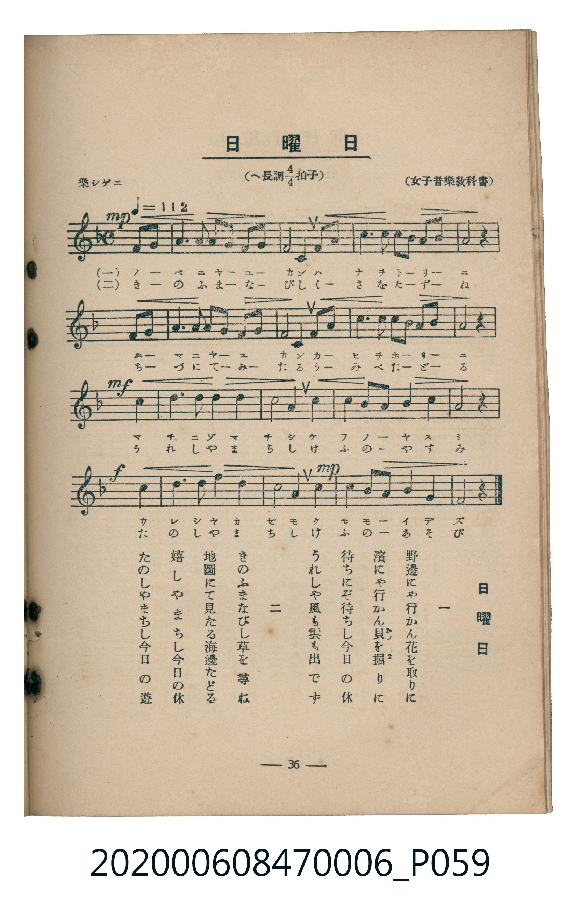

# 日曜日

> Re:Shōka 使用 AI 協助辨識與重建樂譜，可能會有錯誤。歡迎回報。

- **鋼琴伴奏版**：<br><audio controls src="nichiyobi.mp3"></audio>

- 臺灣教育會公認《新定兒童唱歌》尋常科第六學年用（2020.006.0847.0006）

## 說明

原書資訊與歌詞全文（對應 P059.jpg，書頁 p. 36，參考教材第 1 首）：
速度與表情：樂シゲニ ♩=112
調性與拍號：へ長調四分之四拍子（F 大調 4/4 拍）
出處：（女子音樂教科書）


## 歌詞

```text
一
野邊（のべ）にゃ行かん花を取りに
濱（はま）にゃ行かん貝（かひ）を掘（ほ）りに
待ちにぞ待ちし今日の休
うれしや風も雲も出でず

二
きのふまなびし草を尋（たづ）ね
地圖（ちづ）にて見たる海邊（うみべ）たどる
嬉しやまちし今日の休
たのしやまちし今日の遊び
```

## ABC

```abc
X:1
T:日曜日
M:4/4
L:1/16
Q:1/4=112
K:F
V:V1 name="Piano" snm="Pia"
[V:V1]
!mp! z8 z4 F2 G2 | A6 A2 A2 G2 F2 G2 | F8 C4 F2 A2 | c6 c2 c2 B2 A2 B2 |
w: 1.~の _ | べ に ゃ _ ゆ _ | か _ は _ | な を と _ り _
w: 2.~き _ | の ふ ま _ な _ | び _ く _ | さ を た _ づ _
A8 z4 F2 G2 | A6 A2 A2 G2 F2 G2 | F8 C4 F2 A2 | c6 c2 c2 B2 A2 B2 |
w: 1.~に は _ | ま に ゃ _ ゆ _ | か _ か _ | ひ を ほ _ り _
w: 2.~ね ち _ | づ に て _ み _ | た _ う _ | み べ た _ ど _
!mf! A8 z4 c4 | d6 d2 d4 d4 | c8 A4 c4 | c4 B2 A2 B4 c4 |
w: 1.~に ま | ち に ぞ ま | ち し け | ふ の _ や す
w: 2.~る う | れ し や ま | ち し け | ふ の _ や す
!f! A8 z4 c4 | d6 d2 f4 d4 | !mp! c8 A4 c4 | c4 B2 A2 B4 G4 |
w: 1.~み う | れ し や か | ぜ も く | も も _ い で
w: 2.~み た | の し や ま | ち し け | ふ の _ あ そ
F8 z4 z4 |
w: 1.~ず
w: 2.~び
```

## TMD 檔案連結

- [主旋律 TMD 檔案](nichiyobi.tmd) [[在 TMD Studio 編輯](https://tmdlang.github.io/Tmd-TS/#tmd=s7IKdvYPcrWy4qpTUCpJTLdSSM7PyUlNLsnMz7MqzsjMK0nNjM_KTMmPL87Iz05Ugisry88pzU21Si9KTEmNN4s3MjAyiDcwMIs3sDAxBzIMzBBKi_NLi5JTrYqTM_Lzc-JLUitKkvLzsxHyBUX5Zal5iXlANQVFIBtTwIoQClLLMlNSQdLFyYl58WWpRZlpmakpSG5JLSoGuxdsUXxJUWJecXJRZgHIEwhV-UUlGflA9xZkVFplZBaX5BdlJifmxGcn5iF5qyQjFeir5Pzc3NK8zJJKZN2Z6Zl5ViWJmcCAAAVGeWJ8bmJmXk5iHtAlWloKz6YvfTZ7DpBU0NLiUrRVMDQ04rK3VXDjsjHRN7EDmfOifdfzxsXPps580bTp2Zzmp61rXqzqfdzQ9WzahqfrZj1tnfR89dKnUzY-W9vzuKH76Ybupzt2PF8-8fmaNU9b1z5du-Ppzi3Pp6x4v6cDFNZ6wBDWA4U1kGFg9n5PpxIXl76Wgi21AJeCgsLTvvnPZu94sbn9xYquFx3tQHe9WDnvaeuKZ9Paga54uqH3WXunQoCBqaVeVkH6-z09QMUvFzQqFOgpGANd1PO0v_lFQzPQu8_mTgB6QsFQ4eWyaUCXvt8zC2T6y4b5T3ctA5r7YuGKZ82tQNFnK5oeN21_3LTpcXO3wqOZK21BQQhU-WLV_mcNy0Eu6O59MXM-UOXjxh0vp24Hij-dPftpR9uTnd1ABlD26doJQJe5KTxdshwoqQAMeAWgKNBOsHfad72YORWoG-T4pZuBal_O3wy0E-hCYDADHQ9SB1L4ZEcD2IHtfS-buoCKHzeue9y4Eyj7uHH146bmFwt7Hjd2P26a_KJr4-OmSU_7pz1u6gJKgfQ8278RrGH948Z9WDRsmguW7X7cuAkk2zTpWd8MsMhuMBdmytN9rY8bF4I0N86Dsac_2d0FTFxAtzzZMxGk6HFj2-MmoMHTHze1vFy04nFT08vZm4Ak0JuPG5c_bpwF8cuuHojiXrAvtgLd9bhx1ePGzUCNL3pBTgAmNLAT5j9uXAp28lqwE-ZseDoHGFtACaDlEAmgc5a9WAZ0_PzHTd3Ptm6HhU7b48b9sAACmrISKAs2Yg2QD3Id2E7sXgAqB7oKu6KXjcDw2AxSR3lyhgIFLX0uLr_M5IzMyvykTKuAzMS8fIcag5pqkC0KNhZadmAGtoykAEzCwIQBjEsFjad7Nr7Yul1BW8FE4emG_ufrG3Tg2UATi06gpSBTaxQMFHTBEERX5xbUArOEEVDYGCxoDIRGUBFDqELTeCBhCJSoUTCFCAChCZBvAtcGMQ2sDWyLj2GNAkgXCIJoYEACyRogvRMsBoxGBWCaBLGa2qAy3RCZpslQFeuh4qug4pOA7BVgVhdUZjWKDWD1ENuN0G3vheoAuQLE3wrE-8AskOkgmc1QmelQuh8qPhXJ9vlgmaVQmbUoNiwE244_4nb1gCOOxPiiQsRU56bVgpUgYgfif-JiAsQHiW9CCovdeGICZDIiJiAhBrWpcRmYtR-qDxSiIHOgNjbCXACSB_F3wkN9JUQGqhJmE1g9gVDf0UlOqJuBbTED0yAMC2JQTIACGiYCCW6YCEqgYwlzUCqBhcQ8RFjBZWAp8HHjRKj4VjAPlG6BxROYPRMljFBDAh7mTT1w02D6qGUTKD4IhDmwHqQkzA3jsAY6uLDCDHkjsAgsT4BCHoSRQh1LWMBS9BxYWDQ1gcWhuR7Cg4pBdCyH6piFFBYgjJzOYaULWWHeCLFtLlQGUh4h21PLxaVrpwCvNxSAHGUuAA)]
- [鋼琴伴奏 TMD 檔案](nichiyobi_piano.tmd) [[在 TMD Studio 編輯](https://tmdlang.github.io/Tmd-TS/#tmd=s7IKdvYPcrWy4tLSUng2femz2XOA5Ps9HS-79zyfsOXJni1Pl_Y_7-x4v6dTQUuLS9FWwdDQiMveVsGNy8ZE38SOq05B6UX7rueNi59NnfmiadOzOc1PW9e8WNX7uKHr2bQNT9fNeto66fnqpU-nbHy2tudxQ_fTDd1Pd-x4vnzi8zVrnraufbp2x9OdW55PWQG00sjAyEDPwMBMz8DCxBzIMDAD2qrExeWXmZyRWZmflGkVkJmYlx_k4VCja1hTzaUABDYWWnZghr6Wgi06UADa8WRHw4uFPQoaT_dsfLF1u4K2gonC0w39z9c36CgEGJha6mUVpGti0amlDza1RsFAQRcMQXR1bkGtgqGCEVDYGCxoDIRGUBFDqELTeCBhCJSoUTCFCAChCZBvAtcGMQ2sDWyLj2GNAkgXCILox43rgGQNkN4JFnvcuFrhcVMziNXUBpXphsg0TYaqWA8VXwUVnwRkrwCzuqAyq1FsAKuH2G6EbnsvVAfIFSD-ViDeB2aBTAfJbIbKTIfS_VDxqUi2zwfLLIXKrEWxYSHYdvwRt6sHHHEkxhcVIqY6N60WrAQROxD_ExcTID5IfBNSWOzGExMgkxExAQkxqE2Ny8Cs_VB9oBAFmQO1sRHmApA8iL8THuorITJQlTCbwOoJhPqOTnJC3QxsixmYBmFYEINiAhTQMBFIcMNEUAIdS5iDUgksJOYhwgouA0uBjxsnQsW3gnmgdPu4qQXMnokSRqghAQ_zph64aTB91LIJFB8Ewvzp7NmUhLlhHNZABxdWmCFvBBaB5QlQyIMwUqhjCQtYip4DC4umJrA4NNdDeFAxiI7lUB2zkMIChJHTOax0ISvMGyG2zYXKQMojZHtqMeoNH5R6wwRab4BKeAgEhkq8QrRhLJgyjY9FFQBScL5pPLoKsH6oedQxxQQoZBILozANgeumsTHAcNS1U4AHZbQPUAZVwAgsoMwFAA)]

## 分析

```text
================================================================================
📊 TMD Song Profile: [ 日曜日 ]
================================================================================
⏱  Duration:       0:36 (36.4s), 17 measures total
🎼 Key & Tempo:    首調基準 F, != 112.0 BPM, <4/4>
   - 分析範圍：      由實際發聲的音符與和弦推測調性；播放脈絡另行呈現
🎤 人聲音域:    C4 (MIDI 60) – F5 (MIDI 77) [跨度: 17 個半音 / 1.4 個八度, 難度: challenging]
   - 最低音:  C4 in [Nichiyobi #1 @ m.3, 0:05]
   - 最高音: F5 in [Nichiyobi #1 @ m.14, 0:28]
   - 適合: soprano, mezzo-soprano, contralto, tenor, baritone, bass
🏛  結構:      Nichiyobi (36.4s)
⚡ 編曲密度:        Peak 1 軌道同時演奏
🗝  調性診斷：       F 大調（純淨自然大調，未偵測到可信轉調）
   - 風格氣質:    純淨自然大調（陽光明朗、易唱易記，無明顯調外色彩）
   - 轉調歷程:    全曲維持單一推測調性（未偵測到可信轉調）
   - 核心骨幹音:  C, A, F, D, A#
   - 調性數值:    F 大調 [相關度: 0.82, 穩定度: Moderate, 自然音純度: 100.0%]
   - 候選調性 (K-S): F 大調 (0.82), A 小調 (0.77), C 大調 (0.65)
   - 五度圈歷程:   -1
   - 各段落調性細節:
     • [Nichiyobi #1]: F 大調 (r: 0.82, 自然音純度: 100.0%)

  [ 五度圈游移軌跡 ]
               C  
        [F ]*          G  
      Bb               D  
      Eb               A  
         Ab           E  
            Db       B  
               F# 
     (* = active key center)

  [ 十二半音累積音高分佈 ]
     C  : ████████████████████████  30.0%
     C# :                            0.0%
     D  : █████████                 11.7%
     D# :                            0.0%
     E  :                            0.0%
     F  : █████████████             16.7%
     F# :                            0.0%
     G  : █████                      6.7%
     G# :                            0.0%
     A  : █████████████████████     26.7%
     A# : ███████                    8.3%
     B  :                            0.0%
--------------------------------------------------------------------------------
Assignment 軌道音域：
  - Piano         : C4 – F5 (17 個半音 / 1.4 個八度, 66 個音符)
================================================================================
```


## 原書掃描頁




