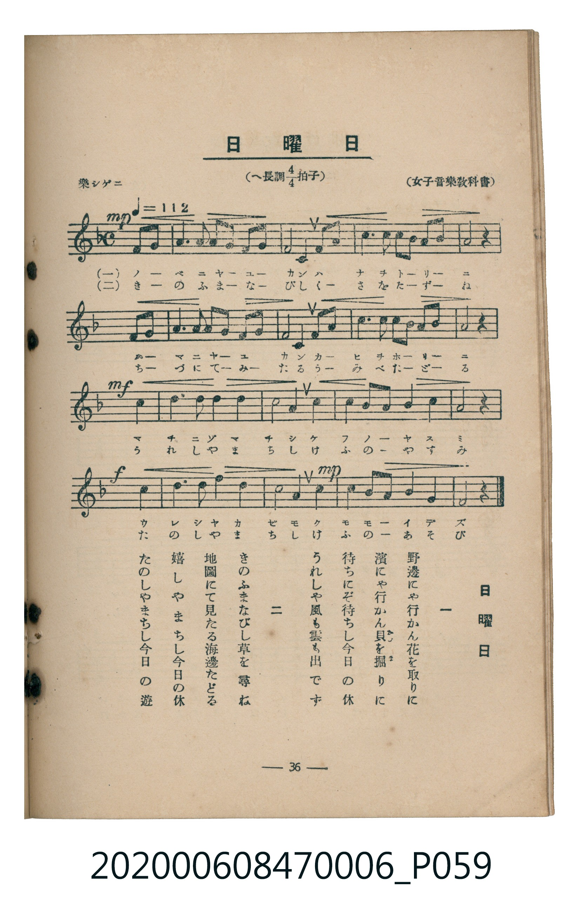

# 日曜日

<audio controls src="nichiyobi.mp3"></audio>

- 臺灣教育會公認《新定兒童唱歌》尋常科第六學年用（2020.006.0847.0006）

## 說明

原書資訊與歌詞全文（對應 P059.jpg，書頁 p. 36，參考教材第 1 首）：
速度與表情：樂シゲニ ♩=112
調性與拍號：へ長調四分之四拍子（F 大調 4/4 拍）
出處：（女子音樂教科書）

## 歌詞

```text
一
野邊（のべ）にゃ行かん花を取りに
濱（はま）にゃ行かん貝（かひ）を掘（ほ）りに
待ちにぞ待ちし今日の休
うれしや風も雲も出でず

二
きのふまなびし草を尋（たづ）ね
地圖（ちづ）にて見たる海邊（うみべ）たどる
嬉しやまちし今日の休
たのしやまちし今日の遊び
```

## 原書掃描頁



## 分析

```text
================================================================================
📊 TMD Song Profile: [ 日曜日 ]
================================================================================
⏱  Duration:       0:42 (42.9s), 20 measures total
🎼 Key & Tempo:    首調基準 F, != 112.0 BPM, <4/4>
   - 分析範圍：      由實際發聲的音符與和弦推測調性；播放脈絡另行呈現
🎤 人聲音域:    C4 (MIDI 60) – F5 (MIDI 77) [跨度: 17 個半音 / 1.4 個八度, 難度: challenging]
   - 最低音:  C4 in [Nichiyobi #1 @ m.1, 0:00]
   - 最高音: F5 in [Nichiyobi #1 @ m.17, 0:34]
   - 適合: soprano, mezzo-soprano, contralto, tenor, baritone, bass
🏛  結構:      Nichiyobi (42.9s)
⚡ 編曲密度:        Peak 1 軌道同時演奏
🗝  調性診斷：       F 大調（純淨自然大調，未偵測到可信轉調）
   - 風格氣質:    純淨自然大調（陽光明朗、易唱易記，無明顯調外色彩）
   - 轉調歷程:    全曲維持單一推測調性（未偵測到可信轉調）
   - 核心骨幹音:  G, F, C, A, D
   - 調性數值:    F 大調 [相關度: 0.82, 穩定度: Moderate, 自然音純度: 100.0%]
   - 候選調性 (K-S): F 大調 (0.82), C 大調 (0.72), D 小調 (0.57)
   - 五度圈歷程:   -1
   - 各段落調性細節:
     • [Nichiyobi #1]: F 大調 (r: 0.82, 自然音純度: 100.0%)

  [ 五度圈游移軌跡 ]
               C  
        [F ]*          G  
      Bb               D  
      Eb               A  
         Ab           E  
            Db       B  
               F# 
     (* = active key center)

  [ 十二半音累積音高分佈 ]
     C  : ██████████████████        18.4%
     C# :                            0.0%
     D  : ██████████                10.5%
     D# :                            0.0%
     E  :                            0.0%
     F  : ███████████████████████   23.7%
     F# :                            0.0%
     G  : ████████████████████████  24.3%
     G# :                            0.0%
     A  : ██████████████████        17.8%
     A# : █████                      5.3%
     B  :                            0.0%
--------------------------------------------------------------------------------
Assignment 軌道音域：
  - Piano         : C4 – F5 (17 個半音 / 1.4 個八度, 64 個音符)
================================================================================
```

## ABC

```abc
X:1
T:日曜日
C:TMD (Chen, Chih-Han / aguai)
M:4/4
L:1/16
Q:1/4=112
K:F

V:V1 name="Piano" snm="Pia"

[V:V1]
!mp! c4 d4 f6 g2 | a4 c4 g4 f4 | d8 c4 f2 g2 | a6 a2 g4 g2 a2 |
f12 z4 | c4 d4 f6 g2 | a4 c4 g4 f4 | d8 c4 f2 g2 |
a6 a2 g4 c2 g2 | f12 z4 | !mf! g8 g4 a4 | b8 g8 |
c8 a4 b2 c2 | d4 c4 a4 b4 | g12 z4 | !f! c8 a4 c4 |
f8 a8 | !mp! g8 c4 f4 | d4 g2 b2 a4 g4 | f12 z4 |
```

- [主旋律 TMD 檔案](nichiyobi.tmd)
- [鋼琴伴奏 TMD 檔案](nichiyobi_piano.tmd)
