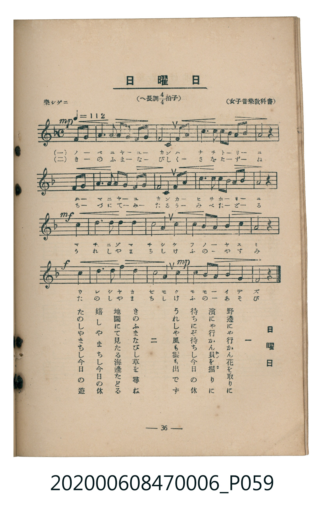

# 日曜日

> Re:Shōka 使用 AI 協助辨識與重建樂譜，可能會有錯誤。歡迎回報。

- **鋼琴伴奏版**：<br><audio controls src="nichiyobi.mp3"></audio>
- **NEUTRINO 歌聲合成版**：<br><audio controls src="nichiyobi_neutrino.mp3"></audio>

- 臺灣教育會公認《新定兒童唱歌》尋常科第六學年用（2020.006.0847.0006）

## 說明

原書資訊與歌詞全文（對應 P059.jpg，書頁 p. 36，參考教材第 1 首）：
速度與表情：樂シゲニ ♩=112
調性與拍號：へ長調四分之四拍子（F 大調 4/4 拍）
出處：（女子音樂教科書）


## 歌詞

```text
一
野邊（のべ）にゃ行かん花を取りに
濱（はま）にゃ行かん貝（かひ）を掘（ほ）りに
待ちにぞ待ちし今日の休
うれしや風も雲も出でず

二
きのふまなびし草を尋（たづ）ね
地圖（ちづ）にて見たる海邊（うみべ）たどる
嬉しやまちし今日の休
たのしやまちし今日の遊び
```

## ABC

<div class="abc-score" data-abc-src="nichiyobi.abc" aria-label="五線譜載入中"></div>

[下載 ABC 原始檔](nichiyobi.abc)

## TMD 檔案連結

- [主旋律 TMD 檔案](nichiyobi.tmd) [[在 TMD Studio 編輯](https://tmdlang.github.io/Tmd-TS/#tmd=s7IKdvYPcrWy4qpTUCpJTLdSSM7PyUlNLsnMz7MqzsjMK0nNjM_KTMmPL87Iz05Ugisry88pzU21Si9KTEmNN4s3MjAyiDcwMIs3sDAxBzIMzBBKi_NLi5JTrYqTM_Lzc-JLUitKkvLzsxHyBUX5Zal5iXlANQVFIBtTwIoQClLLMlNSQdLFyYl58WWpRZlpmakpSG5JLSoGuxdsUXxJUWJecXJRZgHIEwhV-UUlGflA9xZkVFplZBaX5BdlJifmxGcn5iF5qyQjFeir5Pzc3NK8zJJKZN2Z6Zl5ViWJmcCAAAVGeWJ8bmJmXk5iHpJLoC4oSExPtQowMLVU4tLSUng2femz2XOApIKWFpeirYKhoRGXva2CG5eNib6JHUjvi_ZdzxsXP5s680XTpmdzmp-2rnmxqvdxQ9ezaRuerpv1tHXS89VLn07Z-Gxtz-OG7qcbup_u2PF8-cTna9Y8bV37dO2Opzu3PJ-y4v2eDlAs6AHDXg8UC0CGgdn7PZ1KXFz6Wgq21AJcCgoKT_vmP5u948Xm9hcrul50tAPd9WLlvKetK55Nawe64umG3mftnQog_-tlFaS_39MDVPxyQaNCgZ6CMdBFPU_7m180NAO9-2zuBKAnFAwVXi6bBnTp-z2zQKa_bJj_dNcyoLkvFq541twKFH22oulx0_bHTZseN3crPJq50hYUhECVL1btf9awHOSC7t4XM-cDVT5u3PFy6nag-NPZs592tD3Z2Q1kAGWfrp0AdJmbwtMly4GSCsCAVwCKAu0Ee6d914uZU4G6QY5fuhmo9uX8zUA7gS4EBjPQ8SB1IIVPdjSAHdje97KpC6j4ceO6x407gbKPG1c_bmp-sbDncWP346bJL7o2Pm6a9LR_2uOmLqAUSM-z_RvBGtY_btyHRcOmuWDZ7seNm0CyTZOe9c0Ai-wGc2GmPN3X-rhxIUhz4zwYe_qT3V3AxAV0y5M9E0GKHje2PW4CGjz9cVPLy0UrHjc1vZy9CUgCvfm4cfnjxlkQv-zqgSjuBftiK9BdjxtXPW7cDNT4ohfkBGBCAzth_uPGpWAnrwU7Yc6Gp3OAsQWUAFoOkQA6Z9mLZUDHz3_c1P1s63ZY6LQ9btwPCyCgKSuBsmAj1gD5INeB7cTuBaByoKuwK3rZCAyPzSB1lCdnKFDQ0ufi8stMzsiszE_KtArITMzLd6gxqKkG2aJgY6FlB2Zgy0gKwCQMTBjAuFTQeLpn44ut2xW0FUwUnm7of76-QQeeDTSx6ARaCjK1RsFAQRcMQXR1bkEtMEsYAYWNwYLGQGgEFTGEKjSNBxKGQIkaBVOIABCaAPkmcG0Q08DawLb4GNYogHSBIIgGBiSQrAHSO8FiwGhUAKZJEKupDSrTDZFpmgxVsR4qvgoqPgnIXgFmdUFlVqPYAFYPsd0I3fZeqA6QK0D8rUC8D8wCmQ6S2QyVmQ6l-6HiU5Fsnw-WWQqVWYtiw0Kw7fgjblcPOOJIjC8qREx1blotWAkidiD-Jy4mQHyQ-CaksNiNJyZAJiNiAhJiUJsal4FZ-6H6QCEKMgdqYyPMBSB5EH8nPNRXQmSgKmE2gdUTCPUdneSEuhnYFjMwDcKwIAbFBCigYSKQ4IaJoAQ6ljAHpRJYSMxDhBVcBpYCHzdOhIpvBfNA6RZYPIHZM1HCCDUk4GHe1AM3DaaPWjaB4oNAmAPrQUrC3DAOa6CDCyvMkDcCi8DyBCjkQRgp1LGEBSxFz4GFRVMTWBya6yE8qBhEx3KojllIYQHCyOkcVrqQFeaNENvmQmUg5RGyPbVcXLp2CvB6QwHIUeYCAA)]
- [鋼琴伴奏 TMD 檔案](nichiyobi_piano.tmd) [[在 TMD Studio 編輯](https://tmdlang.github.io/Tmd-TS/#tmd=s7IKdvYPcrWy4qpTUCpJTLdSyC8qychPL0osyKi0ysgsLskvykxOzInPTsxLVIIrKs4vLUpOjS9ITE-1CjAwtVTi0tJSeDZ96bPZc4Dk-z0dL7v3PJ-w5cmeLU-X9j_v7Hi_p1NBS4tL0VbB0NCIy95WwY3LxkTfxA5k4Iv2Xc8bFz-bOvNF06Znc5qftq55sar3cUPXs2kbnq6b9bR10vPVS59O2fhsbc_jhu6nG7qf7tjxfPnE52vWPG1d-3Ttjqc7tzyfsgJopZGBkYGegYGZnoGFiTmQYWAGtFWJi8svMzkjszI_KdMqIDMxLz_Iw6FG17CmmksBCGwstOzADH0tBVt0oAC048mOhhcLexQ0nu7Z-GLrdgVtBROFpxv6n69v0FEA-VsvqyBdE4tOLX2wqTUKBgq6YAiiq3MLahUMFYyAwsZgQWMgNIKKGEIVmsYDCUOgRI2CKUQACE2AfBO4NohpYG1gW3wMaxRAukAQRD9uXAcka4D0TrDY48bVCo-bmkGspjaoTDdEpmkyVMV6qPgqqPgkIHsFmNUFlVmNYgNYPcR2I3Tbe6E6QK4A8bcC8T4wC2Q6SGYzVGY6lO6Hik9Fsn0-WGYpVGYtig0Lwbbjj7hdPeCIIzG-qBAx1blptWAliNiB-J-4mADxQeKbkMJiN56YAJmMiAlIiEFtalwGZu2H6gOFKMgcqI2NMBeA5EH8nfBQXwmRgaqE2QRWTyDUd3SSE-pmYFvMwDQIw4IYFBOggIaJQIIbJoIS6FjCHJRKYCExDxFWcBlYCnzcOBEqvhXMA6Xbx00tYPZMlDBCDQl4mDf1wE2D6aOWTaD4IBDmT2fPpiTMDeOwBjq4sMIMeSOwCCxPgEIehJFCHUtYwFL0HFhYNDWBxaG5HsKDikF0LIfqmIUUFiCMnM5hpQtZYd4IsW0uVAZSHiHbU4tRb_ig1Bsm0HoDVMJDIDBU4hWiDWPBlGl8LKoAkILzTePRVYD1Q82jjikmQCGTWBiFaQhcN42NAYajrp0CPCijfYAyqAJGYAFlLgA)]

## 分析

```text
================================================================================
📊 TMD Song Profile: [ 日曜日 ]
================================================================================
⏱  Duration:       0:36 (36.4s), 17 measures total
🎼 Key & Tempo:    首調基準 F, != 112.0 BPM, <4/4>
   - 分析範圍：      由實際發聲的音符與和弦推測調性；播放脈絡另行呈現
🎤 人聲音域:    C4 (MIDI 60) – F5 (MIDI 77) [跨度: 17 個半音 / 1.4 個八度, 難度: challenging]
   - 最低音:  C4 in [Nichiyobi #1 @ m.3, 0:05]
   - 最高音: F5 in [Nichiyobi #1 @ m.14, 0:28]
   - 適合: soprano, mezzo-soprano, contralto, tenor, baritone, bass
🏛  結構:      Nichiyobi (36.4s)
⚡ 編曲密度:        Peak 1 軌道同時演奏
🗝  調性診斷：       F 大調（純淨自然大調，未偵測到可信轉調）
   - 風格氣質:    純淨自然大調（陽光明朗、易唱易記，無明顯調外色彩）
   - 轉調歷程:    全曲維持單一推測調性（未偵測到可信轉調）
   - 核心骨幹音:  C, A, F, D, A#
   - 調性數值:    F 大調 [相關度: 0.82, 穩定度: Moderate, 自然音純度: 100.0%]
   - 候選調性 (K-S): F 大調 (0.82), A 小調 (0.77), C 大調 (0.65)
   - 五度圈歷程:   -1
   - 各段落調性細節:
     • [Nichiyobi #1]: F 大調 (r: 0.82, 自然音純度: 100.0%)

  [ 五度圈游移軌跡 ]
               C  
        [F ]*          G  
      Bb               D  
      Eb               A  
         Ab           E  
            Db       B  
               F# 
     (* = active key center)

  [ 十二半音累積音高分佈 ]
     C  : ████████████████████████  30.0%
     C# :                            0.0%
     D  : █████████                 11.7%
     D# :                            0.0%
     E  :                            0.0%
     F  : █████████████             16.7%
     F# :                            0.0%
     G  : █████                      6.7%
     G# :                            0.0%
     A  : █████████████████████     26.7%
     A# : ███████                    8.3%
     B  :                            0.0%
--------------------------------------------------------------------------------
Assignment 軌道音域：
  - Piano         : C4 – F5 (17 個半音 / 1.4 個八度, 66 個音符)
================================================================================
```


## 原書掃描頁




