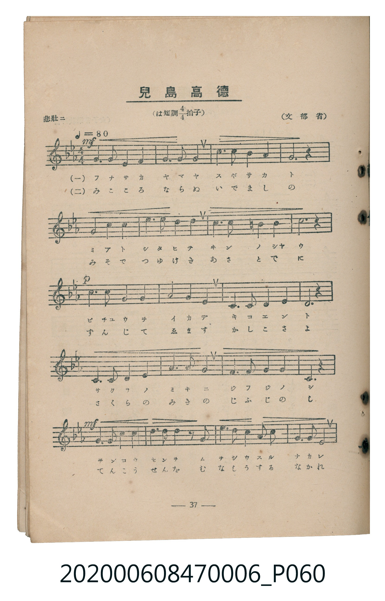
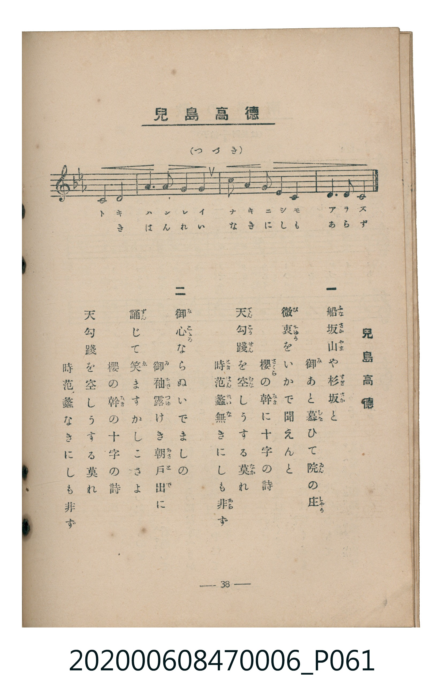

# 兒島高徳

> Re:Shoka 使用 AI 辨識樂譜，可能會有錯誤。歡迎回報。

<audio controls src="kojima_takanori.mp3"></audio>

- 臺灣教育會公認《新定兒童唱歌》尋常科第六學年用（2020.006.0847.0006）

## 說明

原書資訊與歌詞全文（對應 P060.jpg – P061.jpg，書頁 pp. 37–38，參考教材第 2 首）：
速度與表情：悲壯ニ ♩=80
調性與拍號：は短調四分之四拍子（C 小調 4/4 拍，關係調 E♭ 大調）
出處：（文部省）

## 歌詞

```text
一
船坂山（ふなさかやま）や杉坂（すぎさか）と
御（み）あと慕（した）ひて院（ゐん）の庄（しやう）
微衷（びちゆう）をいかで聞えんと
櫻（さくら）の幹（みき）に十字の詩
天（てん）勾踐（こうせん）を空（むな）しうする莫（なか）れ
時（とき）范蠡（はんれい）無（な）きにしも非（あら）ず

二
御心（みこゝろ）ならぬいでましの
御袖（みそで）露（つゆ）けき朝戸出（あさとで）に
誦（ずん）じて笑（ゑ）ますかしこさよ
櫻の幹（みき）の十字の詩
天勾踐を空しうする莫れ
時范蠡なきにしも非ず
```

## ABC

```abc
X:1
T:兒島高徳
M:4/4
L:1/16
Q:1/4=80
K:Cm
V:V1 name="Piano" snm="Pia"
[V:V1]
!mf! C6 C2 C6 G,2 | C6 D2 E8 | G6 G2 F6 G2 | C12 z4 |
D8 E4 D4 | C6 D2 E4 G4 | F6 F2 G4 F4 | G12 z4 |
!p! F6 F2 D6 =B,2 | C8 E8 | G,6 G,2 C6 D2 | C12 z4 |
G,6 G,2 =B,6 C2 | D6 E2 F8 | C6 C2 C6 =B,2 | G,12 z4 |
!mf! C6 C2 C6 D2 | E6 F2 G4 z2 G2 | A6 G2 F4 E2 D2 | C6 F2 E8 |
G,8 =B,8 | C6 D2 E4 F4 | G6 E2 D4 C4 | D6 =B,2 C8 |
```

## TMD 檔案連結

- [主旋律 TMD 檔案](kojima_takanori.tmd) [[在 TMD Studio 編輯](https://tmdlang.github.io/Tmd-TS/#tmd=s7IKdvYPcrWy4qpTUCpJTLdSSM7PyUlNLsnMz7MqzsjMK0nNjM_KTMmPL87Iz05Ugisry88pzU21Si9KTEmNN4s3MjAyiDcwMIs3sDAxBzIMzBBKi_NLi5JTrYqTM_Lzc-JLUitKkvLzsxHyBUX5Zal5iXlANQVFIBtTwIoQClLLMlNSQdKpKZkl-UWZiTlI7kgtKga7FWxJfElRYl5xclFmAcgDCFUlGalAx2ZkFgO1VypxaWkpPG2d9HTztperZzzdt1lBS4tL0VbBwoDL3lbBVYcrO7XSVsE5l8vGRN_EDmTGi_ZdzxsXP5s680XTpmdzmp-2rnmxqvdxQ9ezaRuerpsFNOr56qVPp2x8trbncUP30w3dT3fseL584vM1a562rn26dsfTnVueT1nxfk8HKJT0gGGjBwolIMPA7P2eTiUuLn0tBVtqAS4FBYWnffOfzd7xYnP7ixVdLzrage56sXLe09YVz6a1A13xdEPvs_ZOhQADMwO9rIJ0hUcNk0EcQxDn_Z4eoM6XCxoVCgr0FIzNgXLGFkDBp_3NLxqagSHwbO4EoL8UjBReLpsGdPz7PbNAFr5smP901zKgVS8WrnjW3AoUfda06eni9Y-buxUezVxpCwxaoKoXq_Y_a1gOclB374uZ84GqHjeufz5_LVD86ezZTzvanuzsBjKAsk_XTgA61Fnh6YZ-oKQCMB4UgKJAd7ycPufJ_iaQmOujmWsVni5ZDmQD3QH2dfuuFzOnAk0FagX69GXziudzGkFyIMknOxrATujY-XRu09ONG4FqHjdufdy46nHj1MeN3Y-bWh437gMqBjKeze0EqgErmPm4sQ-iACTVuAJszb6FYDmQtY8bm4Ciz1qBtgJFpj9uBHoKKLjpceOylzMXgQSbJjxumgwWXPd0VwtUGciyNpir9617sXA7WGLz48aFj5vaIHKPmyY9bgSq637cuPxF47zHjUCzJkOd8Gz1brAGoMP6HzcBIwFs_M6dEHc9bgSGFFBk9dPexqdrgY5a92LlSrBVS1aCVSyDOOlp974XO0Dh_LgRaDDQ2tlQpzZNer5yF9jxDcAAApsFNAWoYObjpu4XfavBWoABBw6Uph6wi2ZCAmwFxPIXPc0vFkCCaT3I2U09QL8AxZ-3QAQhhvYC3QgOjqaXc-eBxZtgvpkFibRdYMOBIf50fzPMc0DT5j5ugnhxFVD948Y14IBaDoxAsEPXQfW8WARMoRA9c4HSQA0v52wCiywBhjJY_0SgI57NmfusYwcw8UBdAApVoDdA6oHug6TbZWC5WbConAEMw-drJoKDCEgCRYA2A9MKMK6A9gMDc-rjpg5oRGGLmXVYYgYSG5CwRwtvRBhDwhUc-CiBBwowoArKSw8oUNDS5-Lyzs_KzE0MScxOzAMWulYBmUDaocagRqEaZJeCjYWWHZiBrfRSABYSwCz3YmGPgoYJKBs_X9-gAy9yNLFoANoINUwDqFHTSuFx81Qg7lJ43LQViFcr1AB5S4B4HpTeAxJp2gnE61DUdKAYtasHZFTjfiCeDMFNvSBljauArE4gvQZmVGMLEC8H4n1APB0ssg5mFNDPuWm1CmbxCrpACKSgLON4oBSUbR6vYAhm6ALFjCHSwHISQsNVQaABSBE4ieMOvV09lIXefKAHF4HDAxRO24EYGAjNk4C4DRxOG4B4MxD3gWQfNy8GK1uGK_DmggMHFCjAsG9qA9ITgRgSlE1ADIyrxhVwNasRAQcMFoifQYED5qCHGCisaqAhZQTmgdiwMCQ-wHZ0UhZgwLTR3Pi4eSk4GB43bwIHCMi3q4G8djBvLRADw6wJ6FNg2OFMbbOASkCpbQYQLwNrBAUWKF3NBAdPNziFQVLkVLA83BhgSiuohQcGNPBM1ZHSGSQkockMngwRQUp6UgPWuRSFHDjzrQcGxkpwcgIFCyjxAQMLWP2DfLcDkpnBNFgemByxBBsoDfVDs-U6cECBUl4vnAcKTqBVYBoiMh0RbIigAIUWNJvCk58hNEiRUh8iF0OCF2oACRl0CmXpDZiJQBkQnKAgqWQ3NEtuAuIF4HAEFX-grAtMkKCirhlSxIFEQYlyDbZQBCmFFnWN4JzeOBsi0gTM-00NsMIPnABB-XgmUBQcTWBRYNJs6iFU7IFTGSQVQjKsAbiIM4HEADioDVGSohEizRJIiq1rMQMV3DIlMlA7wAkPFEjAlAQOTGABD8zFsGCDJEpwoDYvAgc6qIwEJtymXdgCE1SkQQo5YPoGB2IPuKaABRcocQJjAhSYTU2wwhCcgGdhJE1IQkNLhdAyELnEAwcdOLhBYkhFADxf13DVcnHp2img1tAKQBFlLi4A)]
- [鋼琴伴奏 TMD 檔案](kojima_takanori_piano.tmd) [[在 TMD Studio 編輯](https://tmdlang.github.io/Tmd-TS/#tmd=s7IKdvYPcrWy4tLSUnjaOunp5m0vV894um_z-z0dL7v3PJ-w5cmeLU-X9j_v7Hi_p1NBS4tL0VbBwoDL3lbBVYcrO7XSVsE5l8vGRN_EjqtOQelF-67njYufTZ35omnTsznNT1vXvFjV-7ih69m0DU_XzQKa_3z10qdTNj5b2_O4ofvphu6nO3Y8Xz7x-Zo1T1vXPl274-nOLc-nrABabWRgZKBnYGCmZ2BhYg5kGJgBbVfi4vLOz8rMTQxJzE7Myy_KtArIBNJBHg41BjUK1VwKQGBjoWUHZuhrKdiiAwWgRU92NLxY2KOgYaLwdEP_8_UNOgoBBmYGelkF6ZpYNGjpgw0Dmp6bVqtgFq-gC4RACsoyjgdKQdnm8QqGYIYuUMwYIq1gBKXhqiDQAKSIC787d_WQ406gKyBWgNwC5qA7EOS0GqjDjMA8EBvmZOLdt6OTrHAsqIXbDXWrqTpSKEIcDg1EeCAjfEB6QD6dPZschyIsB7kPGu3w8DWEegIpeBGpAuIhqAEkRPgU6iVMcEhBQhISxwbgRGgC8RPY8YYowWmECHcCwdm6FtOZhsQGJyRw0EIOmjCRkyHYcWAPgcSQEgo89mu4arEXBz4oxYEJtDgAWRavEG0WnxuLxCIsagxiGcdjKjUAugDmNagSnGphxhoBmUZoYii6yTGUsEr8psKZMNfh8D4Oh5ISrDAbCPmJqDDA5lwTEMsE1bkgWWhy0bVTQE0xClhFlLm4AA)]

## 分析

```text
================================================================================
📊 TMD Song Profile: [ 兒島高徳 ]
================================================================================
⏱  Duration:       1:12 (72.0s), 24 measures total
🎼 Key & Tempo:    首調基準 E,, != 80.0 BPM, <4/4>
   - 分析範圍：      由實際發聲的音符與和弦推測調性；播放脈絡另行呈現
🎤 人聲音域:    G3 (MIDI 55) – G#4 (MIDI 68) [跨度: 13 個半音 / 1.1 個八度, 難度: moderate]
   - 最低音:  G3 in [KojimaTakanori #1 @ m.1, 0:02]
   - 最高音: G#4 in [KojimaTakanori #1 @ m.19, 0:54]
   - 適合: mezzo-soprano, contralto, tenor, baritone, bass
🏛  結構:      KojimaTakanori (72.0s)
⚡ 編曲密度:        Peak 1 軌道同時演奏
🗝  調性診斷：       C 小調（流行色彩小調，未偵測到可信轉調）
   - 風格氣質:    流行小調（略帶和弦色彩音與裝飾副屬和弦）
   - 轉調歷程:    全曲維持單一推測調性（未偵測到可信轉調）
   - 核心骨幹音:  C, G, D#, D, F
   - 調性數值:    C 小調 [相關度: 0.87, 穩定度: Moderate, 自然音純度: 94.5%]
   - 候選調性 (K-S): C 小調 (0.87), C 大調 (0.77), G 大調 (0.51)
   - 五度圈歷程:   +0
   - 各段落調性細節:
     • [KojimaTakanori #1]: C 小調 (r: 0.87, 自然音純度: 94.5%, 調外音: B)

  [ 五度圈游移軌跡 ]
              [C ]*
         F            G  
      Bb               D  
      Eb               A  
         Ab           E  
            Db       B  
               F# 
     (* = active key center)

  [ 十二半音累積音高分佈 ]
     C  : ████████████████████████  32.2%
     C# :                            0.0%
     D  : █████████                 12.6%
     D# : ██████████                13.1%
     E  :                            0.0%
     F  : █████████                 12.6%
     F# :                            0.0%
     G  : █████████████████         22.4%
     G# : █                          1.6%
     A  :                            0.0%
     A# :                            0.0%
     B  : ████                       5.5%
--------------------------------------------------------------------------------
Assignment 軌道音域：
  - Piano         : G3 – G#4 (13 個半音 / 1.1 個八度, 76 個音符)
================================================================================
```


## 原書掃描頁






