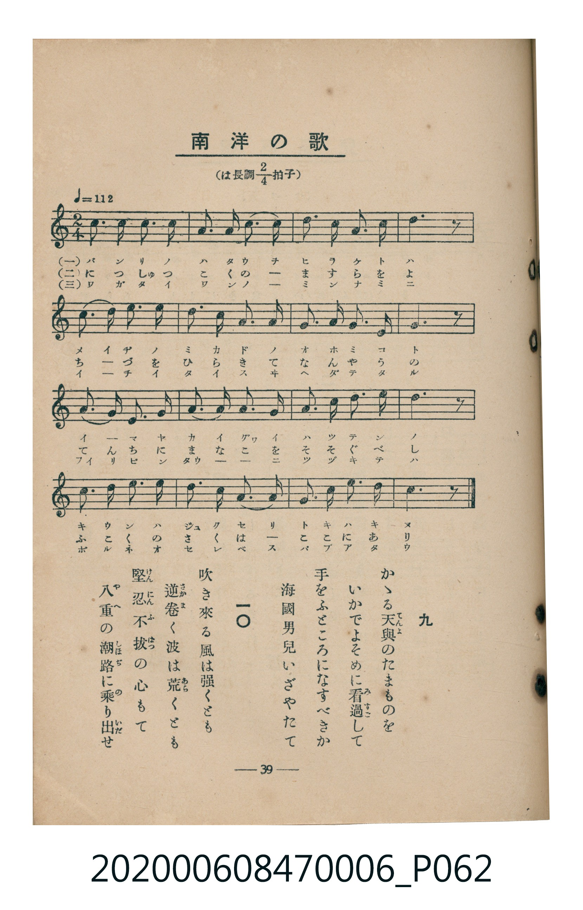
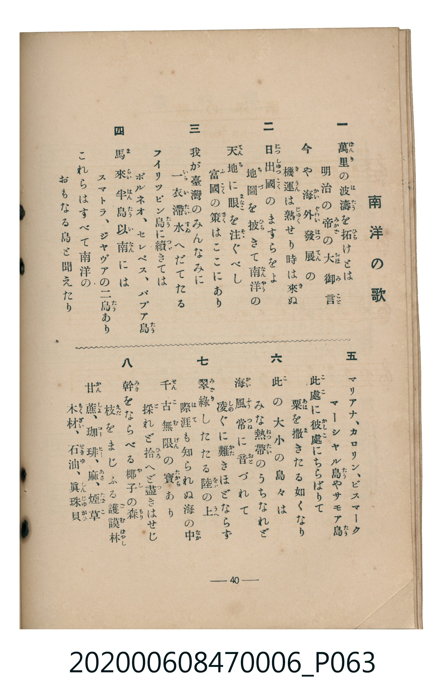

# 南洋の歌

<audio controls src="nanyo_no_uta.mp3"></audio>

- 臺灣教育會公認《新定兒童唱歌》尋常科第六學年用（2020.006.0847.0006）

## 說明

原書資訊與歌詞全文（對應 P062.jpg – P063.jpg，書頁 pp. 39–40，參考教材第 3 首）：
調性與拍號：は長調四分之二拍子（C 大調 2/4 拍），♩=112

## 跨冊／重複收錄參照

> 同曲（〈南洋の歌〉；收錄於《新定兒童唱歌》六年級與《唱歌帖》P207《小公學校唱歌教材集》抄譜）

- **[同曲]** 楊金土手抄《唱歌帖》第 10 冊・X（2020.006.0843）：[**〈南洋の歌 (南洋之歌)〉**](../../../shokacho/vol_10/p207_nanyo_no_uta/index.md)（`C` / `2/4` — [原始 TMD](../../../shokacho/vol_10/p207_nanyo_no_uta/nanyo_no_uta.tmd)）
- 總表：[跨冊重複與同名歌曲總索引](../../../duplicate_songs.md)

## 歌詞

```text
一　萬里（ばんり）の波濤（はたう）を拓（ひら）けとは
明治の帝（みかど）の大御言（おほみこと）
今や海外發展（かいぐわいはつてん）の
機運（きうん）は熟（じゆく）せり時は來（き）ぬ

二　日出國（につしゆつこく）のますらをよ
地圖（ちづ）を披（ひら）きて南洋（なんやう）の
天地（てんち）に眼（まなこ）を注（そゝ）ぐべし
富國（ふこく）の策（さく）はここにあり

三　我が臺灣のみんなみに
一衣帶水（いちいたいすゐ）へだてたる
フイリツピン島（たう）に續（つゞ）きては
ボルネオ、セレベス、パプア島（たう）

四　馬來半島（まらいはんたう）以南（いなん）には
スマトラ、ジヤヴアの二島（たう）あり
これらはすべて南洋の
おもなる島と聞えたり

五　マリアナ、カロリン、ビスマーク
マーシヤル島（たう）やサモア島（たう）
此處（こゝ）に彼處（かしこ）にちらばりて
粟（あは）を撒（ま）きたる如くなり

六　此（こ）の大小の島々は
みな熱帶（ねつたい）のうちなれど
海風常（かいふうつね）に音（おと）づれて
凌（しの）ぐに難（かた）きほどならず

七　翠綠（みどり）したたる陸（をか）の上（うへ）
際涯（はて）も知られぬ海の中（なか）
千古無限（せんこむげん）の寶（たから）あり
採（と）れど拾（ひろ）へど盡（つ）きはせじ

八　幹（みき）をならべる椰子（やし）の森（もり）
枝（えだ）をまじふる護謨林（ごむはやし）
甘蔗（かんしよ）、珈琲（コーヒー）、麻（あさ）、煙草（たばこ）
木材（もくざい）、石油（せきゆ）、眞珠貝（しんじゆがひ）

九　かゝる天與（てんよ）のたまものを
いかでよそめに看過（みすご）して
手をふところになすべきか
海國男兒いざやたて

一〇　吹き來る風は強くとも
逆卷（さかま）く波は荒（あら）くとも
堅忍不拔（けんにんふばつ）の心もて
八重（やへ）の潮路（しほぢ）に乘（の）り出（いだ）せ
```

## ABC

```abc
X:1
T:南洋の歌
M:2/4
L:1/16
Q:1/4=112
K:C
V:V1 name="Piano" snm="Pia"
[V:V1]
c3 c A3 G | G2 A2 G3 E | c3 d c2 A2 | G6 z2 |
A3 A G3 A | c3 d c2 A2 | G3 E E3 D | C6 z2 |
D3 D E2 G2 | A3 A G2 E2 | D3 E G3 A | G6 z2 |
c3 d c2 A2 | G3 A G2 E2 | D3 D E3 D | C6 z2 |
```

## TMD 檔案連結

- [主旋律 TMD 檔案](nanyo_no_uta.tmd) [[在 TMD Studio 編輯](https://tmdlang.github.io/Tmd-TS/#tmd=s7IKdvYPcrWy4qpTUCpJTLdSSM7PyUlNLsnMz7MqzsjMK0nNjM_KTMmPL87Iz05Ugisry88pzU21Si9KTEmNN4s3MjAyiDcwMIs3sDAxBzIMzBBKi_NLi5JTrYqTM_Lzc-JLUitKkvLzsxHyBUX5Zal5iXlANQVFIBtTwIoQClLLMlNSQdKpKZkl-UWZiTlI7kgtKga7FWxJfElRYl5xclFmAcgDCFUlGalAx-YllpQWpaKLZmQWAw2tRBcuyElMBqrV0lJ42jv92Zbux43rnq3tUdDS4lK0VTA0NOKyt1Vw5rIx0jexA-l80b7reePiZ1Nnvmja9GxO89PWNS9W9T5u6Ho2bcPTdbOetk56vnrp0ykbgUY8buh-uqH76Y4dz5dPfL5mzdPWtU_X7ni6c8vzKSve7-kABaQeMPj0QAEJZBiYvd_TqcTFpa-lYEstwKWgoPC0b_6z2TtebG5_saLrRUc70F0vVs572rri2bR2oCuebuh91t6pEGBgZqSXVZCu8KhhMohjDOK839MD1PlyQaNCQYGegrElUM7EACj4tL_5RUMzMASezZ0A9JeCscLLZdOAjn-_ZxbIwher9j9rWA6yqrv3xcz5QNHHjetfTt0OFH86e_bTjrYnO7uf7OoByj5dOwHoBGeFp0uWAyUVgCGsABQFm9TzaOZKW1Dgg0x8sqPhcUPDiwlrXrb3ADU8btzwuGny46YuoEpQZG1e9Gz_ErD4-seN8x83toHEmyY9654MFtz0uAloIFDlxMeNK4BqQCY-m9H3bNNuoOanO-aCFe1_3AiM-JUQE4Huebpv4YsVDWCprseNQJVABZOB-oEKwC7a3fW4qeXZ1u1Pl0x7PnPP041TwUqBRrQ8bpzwuKkfzAA6Z8njxmVAx0LMBdu8cv7Lxm6w6l6gU2Fy65-3AUMKKDjjcVPb48Z-sOBsoB-fzWwCyj7ZB_QUSAtYfA0kVHYBU1jDs-lLn7bvejoHYuRqsI3TwWYAGUAXQ0xa97hx3-PGmcCQAAbM46YOcMKYs-HpHGC8AbUtfNy4FBpoXatRAw3oyGWQfAEWXwUOeaDfwIEM8dLTJSuBZoGlQX4FGgeWW_18zh6wINDmVUC3QC3YDEr8jxvnPm4ChjxQ2YTHjTuBTgYbtL4H5pGtyI5_vhbizKkwEWDAAmWBCOjfJmAgQVNJJyg8OoDR3APJpGB_7wc7CegAYAyuhqamFwsXP92x7dmGLWBjgb4BBgCQBKYdIAkMJWCyBNqy43HjApCXgOJN3SCdj5unPm5a8rh51ePmlsfNUx43b366eRvYCFiqA3p6FySJLnncNA8egNBU97h5zuPm1Y-bex83rXrc0Pi4affj5jWPm4EW7gRxmyc-bgZG3SI0Q8GeA-YcoOdeLlsDTAlPe7tgSvaBYhSS1EC-hOp4snspMMpgfgNFGcRtMGcArWue97i543HzSrAzdjxuBvpqC9BqYIgBkxWGr8BhDNIJDPOmHrCdwCiYCY45aOqApgVQdmkCpligpd1AY4A55kXjvMeNYMNg8bRrCtArYBcAVS163NwFdgQwXNaCg3YzOCyAFkFcuedxEzTwIJztYMeuRncjME02bX3cvAhL-IFy3dolL2ZC8ijQYEjCW_107x6YIND506FJFBRMC8FeBJYywLy_DKT_-SZI7gTlRWg6njQJEgOwSAYlkqfLgAqAeR_oL4hfgWU-KE2uhRRP0GIAVLxsAKpaBwqghlZYrIAS6KrnbRuBKROsei04C4PSJCwLAzM1MKECDe8BFlVgb23d_nLRCmANg1T6AHMOJPOvhfjm5fzNsGIMVHoBczpYP9hbT6HlKdDv62CZcfXL2YthxgE9DfEcsABcCbYZyJ0FzW3NQJ8937_g-bYFsBJ0JaxMBpoHdDcoRF7OBLsNWOiACj2QN57sAKoBqgc6EigFjp2Xs2Y_2wYMV0gJvgwcwE3P5wMdCmQA3boG6E-wTqCXwGUQ2CywB3qbn_Yved6y8OVMUFUCLjLBJUNTw-NGYEEHC_H18BTRDSvYYGn6WR-wuALKgQMHHLLPuoGRCikDIeUtsCBY-Xw2RBkwJiFBAnTpbGBxDY3m1cDAeLpzJywkwPpAnoYE2U5gSDxbsgFS34GLT2DuBNddi4HhDhQBOQaWVOdBaiQgAgYsxBRgCToDFLNN3S_Wbn-xZsWzeZDcPQXsT2Deh5oITqpTZryYApEG-hUYGMAipQNkUEPj8_6O5xM2gS3cDMpLzZOAJETq5a7dsAQOzBFgxa0zX_QCgwoSbBsgqRfswDkrgBU_1Nmg1D4NmkSBeuZvfrYJEgjAsAEWc-CsCRSfM-95_4IXmyA-AzoI6CxIRQcMb6CDIGXck51zQQUDyNnA2qEbWK0AGxGIagXiC1A-ALoHWPABLV8HDB1I3gEGADC9LgcqAlctjeDqp_tlYx8sRoCF1RRY2gSn_WedQHuAYQvML8BWAdB4YJwCsz4wcUHKNSAXXOiDKvk53c-nbAc27cD2TAMHN9ANyxCNk3ZQ9E8A6QKWz6BkvwjU0ni6B5hsgQG0AuhYcDpvAJbd22FVGdC9kMKjH9iCAap-0QspUYBpAZJCkXQ-XdD6dH_vkx29z7qBvgAqmggOw9VgEugDYPRAEua6p_ubwUEDyd-tq1-2A9MiJM2Bshsoze1d92I7JLcBwwKYsxdBCoonO2eABcElQVMXsFUBq0HA6bBxNshEytukUKCgpc_F5ZeYV5nvlx9akmgVkJmYl-9QY1CjUA2yR8HG0EzLDszC1iBWALY7wfV4j4KGiQKwNH2-vkEH3orVxKIBaB3UMA2gRk0rYH0yAYg3A_EqIO5TqAGS_cC6cT8QLwOyN4FFJgHxSqDIRiDdAVWDbNSuHpBRjauBeAkQA5N2K5gJVNk4GYiBJjauA-raAxbZB8QzgaZ1AvEkkEhTB6rDOkGmNYE09UCdAjaqeT3UqX0wo5rnQ0W6wGyQSDfMqBoFwzgFXSAEUmZghilQzBRIg3ggWhfYZoerMoqDsECSEGUwaAASASdy3JGwq4eySFgI9uPj5iZ4JAB91gQMz2ZgIEFEmkARNBsqsxmsBjXYoJEANAoYOMAKDha6jZsgYd3YC8TLwCJAo5qA8dLUAmS3gUXWYYsBkIuARjU3wmIAGhfARglQdAPYDTOAuAGI28CyIJHViBiAhLsZNDjN8Ie2MRCC5UDKSAz_HZ0UhT_cp_OAGOJTYNiDfbrhcTMw5UITIDBJNgPDDORZYLIDifRhiwJgxgEFLygqgHkCluSBgQ7KDNBImQtkAXEjMPs17gSLTMcSBaCm9mJo5mwGYlBrGxIRkOwJcnM3PDeAnAbMeE1rwU5EyaY1wGCFBC4okEEBjho7IFGYGmOk-CIxIwAb6JRFBNDpYI-BMnU_2KfAZjkoKQPzftNucEhAUj7El6Ciai1YBDhUgRkRW1HKH1AgT4XyQEUJpDQCyYMwqPBqAtvYhS0i5oBTNrDXAs6JIGUg16wBYlBRBo7B5olAPB3IWwTLC0CvoJdG2FI-ZhRAoglXXqjl4tK1U0BUGwpAnjIXFwA)]
- [鋼琴伴奏 TMD 檔案](nanyo_no_uta_piano.tmd) [[在 TMD Studio 編輯](https://tmdlang.github.io/Tmd-TS/#tmd=s7IKdvYPcrWy4tLSUnjaO_3Zlu7Hjeuere15v6fjZfee5xO2PNmz5enS_uedHe_3dCpoaXEp2ioYGhpx2dsqOHPZGOmb2HHVKSi9aN_1vHHxs6kzXzRtejan-Wnrmhereh83dD2btuHpullPWyc9X7306ZSNQHMfN3Q_3dD9dMeO58snPl-z5mnr2qdrdzzdueX5lBVAK40MjAz0DAzM9AwsTMyBDAMzoK1KXFx-iXmV-X75oSWJVgGZiXn5QR4ONQY1CtVcCkBgY2imZQdm6Wsp2KIDBaAtT3Y0vFjYo6BhovB0Q__z9Q06CgEGZkZ6WQXpmlg0aOmDDatRMIxT0AVCIGUGZpgCxUyBNIgHonUVjBGqjOIgLJAkRBkMGoBEuPA7cFcPOQ6EOMsMapsZfscYAyFYDqSMROft6CTHeUZQ-0D2gtyA6mCQKEyNMZIXSAy6p7NnUxC32AIK03kQL-AKulrM9OmDkj5NoMkTqDleIdowFplhAmSYgBim8fFA82qgCuHCcIUg-WjTeKgYQiWSuBmIaRafC2IbAZlGYBaqwZguwDQY6CFdOwWEnxQweMpcXAA)]

## 分析

```text
================================================================================
📊 TMD Song Profile: [ 南洋の歌 ]
================================================================================
⏱  Duration:       0:17 (17.1s), 16 measures total
🎼 Key & Tempo:    首調基準 C, != 112.0 BPM, <2/4>
   - 分析範圍：      由實際發聲的音符與和弦推測調性；播放脈絡另行呈現
🎤 人聲音域:    C4 (MIDI 60) – D5 (MIDI 74) [跨度: 14 個半音 / 1.2 個八度, 難度: moderate]
   - 最低音:  C4 in [NanyoNoUta #1 @ m.8, 0:07]
   - 最高音: D5 in [NanyoNoUta #1 @ m.3, 0:02]
   - 適合: soprano, mezzo-soprano, contralto, tenor, baritone, bass
🏛  結構:      NanyoNoUta (17.1s)
⚡ 編曲密度:        Peak 1 軌道同時演奏
🗝  調性診斷：       C 大調（純淨自然大調，未偵測到可信轉調）
   - 風格氣質:    純淨自然大調（陽光明朗、易唱易記，無明顯調外色彩）
   - 轉調歷程:    全曲維持單一推測調性（未偵測到可信轉調）
   - 核心骨幹音:  G, C, A, D, E
   - 調性數值:    C 大調 [相關度: 0.85, 穩定度: Moderate, 自然音純度: 100.0%]
   - 候選調性 (K-S): C 大調 (0.85), G 大調 (0.77), A 小調 (0.61)
   - 五度圈歷程:   +0
   - 各段落調性細節:
     • [NanyoNoUta #1]: C 大調 (r: 0.85, 自然音純度: 100.0%)

  [ 五度圈游移軌跡 ]
              [C ]*
         F            G  
      Bb               D  
      Eb               A  
         Ab           E  
            Db       B  
               F# 
     (* = active key center)

  [ 十二半音累積音高分佈 ]
     C  : █████████████████████     25.8%
     C# :                            0.0%
     D  : ███████████               13.3%
     D# :                            0.0%
     E  : ██████████                12.5%
     F  :                            0.0%
     F# :                            0.0%
     G  : ████████████████████████  30.0%
     G# :                            0.0%
     A  : ███████████████           18.3%
     A# :                            0.0%
     B  :                            0.0%
--------------------------------------------------------------------------------
Assignment 軌道音域：
  - Piano         : C4 – D5 (14 個半音 / 1.2 個八度, 52 個音符)
================================================================================
```


## 原書掃描頁






