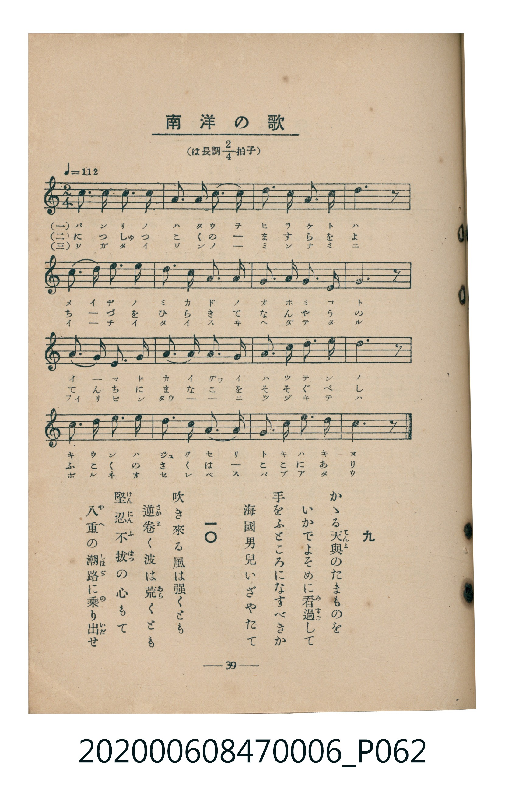
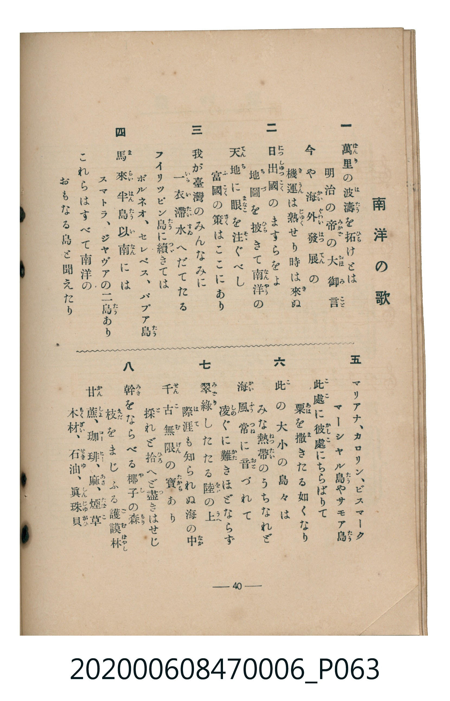

# 南洋の歌

> Re:Shōka 使用 AI 協助辨識與重建樂譜，可能會有錯誤。歡迎[回報](https://github.com/TMDLang/reshoka/issues)。

- **鋼琴伴奏版**：<br><audio controls src="nanyo_no_uta.mp3"></audio>
- **NEUTRINO 歌聲合成版**：<br><audio controls src="nanyo_no_uta_neutrino.mp3"></audio>

- 臺灣教育會公認《新定兒童唱歌》尋常科第六學年用（2020.006.0847.0006）

## 說明

原書資訊與歌詞全文（對應 P062.jpg – P063.jpg，書頁 pp. 39–40，參考教材第 3 首）：
調性與拍號：は長調四分之二拍子（C 大調 2/4 拍），♩=112


## 歌詞

```text
一　萬里（ばんり）の波濤（はたう）を拓（ひら）けとは
明治の帝（みかど）の大御言（おほみこと）
今や海外發展（かいぐわいはつてん）の
機運（きうん）は熟（じゆく）せり時は來（き）ぬ

二　日出國（につしゆつこく）のますらをよ
地圖（ちづ）を披（ひら）きて南洋（なんやう）の
天地（てんち）に眼（まなこ）を注（そゝ）ぐべし
富國（ふこく）の策（さく）はここにあり

三　我が臺灣のみんなみに
一衣帶水（いちいたいすゐ）へだてたる
フイリツピン島（たう）に續（つゞ）きては
ボルネオ、セレベス、パプア島（たう）

四　馬來半島（まらいはんたう）以南（いなん）には
スマトラ、ジヤヴアの二島（たう）あり
これらはすべて南洋の
おもなる島と聞えたり

五　マリアナ、カロリン、ビスマーク
マーシヤル島（たう）やサモア島（たう）
此處（こゝ）に彼處（かしこ）にちらばりて
粟（あは）を撒（ま）きたる如くなり

六　此（こ）の大小の島々は
みな熱帶（ねつたい）のうちなれど
海風常（かいふうつね）に音（おと）づれて
凌（しの）ぐに難（かた）きほどならず

七　翠綠（みどり）したたる陸（をか）の上（うへ）
際涯（はて）も知られぬ海の中（なか）
千古無限（せんこむげん）の寶（たから）あり
採（と）れど拾（ひろ）へど盡（つ）きはせじ

八　幹（みき）をならべる椰子（やし）の森（もり）
枝（えだ）をまじふる護謨林（ごむはやし）
甘蔗（かんしよ）、珈琲（コーヒー）、麻（あさ）、煙草（たばこ）
木材（もくざい）、石油（せきゆ）、眞珠貝（しんじゆがひ）

九　かゝる天與（てんよ）のたまものを
いかでよそめに看過（みすご）して
手をふところになすべきか
海國男兒いざやたて

一〇　吹き來る風は強くとも
逆卷（さかま）く波は荒（あら）くとも
堅忍不拔（けんにんふばつ）の心もて
八重（やへ）の潮路（しほぢ）に乘（の）り出（いだ）せ
```

## ABC

<div class="abc-score" data-abc-src="nanyo_no_uta.abc" aria-label="五線譜載入中"></div>

[下載 ABC 原始檔](nanyo_no_uta.abc)

## TMD 檔案連結

- [主旋律 TMD 檔案](nanyo_no_uta.tmd) [[在 TMD Studio 編輯](https://tmdlang.github.io/Tmd-TS/#tmd=s7IKdvYPcrWy4qpTUCpJTLdSSM7PyUlNLsnMz7MqzsjMK0nNjM_KTMmPL87Iz05Ugisry88pzU21Si9KTEmNN4s3MjAyiDcwMIs3sDAxBzIMzBBKi_NLi5JTrYqTM_Lzc-JLUitKkvLzs9Hl4wsS01OtAgzMjBAyBUX5Zal5iXlA3QVFILekgLUjFKSWZaakgqSLkxPz4stSizLTMlNTkFyZWlQM9gnEipKixLzi5KLMApD3EKryi0oy8oE-KciotMrILC7JL8pMTsyJz07MQ_JwSUYq0L95iSWlRanoohBNlejCBTmJyUhqgcamZ-ZZlSRmlgMdm5-WlpmcmZijxKWlpfC0d_qzLd2PG9c9W9ujoKXFpWirYGhoxGVvq-DMZWOkb2IHMuRF-67njYufTZ35omnTsznNT1vXvFjV-7ih69m0DU_XzXraOun56qVPp2wEGvG4ofvphu6nO3Y8Xz7x-Zo1T1vXPl274-nOLc-nrHi_pwMUV3rAGNIDxRWQYWD2fk-nEheXvpaCLbUAl4KCwtO--c9m73ixuf3Fiq4XHe1Ad71YOe9p64pn09qBrni6ofdZe6cCKML1sgrSFR41TAZxjEGc93t6gDpfLmhUKCjQUzC2BMqZGAAFn_Y3v2hoBobAs7kTgP5SMFZ4uWwa0PHv98wCWfhi1f5nDctBVnX3vpg5Hyj6uHH9y6nbgeJPZ89-2tH2ZGf3k109QNmnaycAneCs8HTJcqCkAjCEFYCiYJN6Hs1caQsKfJCJT3Y0PG5oeDFhzcv2HqCGx40bHjdNftzUBVQJiqzNi57tXwIWX_-4cf7jxjaQeNOkZ92TwYKbHjcBDQSqnPi4cQVQDcjEZzP6nm3aDdT8dMdcsKL9jxuBEb8SYiLQPU_3LXyxogEs1fW4EagSqGAyUD9QAdhFu7seN7U827r96ZJpz2fuebpxKlgp0IiWx40THjf1gxlA5yx53LgM6FiIuWCbV85_2dgNVt0LdCpMbv3zNmBIAQVnPG5qe9zYDxacDfTjs5lNQNkn-4CeAmkBi6-BhMouYApreDZ96dP2XU_nQIxcDbZxOtgMIAPoYohJ6x437nvcOBMYEsCAedzUAU4YczY8nQOMN6C2hY8bl0IDrWs1aqABHbkMki_A4qvAIQ_0GziQIV56umQl0CywNMivQOPAcqufz9kDFgTavAroFqgFm0GJ_3Hj3MdNwJAHKpvwuHEn0Mlgg9b3wDyyFdnxz9dCnDkVJgIMWKAsEAH92wQMJGgq6QSFRwcwmnsgmRTs7_1gJwEdAIzB1dDU9GLh4qc7tj3bsAVsLNA3wAAAksC0AySBoQRMlkBbdjxuXADyElC8qRuk83Hz1MdNSx43r3rc3PK4ecrj5s1PN28DGwFLdUBP74Ik0SWPm-bBAxCa6h43z3ncvPpxc-_jplWPGxofN-1-3LzmcTPQwp0gbvPEx83AqFuEZijYc8CcA_Tcy2VrgCnhaW8XTMk-UIxCkhrIl1AdT3YvBUYZzG-gKIO4DeYMoHXN8x43dzxuXgl2xo7HzUBfbQFaDQwxYLLC8BU4jEE6gWHe1AO2ExgFM8ExB00d0LQAyi5NwBQLtLQbaAwwx7xonPe4EWwYLJ52TQF6BewCoKpFj5u7wI4AhstacNBuBocF0CKIK_c8boIGHoSzHezY1ehuBKbJpq2PmxdhCT9Qrlu75MVMSB4FGgxJeKuf7t0DEwQ6fzo0iYKCaSHYi8BSBpj3l4H0P98EyZ2gvAhNx5MmQWIAFsmgRPJ0GVABMO8D_QXxK7DMB6XJtZDiCVoMgIqXDUBV60AB1NAKixVQAl31vG0jMGWCVa8FZ2FQmoRlYWCmBiZUoOE9wKIK7K2t218uWgGsYZBKH2DOgWT-tRDfvJy_GVaMgUovYE4H6wd76ym0PAX6fR0sM65-OXsxzDigpyGeAxaAK8E2A7mzoLmtGeiz5_sXPN-2AFaCroSVyUDzgO4GhcjLmWC3AQsdUKEH8saTHUA1QPVARwKlwLHzctbsZ9uA4QopwZeBA7jp-XygQ4EMoFvXAP0J1gn0ErgMApsF9kBv89P-Jc9bFr6cCapKwEUmuGRoanjcCCzoYCG-Hp4iumEFGyxNP-sDFldAOXDggEP2WTcwUiFlIKS8BRYEK5_PhigDxiQkSIAunQ0srqHRvBoYGE937oSFBFgfyNOQINsJDIlnSzZA6jtw8QnMneC6azEw3IEiIMfAkuo8SI0ERMCAhZgCLEFngGK2qfvF2u0v1qx4Ng-Su6eA_QnM-1ATwUl1yowXUyDSQL8CAwNYpHSADGpofN7f8XzCJrCFm0F5qXkSkIRIvdy1G5bAgTkCrLh15oteYFBBgm0DJPWCHThnBbDihzoblNqnQZMoUM_8zc82QQIBGDbAYg6cNYHic-Y971_wYhPEZ0AHAZ0FqeiA4Q10EKSMe7JzLqhgADkbWDt0A6sVYCMCUa1AfAHKB0D3AAs-oOXrgKEDyTvAAACm1-VAReCqpRFc_XS_bOyDxQiwsJoCS5vgtP-sE2gPMGyB-QXYKgAaD4xTYNYHJi5IuQbkggt9UCU_p_v5lO3Aph3Ynmng4Aa6YRmicdIOiv4JIF3A8hmU7BeBWhpP9wCTLTCAVgAdC07nDcCyezusKgO6F1J49ANbMEDVL3ohJQowLUBSKJLOpwtan-7vfbKj91k30BdARRPBYbgaTAJ9AIweSMJc93R_MzhoIPm7dfXLdmBahKQ5UHYDpbm9615sh-Q2YFgAc_YiSEHxZOcMsCC4JGjqArYqYDUIOB02zgaZSHmbFAoUtPS5uPwS8yrz_fJDSxKtAjIT8_IdagxqqkHWKNgYmmnZgVnY2sMKwGYnuBrvUdAwUQAWps_XN-jAG7GaWDQAbQMZVqNgGKegC4RACsGqUTADM81QxIzgbIgssqCuggGUrgGb62NYA0yEG8AiwDgB4i4Iu3EdUBMwcqG8-UDcBlU1CSyzCcrrBLInQlWtQNKjqxCPapMRSG41VOUSIAa19uBckORkKK8fbD1UM5C9Dyo-E2wdkiOaOrBbZQyS64fq6gE7H8JuAeuCyoC8i2LPfiTxVVAd-8EyEGdj2GOCcB0kKJBsgQUd2DSY_W1gmRYobxVYFsJejS_oTJFCARhBwKwGNwEk0w2V6UVEH9BckMxmRMjB3QkSh4QAhj1myLGwDogXoPhoNtwXqOE2HSq-D4hnwNl4_GOOFNqNK5ES3XSwLlhoARNdE8RvYHuAcQ4R74bbDwvRHdjtsUC2BxQ6MBPA4QaPr51o9sDiZzrCnqYmsAzEnRj2WCLFAsh1UNOAhRlYFzREgakVNdxg_gSGG9B8WKgjfIphj6EBSNtWhIegEQmyENkJc5CCHiS-BMkBsGwBzqtQa5Etwl927eqhoOwClkHGEBaQwiynzIBiplAWhDaGi2Att5oaoX5pAeJFyAEIj3RQUlmJIgNLaruRVEEyywrsgQ4utxZCxYCtUGhYYpaCvVAV4EiHFSDgMhWWoCCJFZYEsBRa0KIBpBZiIyzrIQowUGaGmDwBKemDsirIZgh7PjhuYUkaW6EFNQOcZSH-BvkBJANs3kCd2zQFVNCgJllY-Y1UHwDV4MkaSEUXOEshTIckWUTJCJOBWDQVqgrkAFjeAHsLai32sgsSoZAcDqHXImcAsLNhkQFJDjBPLESKsh6wDCTZYC-7YJkLHuSQ8gFWEoKSA9AUiIo1KPbshwcoaumNveyC1W_wkhia7GA14gwghhYH0PCcAuU1wF0JCleE27CXXYhkBytCliPVr8CWKVJmg9RUsKwDqlmgdkJLb0iI4Ci7INGKbBGkooCVSsAqEW70erAMNPLBOYyysmtHJzllF6RsMgWWRRAa0eaCycBEgAUZtEhDLt6wt7gQAQ6r1iGRBAsVUD4HDcfBuYhUB2k8wdIdpOjCUaSAiy6ESkShAolDWCoCBTqsjoKkr7lQGWC8N06AsnfiS0XgwgvYnodlblAjBZbpgOMzEFeCxjWg2mC-hzgEpnIpEPdC2ZBSFEcDAlyGwZwMbODBq3JImoGVbsCKHZ4cySqTwaUXrEEECkBY-QfJbLCGD0IGYg80mMFpFta27sKXOcCFF3Lcw-p4iOtg4bMWzR5YXbYCHHaw0MBjD7jwgjbjwAkCFoYNYF3Q5hFGwxhWSIOaNrCQxlvqgwsvWLMUZBqoLw8PrBqoYlj1CbMGVs5PRbJyA1gG4kzsZRcsfU9CCjZIRwTmuV60YIPVDaCyayeU3YuvLIaUXdBeDtg_0HQATdgwazcgxRWkekFKO0BnQPRAqgrMGMJbegHHUenR8gIKQRUC1cC1Yy_DoP4BV90wf0LyH2iIBCoA6svBEhwkC0CbG-DmK6xEg4T-GuyhDy7FYEEMCnxYqQgJYmhLAWwTcqMXW7bFm2jBZdgeqFtBDce1UF0Qd8N8AepPwlLNTLDMRihvO1IaxttWARdfsJ4aqIUDK5hQixVE4wziI1iAg3wEy02Qph6-xhfMRevh_QpYpQszD62fBa_PQcUKomLGYw-4-IK5GtRvhNUZkOIdVrCBWl8QOyH27IaKA3uA8BCANEJnYbcHXHzBmqugeIA17TeBXQfzzw64DEr3ByXFzYYkVOz2gIoveI8MlK6mQdmo_WCgedB0jtIPBhcQSFkAUiLDijp8XUdQyY8YBAHJwJp9YCORrILVXtOQajJIksPX_IIrBYUQrBUKabXB4mIRONYQFsH6v6AKHaZ7AVIoIFtUy8Wla6eAGBtTAPKUuQA)]
- [鋼琴伴奏 TMD 檔案](nanyo_no_uta_piano.tmd) [[在 TMD Studio 編輯](https://tmdlang.github.io/Tmd-TS/#tmd=s7IKdvYPcrWy4qpTUCpJTLdSyC8qychPL0osyKi0ysgsLskvykxOzInPTsxLVIIrKs4vLUpOjS9ITE-1CjAwM9IFEsZKXFpaCk97pz_b0v24cd2ztT3v93S87N7zfMKWJ3u2PF3a_7yz4_2eTgUtLS5FWwVDQyMue1sFZy4bI30TO5DBL9p3PW9c_GzqzBdNm57NaX7auubFqt7HDV3Ppm14um7W09ZJz1cvfTplI9Dcxw3dTzd0P92x4_nyic_XrHnauvbp2h1Pd255PmUF0EojAyMDPQMDMz0DCxNzIMPADGirEheXX2JeZb5ffmhJolVAZmJefpCHQ41BTTWXAhDYGJpp2YFZNQqGcQq6QAikEKwaBTMw0wxFzAjOhsgiC-oqGEDpGrC5PoY1Co8bN4BFHjdNBuIuCLtxHVDT48b1UN58IG6DqpoEltkE5XUC2ROhqlYg6dFViEe1yQgktxqqcjEQT3_c1ArlLgFrnAzl9YOth2oGsvdBxWeCrUNyRFMHdquMQXL9UF09YOdD2C1gXVAZkHdR7NmPJL4KqmM_WAbibAx7TBCugwQFki2woAObBrO_DSzTAuWtAstC2KvxBZ0pUigAI-hxYxPcBJBMN1SmFxF9QHNBMpsRIQd3J0gcEgIY9pghx8I6IF6A4iNghLXDPYIadNOh4vuAeAacjcdL5kgB3rgSKd1NB-uCBRgw3TVBvAe2BxjtEPFuuP2wQN2B3R4LZHtAAQQzARx08CjbiWYPLIqmI-xpagLLQNyJYY8lUkSAXAc17XHjMrAuaKACEyxquMH8CQw3oPmwgEf4FMMeQwOQtq0ID0HjEmQhshPmIAU9SHwJkgNgOQOcXaHWIluEWuIASw5jCAtIYZYuZkAxUygLQhvDRbCWNk2NUOtbkNIKpLSBxRModleiyMBSx24kVZAkvgJ7OIFLm4VQsceNs6Dexyy7eqEqwPEEy_bgkhCWBiDpCxZrWIoaaIYGqYXYCMswiGIHlAWRZSCpFZTBQDZD2PPB0QFLhdiKGpgZoFwG8TfIDyCZGY-bmqECU0DFA2oqg5W6SKU4UA2e1IxU4IBzAcJ0SCpDlGewYIJYNBWqCuQAWHIGewtqLfYSBxKhkEwJodcip1mws2GRAUkOME8sRIqyHrAMJNlgL25g-QEe5JAsDSu8QMkBaApExRoUe_bDAxS1zMVe3MBqJXj5CU12sHpsBhBDczA0PKdAeQ1wV4LCFeE27MUNItnBcv1ypFrxceNcpMwGqV9gWQdUH0DthBa4kBDBUdxAohXZIkjZDitIgBUZ3Oj1YBlo5INzGJHFDaQ4MQUWHxAa0biBycBEgGUPtBRCLpGwN20QYQSrPyHhCvMIKGvC4hyl3gamPkQ6gRQ1OIoAcFGDUIkoBCBhDot1UCDBqgFIepgLlQHGU-MEKHsnvlgHFzZb4ZkB3BSAZZItMFfOR2Q2mNchDoGpnAXEvVA2pNTDUUeDyxyYk4HNKHhtCYljWGkErDvhyYesMhRc2sCaHaAAhJVXkMwBa1sgZCD2QIMZnMZgLdgufIkZXNggRzysGoW4DhY-a9HsgdU9K8BhBwsNPPaAC5vZiFCAh2EDWBe0BYLR_IQVqqDWAyyk8ZbS4MIG1vgDmYbUQAOlBVj0Q6o7mDWwcnkqkpUbwDIQZ2Iva2DpexJSsEGa-zDP9aIFG6wsB5U1O6HsXnxlJ6SsgfYlwP6BpgNowoZZuwEpriDVAVLaAToDogdStGPGEJmNG6AQVCFQDVw79jIH6gRw7QhzGiTLAKtpWJcH1MmBpRFIqoXW6OBGHawQggTYGuwBBi54YKECCi9YSQsJFWhlDLYJuSmILafhTWfgYmcP1K2gttlaqC6Iu2G-AHW0YBE9EyyzEcrbjpTs8DYHwCUOrAsDakTAyhLUkgDR_oH4CBbgIB_BKj9Iawpf-wbmovXw1jasXoOZh9b7gFeZoJIAUffhsQdc4sBcDepQwYp5SIkMK4tADRyInRB7dkPFgf0ieAhA2nmQ8gd7iQNrEYLiAdZ63gR2Hcw_O-AyKJ0ClBQ3G5JQsdsDKnHg_RRQupoGZUOqTmhKAPezYDGMFALgPI2UBSCFKKx0wtehAhXWiNEBkAysZQU2EskqWIUzDanygSQ5fC0cuFJQCMEaepCGESwuQI025OIN1isE1cEw3QuQQgHZolrMYR4f5GEeE8QoT7xCtGEskGECY5jGA1km8TCmAdTdaEpNQAy4CKpCM5AJqCrhDEJGgm03BdsOlASpBPpF104B4Z1oH6AONBEjDBFjDBGg8WgiphgiZhgi5hgiFhgilhgihgZgIWUuAA)]

## 分析

```text
================================================================================
📊 TMD Song Profile: [ 南洋の歌 ]
================================================================================
⏱  Duration:       0:17 (17.1s), 16 measures total
🎼 Key & Tempo:    首調基準 C, != 112.0 BPM, <2/4>
   - 分析範圍：      由實際發聲的音符與和弦推測調性；播放脈絡另行呈現
🎤 人聲音域:    E4 (MIDI 64) – E5 (MIDI 76) [跨度: 12 個半音 / 1.0 個八度, 難度: easy]
   - 最低音:  E4 in [NanyoNoUta #1 @ m.7, 0:07]
   - 最高音: E5 in [NanyoNoUta #1 @ m.5, 0:04]
   - 適合: soprano, mezzo-soprano, contralto, tenor, baritone, bass
🏛  結構:      NanyoNoUta (17.1s)
⚡ 編曲密度:        Peak 1 軌道同時演奏
🗝  調性診斷：       A 小調（純淨自然小調，未偵測到可信轉調）
   - 風格氣質:    純淨自然小調（陰鬱抒情、旋律集中，無明顯調外色彩）
   - 轉調歷程:    全曲維持單一推測調性（未偵測到可信轉調）
   - 核心骨幹音:  A, C, D, E, G
   - 調性數值:    A 小調 [相關度: 0.80, 穩定度: Moderate, 自然音純度: 100.0%]
   - 候選調性 (K-S): A 小調 (0.80), C 大調 (0.72), G 大調 (0.60)
   - 五度圈歷程:   +3
   - 各段落調性細節:
     • [NanyoNoUta #1]: A 小調 (r: 0.80, 自然音純度: 100.0%)

  [ 五度圈游移軌跡 ]
               C  
         F            G  
      Bb               D  
      Eb              [A ]*
         Ab           E  
            Db       B  
               F# 
     (* = active key center)

  [ 十二半音累積音高分佈 ]
     C  : ███████████████████████   25.0%
     C# :                            0.0%
     D  : ███████████████████       20.5%
     D# :                            0.0%
     E  : █████████████             14.3%
     F  :                            0.0%
     F# :                            0.0%
     G  : █████████████             14.3%
     G# :                            0.0%
     A  : ████████████████████████  25.9%
     A# :                            0.0%
     B  :                            0.0%
--------------------------------------------------------------------------------
Assignment 軌道音域：
  - Piano         : E4 – E5 (12 個半音 / 1.0 個八度, 52 個音符)
================================================================================
```


## 原書掃描頁






