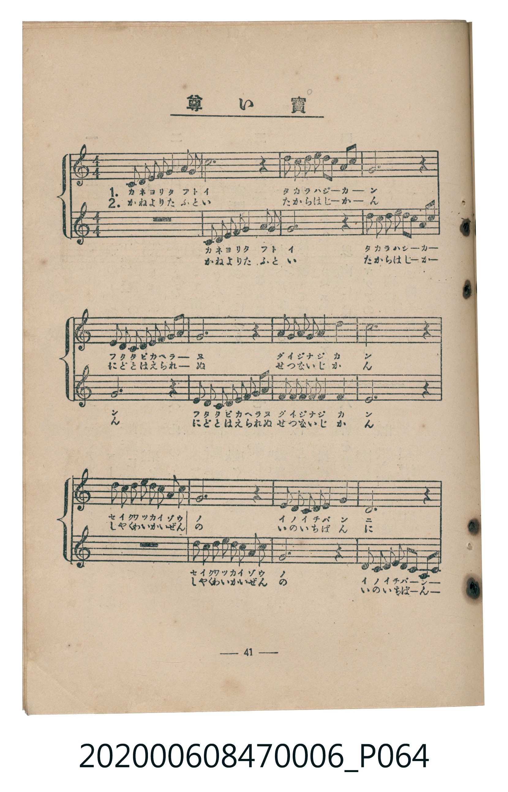
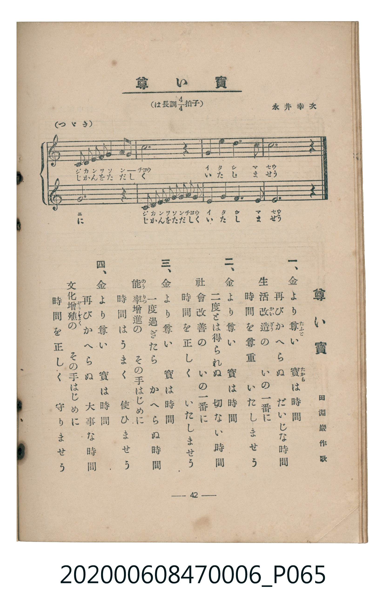

# 尊い寶

> Re:Shōka 使用 AI 協助辨識與重建樂譜，可能會有錯誤。歡迎回報。

<audio controls src="totoi_takara.mp3"></audio>

- lyrics: 田淵巖
- composer: 永井幸次
- 臺灣教育會公認《新定兒童唱歌》尋常科第六學年用（2020.006.0847.0006）

## 說明

原書資訊與歌詞全文（對應 P064.jpg – P065.jpg，書頁 pp. 41–42，參考教材第 4 首）：
調性與拍號：は長調四分之四拍子（C 大調 4/4 拍，二部輪唱）
作詞：田淵巖作歌
作曲：永井幸次


## 歌詞

```text
一、
金より尊（たふと）い　寶（たから）は時間
再びかへらぬ　だいじな時間
生活改造（かいざう）の　いの一番に
時間を尊重　いたしませう

二、
金より尊い　寶は時間
二度とは得られぬ　切ない時間
社會改善の　いの一番に
時間を正しく　いたしませう

三、
金より尊い　寶は時間
一度過ぎたら　かへらぬ時間
能率（のうりつ）增進の　その手はじめに
時間はうまく　使ひませう

四、
金より尊い　寶は時間
再びかへらぬ　大事な時間
文化增殖（ぞうしよく）の　その手はじめに
時間を正しく　守りませう
```

## ABC

```abc
X:1
T:尊い寶
M:4/4
L:1/16
Q:1/4=108
K:C
V:V1 name="Piano" snm="Pia"
[V:V1]
C2 C2 D2 D2 E3 F G2 A2 | G12 z4 | A2 c2 A2 G2 E3 F G2 c2 | G12 z4 |
w: 1.~か ね よ り た ふ と _ | い | た か ら は じ _ か _ | ん
w: 2.~か ね よ り た ふ と _ | い | た か ら は じ _ か _ | ん
w: 3.~か ね よ り た ふ と _ | い | た か ら は じ _ か _ | ん
w: 4.~か ね よ り た ふ と _ | い | た か ら は じ _ か _ | ん
F2 F2 E2 E2 D3 E F2 A2 | G12 z4 | G2 E2 G2 E2 D4 F4 | E12 z4 |
w: 1.~ふ た た び か へ ら _ | ぬ | だ い じ な じ か | ん
w: 2.~に ど と は え ら れ _ | ぬ | せ つ な い じ か | ん
w: 3.~い ち ど す ぎ _ た _ | ら | か へ ら ぬ じ か | ん
w: 4.~ふ た た び か へ ら _ | ぬ | だ い じ な じ か | ん
A2 A2 B2 B2 c3 B A2 c2 | G12 z4 | F2 F2 E2 E2 D4 G4 | C12 z4 |
w: 1.~せ い くわ つ か い ざ う | の | い の い ち ば ん | に
w: 2.~しや く わ い か い ぜ ん | の | い の い ち ば ん | に
w: 3.~の う り つ ぞ う し ん | の | そ の て は じ め | に
w: 4.~ぶ ん か _ ぞ う しよ く | の | そ の て は じ め | に
C2 C2 D2 D2 E3 F G2 A2 | G12 z4 | G4 A4 G4 D4 | c12 z4 |
w: 1.~じ か ん を そ ん _ _ | ちよう | い た し ま | せう
w: 2.~じ か ん を た だ し _ | く | い た し ま | せう
w: 3.~じ か ん は う _ ま _ | く | つ か ひ ま | せう
w: 4.~じ か ん を た だ し _ | く | ま も り ま | せう
```

## TMD 檔案連結

- [主旋律 TMD 檔案](totoi_takara.tmd) [[在 TMD Studio 編輯](https://tmdlang.github.io/Tmd-TS/#tmd=s7IKdvYPcrWy4qpTUCpJTLdSSM7PyUlNLsnMz7MqzsjMK0nNjM_KTMmPL87Iz05Ugisry88pzU21Si9KTEmNN4s3MjAyiDcwMIs3sDAxBzIMzBBKi_NLi5JTrYqTM_Lzc-JLUitKkvLzsxHyBUX5Zal5iXlANQVFIBtTwIoQClLLMlNSQdKpKZkl-UWZiTlI7kgtKga7FWxJfElRYl5xclFmAcgDCFUlGalAx-YllpQWpaKLpubmoyoG2pCemWdVkpgJ9DPI3-WJ8bmJmXk5iXkpSlxaWgpPN3Q9bmx5un6bgpYWl6KtgqGBBZe9rYIzl42JvokdyJycyqLM5GIrhedTNjzbvvXp9mlg05Pzcwvyi1OLrBSebdjxZNfUpzt3PFuzECz1on3X88bFz6bOfNG06dmc5qeta16s6n3c0PVs2oan62Y9bZ30fPXSp1M2Plvb87ih--mG7qc7djxfPvH5mjVPW9c-Xbvj6c4tz6eseL-nAxQPesDQ1wPFA5BhYPZ-T6cSF5e-loIttQCXgoLC0775z2bveLG5_cWKrhcd7UB3vVg572nrimfT2oGueLqh91l7p0KAgZmJXlZBusKjhskgjimI835PD1DnywWNCgUFegomhkA5EyOg4NP-5hcNzcAQeDZ3AtBfCiYKL5dNAzr-_Z5ZIAtfrNr_rGE5yKru3hcz5wNFHzeufzl1O1D86ezZTzvanuzsBjKAsk_XTgA6wVnh6ZLlQEkFYJQoAEWBNjzZ1fOyecWLPauAAQk0GGTqk71zgO4GGgaPKKAI0DNQuWezNwHlkCOLCyyzo-FxQyOI9bJ94uOmjsdNXcAkAbT0ceP8x41bHzcCY6ITmEIeNzQAEwlMvPtxE9AzQPH1z2Y2vZw2GRyMbb2PGzeD5Bp3AKUfN64B6nncuACkuXHG48ZVCKXPp8x_tmX3syk7XzYsABsJ1ANUNO1xYxvY1HVgnUCRdUDnPZ-66nHjapA2iAGPmyYBXfiyHZikIIqA7pn-uHHf48bZQP0QT-0CJi0MT8F9geJsoNqnu5YB_QkUfbpvOsjlTT0Qxz_taAc6G6gNyeVL9gGTNNDlT6eBnEfAnc_WLga7rR-PU3d0Eu_UHQ1Ap75s7HsMQvNBTgWZiwhwhNIXzXuf94GSL8iRjW1AUx83LgGG7dNF8142bIK5fC6Q8awTqH89KIaaGlHdDxJtA7sW5P4ne_c_bgTqRHY8MJES7XisyQOYrp_sAoogpQ1grnvaMw3ozmfrgFkG6P55YFcAIwbI7kdKHvgdjxr4T9eB3IZwPFAd5WUHFCho6XNxheSX5GeGJGYnFiVaBWQm5uU71BjUVIPsUbAxNNOyA7OwFVwKwPIBGK8vFvYoaJgAS-P-5-sbdOCljSYWDUDroIYZ6ik8blqt8Li5F4hXAPEqIH8_kJ4KxB0KNUDeEjAJFAOrWwnE_UD2DiC9Byq2B6SieTOSsUZAYxu7gXgtUEkHEHcB2fOBeCsQrwApb2wBkyAxoLqmTiC9HohnQIwFiUGMbZoMM7ZGwVBBF4yNoNgYiHWBJaMpkDQD4howCxs0gNI1YHWGcVANIOXIhoAliDAF7B4fQ5AHuoF8kDeBJNCjILILLDIfrBLmYZjtIG9jNzseSQ1IL9RkYMCA2OvB5AyoGogcVDUwgAiYCHGt0ZByrfGQcq3JUHEt_jJkVw_ZZQiovACXEaCyYzK0XABlZlB5ASkfesBkA7hEgZQfwEIBRAPVYi0_gEY0ArUDAw1SNoDKEWA50dQDM7JxDZicDcRAIxuBRRcwUMFlCDBY0MoOE6D_QRiU3UEYVH6AWCAxYssOWHEBoyFmQMyFqIAUJnjMQCo5toLjDxLDEHIzmITEKLCKg8Y5LC2swWE2cnpZANYJSlmQNAIKFOqUHKvBuleCSVAqhqVEUEqHpE5QxJDm2tlgE5YguRPhcrJdCy45IOYsRHLzTDDZBzcZkishJsNCGZ9bIbl7B4iE5kSQD6lRbgyFdECg7dFJfttjN7Q8WP-4eR0wXwPzL6joAAttA-Jl4KKhD9oQAbEgdCMQTwAXGiD5bvSiYzpQWTOQBrVUgFrAxQKoOQKi54B9DAqlddByGMSC0AuBeANcfjWi-AAVESBsDsXglgKICW9PEFOAYC-EIAUKRAWoeYPXDKQCBJJ9IJHc_7ipH8yA5CZY2gH5aRqY1QY2HuRTwqkHYiRIJWpO2gBVg0gxsJIBf-pBlCLAJjjUvWBjIE6GiCA7eQ7ckgF1MrgogZgJCj5YhQ4J4nlQ97aBkxup7p2L5N5lYBKtYm9qJN294OJkG9wtiEyO5lpo-wQcCQPlYLwlCrBTiFmigIdLiChRIC0KUNHwuHkTkL0XygZ2K5obHzcvh5Yq0BIF3GjZDpSaBxYBFUfL0EsTSIMCFKjAPiGQDeq0LABHOygMwUaBky1IHCS2D94saaNu5wWmAqQeBGF8WDkCtAVSLuExBKkAgdQMkNYlOMEAfQcSAcU1cpaBxOlCcPcZlBHwxiw0A4JNgNeykCwCYe1DUgnqSRMyEKn4wOVgWBMbEikI40EJfCAcCy44MBwLzTEwM1ANJ8apoIIHohORsTdR6FRwmUGLcIU553FTE5wFKj_JdGwtF5eunQLSGIkCkKvMBQA)]
- [鋼琴伴奏 TMD 檔案](totoi_takara_piano.tmd) [[在 TMD Studio 編輯](https://tmdlang.github.io/Tmd-TS/#tmd=s7IKdvYPcrWy4tLSUni6oetxY8vT9dve7-l42b3n-YQtT_Zsebq0_3lnx_s9nQpaWlyKtgqGBhZc9rYKzlw2Jvomdlx1Cko5lUWZycVWCs-nbHi2fevT7dOUQKLJ-bkF-cWpRVYKzzbseLJr6tOdO56tWQiWetG-63nj4mdTZ75o2vRsTvPT1jUvVvU-buh6Nm3D03WznrZOer566dMpG5-t7Xnc0P10Q_fTHTueL5_4fM2ap61rn67d8XTnludTVgDdaGRgZKBnYGCmZ2BhYg5kGJgBnanExRWSX5KfGZKYnViUaBWQmZiXH-ThUGNQU82lAAQ2hmZadmCWvpaCLTpQANryZEfDi4U9ChomwADpf76-QUchwMDMRC-rIF0TiwYtfbBhNQqGCrpgbATFxkCsq2CiYAokzYC4BszCBg2gdA1YnWEcVANIObIhYAkiTAG7x8ewRuFxYzeQ_7hxLYhs6gCTXWCR-WCVjxu3AvEKuO3AyMdhdjySGpBeqMlNnWD2ejA5A6oGIgdV3TSZkIkQ1xoNKdcaDynXmgwV1-LPlbt6yMmVJkCTQRiUkUAYlDNBLJAYsbkSlhFhNMQMiLkQFZBsiscMpDy5FRwykLCDkJvBJCSsHjfugIYmLJTX4DAbOSYWgHWC4gwS-o8bV8HZ5MQEIk-uButeCSZB6QMWx6A0BIn3x009JLp2NtiEJUjuRLicbNeC8yTEnIVIbp4JJvvgJkPSO8RkWCjjcysk3-wAkdA0DvIhNXLkUEgHBOrJTnJyJCjXgbA5FIOrNRATXvkRkyex52tIHoWoANXFeM1AypOQFAkJt_7HTf1gBiSBwqKjBYingVltYOMfN67DYQFyhECMBKlETZwboGoQkQDLbPgjBJExpz9ugroXbAzEyRARZCfPgVsyoE4G506ImaDgg9U-kCCeB3VvG8hbJLt3LpJ7l4FJtFqoqZF094Jz6Da4WxD5Bs210MoUHAkD5WC8mfTp7NmYmdSULo1ZmAqQehCE8WFZFWgLJOvjMQQpj0LKM0hrAxwnTZPAIqDgRE6VkGBbCIwZSFrDG3jQNA42AV43QFIhhLUPSeVsIgxEyqG4HAxrci1AsgikHpSGBsKx4LyJ4VhoooSZgWo4MU4F5W2ITkTe2UShU8HZkhbhCnPO46YmOAtURJHp2FosnVAfXJ1QaOO2cdPL5hXAvuez7l5g39YQml-BPdqn-3peNmx62rr0xZ5VwG7x-z09z7dOeLph39MNvU_29j6bsu3Z3PmInAvLOrggJCSBeQ_kWjBhBCeMIT4wiVcwBbHMQAQwH8P8hQ6R-q1gw2BawBrQzAJJwqwmwkCgNrBeqDlgAuxEMBssQbzrEO5BsKCGQS1BDhiowwl6F0yYwwlIcwPIhIcFpR6FOhfZbeD4wm8g8fEKayDBQwBunWk8Im8QthKU2nXtFJASfLSPYawCupARppAxppAJWEiZCwA)]

## 分析

```text
================================================================================
📊 TMD Song Profile: [ 尊い寶 ]
================================================================================
⏱  Duration:       0:35 (35.6s), 16 measures total
🎼 Key & Tempo:    首調基準 C, != 108.0 BPM, <4/4>
   - 分析範圍：      由實際發聲的音符與和弦推測調性；播放脈絡另行呈現
🎤 人聲音域:    C4 (MIDI 60) – C5 (MIDI 72) [跨度: 12 個半音 / 1.0 個八度, 難度: easy]
   - 最低音:  C4 in [TotoiTakara #1 @ m.1, 0:00]
   - 最高音: C5 in [TotoiTakara #1 @ m.3, 0:04]
   - 適合: soprano, mezzo-soprano, contralto, tenor, baritone, bass
🏛  結構:      TotoiTakara (35.6s)
⚡ 編曲密度:        Peak 1 軌道同時演奏
🗝  調性診斷：       C 調性不明確（純淨自然大調，未偵測到可信轉調）
   - 風格氣質:    純淨自然大調（陽光明朗、易唱易記，無明顯調外色彩）
   - 轉調歷程:    全曲維持單一推測調性（未偵測到可信轉調）
   - 核心骨幹音:  G, C, E, D, A
   - 調性數值:    C 調性不明確 [相關度: 0.83, 穩定度: Ambiguous, 自然音純度: 100.0%]
   - 候選調性 (K-S): C 大調 (0.83), G 大調 (0.81), E 小調 (0.65)
   - 五度圈歷程:   +0
   - 各段落調性細節:
     • [TotoiTakara #1]: C 調性不明確 (r: 0.83, 自然音純度: 100.0%)

  [ 五度圈游移軌跡 ]
              [C ]*
         F            G  
      Bb               D  
      Eb               A  
         Ab           E  
            Db       B  
               F# 
     (* = active key center)

  [ 十二半音累積音高分佈 ]
     C  : ████████████              18.3%
     C# :                            0.0%
     D  : ███████                   10.3%
     D# :                            0.0%
     E  : ██████████                15.2%
     F  : █████                      7.6%
     F# :                            0.0%
     G  : ████████████████████████  37.5%
     G# :                            0.0%
     A  : ██████                     8.9%
     A# :                            0.0%
     B  : █                          2.2%
--------------------------------------------------------------------------------
Assignment 軌道音域：
  - Piano         : C4 – C5 (12 個半音 / 1.0 個八度, 64 個音符)
================================================================================
```


## 原書掃描頁






