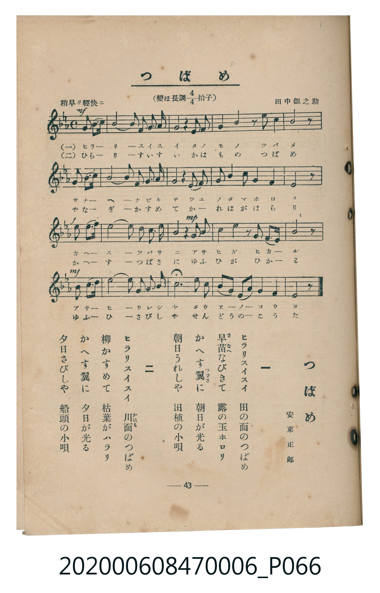

# つばめ

<audio controls src="tsubame.mp3"></audio>

- lyrics: 安東正郎
- composer: 田中銀之助
- 臺灣教育會公認《新定兒童唱歌》尋常科第六學年用（2020.006.0847.0006）

## 說明

原書資訊與歌詞全文（對應 P066.jpg，書頁 p. 43，參考教材第 5 首）：
速度與表情：稍早ク輕快ニ
調性與拍號：變ほ長調四分之四拍子（E♭ 大調 4/4 拍）
作詞：安東正郎
作曲：田中銀之助

## 歌詞

```text
一
ヒラリスイスイ　田の面のつばめ
早苗（さなへ）なびきて　露の玉ホロリ
かへす翼（つばさ）に　朝日が光る
朝日うれしや　田植の小唄

二
ヒラリスイスイ　川面（かはも）のつばめ
柳かすめて　枯葉がハラリ
かへす翼に　夕日が光る
夕日さびしや　船頭の小唄
```

## ABC

```abc
X:1
T:つばめ
C:TMD (Chen, Chih-Han / aguai)
M:4/4
L:1/16
Q:1/4=116
K:Eb
V:V1 name="Piano" snm="Pia"
[V:V1]
!mf! b2 g b e4 e2 c b c2 e c | b4 z4 g4 b4 | f4 g4 z2 f2 g2 b2 | c8 z4 b2 g b |
c4 c2 b c e4 f2 e2 | c8 b4 g2 f2 | e3 f g2 b2 f4 g4 | !f! e8 z4 e2 d c |
d4 d2 b b b4 f2 b2 | !mp! g4 z4 b4 b4 | c4 b4 z2 b2 c2 b g | !mf! f4 z4 z4 b2 g b |
e4 e2 c b c4 e2 f2 | g8 e4 c2 b2 | c2 b g b2 c b f4 g4 | e12 z4 |
```

## TMD 檔案連結

- [主旋律 TMD 檔案](tsubame.tmd)
- [鋼琴伴奏 TMD 檔案](tsubame_piano.tmd)

## 分析

```text
================================================================================
📊 TMD Song Profile: [ つばめ ]
================================================================================
⏱  Duration:       0:33 (33.1s), 16 measures total
🎼 Key & Tempo:    首調基準 E,, != 116.0 BPM, <4/4>
   - 分析範圍：      由實際發聲的音符與和弦推測調性；播放脈絡另行呈現
🎤 人聲音域:    D#4 (MIDI 63) – G5 (MIDI 79) [跨度: 16 個半音 / 1.3 個八度, 難度: moderate]
   - 最低音:  D#4 in [Tsubame #1 @ m.7, 0:12]
   - 最高音: G5 in [Tsubame #1 @ m.14, 0:26]
   - 適合: soprano, mezzo-soprano, tenor, baritone
🏛  結構:      Tsubame (33.1s)
⚡ 編曲密度:        Peak 1 軌道同時演奏
🗝  調性診斷：       D# 大調（純淨自然大調，未偵測到可信轉調）
   - 風格氣質:    純淨自然大調（陽光明朗、易唱易記，無明顯調外色彩）
   - 轉調歷程:    全曲維持單一推測調性（未偵測到可信轉調）
   - 核心骨幹音:  A#, D#, C, G, F
   - 調性數值:    D# 大調 [相關度: 0.84, 穩定度: Moderate, 自然音純度: 100.0%]
   - 候選調性 (K-S): D# 大調 (0.84), A# 大調 (0.76), C 小調 (0.70)
   - 五度圈歷程:   -3
   - 各段落調性細節:
     • [Tsubame #1]: D# 大調 (r: 0.84, 自然音純度: 100.0%)

  [ 五度圈游移軌跡 ]
               C  
         F            G  
      Bb               D  
     [Eb]*              A  
         Ab           E  
            Db       B  
               F# 
     (* = active key center)

  [ 十二半音累積音高分佈 ]
     C  : ███████████████████       19.6%
     C# :                            0.0%
     D  : ███                        3.1%
     D# : █████████████████████     22.3%
     E  :                            0.0%
     F  : ███████████               12.1%
     F# :                            0.0%
     G  : ████████████████          17.4%
     G# :                            0.0%
     A  :                            0.0%
     A# : ████████████████████████  25.4%
     B  :                            0.0%
--------------------------------------------------------------------------------
Assignment 軌道音域：
  - Piano         : D#4 – G5 (16 個半音 / 1.3 個八度, 83 個音符)
================================================================================
```


## 原書掃描頁




