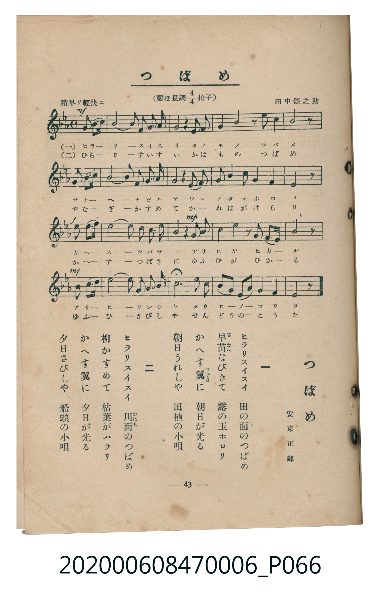

# つばめ

> Re:Shōka 使用 AI 協助辨識與重建樂譜，可能會有錯誤。歡迎回報。

<audio controls src="tsubame.mp3"></audio>

- lyrics: 安東正郎
- composer: 田中銀之助
- 臺灣教育會公認《新定兒童唱歌》尋常科第六學年用（2020.006.0847.0006）

## 說明

原書資訊與歌詞全文（對應 P066.jpg，書頁 p. 43，參考教材第 5 首）：
速度與表情：稍早ク輕快ニ
調性與拍號：變ほ長調四分之四拍子（E♭ 大調 4/4 拍）
作詞：安東正郎
作曲：田中銀之助


## 歌詞

```text
一
ヒラリスイスイ　田の面のつばめ
早苗（さなへ）なびきて　露の玉ホロリ
かへす翼（つばさ）に　朝日が光る
朝日うれしや　田植の小唄

二
ヒラリスイスイ　川面（かはも）のつばめ
柳かすめて　枯葉がハラリ
かへす翼に　夕日が光る
夕日さびしや　船頭の小唄
```

## ABC

```abc
X:1
T:つばめ
M:4/4
L:1/16
Q:1/4=116
K:Eb
V:V1 name="Piano" snm="Pia"
[V:V1]
!mf! B2 G B e4 e2 c B c2 e c | B4 z4 G4 B4 | F4 G4 z2 F2 G2 B2 | c8 z4 B2 G B |
w: 1.~ひ ら _ り _ す い す _ _ | い た の | も の つ ば _ | め さ な _
w: 2.~ひ ら _ り _ す い す _ _ | い か は | も の つ ば _ | め や な _
c4 c2 B c e4 f2 e2 | c8 B4 G2 F2 | E3 F G2 B2 F4 G4 | !f! E8 z4 e2 d c |
w: 1.~へ _ な び き _ _ | て つ ゆ _ | の た ま ほ ろ _ | り か へ _
w: 2.~ぎ _ か す め _ _ | て か _ _ | れ は が は ら _ | り か へ _
d4 d2 B B B4 F2 B2 | !mp! G4 z4 B4 B4 | c4 B4 z2 B2 c2 B G | !mf! F4 z4 z4 B2 G B |
w: 1.~す _ つ ば さ _ _ | に あ さ | ひ が ひ か _ _ | る あ さ _
w: 2.~す _ つ ば さ _ _ | に ゆ ふ | ひ が ひ か _ _ | る ゆ ふ _
e4 e2 c B c4 e2 f2 | g8 e4 c2 B2 | c2 B G B2 c B F4 G4 | E12 z4 |
w: 1.~ひ _ う れ し _ _ | や た う _ | え _ _ の _ _ こ う | た
w: 2.~ひ _ さ び し _ _ | や せ ん _ | ど う _ の _ _ こ う | た
```

## TMD 檔案連結

- [主旋律 TMD 檔案](tsubame.tmd) [[在 TMD Studio 編輯](https://tmdlang.github.io/Tmd-TS/#tmd=s7IKdvYPcrWy4qpTUCpJTLdSSM7PyUlNLsnMz7MqzsjMK0nNjM_KTMmPL87Iz05Ugisry88pzU21Si9KTEmNN4s3MjAyiDcwMIs3sDAxBzIMzBBKi_NLi5JTrYqTM_Lzc-JLUitKkvLzsxHyBUX5Zal5iXlANQVFIBtTwIoQClLLMlNSQdKpKZkl-UWZiTlI7kgtKga7FWxJfElRYl5xclFmAcgDCFUlGalAxybmZeaC9GppKTxuXPK4ccPjpkYFLS0uRVsFQ0MzLntbBVcdLhsTfRM7kMacyqLM5GIrhafrOp_N3fhs7eKXzX1gE5Pzcwvyi1OLrBSeT9nwZMfal10NT3Z2P-1aCZZ90b7reePiZ1Nnvmja9GxO89PWNS9W9T5u6Ho2bcPTdbOetk56vnrp0ylA83oeN3Q_3dD9dMeO58snPl-z5mnr2qdrdzzdueX5lBXv93SAQlQPGI56oBAFMgzM3u_pVOLi0tdSsKUW4FJQUHjaN__Z7B0vNre_WNH1oqMd6K4XK-c9bV3xbFo70BVPN_Q-a-9UCDAwM9PLKkh_v6cHqPjlgkaFAj0FE2Mg92l_84uGZqB3n82dAPSEgqnCy2XTgC59v2cWyPSXDfOf7loGNPfFwhXPmluBos9X9D6bvvJx0_oXe6Y-3b_6cXM3SN2LVfufNSwH2d_d-2LmfKC6F-u6Hjfufjl1O1Dq6ezZTzvaQIE8ezZQwdO1E4BOc300c63C0yXLgfIKwDhTAEoA7QUZ9mTvHKAfgGYgRx1U4tnsTSBHoEYcF1hyRwOIetw86XHzysfNqx437XzctARKNjQAtTxuXPdy7iIgCU89IA1A37zong500OPGqY8bVz1u3AF0Bpix-XFj7-PGZUDNL-dsAmp73tf5uHn24-a1QNPBVjV2A1U_bpz5fP8esH6wqY1TwfpXA7U9mzP32fSljxt7nrZ2Pm4CBxRMqO1xU8_jxumPm1ogbnu2BGjVuqcb-p9OaYF4Z1cPPu883T4X6BewrUBHrH_c1AS2Fc1r84FeAErPBPIhHnk2b_2LiUB1PY-b-yHmonsE4vKnS6aiuxwmBAwkoKlQl7_o2PlywVqEy4HqKE_WUKCgpc_FFVJcmpQIzPsBmYl5-Q41BjXVIDsUbAzNtOzALGz5SQGYkoHJ4cXCHgUNEwWg056vb9CBZwJNLBqAVkEN0wBq1LQChTsQrwTiPUC8CkI37QTiJWC6BsraD5TpA_GaF4FZj5tbgHgCWGQhirG7ekDGNm4CauqEGtcFoRtnAjFQG5AGagOzuoF4PdiSJiBrHai8A-INYBFgmQcxtkahOjetFphldRWMgaRhHJABgmCGGVDEDMIxA6oEKQJBAyhtDKVh4jUKRmgyIJUgMRAfpKoGbBwyhJkFc0AN2FU-hiBPbAKKgTwKIruQ9CB7FmYziA9hx8NVzYez1iHUAQMDXRSkAxQ4IHIDkspGNLciTJ4KJleB1EHca0QN93bDWeup694mkF0w9-JP8bt6KErxTVuByRGaJJtnQGkQfzJQbi04RbdB0_cyMA-Y2sHpfx4QzwZiiJpVWFI90BMgL0BSOyiTgGhQGgcGLtDroCBdBhEByoCCowcckMDyB0IDIwYk2oVI-bC0CKJBCR2e-I1ADDAPM8HCEjsoSYOSdo2CIUQPPJGjZwKYCgSEJfpqYM4DW2MOyl9IKX8HkmKwpxs3A3EvmjEQL6OKQdIFJNbbkNRB0g4oTzxu3Adm7QarwWImStpFSUfgFApxHXK670OxHxElxLgWluaR7e-BykEiD5YfIDmLPLcSKOU7KUvzqxFpHVS6g9M8pAQH5QdQegaGSROwbIfygLVC0xooDdILTq7Nq7GV9KDA3IEo4cE0pBQHFUKgIAUaAIzox41go0E1Azi9g2hETuhGpHlzaPiAaFMwhPBBiRZSQiOX3SBYnVsAqR9AEFHUw_IFcqUAYkMykzFSZQAzCGEgUoWDnOphpSMk_hDexExHqzFiG1FKwtTDSmSIKCRNwcpOcEkNT3uQIEI1EdVkiKnIaZ4Ct8LzJSjSqOpWsMkQUwmkeWAjmrI0D0nNkLQOauWA0j6w-G0Gpuum7eD0DG3ZAEVBbl4BVQstuJuA5RlUZj-2sh6SoiHpHZiWwfRUaDE4HawNVBsAK4ymyeDAAzayGkF6gK0csFpgdQPkg2TmI9I-9sYNXABc6gPTP0wVDMK1QZI2LPGDEjkkwZsSUeTDICwToLdzEGkJ6A1w1TUdTSfE06hiyG0c5NK-Ay4KazOAggSbSph-dAhLU-jtG4TNiOggxp2zYSxghCFsXwl3DzVcWsvFpWunAG3tKwCZylwA)]
- [鋼琴伴奏 TMD 檔案](tsubame_piano.tmd) [[在 TMD Studio 編輯](https://tmdlang.github.io/Tmd-TS/#tmd=s7IKdvYPcrWy4tLSUnjcuORx44bHTY3v93S87N7zfMKWJ3u2PF3a_7yz4_2eTgUtLS5FWwVDQzMue1sFVx0uGxN9EzuuOgWlnMqizORiK4Wn6zqfzd34bO3il819SiCJ5Pzcgvzi1CIrhedTNjzZsfZlV8OTnd1Pu1aCZV-073reuPjZ1JkvmjY9m9P8tHXNi1W9jxu6nk3b8HTdrKetk56vXvp0CtC8nscN3U83dD_dseP58onP16x52rr26dodT3dueT5lBdCpRgZGBnoGBmZ6BhYm5kCGgRnQtUpcXCHFpUmJualWAZmJeflBHg41BjXVXApAYGNopmUHZulrKdiiAwWgDU92NLxY2KOgYaLwdEP_8_UNOgoBBmZmelkF6ZpYNGjpgw2rUajOTatVMFXQVTAGkoZxQAYIghlmQBEzCMcMqBKkCAQNoLQxlIaJ1ygYocmAVILEQHyQqhqwccgQZhbMATVgV_kY1gAjdhNQ7HFTJ5jsQtLzuHEmELeAaZjNID6EHQ9XNR_OWodQ19SEIQrSAUxGYHIDkspGNLciTJ4KJleB1EHca0QN93bDWeup694mkF0w9-JPQ7t6yElDsFgF0aAkA09GRiAGmIcZ9bBkA0ocoERSo2AI0QNPLujJCaYCAWHJpxqYhsHWmINSKlIa2oGkGBQCjxs3A3EvmjEglcvQxCAhDAm_NiR1kFgApa7HjfvArN1gNVjMREkFKDECjmuI65BTUB-K_d2QlIMRr9hdC0s9yPb3QOXWAzGIDUlZkDRKnlsJlECd5KQec6hNINoUDCF8UPRDSg3k8gQEq3MLIGUWCCKKH1gKQy6oQGxIsjRGKqBgBiEMRCoEkdMPLMdCQmIJOMdB8j96jKzGCDdEzoWph5USEFFI7MDyM7j0gMciKEZgbJiJqCZDTEVOPRS4FZ7CHzdupa5bwSZDTCWQep7Onk1O6sFeZcEFwCUQMAXBVMEgXBskccCSDyiZQJKMKRHFDwzCkhF67YWIjTZwbnzcOB1NJyjsYDUBQjWi5kIueTrgorCa4HHjZKwqYfrRISxW0GsthM1ToSUkce6cDWM1wdwBMnEl3D3UcGktWqPIB7lRZAJtE9UAo8AwXiHaMFbBJD4eFFMQDpQCtl2AotGm8UgiIHXRJkARAyCEBAiSIJyBJAbXCmXAzYSLIBsFl8VUhukGTHciG4XkM6ibcBqE1TKQScBg1LVTgIZktA9QAplrBOYqcwEA)]

## 分析

```text
================================================================================
📊 TMD Song Profile: [ つばめ ]
================================================================================
⏱  Duration:       0:33 (33.1s), 16 measures total
🎼 Key & Tempo:    首調基準 E,, != 116.0 BPM, <4/4>
   - 分析範圍：      由實際發聲的音符與和弦推測調性；播放脈絡另行呈現
🎤 人聲音域:    D#4 (MIDI 63) – G5 (MIDI 79) [跨度: 16 個半音 / 1.3 個八度, 難度: moderate]
   - 最低音:  D#4 in [Tsubame #1 @ m.7, 0:12]
   - 最高音: G5 in [Tsubame #1 @ m.14, 0:26]
   - 適合: soprano, mezzo-soprano, tenor, baritone
🏛  結構:      Tsubame (33.1s)
⚡ 編曲密度:        Peak 1 軌道同時演奏
🗝  調性診斷：       D# 大調（純淨自然大調，未偵測到可信轉調）
   - 風格氣質:    純淨自然大調（陽光明朗、易唱易記，無明顯調外色彩）
   - 轉調歷程:    全曲維持單一推測調性（未偵測到可信轉調）
   - 核心骨幹音:  A#, D#, C, G, F
   - 調性數值:    D# 大調 [相關度: 0.84, 穩定度: Moderate, 自然音純度: 100.0%]
   - 候選調性 (K-S): D# 大調 (0.84), A# 大調 (0.76), C 小調 (0.70)
   - 五度圈歷程:   -3
   - 各段落調性細節:
     • [Tsubame #1]: D# 大調 (r: 0.84, 自然音純度: 100.0%)

  [ 五度圈游移軌跡 ]
               C  
         F            G  
      Bb               D  
     [Eb]*              A  
         Ab           E  
            Db       B  
               F# 
     (* = active key center)

  [ 十二半音累積音高分佈 ]
     C  : ███████████████████       19.6%
     C# :                            0.0%
     D  : ███                        3.1%
     D# : █████████████████████     22.3%
     E  :                            0.0%
     F  : ███████████               12.1%
     F# :                            0.0%
     G  : ████████████████          17.4%
     G# :                            0.0%
     A  :                            0.0%
     A# : ████████████████████████  25.4%
     B  :                            0.0%
--------------------------------------------------------------------------------
Assignment 軌道音域：
  - Piano         : D#4 – G5 (16 個半音 / 1.3 個八度, 83 個音符)
================================================================================
```


## 原書掃描頁




