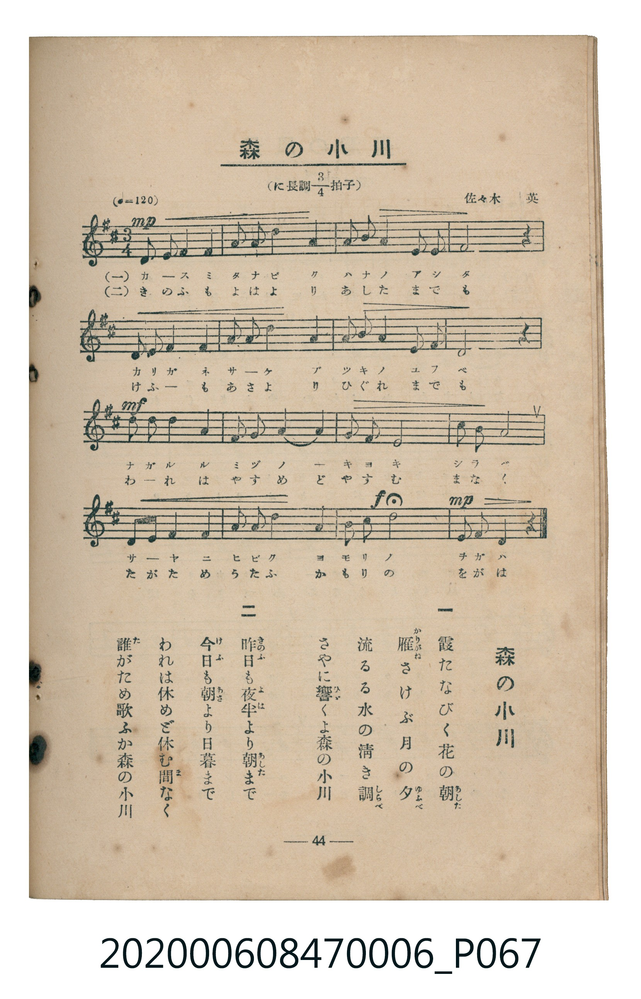

# 森の小川

> Re:Shōka 使用 AI 協助辨識與重建樂譜，可能會有錯誤。歡迎回報。

<audio controls src="mori_no_ogawa.mp3"></audio>

- composer: 佐々木英
- 臺灣教育會公認《新定兒童唱歌》尋常科第六學年用（2020.006.0847.0006）

## 說明

原書資訊與歌詞全文（對應 P067.jpg，書頁 p. 44，參考教材第 6 首）：
速度與表情：（♩=120）
調性與拍號：に長調四分之三拍子（D 大調 3/4 拍）
作曲：佐々木英


## 歌詞

```text
一
霞（かすみ）たなびく花の朝（あした）
雁（かりがね）さけぶ月の夕（ゆふべ）
流るる水の清き調（しらべ）
さやに響（ひゞ）くよ森の小川

二
昨日（きのふ）も夜半（よは）より朝（あした）まで
今日（けふ）も朝（あさ）より日暮まで
われは休めど休む間（ま）なく
誰（た）がため歌ふか森の小川
```

## ABC

```abc
X:1
T:森の小川
M:3/4
L:1/16
Q:1/4=120
K:D
V:V1 name="Piano" snm="Pia"
[V:V1]
!mp! A,2 D2 E2 F6 | A2 F2 E2 D6 | B,2 D2 B,8 | A,2 F,2 A,4 z4 |
w: 1.~か _ す み | た な び く | は な の | あ し た
w: 2.~き の ふ も | よ は よ り | あ し た | ま で も
A,2 D2 E2 F6 | A2 F2 E2 D6 | B,2 D2 B,8 | A,2 E,2 D,4 z4 |
w: 1.~か り が ね | さ _ け ぶ | つ き の | ゆ ふ べ
w: 2.~け ふ _ も | あ さ よ り | ひ ぐ れ | ま で も
!mf! B,2 B,2 B,2 D6 | E2 E2 E2 F6 | E2 D2 B,8 | E2 F2 A8 |
w: 1.~な が る る | み づ の _ | き よ き | し ら べ
w: 2.~わ _ れ は | や す め ど | や す む | ま な く
A,2 D2 E2 F6 | A2 F2 E2 D6 | !f! B,2 E2 d8 | !mp! A2 F2 D4 z4 |
w: 1.~さ _ や に | ひ び く よ | も り の | を が は
w: 2.~た が た め | う た ふ か | も り の | を が は
```

## TMD 檔案連結

- [主旋律 TMD 檔案](mori_no_ogawa.tmd) [[在 TMD Studio 編輯](https://tmdlang.github.io/Tmd-TS/#tmd=s7IKdvYPcrWy4qpTUCpJTLdSSM7PyUlNLsnMz7MqzsjMK0nNjM_KTMmPL87Iz05Ugisry88pzU21Si9KTEmNN4s3MjAyiDcwMIs3sDAxBzIMzBBKi_NLi5JTrYqTM_Lzc-JLUitKkvLzsxHyBUX5Zal5iXlANQVFIBtTwIoQClLLMlNSQdKpKZkl-UWZiTlI7kgtKga7FWxJfElRYl5xclFmAcgDCFUlGalAx-YllpQWpSJEgUalZ-ZZlSRmAj0H8mB5YnxuYmZeTmJeihKXlpbCs8XrHjeue7qh_-n2uQpaWlyKtgqGRgZc9rYKLlw2xvomdiCjkvNzC_KLU4usFJ7snfC4ofXZnBUvujeCbXnRvut54-JnU2e-aNr0bE7z09Y1L1b1Pm7oejZtw9N1s562Tnq-eunTKRufre153ND9dEP30x07ni-f-HzNmqeta5-u3fF055bnU1a839MBCl09YJjqgUIXyDAwe7-nU4mLS19LwZZagEtBQeFp3_xns3e82Nz-YkXXi452oLterJz3tHXFs2ntQFc83dD7rL1TIcDAzFwvqyD9_Z4eoOKXCxoVCvQUTEyA3Kf9zS8amoHefTZ3AtATCmYKL5dNA7r0_Z5ZINNfNsx_umsZ0NwXC1c8a24FigINfTRzpS0wTIGqQEperNr_rGE5yOru3hcz5wOVPG5c_XLqdqD409mzn3a0PdnZ_WRHJ1D26doJQN0uCk-XLAdKKgAjQwEoCjXmyd45z2ZvAupGjhEusMyOBrBT5swD6n7c2P24cebjxv1AbY8b5z9uXPW4cfPjxv4XXRuB0f5szlywmqbHjdOBslCjX85uhOps6nrc2PO4cS1Y89THjRMfN257Ngcote7pkqkgNU1tjxu3Pm7cCdX5bGvj4yagtu5nG7aAjN_R-rixF-h2sHHTHzcBTYEpBZnX1ALy-nyI9KbHTUAHA1X0P27qQE6VEE_t6gFbMGPFs-lLwep7gQqAloO0NDU9XTLnaW8X2EVAqfVgQSC7C9ODjxv3PW5cDjZydxfMLKC_oAYhaQB6EGbK9KXPZgEtg-l83AR0IzBc1j_ZM_FxU-PjxpVgRsPLaZPBmveB7QGGdD8kwjeARSG2A7XNB-oB5QdQyHWj-BSomvJUDgUKWvpcXL7A_O-X75-eWJ5oFZCZmJfvUGNQUw2yR8HGQssOzMCWwxSAaRuYjl4s7FHQMFEAuu75-gYdeLbQxKIBaBvUMA2gRk0rYCCtVnjcvAdI7wTS8xVqgKz9QFYXEE8GsteDRJr7oSJ9YPlFQLwdrA7ZuF09IOMae4F4HRBvBSpoAivvAPLWQ-imLpBIYxMQTwdisHWN-4B4OVg11LgahercgloF03gFQwUjBWMFXSCsUTAFsoyAIhCeGUgSSIB4YNl4BeN4EKmrYAASABvkYwgyvxvIB-YuIN4PVQyyGRjzQLwZiPvhokBXgkXXwY1FdquuAsh0qMlGIDlUv0J1oPkXmzkwMYTPYWbjj-pdPZRHNdB_TWuAdC_YrUCXgyN_I5CeBo7qFiBvLSyqm5cB8VQgnoktqidCvA42ABzVYE8ClSNF9SYgngDk9eCKalJj2QgohD2WQVYCcy4Qr4WH8FRw3IMcug0utgQec_CYaGqDeKVxJ5ZYhngTaA4ijtE8ChNFeJb8ON7RSVEcg7IpOH5Bcb0aHIfAtN7cCo5RUFSBfAuK3xVgGsQDZuXmlTjiuAmU80HxCwpWcFnQBEwgoMzU1AikV6KINMA9DMpE_cjZOa0WFI0QBItcIzCERTwo0pFiGiRhCuMhRTPIZKBbmkDRDcrYkEAGlliNS9EyLjCKwVmxF0kMmAGbOqHRjGQyKJqBPgVFMcSfsGSB6ld00Qa0aIb4GmYy3mgGtiEoy8rQfNcMTMzN3eBongQvsUGRCxIBltOg7A7NysDECU4Y8HhBzsqg8hDkdSAN9CzIQ6AcARIF5QqwBcAUDMlh68A8oHVgHeuJz8pGCtXAdGAYBw82SDEPVAZShJ6hwVkXHNarUTIYpMgGxS0sPhAOQ2RohPMwMzSqZ2Fmo3qYNLNrubh07RSQqnEFIFeZCwA)]
- [鋼琴伴奏 TMD 檔案](mori_no_ogawa_piano.tmd) [[在 TMD Studio 編輯](https://tmdlang.github.io/Tmd-TS/#tmd=s7IKdvYPcrWy4tLSUni2eN3jxnVPN_Q_3T73_Z6Ol917nk_Y8mTPlqdL-593drzf06mgpcWlaKtgaGTAZW-r4MJlY6xvYsdVp6CUnJ9bkF-cWmSl8GTvhMcNrc_mrHjRvVEJJPWifdfzxsXPps580bTp2Zzmp61rXqzqfdzQ9WzahqfrZj1tnfR89dKnUzY-W9vzuKH76Ybupzt2PF8-8fmaNU9b1z5du-Ppzi3Pp6wAusbIwMhAz8DATM_AwsQcyDAwAzpIiYvLN78o0y_fPz2xPNEqIDMxLz_Iw6HGoKaaSwEIbCy07MAMfS0FW3SgALTkyY6GFwt7FDRMFIDefr6-QUchwMDMXC-rIF0TiwYtfbBhNQrVuQW1CqbxCoYKRgrGCrpAWKNgCmQZAUUgPDOQJJAA8cCy8QrG8SBSV8EAJAA2yMewRuFxYzeQ_7hxJhDvhyp-3DgfiFcB8WYg7oeLroeKroMb-7ixCYing3XoKoBMh5psBJLrBat93LhV4XFTE0xHUwfEJBDd1IXVHJjYPiBeDtULMRt_YO7qIScwSQ1HI6AQ9nAE-edxYw8Qr4X7YSo4dCcC8Ta42BJ42MD92tQGCafGnVjCEaR7K8gcRCiCw2sqRihuAuIJQJEeCkJxRyd5STKtFhRQEAQLPiMwhAUtKFiRwhIkYQrjIQUkKIkBA7EJFKCgxAnxxn4gXoqW-ICBCE5OvUhiwETU1AkNSCSTQQHZBErKoMABJUBYwLdAEn9TI5BeiSHagBaQILdBMgTBgHw6ezYtkqORQjUwpA3j4A6DFAZAZSBF6IkSnPzAvlmNkkggGRsUejAfAxMUOPkiJ8pJ0OQMCi30RAkqIkByQBoYdjCzQckYJANKyvC4I9LsWiylqQ9yaWoCLU1rQBkw2jAWjNE4JvFAnkk8kAsi4JIGULeTotUUyAcqQGg1Aykwi88FqgCTwCQMFDAC8UEEdhOiTUF8EEGRC4CBo2ungBQ-0T5ALehCRmAhZS4A)]

## 分析

```text
================================================================================
📊 TMD Song Profile: [ 森の小川 ]
================================================================================
⏱  Duration:       0:24 (24.0s), 16 measures total
🎼 Key & Tempo:    首調基準 D, != 120.0 BPM, <3/4>
   - 分析範圍：      由實際發聲的音符與和弦推測調性；播放脈絡另行呈現
🎤 人聲音域:    D3 (MIDI 50) – D5 (MIDI 74) [跨度: 24 個半音 / 2.0 個八度, 難度: difficult]
   - 最低音:  D3 in [MoriNoOgawa #1 @ m.8, 0:11]
   - 最高音: D5 in [MoriNoOgawa #1 @ m.15, 0:21]
   - 適合: contralto, tenor, bass
🏛  結構:      MoriNoOgawa (24.0s)
⚡ 編曲密度:        Peak 1 軌道同時演奏
🗝  調性診斷：       D 大調（純淨自然大調，未偵測到可信轉調）
   - 風格氣質:    純淨自然大調（陽光明朗、易唱易記，無明顯調外色彩）
   - 轉調歷程:    全曲維持單一推測調性（未偵測到可信轉調）
   - 核心骨幹音:  D, F#, B, A, E
   - 調性數值:    D 大調 [相關度: 0.85, 穩定度: Moderate, 自然音純度: 100.0%]
   - 候選調性 (K-S): D 大調 (0.85), B 小調 (0.79), A 大調 (0.60)
   - 五度圈歷程:   +2
   - 各段落調性細節:
     • [MoriNoOgawa #1]: D 大調 (r: 0.85, 自然音純度: 100.0%)

  [ 五度圈游移軌跡 ]
               C  
         F            G  
      Bb              [D ]*
      Eb               A  
         Ab           E  
            Db       B  
               F# 
     (* = active key center)

  [ 十二半音累積音高分佈 ]
     C  :                            0.0%
     C# :                            0.0%
     D  : ████████████████████████  28.9%
     D# :                            0.0%
     E  : ████████████              14.4%
     F  :                            0.0%
     F# : █████████████████         20.0%
     G  :                            0.0%
     G# :                            0.0%
     A  : ██████████████            16.7%
     A# :                            0.0%
     B  : █████████████████         20.0%
--------------------------------------------------------------------------------
Assignment 軌道音域：
  - Piano         : D3 – D5 (24 個半音 / 2.0 個八度, 56 個音符)
================================================================================
```


## 原書掃描頁




