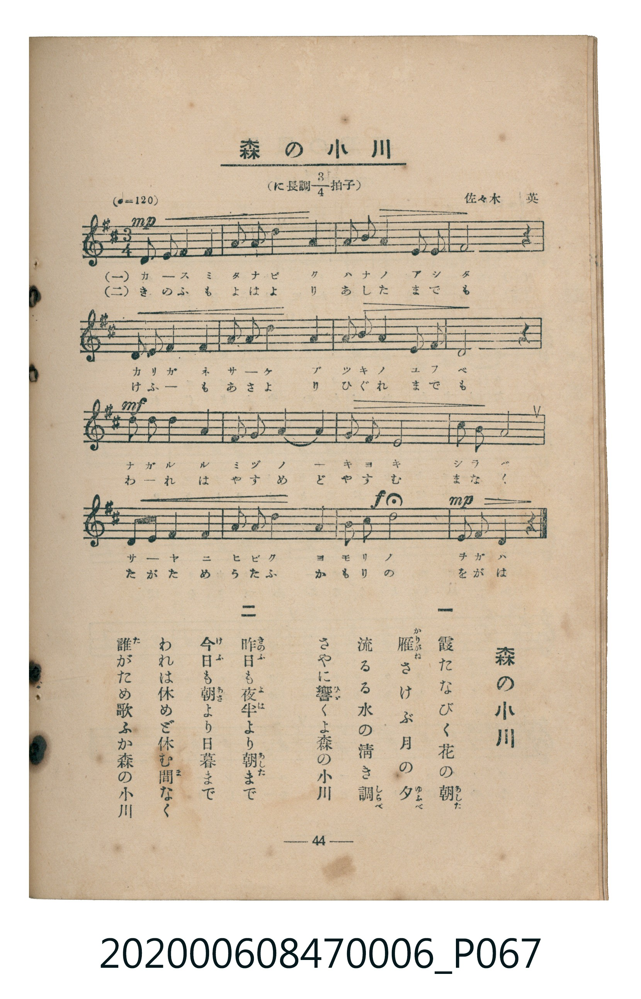

# 森の小川

<audio controls src="mori_no_ogawa.mp3"></audio>

- composer: 佐々木英
- 臺灣教育會公認《新定兒童唱歌》尋常科第六學年用（2020.006.0847.0006）

## 說明

原書資訊與歌詞全文（對應 P067.jpg，書頁 p. 44，參考教材第 6 首）：
速度與表情：（♩=120）
調性與拍號：に長調四分之三拍子（D 大調 3/4 拍）
作曲：佐々木英

## 歌詞

```text
一
霞（かすみ）たなびく花の朝（あした）
雁（かりがね）さけぶ月の夕（ゆふべ）
流るる水の清き調（しらべ）
さやに響（ひゞ）くよ森の小川

二
昨日（きのふ）も夜半（よは）より朝（あした）まで
今日（けふ）も朝（あさ）より日暮まで
われは休めど休む間（ま）なく
誰（た）がため歌ふか森の小川
```

## ABC

```abc
X:1
T:森の小川
M:3/4
L:1/16
Q:1/4=120
K:D
V:V1 name="Piano" snm="Pia"
[V:V1]
!mp! A,2 D2 E2 F6 | A2 F2 E2 D6 | B,2 D2 B,8 | A,2 F,2 A,4 z4 |
A,2 D2 E2 F6 | A2 F2 E2 D6 | B,2 D2 B,8 | A,2 E,2 D,4 z4 |
!mf! B,2 B,2 B,2 D6 | E2 E2 E2 F6 | E2 D2 B,8 | E2 F2 A8 |
A,2 D2 E2 F6 | A2 F2 E2 D6 | !f! B,2 E2 d8 | !mp! A2 F2 D4 z4 |
```

## TMD 檔案連結

- [主旋律 TMD 檔案](mori_no_ogawa.tmd) [[在 TMD Studio 編輯](https://tmdlang.github.io/Tmd-TS/#tmd=s7IKdvYPcrWy4tLSUni2eN3jxnVPN_Q_3T5XQUuLS9FWwdDIgMveVsGFy8ZY38SOq05BKTk_tyC_OLXISuHJ3gmPG1qfzVnxonujEkjqRfuu542Ln02d-aJp07M5zU9b17xY1fu4oevZtA1P18162jrp-eqlT6dsfLa253FD99MN3U937Hi-fOLzNWuetq59unbH051bnk9Z8X5Ph5GBkYGegYGZnoGFiTmQYWD2fk-nEheXvpaCLbUAl4KCwtO--c9m73ixuf3Fiq4XHe1Ad71YOe9p64pn09qBrni6ofdZe6dCgIGZuV5WQfr7PT1AxS8XNCoU6CmYmAC5T_ubXzQ0A737bO4EoCcUzBReLpsGdOn7PbNApr9smP901zKguS8WrnjW3AoUBRr6aOZKW2CYAlWBlLxYtf9Zw3KQ1d29L2bOByp53Lj65dTtQPGns2c_7Wh7srP7yY5OoOzTtROAul0Uni5ZDpRUAEaGAlAUasyTvXOezd4E1I0cI1xgmR0NYKfMmQfU_bix-3HjzMeN-4HaHjfOf9y46nHj5seN_S-6NgKj_dmcuWA1TY8bpwNloUa_nN0I1dnU9bix53HjWrDmqY8bJz5u3PZsDlBq3dMlU0FqmtoeN2593LgTqvPZ1sbHTUBt3c82bAEZv6P1cWMv0O1g46Y_bgKaAlMKMq-pBeT1-RDpTY-bgA4Gquh_3NSBnCohntrVA7Zgxopn05eC1fcCFQAtB2lpanq6ZM7T3i6wi4BS68GCQHYXpgcfN-573LgcbOTuLphZQH9BDULSAPQgzJTpS5_NAloG0_m4CehGYLisf7Jn4uOmxseNK8GMhpfTJoM17wPbAwzpfkiEbwCLQmwHapsP1APKD6CQ60bxKVA15akcChS09Lm4fPOLMv3y_dMTyxOtAjIT8_IdagxqFKpBFinYWGjZgRnYspgCMHEDE9KLhT0KGiYKQOc9X9-gA88Xmlg0AK2DGqYB1KhpBQyl1QqPm_cA6Z1Aer5CDZC1H8jqAuLJQPZ6kEhzP1SkDyy_CIi3g9UhG7erB2RcYy8QrwPirUAFTWDlHUDeegjd1AUSaWwC4ulADLaucR8QLwerhhoH9HtuQa2CabyCoYKRgrGCLhDWKJgCWUZAEQjPDCQJJEA8sGy8gnE8iNRVMAAJgNMj7kDb1UN5oK0C0muAdC_Yl0D_goNxI5CeBg60FiBvLSzQmpcB8VQgnokt0CZCAgxsADjQwEEEVI4UaJuAeAKQ14Mr0EgNLyOgELHhtaOTovACJR5wWIHCbTU4POYDcSs4dEDeBoUgKKxWgGkQD5jAmlfiCK8mUHoEhVUPOGmBlAMDu3EmkG4E0itRRBrg4QWMsMZ-5ESWVgsKEgiCBZQRGMICERSASKEGkjCF8fAHGbCaoCyJQdND8xIg7gYH2SR4ngQFFEgEmBNByRCaxIApBBzIcD8iJzFgeDeCggtIAwMJFCRtUFGgRY1gC4CJCZTYQPkXxANaB9axnvgkZqRQDQxTwzh4gEEyMlAZSBEkodVycenaKSCVeQpArjIXFwA)]
- [鋼琴伴奏 TMD 檔案](mori_no_ogawa_piano.tmd) [[在 TMD Studio 編輯](https://tmdlang.github.io/Tmd-TS/#tmd=s7IKdvYPcrWy4tLSUni2eN3jxnVPN_Q_3T73_Z6Ol917nk_Y8mTPlqdL-593drzf06mgpcWlaKtgaGTAZW-r4MJlY6xvYsdVp6CUnJ9bkF-cWmSl8GTvhMcNrc_mrHjRvVEJJPWifdfzxsXPps580bTp2Zzmp61rXqzqfdzQ9WzahqfrZj1tnfR89dKnUzY-W9vzuKH76Ybupzt2PF8-8fmaNU9b1z5du-Ppzi3Pp6wAusbIwMhAz8DATM_AwsQcyDAwAzpIiYvLN78o0y_fPz2xPNEqIDMxLz_Iw6HGoEahmksBCGwstOzADH0tBVt0oAC05cmOhhcLexQ0TBSA_n6-vkFHIcDAzFwvqyBdE4sGLX2wYUDTcwtqFUzjFQwVjBSMFXSBsEbBFMgyAopAeGYgSSAB4oFl4xWM40GkroIBSIALv7N29ZDjLFJdZAQUItZFOzrJC6i0WpClEARzihEYwpwJciKSu0ASpjAefkc9nT2bFsFkpFANdLVhHNxJkOgGKgMpggRWLZak54OS9EygSa8GFMbRhrFgjMYxiQfyTOKBXBABlzQAWkCqVlMgH6gAodUMpMAsPheoAkwCQxYoYATigwjsJkSbgvgggiIXAENH104BKYAUMLnKXFwA)]

## 分析

```text
================================================================================
📊 TMD Song Profile: [ 森の小川 ]
================================================================================
⏱  Duration:       0:24 (24.0s), 16 measures total
🎼 Key & Tempo:    首調基準 D, != 120.0 BPM, <3/4>
   - 分析範圍：      由實際發聲的音符與和弦推測調性；播放脈絡另行呈現
🎤 人聲音域:    D3 (MIDI 50) – D5 (MIDI 74) [跨度: 24 個半音 / 2.0 個八度, 難度: difficult]
   - 最低音:  D3 in [MoriNoOgawa #1 @ m.8, 0:11]
   - 最高音: D5 in [MoriNoOgawa #1 @ m.15, 0:21]
   - 適合: contralto, tenor, bass
🏛  結構:      MoriNoOgawa (24.0s)
⚡ 編曲密度:        Peak 1 軌道同時演奏
🗝  調性診斷：       D 大調（純淨自然大調，未偵測到可信轉調）
   - 風格氣質:    純淨自然大調（陽光明朗、易唱易記，無明顯調外色彩）
   - 轉調歷程:    全曲維持單一推測調性（未偵測到可信轉調）
   - 核心骨幹音:  D, F#, B, A, E
   - 調性數值:    D 大調 [相關度: 0.85, 穩定度: Moderate, 自然音純度: 100.0%]
   - 候選調性 (K-S): D 大調 (0.85), B 小調 (0.79), A 大調 (0.60)
   - 五度圈歷程:   +2
   - 各段落調性細節:
     • [MoriNoOgawa #1]: D 大調 (r: 0.85, 自然音純度: 100.0%)

  [ 五度圈游移軌跡 ]
               C  
         F            G  
      Bb              [D ]*
      Eb               A  
         Ab           E  
            Db       B  
               F# 
     (* = active key center)

  [ 十二半音累積音高分佈 ]
     C  :                            0.0%
     C# :                            0.0%
     D  : ████████████████████████  28.9%
     D# :                            0.0%
     E  : ████████████              14.4%
     F  :                            0.0%
     F# : █████████████████         20.0%
     G  :                            0.0%
     G# :                            0.0%
     A  : ██████████████            16.7%
     A# :                            0.0%
     B  : █████████████████         20.0%
--------------------------------------------------------------------------------
Assignment 軌道音域：
  - Piano         : D3 – D5 (24 個半音 / 2.0 個八度, 56 個音符)
================================================================================
```


## 原書掃描頁




