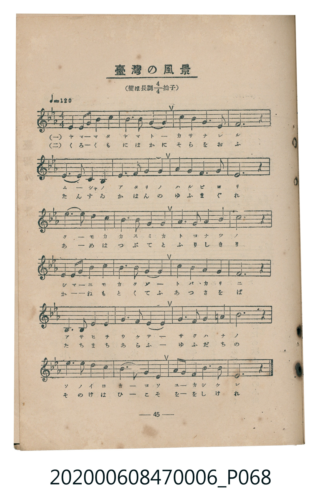
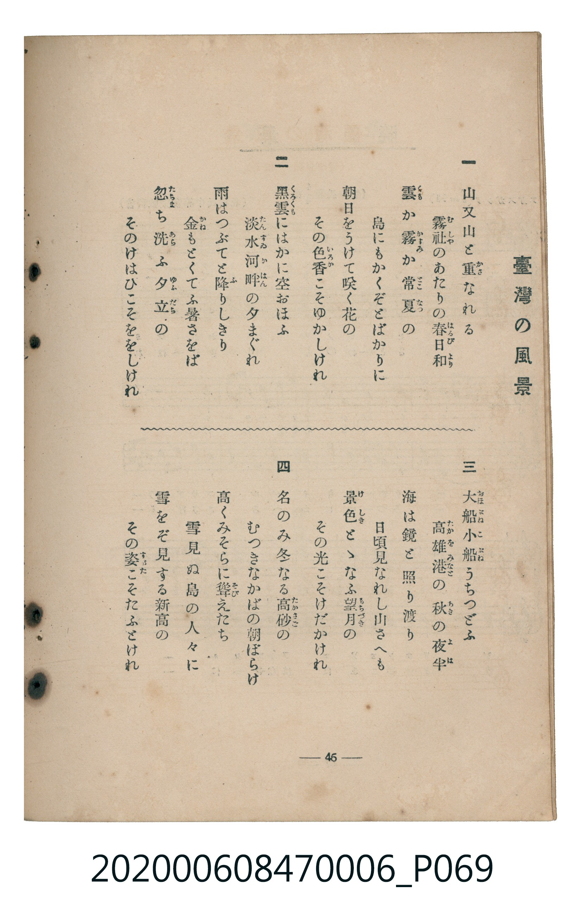

# 臺灣の風景

> Re:Shoka 使用 AI 協助辨識與重建樂譜，可能會有錯誤。歡迎回報。

<audio controls src="taiwan_no_fukei.mp3"></audio>

- 臺灣教育會公認《新定兒童唱歌》尋常科第六學年用（2020.006.0847.0006）

## 說明

原書資訊與歌詞全文（對應 P068.jpg – P069.jpg，書頁 pp. 45–46，參考教材第 7 首）：
調性與拍號：變ほ長調四分之四拍子（Eb 大調 4/4 拍），♩=120

## 歌詞

```text
一　山又山と重（かさ）なれる
霧社（むしや）のあたりの春日和（はるびより）
雲（くも）か霞（かすみ）か常夏（とこなつ）の
島にもかくぞとばかりに
朝日をうけて咲く花の
その色香（いろか）こそゆかしけれ

二　黑雲（くろくも）にはかに空おほふ
淡水河畔（たんすゐかはん）の夕まぐれ
雨はつぶてと降（ふ）りしきり
金（かね）もとくてふ暑さをば
忽（たちま）ち洗（あら）ふ夕立（ゆふだち）の
そのけはひこそををしけれ

三　大船小船（おほぶねこぶね）うちつどふ
高雄港（たかをみなと）の秋（あき）の夜半（よは）
海は鏡と照り渡り
日頃見なれし山さへも
景色（けしき）とゝなふ望月（もちづき）の
その光こそけだかけれ

四　名のみ冬なる高砂（たかさご）の
むつきなかばの朝ばらけ
高くみそらに聳（そび）えたち
雪見ぬ島の人々に
雪をぞ見する新高の
その姿（すがた）こそたふとけれ
```

## ABC

```abc
X:1
T:臺灣の風景
M:4/4
L:1/16
Q:1/4=120
K:Eb
V:V1 name="Piano" snm="Pia"
[V:V1]
G4 A2 G2 F4 E4 | B6 c2 B4 G4 | A4 c4 G6 A2 | F12 z4 |
E6 D2 C4 E4 | G6 A2 G4 F4 | G4 G4 F6 G2 | E12 z4 |
e6 d2 c4 B4 | A6 c2 B4 G4 | F6 F2 G4 =A4 | B12 z4 |
G4 A2 G2 F4 E4 | B6 c2 B4 G4 | A4 c4 G4 A4 | F12 z4 |
B,6 C2 D4 E4 | G6 A2 G4 F4 | G6 A2 G4 =A4 | B12 z4 |
e6 d2 c4 B4 | A4 c4 B4 G4 | A2 G2 F4 F4 B4 | E12 z4 |
```

## TMD 檔案連結

- [主旋律 TMD 檔案](taiwan_no_fukei.tmd) [[在 TMD Studio 編輯](https://tmdlang.github.io/Tmd-TS/#tmd=s7IKdvYPcrWy4qpTUCpJTLdSSM7PyUlNLsnMz7MqzsjMK0nNjM_KTMmPL87Iz05Ugisry88pzU21Si9KTEmNN4s3MjAyiDcwMIs3sDAxBzIMzBBKi_NLi5JTrYqTM_Lzc-JLUitKkvLzsxHyBUX5Zal5iXlANQVFIBtTwIoQClLLMlNSQdKpKZkl-UWZiTlI7kgtKga7FWxJfElRYl5xclFmAcgDCFUlGalAx-YllpQWpaKLFuQkJgMFtbQUXrTvet64-HHjupeLVjybuV5BS4tL0VbB0MiAy95WwVWHy8ZE38QOpBui8NnUmS-aNj2b0_y0dc2LVb2PG7qeTdvwdN2sp62Tnq9e-nTKxmdrex43dD_d0P10x47nyyc-X7Pmaevap2t3PN255fmUFe_3dIBCTQ8YVnqgUAMyDMze7-lU4uLS11KwpRbgUlBQeNo3_9nsHS82t79Y0fWiox3orhcr5z1tXfFsWjvQFU839D5r71QIMDCz0MsqSFd41DAZxLEEcd7v6QHqfLmgUaGgQE_BxBQoZwJ0ZM_T_uYXDc3AEHg2dwLQXwrmCi-XTQM6_v2eWSALX6za_6xhOciq7t4XM-cDRV-s63rcuPvl1O1AqaezZz_taHuysxvIACp4unYC0BWuSQpPlywHyioAQ1kBKAw2refRzJW2oBgAmfpkR8PjhoanGzc-7e8Ako8bV7xsByrreNzY_bhxKlD948ZVj5t6Hjd1g1S_nLP8-ZJ9IOmmhseN0x83tYBVrHvc2PS4cf7jJqB71j2bsfTZ9KVPJ_WATVkP1Pm4cfPjJqCWLqBisCmzN4Hl-h83NYH1d7-cMw9m58zHjfshgsAYfrqkHyy-4nHjZJBDGpdA7ANHwOZtjxtXA40Aa-t_3DgPrG4DiAtyyGqQomdz5gId87hp0uPGtseNEx83Lns6aRNQ9YsuoFfBxjxunAtkvejc9HLZTLBdLY-beoFmgC0CWjr3cRNQJ9CG6SD9TT2QUNsFTIUNL3dPRPIKUBPcQ6tBHgdpWv185a7HjaBoety4Feyg7QufbdjybNPm51OngHUCQw1oy8zHTRPAGoDhNRnix6dLpj5u3Pe4cQLIUnCoAX0HNHXJ40agx5eBYmomJKa2gjSAvAx0Yi-QAVbdPhEWomvB0sBgAuoHBhNQ59Zns4BBMRUcLBvAYbl_L9QxjQuBloIdsPDZlulgwabHTcBUAxTZCnTS89XAkAHGJTBMtj5uXABUhogRSFCCgxnoTmAwQ4JvEtgelODb0QlKdMCk2bHz6YZ-IAm2CBJMQM-tBWsFMcCGA-0Cugro75XQQHy5esbL2S3PdqyHORoY40Ar9oOTCLAQADno-XKwQ0EJE5TswQE652kvMA0CXQ9KmNDE-GzrdiDnZT_QhhXPW5cDg-_ZjoXQQAQmnZcLml8sAwYiOBM0TgdnEWC87AAGKFjFzPXApAO2COhrUPiD7VrxuAkYFEDHbH02Z_azOR1gS4EuAVqyFO4eRJA9bYWlNZApwEAFWggPLGCGBgXWBGD6Aobt_qdta8Cu6QYGwvMFwOQGCwGQs4BJCm4yKIcCwwyoDegOoDQwY6wDZgcQowmoaCI0IMFpAhhywIgCJdwXjZvBRgLVARlAEWiqgKTAVeCwWAPOeuue7Nr1uKEVmtGAcuA4mAdWAUzO3cCCG2w8sj-XA7M20EBgHgcGJrAIg3sbaAUwOQETKNjbQA2UF9JQoKClz8UVkphZnpjnl-9Wmp2aaRWQmZiX71BjUKNQDbJKwcZCyw7MwFZHKACLYmAh-WJhj4KGiQIwtT5f36ADL9g1sWgAWgg1TAOoUdNK4XHzEiCe97h5D4gCxsx-hRqYIBB3gCSAAk2rgXgrUKALiNeAlaxGMWxXD8iwxn6gsl6wYWBmE0hlI1Bv43ogBpU5YIG5QKlOIJ4EZHeBRbbCDKtRMFbQVTABkkZA2hCIaxRMgaSughmYBsnWAOVBfAgPpLoGrBoGDUBqwOkTd6jt6qEs1BaAPdm0_XHzYiCvDxxGi8DB97h5FUykGRgGwHB63DwZiFeARVZhCzVQOQukZgL1TwAHRzckxMCi68Bmt4EDCVj-ATFYTVMPIshAwaSrYB6vYBYPDzRY0IBoUOBARGA8EAumj_hA29FJUaA1rYckM1A4gRMCOFXtBIrMh4k0dwBZm6HprAUs0octxJogwd8IDidQiAETbOM2IF4GxOCQBoVWE9CUxulA3Au2rQspxOIgQQZORaB0BUlTqKkMElBGkBSpjpQUiQ4xYPlIWYhtR2ROYJoAhhws1ECpYx80c4ICrXkCRAKYwEAi3dgCDWTCHmDFBc6YsGACJlFwoG2FGtYIkgKF5lRwBgWJbCA_c4LYZGTOKZSFGiiBgQorYPnSvAkcZEAfNm0E8tpg5RkodQDDEJxDwUUQ9nQGTJiNC6HZbiEseEBlFzy84DlzAVzJOkR4mYIyJDA44kG5E3_WhImQmdJa11IWZnvBQfC4CVTyr4UkM0geA-ZGoCQohJZBBEDJD5gugeEJElyDLdiABTwwFIA1Jjx_boJUCqACbS7Y9EkQw0BVACiHTsQo07DnUBgPltQgSRGEIWowi7RaLi5dOwWUWlYBKKDMxQUA)]
- [鋼琴伴奏 TMD 檔案](taiwan_no_fukei_piano.tmd) [[在 TMD Studio 編輯](https://tmdlang.github.io/Tmd-TS/#tmd=s7IKdvYPcrWy4tLSUnjRvut54-LHjeteLlrxbOb693s6XnbveT5hy5M9W54u7X_e2fF-T6eClhaXoq2CoZEBl72tgqsOl42JvokdV52CEkT3s6kzXzRtejan-Wnrmhereh83dD2btuHpullPWyc9X7306ZSNz9b2PG7ofrqh--mOHc-XT3y-Zs3T1rVP1-54unPL8ykrgHYaGRgZ6BkYmOkZWJiYAxkGZkBrlbi4QhIzyxPz_PLdSrNTM60CMhPz8oM8HGoMahSquRSAwMZCyw7M0NdSsEUHCkB7nuxoeLGwR0HDROHphv7n6xt0FAIMzCz0sgrSNbFo0NIHG1ajYKygq2ACJI2AtCEQ1yiYAkldBTMwDZKtAcqD-BAeSHUNWDUMGoDUcOF3264ectwGco-ugnm8glk83HUwN4BokCsgIjAeiAXTR7zrdnSS5bo4iPPAQQMKLEhAoQYdxFFGkGBWRwpfol33dPZsesQriE1GvE4hx22moOgEWh0Pilv8EQsTITPsWtdSMWZhPFjgQQIXhCFqMJNdLdZ87YOSr02g-RqoP14h2jAWRmHyTYAMEyS-aTyQZRofC2YYAK1DMcYMJGsWn4tkElwDHhEghWEU1GJMFxgBGUaxMIqQiyj1GFwY3SBMXxDpImMgZQwOIaw-A8rgDCBg1OraKaDErgI2AWUuLgA)]

## 分析

```text
================================================================================
📊 TMD Song Profile: [ 臺灣の風景 ]
================================================================================
⏱  Duration:       0:48 (48.0s), 24 measures total
🎼 Key & Tempo:    首調基準 E,, != 120.0 BPM, <4/4>
   - 分析範圍：      由實際發聲的音符與和弦推測調性；播放脈絡另行呈現
🎤 人聲音域:    A#3 (MIDI 58) – D#5 (MIDI 75) [跨度: 17 個半音 / 1.4 個八度, 難度: challenging]
   - 最低音:  A#3 in [TaiwanNoFukei #1 @ m.17, 0:32]
   - 最高音: D#5 in [TaiwanNoFukei #1 @ m.9, 0:16]
   - 適合: soprano, mezzo-soprano, contralto, tenor, baritone, bass
🏛  結構:      TaiwanNoFukei (48.0s)
⚡ 編曲密度:        Peak 1 軌道同時演奏
🗝  調性診斷：       D# 大調（純淨自然大調，未偵測到可信轉調）
   - 風格氣質:    純淨自然大調（陽光明朗、易唱易記，無明顯調外色彩）
   - 轉調歷程:    全曲維持單一推測調性（未偵測到可信轉調）
   - 核心骨幹音:  G, A#, F, D#, G#
   - 調性數值:    D# 大調 [相關度: 0.82, 穩定度: Moderate, 自然音純度: 97.8%]
   - 候選調性 (K-S): D# 大調 (0.82), G 小調 (0.71), A# 大調 (0.70)
   - 五度圈歷程:   -3
   - 各段落調性細節:
     • [TaiwanNoFukei #1]: D# 大調 (r: 0.82, 自然音純度: 97.8%, 調外音: A)

  [ 五度圈游移軌跡 ]
               C  
         F            G  
      Bb               D  
     [Eb]*              A  
         Ab           E  
            Db       B  
               F# 
     (* = active key center)

  [ 十二半音累積音高分佈 ]
     C  : █████████                  8.9%
     C# :                            0.0%
     D  : ███                        2.8%
     D# : █████████████████         16.1%
     E  :                            0.0%
     F  : ██████████████████        17.2%
     F# :                            0.0%
     G  : ████████████████████████  23.3%
     G# : ██████████                10.0%
     A  : ██                         2.2%
     A# : ████████████████████      19.4%
     B  :                            0.0%
--------------------------------------------------------------------------------
Assignment 軌道音域：
  - Piano         : A#3 – D#5 (17 個半音 / 1.4 個八度, 81 個音符)
================================================================================
```


## 原書掃描頁






