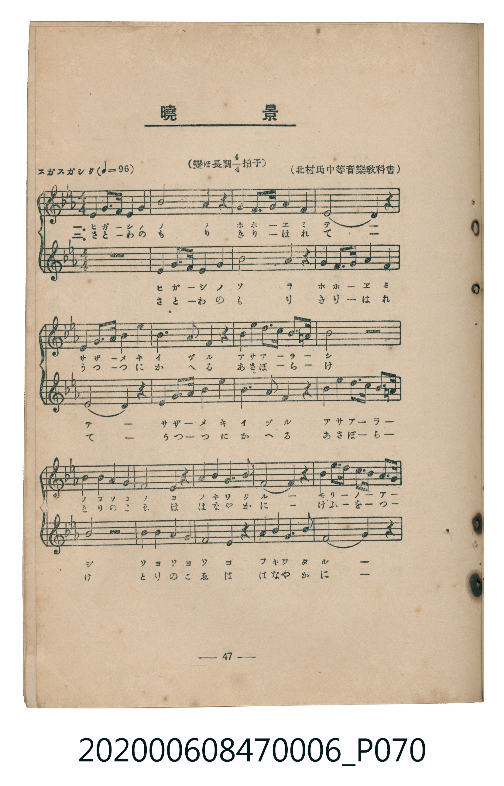
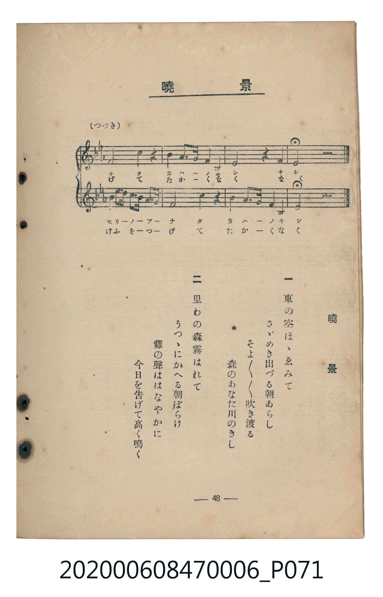

# 曉景

> Re:Shoka 使用 AI 協助辨識與重建樂譜，可能會有錯誤。歡迎回報。

<audio controls src="gyokei.mp3"></audio>

- 臺灣教育會公認《新定兒童唱歌》尋常科第六學年用（2020.006.0847.0006）

## 說明

原書資訊與歌詞全文（對應 P070.jpg – P071.jpg，書頁 pp. 47–48，參考教材第 8 首）：
速度與表情：スガスガシク（♩=96）
調性與拍號：變ほ長調四分之四拍子（原譜標示「變ほ長調」，調號記為降B、降E二降記號之 B♭ 大調 4/4 拍，二部輪唱）
出處：（北村氏中等音樂教科書）

## 跨冊／重複收錄參照

> 同曲（〈曉景〉；收錄於《新定兒童唱歌》六年級與《唱歌帖》P090）

- **[同曲]** 楊金土手抄《唱歌帖》第 2 冊・II（2020.006.0843）：[**〈曉景（二部輪唱）〉**](../../../shokacho/vol_02/p090_gyokei/index.md)（`E,` / `4/4` — [原始 TMD](../../../shokacho/vol_02/p090_gyokei/gyokei.tmd)）
- 總表：[跨冊重複與同名歌曲總索引](../../../duplicate_songs.md)

## 歌詞

```text
一
東の空ほゝゑみて
さゞめき出づる朝あらし
そよ／＼吹き渡る
森のあなた川のきし

二
里わの森霧はれて
うつゝにかへる朝ぼらけ
雞の聲ははなやかに
今日を告げて高く鳴く
```

## ABC

```abc
X:1
T:曉景
M:4/4
L:1/16
Q:1/4=96
K:Bb
V:V1 name="Piano" snm="Pia"
[V:V1]
F4 B3 c d4 B4 | G8 F4 z4 | F4 B3 c d4 e4 | c8 F4 z4 |
c4 c3 d e4 c4 | d3 e f4 d4 z4 | e4 e3 d c7 d | B8 z4 z4 |
f4 e4 d4 c4 | B4 z4 e2 e2 d2 c2 | d8 B4 z4 | g3 g f3 f e3 e d3 d |
c8 f4 z4 | B4 e2 e2 d4 c4 | B8 z4 F4 | B8 z4 z4 |
```

## TMD 檔案連結

- [主旋律 TMD 檔案](gyokei.tmd) [[在 TMD Studio 編輯](https://tmdlang.github.io/Tmd-TS/#tmd=s7IKdvYPcrWy4qpTUCpJTLdSSM7PyUlNLsnMz7MqzsjMK0nNjM_KTMmPL87Iz05Ugisry88pzU21Si9KTEmNN4s3MjAyiDcwMIs3sDAxBzIMzBBKi_NLi5JTrYqTM_Lzc-JLUitKkvLzsxHyBUX5Zal5iXlANQVFIBtTwIoQClLLMlNSQdKpKZkl-UWZiTlI7kgtKga7FWxJfElRYl5xclFmAcgDCFUlGalAx-YllpQWpSpxaWkpPJvd-WzmegUtLS5FWwVLMy57WwUnHS4bE30TO5CmF-27njcufjZ15oumTc_mND9tXfNiVe_jhq5n0zY8XTfraeuk56uXPp2y8dnanscN3U83dD_dseP58onP16x52rr26dodT3dueT5lxfs9HaBg0QMGhh4oWIAMA7P3ezqVuLj0tRRsqQW4FBQUnvbNfzZ7x4vN7S9WdL3oaAe668XKeU9bVzyb1g50xdMNvc_aOxUCDMwN9LIK0hUeNUwGcQxBnPd7eoA6Xy5oVCgo0FMwMQfKmVgABZ_2N79oaAaGwLO5E4D-UrBQeLlsGtDx7_fMAln4smH-013LgFa9WLjiWXMrUPRx087HTWtg5PbHTeuBNj-audLWEuRnkJ4Xq_Y_a1gOcl5374uZ84F6Xqzrety4--XU7UCpp7NnP-1oe7KzG8gAKni6dgLI5X3zX6yd82zFzOdLdj1u6EFW_7ihF-hMIANo1IsVM5437Xo5s9fpcUMjkHJ9sqsHSAGFgZJAIxWcHs1cq_B0yXKgcgVgHCsALQBqBqlqXvFizypgVELd-LR914uZU4FOA1neM_3Z3InPNvQ_2bH2-drOl_M3P1vRBAwRYEwDgwykAaTjyY4GEPVs7sbHjeuer9wFdODjprmPmyY-btz_uHEZSO5x49THTfMeNzU-buwFWvC4cenjpu5nc-Y-bmx63NT5uHE6RBFQU8f7Pf3v9-x5OmEnUOmzHQuB6sCGL14HNBykvHHV48b5T7cDtQK5vSCtYDfs6gFHSnvP46Z-oBRQ_cs5yx83rn_c1AN3Q9vjxiUglzWuftzY_bhxB8wNe8BumAg2YPY8oO4XjZtAWkFo1eOmFrDq1WBrdnc9mw50-6SnE4HxMAlo8svVMx439r_cvAVIglRQnpqhQEFLn4vLvTI_OzXTKiAzMS_focagRqEaZIeCjaGZlh2YhS0bKQBTKzBOXizsUdAwUXi6of_5-gYdeNrXxKIBaBXUMA2gRk0rhcfNkxSAqRhI7wHS24F0n0INkLUXyFoJYjXPhmKQ_AogPR8s2gYWQTZuVw_IuMapQAxSBlLeD2SvAxvXBMRdIFZjL5gFlm9cD2T3gEWXIRtXo2Aar6ALhoZg0kjBGIWvC1RiBlMCg3A9BnA1OI0xgSsxImgKONXhDv5dPRQFf9NWIN4GCY_mhUD2WnB4LQHyWoF4NZi3CKoOSIPVrQTTIJnt2KIAGDeNIANAQQykG8GGNHYD8Q6glm4wDxgh4KgCGQeKqk6YkY0TEdEACxwIbQwPNph4DTRATRRMoSKwAEbEAUwPhDZGC3BjoApYnMIgTC-xMbCjk7IYACV1YIpFokEJHJSGgQEEjI_HzaB0uh8suhoWTM2guFgFjY8-aCBC4gdLjICMBSZ6YGZ43DgZyJ4IDmmgsWAMNKapBRxDIFG4FcCYeNwIjHaw0cBcCotPlIyCErqI8EfEECx0YaEJUgnCIJUgVbA4REB0HcC8BqbNoLaZQm0zgeoExiH-GALWcpgxBK6RiSyigEEHCf8mUOAASxVoqINEgPEDzAUIFpbQB4YdsIABheh8SD4Ah2Q_WAQY9igsjLQPg7CQRoQKLJyQQxR72KOnbHghQ0zir-Xi0rVTgNQPCkCWMhcXAA)]
- [鋼琴伴奏 TMD 檔案](gyokei_piano.tmd) [[在 TMD Studio 編輯](https://tmdlang.github.io/Tmd-TS/#tmd=s7IKdvYPcrWy4tLSUng2u_PZzPXv93S87N7zfMKWJ3u2PF3a_7yz4_2eTgUtLS5FWwVLMy57WwUnHS4bE30TO646BaUX7bueNy5-NnXmi6ZNz-Y0P21d82JV7-OGrmfTNjxdN-tp66Tnq5c-nbLx2dqexw3dTzd0P92x4_nyic_XrHnauvbp2h1Pd255PmUF0EojAyMDPQMDMz0DCxNzIMPADGirEheXe2V-dmqmVUBmYl5-kIdDjUGNQjWXAhDYGJpp2YFZ-loKtuhAAWjDkx0NLxb2KGiYKDzd0P98fYOOQoCBuYFeVkG6JhYNWvpgw2oUTOMVdMHQEEwaKRij8HWBSsxgSmAQrscArganMSZwJUYETeHC78FdPeR4EGYthDaGOwgmXgN1qomCKVQE5nSE72B6ILQxmleMgSpgoQWDML3E-m1HJ1mRh-IuhMsRfoO5C-YOkEoQBqkEqYL5HgHRdQDjH0ybQW0zhdpmAtUJ9D1-vz2dPRvTb4ZExxsMwvyKcBfMpch-wu579FiBJz1iIq4WNVv64MyW0DTauOll8wpgbnzW3QvM6YZQXwPz99N9PS8bNj1tXfpizypgIfF-T8_zrROebtj3cm8XqMyYsu3Z3PkI_8McgAvWwDMwPOtBGEbxCsZoQpBcjJmNseVjPKaZwE2DxRExRsIVQRlA4-AGweWA6RDCBErBYwduMVJORHMLUAmaI4AiMOfBfQ-DGJGLsAtuMNxSJLfBDYJnI5AAmAArByuFewEBMfTBXAYtUoEU1AFACuoCIAU1B-QTbEGM4Qm4NWjOgijH4g2c4QFK7Lp2CpD0roDCUubiAgA)]

## 分析

```text
================================================================================
📊 TMD Song Profile: [ 曉景 ]
================================================================================
⏱  Duration:       0:40 (40.0s), 16 measures total
🎼 Key & Tempo:    首調基準 B,, != 96.0 BPM, <4/4>
   - 分析範圍：      由實際發聲的音符與和弦推測調性；播放脈絡另行呈現
🎤 人聲音域:    F4 (MIDI 65) – G5 (MIDI 79) [跨度: 14 個半音 / 1.2 個八度, 難度: moderate]
   - 最低音:  F4 in [Gyokei #1 @ m.1, 0:00]
   - 最高音: G5 in [Gyokei #1 @ m.12, 0:27]
   - 適合: soprano, mezzo-soprano, tenor, baritone
🏛  結構:      Gyokei (40.0s)
⚡ 編曲密度:        Peak 1 軌道同時演奏
🗝  調性診斷：       A# 大調（純淨自然大調，未偵測到可信轉調）
   - 風格氣質:    純淨自然大調（陽光明朗、易唱易記，無明顯調外色彩）
   - 轉調歷程:    全曲維持單一推測調性（未偵測到可信轉調）
   - 核心骨幹音:  C, A#, D, F, D#
   - 調性數值:    A# 大調 [相關度: 0.85, 穩定度: High, 自然音純度: 100.0%]
   - 候選調性 (K-S): A# 大調 (0.85), F 大調 (0.61), C 小調 (0.58)
   - 五度圈歷程:   -2
   - 各段落調性細節:
     • [Gyokei #1]: A# 大調 (r: 0.85, 自然音純度: 100.0%)

  [ 五度圈游移軌跡 ]
               C  
         F            G  
     [Bb]*              D  
      Eb               A  
         Ab           E  
            Db       B  
               F# 
     (* = active key center)

  [ 十二半音累積音高分佈 ]
     C  : ████████████████████████  21.7%
     C# :                            0.0%
     D  : █████████████████████     18.9%
     D# : █████████████████         15.1%
     E  :                            0.0%
     F  : ███████████████████       17.0%
     F# :                            0.0%
     G  : ██████                     5.7%
     G# :                            0.0%
     A  :                            0.0%
     A# : ████████████████████████  21.7%
     B  :                            0.0%
--------------------------------------------------------------------------------
Assignment 軌道音域：
  - Piano         : F4 – G5 (14 個半音 / 1.2 個八度, 58 個音符)
================================================================================
```


## 原書掃描頁






