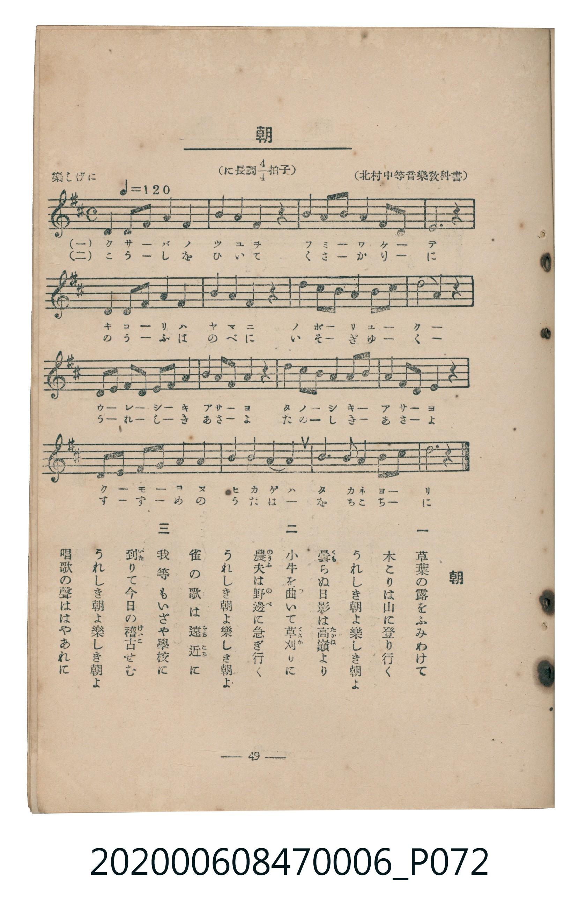

# 朝

> Re:Shōka 使用 AI 協助辨識與重建樂譜，可能會有錯誤。歡迎回報。

<audio controls src="asa.mp3"></audio>

- 臺灣教育會公認《新定兒童唱歌》尋常科第六學年用（2020.006.0847.0006）

## 說明

原書資訊與歌詞全文（對應 P072.jpg，書頁 p. 49，參考教材第 9 首）：
速度與表情：樂しげに ♩=120
調性與拍號：に長調四分之四拍子（D 大調 4/4 拍）
出處：（北村中等音樂教科書）


## 跨冊／重複收錄參照

> 同曲（〈朝〉；收錄於《新定兒童唱歌》六年級與《唱歌帖》P213《小公學校唱歌教材集》抄譜）

- **[同曲]** 《新編小公學校唱歌教材集》第五、六學年（大正12年／1923，國臺圖 0725-41）：[**〈朝〉**](../../../shoka_kyozai_shu_1923/grade_5_6/29_asa/index.md)（`D` / `4/4` — [原始 TMD](../../../shoka_kyozai_shu_1923/grade_5_6/29_asa/asa.tmd)）
- **[同曲]** 楊金土手抄《唱歌帖》第 10 冊・X（2020.006.0843）：[**〈朝 (早晨)〉**](../../../shokacho/vol_10/p213_asa/index.md)（`D` / `4/4` — [原始 TMD](../../../shokacho/vol_10/p213_asa/asa.tmd)）
- 總表：[跨冊重複與同名歌曲總索引](../../../duplicate_songs.md)

## 歌詞

```text
一
草葉の露をふみわけて
木こりは山に登り行く
うれしき朝よ樂しき朝よ
曇（くも）らぬ日影は高嶺（たかね）より

二
小牛を牽（ひ）いて草刈（くさか）りに
農夫（のうふ）は野邊（のべ）に急ぎ行く
うれしき朝よ樂しき朝よ
雀の歌は遠近（をちこち）に

三
我等もいざや學校に
到（いた）りて今日の稽古（けいこ）せむ
うれしき朝よ樂しき朝よ
唱歌の聲ははやあれに
```

## ABC

```abc
X:1
T:朝
M:4/4
L:1/16
Q:1/4=120
K:D
V:V1 name="Piano" snm="Pia"
[V:V1]
D2 E2 F2 G2 A4 A4 | B2 c2 d4 d4 z4 | A4 F2 A2 F4 D2 E2 | F12 z4 |
w: 1.~く さ _ _ ば の | つ _ ゆ を | ふ み _ わ け _ | て
w: 2.~こ う _ _ し を | ひ _ い て | く さ _ か り _ | に
w: 3.~わ れ _ _ ら も | い _ ざ や | が つ _ か う _ | に
D2 E2 F2 G2 A4 A4 | B2 c2 d4 d4 z4 | A4 B2 A2 F4 D2 F2 | E8 D4 z4 |
w: 1.~き こ _ _ り は | や _ ま に | の ぼ _ り ゆ _ | く _
w: 2.~の う _ _ ふ は | の _ べ に | い そ _ ぎ ゆ _ | く _
w: 3.~い た _ _ り て | け _ ふ の | け い _ こ せ _ | む _
E2 F2 G2 F2 E4 A4 | F2 D2 D4 D4 z4 | E2 F2 G2 A2 B4 c4 | d2 B2 A4 A4 z4 |
w: 1.~う _ れ _ し き | あ さ _ よ | た の _ _ し き | あ さ _ よ
w: 2.~う _ れ _ し き | あ さ _ よ | た の _ _ し き | あ さ _ よ
w: 3.~う _ れ _ し き | あ さ _ よ | た の _ _ し き | あ さ _ よ
D2 E2 F2 G2 A4 A4 | B4 c4 d2 c2 B4 | A3 F E2 A2 F4 E4 | D12 z4 |
w: 1.~く _ も _ ら ぬ | ひ か げ _ は | た _ か ね よ _ | り
w: 2.~す _ ず _ め の | う た は _ _ | を _ ち こ ち _ | に
w: 3.~しや _ う _ か の | こ ゑ は _ _ | は _ や あ れ _ | に
```

## TMD 檔案連結

- [主旋律 TMD 檔案](asa.tmd) [[在 TMD Studio 編輯](https://tmdlang.github.io/Tmd-TS/#tmd=s7IKdvYPcrWy4qpTUCpJTLdSSM7PyUlNLsnMz7MqzsjMK0nNjM_KTMmPL87Iz05Ugisry88pzU21Si9KTEmNN4s3MjAyiDcwMIs3sDAxBzIMzBBKi_NLi5JTrYqTM_Lzc-JLUitKkvLzsxHyBUX5Zal5iXlANQVFIBtTwIoQClLLMlNSQdKpKZkl-UWZiTlI7kgtKga7FWxJfElRYl5xclFmAcgDCFUlGalAx5Zk5qbG56fFpyRWKnFpaSk8mzNXQUuLS9FWwdDIgMveVsGFy8ZE38QOpO1F-67njYufTZ35omnTsznNT1vXvFjV-7ih69m0DU_XzXraOun56qVPp2x8trbncUP30w3dT3fseL584vM1a562rn26dsfTnVueT1nxfk8HKGD0gMGhBwoYIMPA7P2eTiUuLn0tBVtqAS4FBYWnffOfzd7xYnP7ixVdLzrage56sXLe09YVz6a1A13xdEPvs_ZOhQADcyO9rIL093t6gIpfLmhUKNBTMLEEcp_2N79oaAZ699ncCUBPKFgqvFw2DejS93tmgUx_2TD_6a5lQHNfLFzxrLkVKPpsRdPjxumPGyc9blyt8GjmSltQEAJVvli1_1nDcpALuntfzJwPVAlU8HLqdqD409mzn3a0PdnZDWQAZZ-unQB0mYvC0yXLgZIKwIBXAIoC7QR7p33Xi5lTgbpBju-Z_mzuxCc71j5f2_ly_magzUB3AgMb6AWQapDyJzsawJb3dr6Y2Pm4cd3LOZseNwGdtvVx4_7HTf2PGyc-blwGUvFszorHjZMfN3U9blz_dONGoNuez9wN5L5Y2PO4sR-k4nFj2-MmIAfot15gAnnc1AHzKpQLNmY2KFSBOh43NQHd8LgJaOmaZ9OXPt0LNHL9y9Uznm7bBVYw_3Fj9-PGtWA1HUB7IK7d1QP244b-552zge583rkXrHgTSFljC9CpQI887eiAWtE4FWgI2ASgq1eD_blv09Mlq8HS60DubdwK1rn-ZXvfy6YumPhOsODqZw1LHzf2kejBl7MbgGaAUjfQ1MYFL_ZPBJkKCtKFoPBrXAgxGxr44Ch71jERGEHAAAF7YdrjphZgPni2AKge7OanHRvADgPKAVMFxDPLnuzuAoYa0KbnK_Y-7V8CVgCMKqCayWALgKEDjlii3AzNjo3rXjRuAjobhJqAJjWBdYLdQHlWgwIFLX0uLsfiRKuAzMS8fIcag5pqkPkKNoZmWnZgFrb8rQDMWcCUCowKBQ0TcPSvb9CBZ0pNLBqA1kAN0wBq1LRSeNy0Hoi3Kjxu3gPEE4C4T6EGSLYA8TIg3gTmTQXi-VA1IPUbwWyQTBuKkbt6QEY2TgaFL0R543Sg8kkgpY2bgBhobOMyMK8fiEHGgtR0A9V0wYwEZn-okTUKhgq6CkZAbAzEJkBsCsQgCKNrFMyApDkQG8ZBheAMA7gamGqQKSA2iAYrhZpeAxdBh3AzwO7xMYQ4XBfsdISqx40b4Kx1cFsfNy6BiTa1wVmToKx4JHVb4br3w9WBbIGITURSuQyHO-GmQdxpBFI7GawbZjPErOkY7oBEDEy-Bc6C2YTsToSbYL4HRR3MxC4klauJc6cxUC3Yp8AchezOpk44qwnJVITrpsHlYWLI7oSZhRQDCHfCQ4Q4d-LPe7t6KMt7a4F4MzRfrQLifnCeWgLE84C4G8zrA-I5SGpAuRKcUUA5F8jCkv_WIeU_YNZuXA_2LEh0J9jTkMB83DgXqgZoBTCJwvIfMGcijKV2HgSpRc-DIHYN2A5kCJJBMQMpD_aCYxKUwhFpBpb-QN6FxzA8fTxu3AdnwWIdOc3A8u3jxj2YJsLzL3IuwJ1mEHkQZCp6HkTkdiR3Itm_E687Ef6ZC2f1UeJOUB4EmwqsRpHdiRSesLIApBJWGiH7A-Z2ZHci1CFcDIsvYDWMUNnUQNCdBOq_TsryICQ_PW5eA6GbtkPptWDXLUKqHVeARfZD8yRULSgPQ_Mjqlos-RKaJ4GFHbxuBNO94CBrAhesEBUdYBFglQvKtTC1QHWwPIqqFp5XkfMpiIblKUReBYmCchYsd2HkMoy8DsqxIAjK4RAV4OwNy8jIxmPLqoiqD1Esw6shcEaGJRlQUY9WsQL9hpm0QMkUkegoNhEpuw4Rt4Kz7OB3K95sC-yyUdxsBWc0YKYD0yuBuAdcYU4Cyq4GYmB7E1KhgrIsSKQZlH9WwJuuq7Bl0ZnQ7DYLmrkawUECCXBIhoRYDDIWaFHjQnC5BqbJbb6CICxzgbMWiAOTgNWcxmCDkGtOWN6GWIMN4mq9QiIM1rJCam01roGbidwqRLSdYK1G1LoLVm9AVAJ7p2BTYQkCBkEhBqtT0CG2zDgTbuosuEsb4WLI7Wx4VkByCcx9yLYjXL8QTEJayCA2mkpS2q_APiNSIwPhFESgITsVXgU2ISpILE6Fi0HMhuY4lEYy8U6t5eLStVMAdi4VgJQyFwA)]
- [鋼琴伴奏 TMD 檔案](asa_piano.tmd) [[在 TMD Studio 編輯](https://tmdlang.github.io/Tmd-TS/#tmd=s7IKdvYPcrWy4tLSUng2Z-77PR0vu_c8n7DlyZ4tT5f2P-_seL-nU0FLi0vRVsHQyIDL3lbBhcvGRN_EjqtOQelF-67njYufTZ35omnTsznNT1vXvFjV-7ih69m0DU_XzXraOun56qVPp2x8trbncUP30w3dT3fseL584vM1a562rn26dsfTnVueT1kBtNLIwMhAz8DATM_AwsQcyDAwA9qqxMXlWJxoFZCZmJcf5OFQY1BTzaUABDaGZlp2YJa-loItOlAAmv5kR8OLhT0KGiYKTzf0P1_foKMQYGBupJdVkK6JRYOWPtiwGgVDBV0FIyA2BmITIDYFYhCE0TUKZkDSHIgN46BCcIYBXA1MNcgUEBtEg5VCTa-Bi6BDuBlg9_gY1ig8buwH8h83TkVS9bhxA5y1Dm7r48YlMNGmNjhrEpQVj6RuK1z3frg6kC0QsYlIKpfhcCfcNIg7jUBqJ4N1w2yGmDUdwx0glZvg8i1wFswmZHci3ATz_ePGbriJXUgqVxPnTmOgWrBPHzf1ILuzqRPOakIyFeG6aXB5mBiyO2FmIcUAwp3wECHOnfhT9a6egU_VILXoqRrErgHbgQxBMihmIKXqXnDYgNIMIhZgMfq4cT3cVkSIP27cB2fBwhE5FmA54XHjHkwT4TkCOV3hjgVEqgaZip6qEfkHyZ1I9u_E606Ef-bCWX2UuBOUqsGmPm6cj-xOpPCE5S6QSlj-RvYHzO3I7kSoQ7gYFl-PG2cjVDY1EHQngbK6k5xUjZyiQTQs9SFSNUgUlAZh6RAjPWLkClDaBkFQXoCoAGcEWJJHNh5bokYUu4giAV4EgpM8LHBBxQxaod7UAWUhRwIoQhHRQ7GJSAl7iLgVnLgHv1vxJvCns2fTrtgGQVhyBSdWEAcmASu1jcEGIZfasNwCsQYbxNUWgQQBrJ5Eqjsb18DNRK7jETUhrA2AWm7CyiyIyseNa8GmwoIYBkHlDKw8Q4fYkvdMuKmz4C5thIsht5rgiQvJJTD3IduOcP1CMAlp74DYaCpJaY00Tkeu4BBOQQQaslPhxW8TonDG4lS4GMRsaBpGafIQ79RapDa4D3Ib3ATaBAemoHiFaMNYGFWjYBIPZJnEg0UMsMibguRNgfIgBlABpcZA5KGmoBgOZiDrBJkDl4BbAFdBpIOwa8RmGSj4dO0UgCEY7QMUhDGNEExjMFOZCwA)]

## 分析

```text
================================================================================
📊 TMD Song Profile: [ 朝 ]
================================================================================
⏱  Duration:       0:32 (32.0s), 16 measures total
🎼 Key & Tempo:    首調基準 D, != 120.0 BPM, <4/4>
   - 分析範圍：      由實際發聲的音符與和弦推測調性；播放脈絡另行呈現
🎤 人聲音域:    D4 (MIDI 62) – D5 (MIDI 74) [跨度: 12 個半音 / 1.0 個八度, 難度: easy]
   - 最低音:  D4 in [Asa #1 @ m.1, 0:00]
   - 最高音: D5 in [Asa #1 @ m.2, 0:02]
   - 適合: soprano, mezzo-soprano, contralto, tenor, baritone, bass
🏛  結構:      Asa (32.0s)
⚡ 編曲密度:        Peak 1 軌道同時演奏
🗝  調性診斷：       D 大調（純淨自然大調，未偵測到可信轉調）
   - 風格氣質:    純淨自然大調（陽光明朗、易唱易記，無明顯調外色彩）
   - 轉調歷程:    全曲維持單一推測調性（未偵測到可信轉調）
   - 核心骨幹音:  D, A, F#, E, B
   - 調性數值:    D 大調 [相關度: 0.93, 穩定度: High, 自然音純度: 100.0%]
   - 候選調性 (K-S): D 大調 (0.93), A 大調 (0.79), F# 小調 (0.72)
   - 五度圈歷程:   +2
   - 各段落調性細節:
     • [Asa #1]: D 大調 (r: 0.93, 自然音純度: 100.0%)

  [ 五度圈游移軌跡 ]
               C  
         F            G  
      Bb              [D ]*
      Eb               A  
         Ab           E  
            Db       B  
               F# 
     (* = active key center)

  [ 十二半音累積音高分佈 ]
     C  :                            0.0%
     C# : ██████                     6.1%
     D  : ████████████████████████  24.6%
     D# :                            0.0%
     E  : █████████████             13.2%
     F  :                            0.0%
     F# : ██████████████████        18.9%
     G  : ████                       4.4%
     G# :                            0.0%
     A  : ████████████████████████  24.1%
     A# :                            0.0%
     B  : █████████                  8.8%
--------------------------------------------------------------------------------
Assignment 軌道音域：
  - Piano         : D4 – D5 (12 個半音 / 1.0 個八度, 73 個音符)
================================================================================
```


## 原書掃描頁




