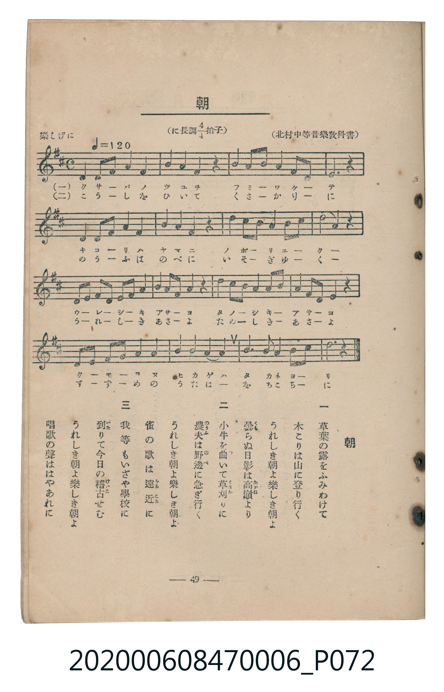

# 朝

<audio controls src="asa.mp3"></audio>

- 臺灣教育會公認《新定兒童唱歌》尋常科第六學年用（2020.006.0847.0006）

## 說明

原書資訊與歌詞全文（對應 P072.jpg，書頁 p. 49，參考教材第 9 首）：
速度與表情：樂しげに ♩=120
調性與拍號：に長調四分之四拍子（D 大調 4/4 拍）
出處：（北村中等音樂教科書）

## 歌詞

```text
一
草葉の露をふみわけて
木こりは山に登り行く
うれしき朝よ樂しき朝よ
曇（くも）らぬ日影は高嶺（たかね）より

二
小牛を牽（ひ）いて草刈（くさか）りに
農夫（のうふ）は野邊（のべ）に急ぎ行く
うれしき朝よ樂しき朝よ
雀の歌は遠近（をちこち）に

三
我等もいざや學校に
到（いた）りて今日の稽古（けいこ）せむ
うれしき朝よ樂しき朝よ
唱歌の聲ははやあれに
```

## ABC

```abc
X:1
T:朝
M:4/4
L:1/16
Q:1/4=120
K:D
V:V1 name="Piano" snm="Pia"
[V:V1]
D2 E2 F2 G2 A4 A4 | B2 c2 d4 d4 z4 | A4 F2 A2 F4 D2 E2 | F12 z4 |
D2 E2 F2 G2 A4 A4 | B2 c2 d4 d4 z4 | A4 B2 A2 F4 D2 F2 | E8 D4 z4 |
E2 F2 G2 F2 E4 A4 | F2 D2 D4 D4 z4 | E2 F2 G2 A2 B4 c4 | d2 B2 A4 A4 z4 |
D2 E2 F2 G2 A4 A4 | B4 c4 d2 c2 B4 | A3 F E2 A2 F4 E4 | D12 z4 |
```

## TMD 檔案連結

- [主旋律 TMD 檔案](asa.tmd) [[在 TMD Studio 編輯](https://tmdlang.github.io/Tmd-TS/#tmd=s7IKdvYPcrWy4tLSUng2Z66ClhaXoq2CoZEBl72tgguXjYm-iR1XnYLSi_ZdzxsXP5s680XTpmdzmp-2rnmxqvdxQ9ezaRuerpv1tHXS89VLn07Z-Gxtz-OG7qcbup_u2PF8-cTna9Y8bV37dO2Opzu3PJ-y4v2eDiMDIwM9AwMzPQMLE3Mgw8Ds_Z5OJS4ufS0FW2oBLgUFhad985_N3vFic_uLFV0vOtqB7nqxct7T1hXPprUDXfF0Q--z9k6FAANzI72sgvT3e3qAil8uaFQo0FMwsQRyn_Y3v2hoBnr32dwJQE8oWCq8XDYN6NL3e2aBTH_ZMP_prmVAc18sXPGsuRUo-mxF0-PG6Y8bJz1uXK3waOZKW1AQAlW-WLX_WcNykAu6e1_MnA9UCVTwcup2oPjT2bOfdrQ92dkNZABln66dAHSZi8LTJcuBkgrAgFcAigLtBHunfdeLmVOBukGO75n-bO7EJzvWPl_b-XL-ZqDNQHcCAxvoBZBqkPInOxrAlvd2vpjY-bhx3cs5mx43AZ229XHj_sdN_Y8bJz5uXAZS8WzOiseNkx83dT1uXP9040ag257P3A3kvljY87ixH6TicWPb4yYgB-i3XmACedzUAfMqlAs2ZjYoVIE6Hjc1Ad3wuAlo6Zpn05c-3Qs0cv3L1TOebtsFVjD_cWP348a1YDUdQHsgrt3VA_bjhv7nnbOB7nzeuReseBNIWWML0KlAjzzt6IBa0TgVaAjYBKCrV4P9uW_T0yWrwdLrQO5t3ArWuf5le9_Lpi6Y-E6w4OpnDUsfN_aR6MGXsxuAZoBSN9DUxgUv9k8EmQoK0oWg8GtcCDEbGvjgKHvWMREYQcAAAXth2uOmFmA-eLYAqB7s5qcdG8AOA8oBUwXEM8ue7O4ChhrQpucr9j7tXwJWAIwqoJrJYAuAoQOOWKLcDM2OjeteNG4COhuEmoAmNYF1gt1AeVaDAgUtfS4ux-JEq4DMxLx8hxqDGoVqkAUKNoZmWnZgFrYMrgDMWsCkCowLBQ0TcPyvb9CB50pNLBqA9kAN0wBq1LRSeNy0Hoi3Kjxu3gPEE4C4T6EGSLYA8TIg3gTmTQXi-VA1IPUbwWyQTBuKkbt6QEY2TgYFMER543Sg8kkgpY2bgBhobOMyMK8fiEHGgtR0A9V0wYwE5n-okTUKhgq6CkZAbAzEJkBsCsQgCKNrFMyApDkQG8ZBheAMA7gamGqQKSA2iAYrhZpeAxdBh3AzwAkTdxzs6qEsDtYC8WZo-K4C4n5w2C4B4nlA3A3m9QHxHCQ1oNgBBxgoBoEsLPGwDikegFHcuB4cviDRneBwBvFAMTIXqgZoRRNEPTSGEMZSOy5AatHjAsSuAduBDEEypMTFjk7K4gISro-b10Dopu1Qei04rBch5ZYVYJH90LiBqgXFJTReUNViiR9o3DT1IPIKmO4Fh38TIoc0dYBFgFkQFHswtUB1sLhCVQuPM-T4AtGwsEXEGUgUFMKwUMYIbYw4B8UcCIJiGqICHM2wCEU2nsgoA9bfFBdh4EAGBjiYXgnEPeBMMwkouxqIgWUPJFOBogsk0gwKuxXwYmwVtuiZCQ3qWdCAbQQHPyi4gREHjgyIxSBjgRY1LoQWfUCa3KIMOWDBwQriwCRguccYbBBy7oHFK8QabBARFbVcXLp2CsDKRgFIKXNxAQA)]
- [鋼琴伴奏 TMD 檔案](asa_piano.tmd) [[在 TMD Studio 編輯](https://tmdlang.github.io/Tmd-TS/#tmd=s7IKdvYPcrWy4tLSUng2Z-77PR0vu_c8n7DlyZ4tT5f2P-_seL-nU0FLi0vRVsHQyIDL3lbBhcvGRN_EjqtOQelF-67njYufTZ35omnTsznNT1vXvFjV-7ih69m0DU_XzXraOun56qVPp2x8trbncUP30w3dT3fseL584vM1a562rn26dsfTnVueT1kBtNLIwMhAz8DATM_AwsQcyDAwA9qqxMXlWJxoFZCZmJcf5OFQY1CjUM2lAAQ2hmZadmCWvpaCLTpQABr_ZEfDi4U9ChomCk839D9f36CjEGBgbqSXVZCuiUWDlj7YsBoFQwVdBSMgNgZiEyA2BWIQhNE1CmZA0hyIDeOgQnCGAVwNTDXIFBAbRIOVQk2vgYugQ7gZXPh9t6tn4H0HUovuOxC7BmwHMgTJkOK7HZ3k-A7ZZyAa5gqE70CiILfA3IPhLozQAfkRBEFhAlEBDhCY15GNJ9JzT2fPpl3UITsV7FAQByYBizljsEHIMQcLKYg12CDCc7VIedIHJU-aQLMk0JR4hWjDWBhVo2ASD2SZxINFDLDIm4LkTYHyIAZQAaXGQOShpqAYDmYg6wSZA5eAWwBXQaSDsGvEZhko_HTtFIBBqICglLm4AA)]

## 分析

```text
================================================================================
📊 TMD Song Profile: [ 朝 ]
================================================================================
⏱  Duration:       0:32 (32.0s), 16 measures total
🎼 Key & Tempo:    首調基準 D, != 120.0 BPM, <4/4>
   - 分析範圍：      由實際發聲的音符與和弦推測調性；播放脈絡另行呈現
🎤 人聲音域:    D4 (MIDI 62) – D5 (MIDI 74) [跨度: 12 個半音 / 1.0 個八度, 難度: easy]
   - 最低音:  D4 in [Asa #1 @ m.1, 0:00]
   - 最高音: D5 in [Asa #1 @ m.2, 0:02]
   - 適合: soprano, mezzo-soprano, contralto, tenor, baritone, bass
🏛  結構:      Asa (32.0s)
⚡ 編曲密度:        Peak 1 軌道同時演奏
🗝  調性診斷：       D 大調（純淨自然大調，未偵測到可信轉調）
   - 風格氣質:    純淨自然大調（陽光明朗、易唱易記，無明顯調外色彩）
   - 轉調歷程:    全曲維持單一推測調性（未偵測到可信轉調）
   - 核心骨幹音:  D, A, F#, E, B
   - 調性數值:    D 大調 [相關度: 0.93, 穩定度: High, 自然音純度: 100.0%]
   - 候選調性 (K-S): D 大調 (0.93), A 大調 (0.79), F# 小調 (0.72)
   - 五度圈歷程:   +2
   - 各段落調性細節:
     • [Asa #1]: D 大調 (r: 0.93, 自然音純度: 100.0%)

  [ 五度圈游移軌跡 ]
               C  
         F            G  
      Bb              [D ]*
      Eb               A  
         Ab           E  
            Db       B  
               F# 
     (* = active key center)

  [ 十二半音累積音高分佈 ]
     C  :                            0.0%
     C# : ██████                     6.1%
     D  : ████████████████████████  24.6%
     D# :                            0.0%
     E  : █████████████             13.2%
     F  :                            0.0%
     F# : ██████████████████        18.9%
     G  : ████                       4.4%
     G# :                            0.0%
     A  : ████████████████████████  24.1%
     A# :                            0.0%
     B  : █████████                  8.8%
--------------------------------------------------------------------------------
Assignment 軌道音域：
  - Piano         : D4 – D5 (12 個半音 / 1.0 個八度, 73 個音符)
================================================================================
```


## 原書掃描頁




