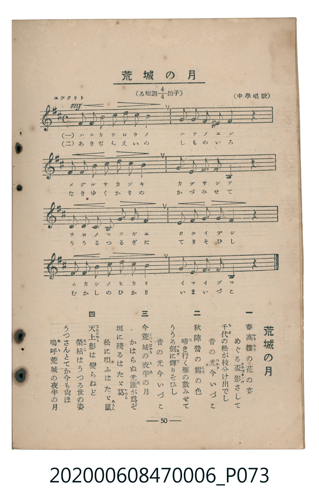

# 荒城の月

<audio controls src="kojo_no_tsuki.mp3"></audio>

- 臺灣教育會公認《新定兒童唱歌》尋常科第六學年用（2020.006.0847.0006）

## 說明

原書資訊與歌詞全文（對應 P073.jpg，書頁 p. 50，參考教材第 10 首）：
速度與表情：ユツクリト
調性與拍號：ろ短調四分之四拍子（B 小調 4/4 拍，關係調 D 大調）
出處：（中學唱歌）

## 歌詞

```text
一
春高樓（かうろう）の花の宴
めぐる盃（さかづき）影（かげ）さして
千代の松が枝分け出でし
昔の光（ひかり）今いづこ

二
秋陣營の霜（しも）の色
啼（な）き行く雁の數みせて
ううる劍（つるぎ）に照（て）りそひし
昔の光今いづこ

三
今荒城（くわうじやう）の夜半（よは）の月
かはらぬ光誰（た）が爲ぞ
垣に殘るはたゞ葛（かづら）
松に唄ふはたゞ嵐（あらし）

四
天上（てんじやう）影は變らねど
榮枯（えいこ）はうつる世の姿
うつさんとてか今も尚ほ
嗚呼（あゝ）荒城の夜半の月
```

## ABC

```abc
X:1
T:荒城の月
M:4/4
L:1/16
Q:1/4=76
K:Bm
V:V1 name="Piano" snm="Pia"
[V:V1]
!mf! F4 F4 B4 c4 | d4 c4 B8 | G4 G4 F4 E4 | F12 z4 |
F4 F4 B4 c4 | d4 c4 B8 | G4 F4 E4 ^A,4 | B,12 z4 |
F4 F4 B4 c4 | d4 c4 B8 | G4 G4 F4 E4 | F16 |
F4 F4 B4 c4 | d4 c4 B8 | G4 F4 E4 C4 | B,12 z4 |
```

## TMD 檔案連結

- [主旋律 TMD 檔案](kojo_no_tsuki.tmd) [[在 TMD Studio 編輯](https://tmdlang.github.io/Tmd-TS/#tmd=s7IKdvYPcrWy4tLSUnjRO-np_L7HjeuezelQ0NLiUrRVMDfjsrdVcOHKTq20VXDK5bIx0Tex46pTUHrRvut54-JnU2e-aNr0bE7z09Y1L1b1Pm7oejZtw9N1s562Tnq-eunTKRufre153ND9dEP30x07ni-f-HzNmqeta5-u3fF055bnU1a839NhZGBkoGdgYKZnYGFiDmQYmL3f06nExaWvpWBLLcCloKDwtG_-s9k7Xmxuf7Gi60VHO9BdL1bOe9q64tm0dqArnm7ofdbeqRBgYG6sl1WQ_n5PD1DxywWNCgV6CqYGQO7T_uYXDc1A7z6bOwHoCQVDA4WXy6YBnfp-zyyQ8S8b5j_dtQxo8IuFK541twJFHzcve9zc8rhp_ePmVY-bO0CKXqza_6xhOcj27t4XM-eDFDX1Pp-_Fij-dPbspx1tT3Z2AxlA2adrJwBd5aTwdEM_UFIBGOgKQFGgO15On_NkfxNIzEXh6ZLlQAbQDWD_te96MXMq0Eigvic7wEEMDn2QNEj-yY4GEPVsxtKXq2c8WzEZqOxxY_fjxjagE4AkUBkw3l90bQSST9dtASl93NT4uHHC46bu57ObwaqngjUsfdwIdEjn070bYUZMAmsGyk5_3LgM7Jbe5ie7F4PS0dx9jxt7ns2bC_Tb48aJQDc-blwOVAdxyRSQXa3AEAQaswlkUlMX0KQnu7seN7aA7ZkMcfmuHhD1fHn3y5mLn7fPB-p6OWcOWNf0x01NUJd3bgLbPHUPWGIVWLT3xcKex439L2cDPbLu2dQdjxv3P26cDXUkyOsg33c_7QL6B6hnCZD9uLEPrHP189blYMFlIG4T0EVzwW5EdTmmU3eA4wIoDslKYCP6Hzf1gy2b8bgJqBga1E-XzHnaC_Rvx-MmoJr1EEFgvoM4DeiQ9Y-bgELA7NL5YtUGsEHABAMU6XneAXTIPLBv5wEDefWzdUCDwRoa5z9umvdi4mxYxCwFGgFNHuCYWP10CtABW-FKn24FpbLHjU1gq6bDkgowCYKpJSuf7AC7sHHZ46bJyO4HRj7QkBfrusAa1z5uXAm2Y9m6Z_OAPgFqACKgUmAiA0oDLQN6HhS6T3ZMA_l8-X54-C8BpRuQ2StAljR2g0K0qenphlmPG3eD3TB91tOJkCgFOnIu0Dx4GQUJQESgUV5MQIGClj4Xl3d-Vr5ffkhxaXamVUBmYl6-Q41BjUI1yCIFGxMtOzADWxmlACwdgHkNmPIUNExA-ff5-gYdeMGiiUUD0DqoYRpAjZpWCo-b-4F4NTADgvAyhRogby2Y9bi5D8wDyXfBeE0rgKzNKMbs6gEZ09gExL1AvAioaDJIaWMHELcA8TowbzpQHKQGwgOKN_XCjAH6NTetVsEYCM0UzIFcwzggZaagC2SaAKGxghGQZQzk6yoYKNSA0w3u8NjVQ1l4LAQ6bQM0TLaC_QxkNbcC6bUwXtMmsNzjpu3gEGrDFh6rIOHR1Aak-8F-7gbygAEJDQEgr3EpEO8H4tlgkWWI8MARFKCAMFWPB7LN4okMjR2dlIVGIxCD4rwPiOeBfQuKujXglADirQeyNgLxEiC7HRw-27GFBigUgLgJ5OslYGUgFtDQxtVQv0PCZi4Qb4KmF0KhgZowgGL4gwJY0lAWFAugkb8dnjUmQRPHKrCPQEEwD0q3gkWwZZSmBmjkAzMENCkAUxM0cUCzRuM-KL0ULDKZqIRhjpYuarm4dO0UkMoWBSBXmYsLAA)]
- [鋼琴伴奏 TMD 檔案](kojo_no_tsuki_piano.tmd) [[在 TMD Studio 編輯](https://tmdlang.github.io/Tmd-TS/#tmd=s7IKdvYPcrWy4tLSUnjRO-np_L7Hjeuezel4v6fjZfee5xO2PNmz5enS_uedQJFOBS0tLkVbBXMzLntbBReu7NRKWwWnXC4bE30TO646BaUX7bueNy5-NnXmi6ZNz-Y0P21d82JV7-OGrmfTNjxdN-tp66Tnq5c-nbLx2dqexw3dTzd0P92x4_nyic_XrHnauvbp2h1Pd255PmUF0GYjAyMDPQMDMz0DCxNzIMPADGi5EheXd35Wvl9-SHFpdqZVQGZiXn6Qh0ONQY1CNZcCENiYaNmBGfpaCrboQAFoy5MdDS8W9ihomCg83dD_fH2DjkKAgbmxXlZBuiYWDVr6YMOApuem1SoYA6GZgjmQaxgHpMwUdIFMEyA0VjACsoyBfF0FA4UaLvwu2NVDjgtwWA6y2lQ9Hsg2iyfS_h2dVLQf1fNAMfyWP509m8qeN0fzey2WJOKDNYmAtMUrRJvF58YisXCJGgGZRkAWjAY6CiRrHB8LZoCsJt9QuFHoCikzFodbITbRyrnACNC1U0CKAwVMrjIXFwA)]

## 分析

```text
================================================================================
📊 TMD Song Profile: [ 荒城の月 ]
================================================================================
⏱  Duration:       0:50 (50.5s), 16 measures total
🎼 Key & Tempo:    首調基準 D, != 76.0 BPM, <4/4>
   - 分析範圍：      由實際發聲的音符與和弦推測調性；播放脈絡另行呈現
🎤 人聲音域:    A#3 (MIDI 58) – D5 (MIDI 74) [跨度: 16 個半音 / 1.3 個八度, 難度: moderate]
   - 最低音:  A#3 in [KojoNoTsuki #1 @ m.7, 0:21]
   - 最高音: D5 in [KojoNoTsuki #1 @ m.2, 0:03]
   - 適合: soprano, mezzo-soprano, contralto, tenor, baritone, bass
🏛  結構:      KojoNoTsuki (50.5s)
⚡ 編曲密度:        Peak 1 軌道同時演奏
🗝  調性診斷：       B 小調（純淨自然小調，未偵測到可信轉調）
   - 風格氣質:    純淨自然小調（陰鬱抒情、旋律集中，無明顯調外色彩）
   - 轉調歷程:    全曲維持單一推測調性（未偵測到可信轉調）
   - 核心骨幹音:  F#, B, C#, G, D
   - 調性數值:    B 小調 [相關度: 0.79, 穩定度: Moderate, 自然音純度: 98.4%]
   - 候選調性 (K-S): B 小調 (0.79), B 大調 (0.75), F# 大調 (0.65)
   - 五度圈歷程:   +5
   - 各段落調性細節:
     • [KojoNoTsuki #1]: B 小調 (r: 0.79, 自然音純度: 98.4%, 調外音: A#)

  [ 五度圈游移軌跡 ]
               C  
         F            G  
      Bb               D  
      Eb               A  
         Ab           E  
            Db      [B ]*
               F# 
     (* = active key center)

  [ 十二半音累積音高分佈 ]
     C  :                            0.0%
     C# : ███████████               14.8%
     D  : █████                      6.6%
     D# :                            0.0%
     E  : █████                      6.6%
     F  :                            0.0%
     F# : ████████████████████████  31.1%
     G  : ████████                   9.8%
     G# :                            0.0%
     A  :                            0.0%
     A# : █                          1.6%
     B  : ███████████████████████   29.5%
--------------------------------------------------------------------------------
Assignment 軌道音域：
  - Piano         : A#3 – D5 (16 個半音 / 1.3 個八度, 48 個音符)
================================================================================
```


## 原書掃描頁




