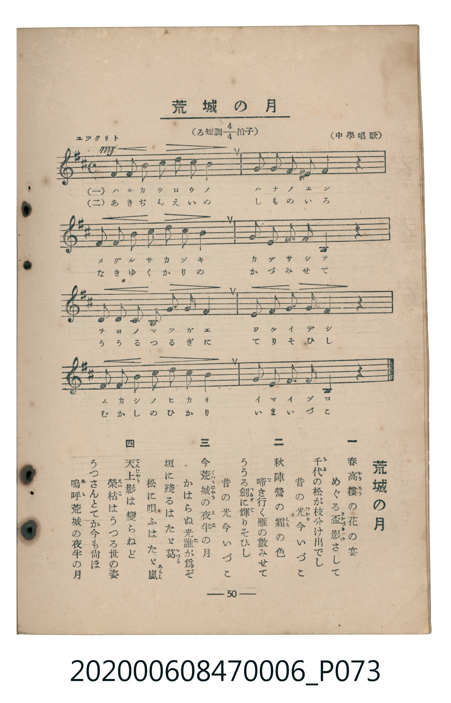

# 荒城の月

> Re:Shōka 使用 AI 協助辨識與重建樂譜，可能會有錯誤。歡迎回報。

<audio controls src="kojo_no_tsuki.mp3"></audio>

- 臺灣教育會公認《新定兒童唱歌》尋常科第六學年用（2020.006.0847.0006）

## 說明

原書資訊與歌詞全文（對應 P073.jpg，書頁 p. 50，參考教材第 10 首）：
速度與表情：ユツクリト
調性與拍號：ろ短調四分之四拍子（B 小調 4/4 拍，關係調 D 大調）
出處：（中學唱歌）


## 歌詞

```text
一
春高樓（かうろう）の花の宴
めぐる盃（さかづき）影（かげ）さして
千代の松が枝分け出でし
昔の光（ひかり）今いづこ

二
秋陣營の霜（しも）の色
啼（な）き行く雁の數みせて
ううる劍（つるぎ）に照（て）りそひし
昔の光今いづこ

三
今荒城（くわうじやう）の夜半（よは）の月
かはらぬ光誰（た）が爲ぞ
垣に殘るはたゞ葛（かづら）
松に唄ふはたゞ嵐（あらし）

四
天上（てんじやう）影は變らねど
榮枯（えいこ）はうつる世の姿
うつさんとてか今も尚ほ
嗚呼（あゝ）荒城の夜半の月
```

## ABC

```abc
X:1
T:荒城の月
M:4/4
L:1/16
Q:1/4=76
K:Bm
V:V1 name="Piano" snm="Pia"
[V:V1]
!mf! F4 F4 B4 c4 | d4 c4 B8 | G4 G4 F4 E4 | F12 z4 |
w: 1.~は る か う | ろ う の | は な の え | ん
w: 2.~あ き ぢ ん | え い の | し も の い | ろ
w: 3.~い ま くわ う | じや う の | よ は の つ | き
w: 4.~て ん じや う | か げ は | か は ら ね | ど
F4 F4 B4 c4 | d4 c4 B8 | G4 F4 E4 ^A,4 | B,12 z4 |
w: 1.~め ぐ る さ | か づ き | か げ さ し | て
w: 2.~な き ゆ く | か り の | か づ み せ | て
w: 3.~か は ら ぬ | ひ か り | た が た め | ぞ
w: 4.~え い こ は | う つ る | よ の す が | た
F4 F4 B4 c4 | d4 c4 B8 | G4 G4 F4 E4 | F16 |
w: 1.~ち よ の ま | つ が え | わ け い で | し
w: 2.~う う る つ | る ぎ に | て り そ ひ | し
w: 3.~か き に の | こ る は | た だ か づ | ら
w: 4.~う つ さ ん | と て か | い ま も な | ほ
F4 F4 B4 c4 | d4 c4 B8 | G4 F4 E4 C4 | B,12 z4 |
w: 1.~む か し の | ひ か り | い ま い づ | こ
w: 2.~む か し の | ひ か り | い ま い づ | こ
w: 3.~ま つ に う | た ふ は | た だ あ ら | し
w: 4.~あ あ くわ う | じや う の | よ は の つ | き
```

## TMD 檔案連結

- [主旋律 TMD 檔案](kojo_no_tsuki.tmd) [[在 TMD Studio 編輯](https://tmdlang.github.io/Tmd-TS/#tmd=s7IKdvYPcrWy4qpTUCpJTLdSSM7PyUlNLsnMz7MqzsjMK0nNjM_KTMmPL87Iz05Ugisry88pzU21Si9KTEmNN4s3MjAyiDcwMIs3sDAxBzIMzBBKi_NLi5JTrYqTM_Lzc-JLUitKkvLzsxHyBUX5Zal5iXlANQVFIBtTwIoQClLLMlNSQdKpKZkl-UWZiTlI7kgtKga7FWxJfElRYl5xclFmAcgDCFUlGalAx-YllpQWpaKLpiXmZuZUIkSBFqRn5lnl5ucllQI9jSmRmpmVieQNLS2FF72Tns7ve9y47tmcDgUtLS5FWwVzMy57WwUXruzUSlsFp1wuGxN9EzuQUS_adz1vXPxs6swXTZuezWl-2rrmxarexw1dz6ZteLpu1tPWSc9XL306ZeOztT2PG7qfbuh-umPH8-UTn69Z87R17dO1O57u3PJ8yor3ezpAIa4HDGc9UIgDGQZm7_d0KnFx6Wsp2FILcCkoKDztm_9s9o4Xm9tfrOh60dEOdNeLlfOetq54Nq0d6IqnG3qftXcqBBiYG-tlFaS_39MDVPxyQaNCgZ6CqQGQ-7S_-UVDM9C7z-ZOAHpCwdBA4eWyaUCnvt8zC2T8y4b5T3ctAxr8YuGKZ82tQNHHzcseN7c8blr_uHnV4-YOkKIXq_Y_a1gOsr2798XM-SBFTb3P568Fij-dPftpR9uTnd1ABlD26doJQFc5KTzd0A-UVAAGugJQFOiOl9PnPNnfBBJzUXi6ZDmQAXQD2H_tu17MnAo0EqjvyQ5wEINDHyQNkn-yowFEPZux9OXqGc9WTAYqe9zY_bixDegEIAlUBoz3F10bgeTTdVtASh83NT5unPC4qfv57Gaw6qlgDUsfNwId0vl070aYEZPAmoGy0x83LgO7pbf5ye7FoHQ0d9_jxp5n8-YC_fa4cSLQjY8blwPVQVwyBWRXKzAEgcZsApnU1AU06cnurseNLWB7JkNcvqsHRD1f3v1y5uLn7fOBul7OmQPWNf1xUxPU5Z2bwDZP3QOWWAUW7X2xsOdxY__L2UCPrHs2dcfjxv2PG2dDHQnyOsj33U-7gP4B6lkCZD9u7APrXP28dTlYcBmI2wR00VywG1FdjunUHeC4AIpDshLYiP7HTf1gy2Y8bgIqhgb10yVznvYC_dvxuAmoZj1EEJjvIE4DOmT94yagEDC7dL5YtQFsEDDBAEV6nncAHTIP7Nt5wEBe_Wwd0GCwhsb5j5vmvZg4GxYxS4FGQJMHOCZWP50CdMBWuNKnW0Gp7HFjE9iq6bCkAkyCYGrJyic7wC5sXPa4aTKy-4GRDzTkxbousMa1jxtXgu1Ytu7ZPKBPgBqACKgUmMiA0kDLgJ4Hhe6THdNAPl--Hx7-S0DpBmT2CpAljd2gEG1qerph1uPG3WA3TJ_1dCIkSoGOnAs0D15GQQIQEWiUFxNQoKClz8XlnZ-V75cfUlyanWkVkJmYl-9QY1BTDbJHwcZEyw7MwFZEKQALB2BWAyY8BQ0TUPZ9vr5BB16uaGLRALQNapgGUKOmlcLj5n4gXg3MfyC8TKEGyFsLZj1u7gPzQPJdMF7TCiBrM4oxu3pAxjQ2AXEvEC8CKpoMUtrYAcQtQLwOzJsOFAepgfCA4k29MGNqFKpz02oVjIHQTMEcyDWMA1JmCrpApgkQGisYAVnGQL6ugoFCDViPjyHImPVAY7pBKRgUwWD3gZzQBrYGpBusonEVmA9yEEjFZLA58TBzjECq8DkeYg7C-SBxiE0o5hhDvdW4D4hBuRDmJHBKRnVVE8h0kMtApi0BK0IzzQQkBowDoGuQDAAJgrw6Cawd4jAQHxQMnUB6LVhkJdwo_AlnVw9lCWch0NYN0MSzFewtIKu5FUiD3QFOUJvAco-btoOTUhu2hAOKHWDYN4HCpx_mpSZgioMmFZAHlwLxfiCeDRZZhkg4ONIMKMWYqgODQMEsHjPZNDUCDZkATTpTUSwBRQNyKE8FRz3EUsxkg8_pCHPQHY-ZbJDjcA1YFTDcoGZBzJkPxD0QGuh6kMg8LAkGlmhBiWY9WBXIZUvAPkUkPFCimwk2D2IycallRydlqQUY5s2gwqMPiOeBUwOoDFgDLlJAPJD_NwIx0LXN7WC3bseWWkAeAmJw1IFzDpgFNLRxNTR4IREwFxyIkJxLKLWgljBAMaQSBpTIYYG2D2we0IHgqOiABikoo0-EBvxyqI0o5oCTCj53Q6IYm8tRzIEnFVBJBcxc0PwBjGywWbACAZRUFsCTHsimTlRzwEkFmjBACRxa4gEjB-QGoD6IOdCyDFzqrQKL7IabgzepAGt0ypIK0PXgwmM7vA4CZkVw4QJ2BziJzIPSrWARbDVSUwM0EIBFNzSoELkKubAG0eCAAgYlMQWLOc5yBZ-NKIGKYidGuUINc8CJBaQCFMmgxAKpPUCJA1geYyQWYCQDkwki0aGWK6AkAMKUVGu1XFy6dgpILR0FIFeZCwA)]
- [鋼琴伴奏 TMD 檔案](kojo_no_tsuki_piano.tmd) [[在 TMD Studio 編輯](https://tmdlang.github.io/Tmd-TS/#tmd=s7IKdvYPcrWy4tLSUnjRO-np_L7Hjeuezel4v6fjZfee5xO2PNmz5enS_uedQJFOBS0tLkVbBXMzLntbBReu7NRKWwWnXC4bE30TO646BaUX7bueNy5-NnXmi6ZNz-Y0P21d82JV7-OGrmfTNjxdN-tp66Tnq5c-nbLx2dqexw3dTzd0P92x4_nyic_XrHnauvbp2h1Pd255PmUF0GYjAyMDPQMDMz0DCxNzIMPADGi5EheXd35Wvl9-SHFpdqZVQGZiXn6Qh0ONQU01lwIQ2Jho2YEZ-loKtuhAAWjJkx0NLxb2KGiYKDzd0P98fYOOQoCBubFeVkG6JhYNWvpgw2oUqnPTahWMgdBMwRzINYwDUmYKukCmCRAaKxgBWcZAvq6CgUINWI-PYY3C48b1Co-buoE0CLcB1Txu6gWzgOEL1g1W0bgKzH_c2AFWMRlsTjzMHCOQqiYgBulcBJYHiXQAcQuSOdOBMiBVIHNaoDahmGMMUgXSsQ-I-x839cOc1DjjcRNIHMlVTSDTQS4DmbYErAjNNBOQ2DKwa5AMAAmCvDoJrB3iMBAfFAydQHotWGQl3Cj8UbWrh5yowhFLoDgyVQdaqmAWjxlRTY1Ad02ARtZUuLuXQj2O7K-p4MCGeB8zokBRCYyoJlBg9sP0NXUhRRTM3P1APBubOeCIQg61NWBVm-BmQcyZD8Q9EBroepDIPCxRBEsmoGhaD1YFctkSsE8RUQ2K5plg8yAmExc_OzqpGD-ouQgohpSLFiI5cx_YiUAPgD3fAfUEKDFPhHp1OTQ_oJgDjhyQ14EYHMngVA1m9QHxamigglI0KLLmggMciznwyAHlxtVgN4FEgMELNguW6EGRswAe2SCbOlHNAUcONCpASQqaq1dA3ADUBzEHml_BOXsVWGQ33By8kfN09mwqZx5znHmnAepRYBEEDQ70tAordkA0ODiAAYaRd6hhDjh6QCpAwQqKHkiZBIqOrViiBxiswIhBRDNq3gEFOghTUljWYqmwfLBVWKCwjVeINovPjUVi4RI1AjKNgCwYDYw5kKxxfCyYAYsf8gyFG4WukDJjcbgVYhOtnAsMf107BaQoiPYxjFVAFzLCFDLGFDIBCylzAQA)]

## 分析

```text
================================================================================
📊 TMD Song Profile: [ 荒城の月 ]
================================================================================
⏱  Duration:       0:50 (50.5s), 16 measures total
🎼 Key & Tempo:    首調基準 D, != 76.0 BPM, <4/4>
   - 分析範圍：      由實際發聲的音符與和弦推測調性；播放脈絡另行呈現
🎤 人聲音域:    A#3 (MIDI 58) – D5 (MIDI 74) [跨度: 16 個半音 / 1.3 個八度, 難度: moderate]
   - 最低音:  A#3 in [KojoNoTsuki #1 @ m.7, 0:21]
   - 最高音: D5 in [KojoNoTsuki #1 @ m.2, 0:03]
   - 適合: soprano, mezzo-soprano, contralto, tenor, baritone, bass
🏛  結構:      KojoNoTsuki (50.5s)
⚡ 編曲密度:        Peak 1 軌道同時演奏
🗝  調性診斷：       B 小調（純淨自然小調，未偵測到可信轉調）
   - 風格氣質:    純淨自然小調（陰鬱抒情、旋律集中，無明顯調外色彩）
   - 轉調歷程:    全曲維持單一推測調性（未偵測到可信轉調）
   - 核心骨幹音:  F#, B, C#, G, D
   - 調性數值:    B 小調 [相關度: 0.79, 穩定度: Moderate, 自然音純度: 98.4%]
   - 候選調性 (K-S): B 小調 (0.79), B 大調 (0.75), F# 大調 (0.65)
   - 五度圈歷程:   +5
   - 各段落調性細節:
     • [KojoNoTsuki #1]: B 小調 (r: 0.79, 自然音純度: 98.4%, 調外音: A#)

  [ 五度圈游移軌跡 ]
               C  
         F            G  
      Bb               D  
      Eb               A  
         Ab           E  
            Db      [B ]*
               F# 
     (* = active key center)

  [ 十二半音累積音高分佈 ]
     C  :                            0.0%
     C# : ███████████               14.8%
     D  : █████                      6.6%
     D# :                            0.0%
     E  : █████                      6.6%
     F  :                            0.0%
     F# : ████████████████████████  31.1%
     G  : ████████                   9.8%
     G# :                            0.0%
     A  :                            0.0%
     A# : █                          1.6%
     B  : ███████████████████████   29.5%
--------------------------------------------------------------------------------
Assignment 軌道音域：
  - Piano         : A#3 – D5 (16 個半音 / 1.3 個八度, 48 個音符)
================================================================================
```


## 原書掃描頁




