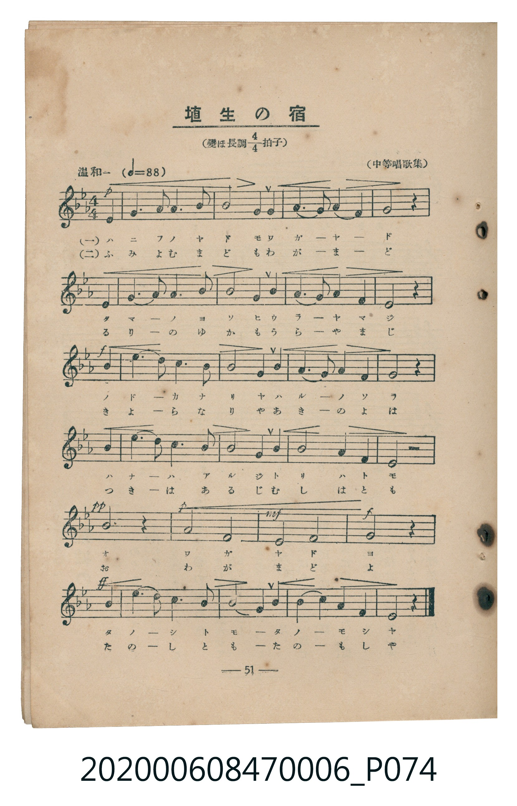
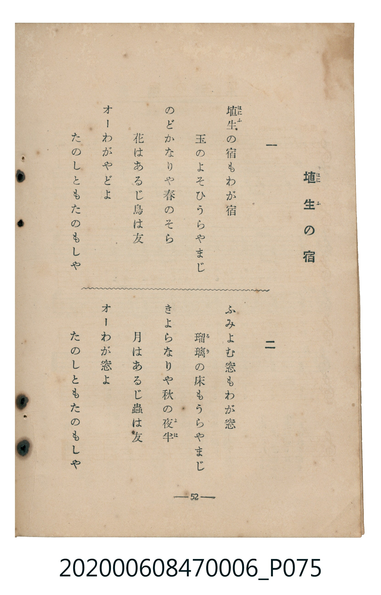

# 埴生の宿

> Re:Shoka 使用 AI 協助辨識與重建樂譜，可能會有錯誤。歡迎回報。

<audio controls src="hanyu_no_yado.mp3"></audio>

- 臺灣教育會公認《新定兒童唱歌》尋常科第六學年用（2020.006.0847.0006）

## 說明

原書資訊與歌詞全文（對應 P074.jpg – P075.jpg，書頁 pp. 51–52，參考教材第 11 首）：
速度與表情：温和ニ（♩=88）
調性與拍號：變ほ長調四分之四拍子（E♭ 大調 4/4 拍）
出處：（中等唱歌集）

## 跨冊／重複收錄參照

> 同曲（英國名曲 *Home! Sweet Home!*〈埴生の宿〉；收錄於《新定兒童唱歌》六年級、高等科女子用與《唱歌帖》P097）

- **[同曲]** 《新定兒童唱歌》高等科女子用（2020.006.0849）：[**〈埴生の宿〉**](../../koto_girls_2020.006.0849/2_4_05_hanyu_no_yado/index.md)（`E,` / `4/4` — [原始 TMD](../../koto_girls_2020.006.0849/2_4_05_hanyu_no_yado/hanyu_no_yado.tmd)）
- **[同曲]** 楊金土手抄《唱歌帖》第 2 冊・II（2020.006.0843）：[**〈埴生の宿〉**](../../../shokacho/vol_02/p097_hanyu_no_yado/index.md)（`D` / `4/4` — [原始 TMD](../../../shokacho/vol_02/p097_hanyu_no_yado/hanyu_no_yado.tmd)）
- 總表：[跨冊重複與同名歌曲總索引](../../../duplicate_songs.md)

## 歌詞

```text
一
埴生（はにふ）の宿もわが宿
玉のよそひうらやまじ
のどかなりや春のそら
花はあるじ鳥は友
オーわがやどよ
たのしともたのもしや

二
ふみよむ窓もわが窓
瑠璃（るり）の床（ゆか）もうらやまじ
きよらなりや秋の夜半（よは）
月はあるじ蟲は友
オーわが窓よ
たのしともたのもしや
```

## ABC

```abc
X:1
T:埴生の宿
M:4/4
L:1/16
Q:1/4=88
K:Eb
V:V1 name="Piano" snm="Pia"
[V:V1]
!p! z4 E4 E6 F2 | F6 G2 G8 | E4 E4 F6 E2 | F4 A4 G8 |
z4 E4 E6 F2 | F6 G2 G8 | E4 G4 F6 E2 | F4 A4 E8 |
!f! z4 B4 e6 d2 | c6 B2 B8 | G4 B4 A6 G2 | A4 F4 G8 |
z4 B4 e6 d2 | c6 B2 B8 | G4 B4 A8 | F4 B4 E8 |
!pp! B12 z4 | !p! A8 F8 | !mf! E8 F8 | !f! !ff! G12 B4 |
e6 d2 c6 B2 | B8 G4 B4 | A6 G2 A4 F4 | E12 z4 |
```

## TMD 檔案連結

- [主旋律 TMD 檔案](hanyu_no_yado.tmd) [[在 TMD Studio 編輯](https://tmdlang.github.io/Tmd-TS/#tmd=s7IKdvYPcrWy4qpTUCpJTLdSSM7PyUlNLsnMz7MqzsjMK0nNjM_KTMmPL87Iz05Ugisry88pzU21Si9KTEmNN4s3MjAyiDcwMIs3sDAxBzIMzBBKi_NLi5JTrYqTM_Lzc-JLUitKkvLzsxHyBUX5Zal5iXlANQVFIBtTwIoQClLLMlNSQdKpKZkl-UWZiTlI7kgtKga7FWxJfElRYl5xclFmAcgDCFUlGalAx6Yl5mbmVCpxaWkpPJ2_5fmU-Y8b1z1dt19BS4tL0VbBwoLL3lbBVYfLxkTfxA6k9UX7rueNi59NnfmiadOzOc1PW9e8WNX7uKHr2bQNT9fNeto66fnqpU-nbHy2tudxQ_fTDd1Pd-x4vnzi8zVrnraufbp2x9OdQDtWvN_TAQocPWCQ6IECB8gwMHu_p1OJi0tfS8GWWoBLQUHhad_8Z7N3vNjc_mJF14uOdqC7Xqyc97R1xbNp7UBXPN3Q-6y9UyHAwNxEL6sgXeFRw2QQxxTEeb-nB6jz5YJGhYICPQVTQ6CcqRFQ8Gl_84uGZmAIPJs7AegvBUNDhZfLpgFd_37PLJCNLxvmP921DGjXi4UrnjW3AkWf7Vj5dFLP4-ZuoI2PZq60tbAAqgYpfbFq_7OG5SBndfe-mDkfqPTFuq7HjbtfTt0OlHo6e_bTjrYnO7uBDKCCp2snAPW7Ppq5VuHpkuVAeQVgnCgAJaCGPW3f9WLmVKAZQFVPdqx9vrYTEg8vZ7eBVICUPNnRAFYJjmigsseN6x83rn7cuBWoABLvj5uaHjf1P27sAbJBSp_3gSQeNwGVzn3cuOlxY9vjps7HTS2PG_c9bpwBUgGSblz5uLH7ceOqx01dQLlnM5aCBecClYJ92bURbBHQZKCiGS83A6XXP-3vButuWvW4eQ_ESrCxK4F2QYwFpcTHjdMfN64AOQrCBTGmA9VBfLOrB6Jy6-NGoMM7Hjc1PF81Ge4DIBvsg4kLnk9qBnkWaHtTF9Snu4AMoEgb0N0gEZC5WHzWCzYVqAHqs-fLgR5Y93TJnKe9EP2gEIQG_7M5kOCE-vLFfGBgYfMl2InEeBGogvIsAAUKWvpcXB6JeZWlfvmRiSn5VgGZiXn5DjUGNQrVIIsUbCy07MAMbPlPAZjMgUnnxcIeBQ0Thacb-p-vb9CBZxpNLBqA1kEN0wBq1LRSeNzcD8TdQDwViPuAeIlCDZDsBOJFQLwexGtaA2TtAcuBaKh8E7AwQjJuVw_IuMatQLwfKNkBxA1A9j6Q8saVQF4TEPeDeT0Q44ByUOPA8t0w44B-L6hVMFDQVTCEYl0FI6CoEZhlDIQgWhcoApOHyBhC1ZiAVUHVgFMk7tDb1UNZ6M2Dhgwo5FaAw2ovkDUJSC8DhxPQY_CQmweW3wFWjRlyTV3QUFkHZLeBQwUYLaBQawTzmkBRApRvaoGH6gxQVkCEGrEhBuJhhhhEF-EQ29FJWYjBvLEaSHeBw2gVNHzAiaMZJA4NUWBYwsKwH1uIAdMY2CigkY2rwGEEDENw-DSBw6cXKUQ7wCLrgXgJUjpLg6QzU5D_48DeNwcKm4FZpmBhSLCBggzEAwUUKABrwCxQ0BGZ0IBVBWXBBk0doOzatAgWUODEBPYZOBBBWRkUJouwZUxYYICCABw8wAwHTkLAbAoKmulQuRXgRIeSqEgMHpAIKGjA2ojNh1MoCp4mcPQDSytQWQVigdJTJ5gF8g_Wkgqc-IAlEqg8AgUAsDQClkMgMWAYNs5HLo2AxRHMsyAIChNIIQXzMCQ7gUVzgWkK5mskYaAoLKmAYHUaUABkJqF007qWsnQDKphAeWQ7PKWAinWQyH4wDyoPEgWqgQQdlsACZiFw6gGlEkg5ByyYwCLzwYEHlQcXV9PB8i2IAISnHVjKqYEHJyzlQDIUiA_LWJCyCiXIuWq5uHTtFJDqSwUgV5mLCwA)]
- [鋼琴伴奏 TMD 檔案](hanyu_no_yado_piano.tmd) [[在 TMD Studio 編輯](https://tmdlang.github.io/Tmd-TS/#tmd=s7IKdvYPcrWy4tLSUng6f8vzKfMfN657um7_-z0dL7v3PJ-w5cmeLU-X9j_v7Hi_p1NBS4tL0VbBwoLL3lbBVYfLxkTfxI6rTkHpRfuu542Ln02d-aJp07M5zU9b17xY1fu4oevZtA1P18162jrp-eqlT6dsfLa253FD99MN3U937Hi-fOLzNWuetq59unbH051Ai1cArTQyMDLQMzAw0zOwMDEHMgzMgLYqcXF5JOZVlvrlRyam5FsFZCbm5Qd5ONQY1ChUcykAgY2Flh2Yoa-lYIsOFIC2PNnR8GJhj4KGicLTDf3P1zfoKAQYmJvoZRWka2LRoKUPNgxoekGtgoGCroIhFOsqGAFFjcAsYyAE0bpAEZg8RMYQqsYErAqqhgu_-3b1kOM-Yt0G4mG6DaKLsNt2dJIVdmmQsDMF2RQHtsgcKGwGZpmChSEOBDkOxAM5CeTUGjAL5EgiA-_p7NnkBh6JjgOJgBwG1kZszE4hL-UBkx7MGSAIci0kQcKcAolQsGguMKxh7kESBorCghAEq9OAAiAzCYVn61pynAwPR1go1sA9AAtFSNSC-LAohqRPFE9y1WLJ7j4o2d0Emt1BkWgYrxBtGAvGQAvjgTzT-FiYKNB4CAMugarGAGgdbQ0yASkyoaVBcAlcBkHVQcQQapAcgOkkFD2o5iDZh1CFFmo4TQLGra6dAlL0KmBylbm4AA)]

## 分析

```text
================================================================================
📊 TMD Song Profile: [ 埴生の宿 ]
================================================================================
⏱  Duration:       1:05 (65.5s), 24 measures total
🎼 Key & Tempo:    首調基準 E,, != 88.0 BPM, <4/4>
   - 分析範圍：      由實際發聲的音符與和弦推測調性；播放脈絡另行呈現
🎤 人聲音域:    D#4 (MIDI 63) – D#5 (MIDI 75) [跨度: 12 個半音 / 1.0 個八度, 難度: easy]
   - 最低音:  D#4 in [HanyuNoYado #1 @ m.1, 0:00]
   - 最高音: D#5 in [HanyuNoYado #1 @ m.9, 0:23]
   - 適合: soprano, mezzo-soprano, contralto, tenor, baritone, bass
🏛  結構:      HanyuNoYado (65.5s)
⚡ 編曲密度:        Peak 1 軌道同時演奏
🗝  調性診斷：       D# 大調（純淨自然大調，未偵測到可信轉調）
   - 風格氣質:    純淨自然大調（陽光明朗、易唱易記，無明顯調外色彩）
   - 轉調歷程:    全曲維持單一推測調性（未偵測到可信轉調）
   - 核心骨幹音:  D#, A#, G, F, G#
   - 調性數值:    D# 大調 [相關度: 0.92, 穩定度: High, 自然音純度: 100.0%]
   - 候選調性 (K-S): D# 大調 (0.92), A# 大調 (0.66), G 小調 (0.55)
   - 五度圈歷程:   -3
   - 各段落調性細節:
     • [HanyuNoYado #1]: D# 大調 (r: 0.92, 自然音純度: 100.0%)

  [ 五度圈游移軌跡 ]
               C  
         F            G  
      Bb               D  
     [Eb]*              A  
         Ab           E  
            Db       B  
               F# 
     (* = active key center)

  [ 十二半音累積音高分佈 ]
     C  : █████                      5.0%
     C# :                            0.0%
     D  : ██                         1.7%
     D# : ████████████████████████  25.0%
     E  :                            0.0%
     F  : █████████████████         17.8%
     F# :                            0.0%
     G  : ██████████████████        18.9%
     G# : ████████████              12.2%
     A  :                            0.0%
     A# : ███████████████████       19.4%
     B  :                            0.0%
--------------------------------------------------------------------------------
Assignment 軌道音域：
  - Piano         : D#4 – D#5 (12 個半音 / 1.0 個八度, 70 個音符)
================================================================================
```


## 原書掃描頁






