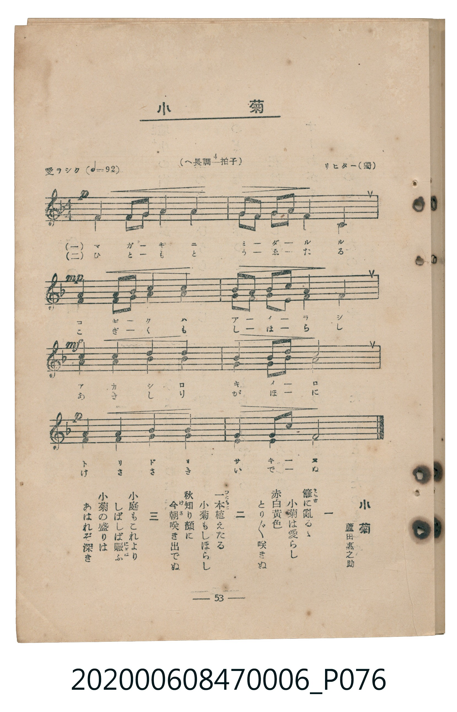

# 小菊

<audio controls src="kogiku.mp3"></audio>

- lyrics: 蘆田惠之助
- composer: リヒター（獨）
- 臺灣教育會公認《新定兒童唱歌》尋常科第六學年用（2020.006.0847.0006）

## 說明

原書資訊與歌詞全文（對應 P076.jpg，書頁 p. 53，參考教材第 12 首）：
速度與表情：愛ラシク（♩=92）
調性與拍號：へ長調四分之四拍子（F 大調 4/4 拍，二部合唱）
作詞：蘆田惠之助
作曲：リヒター（獨）

## 歌詞

```text
一
籬（まがき）に亂るゝ　小菊は愛らし
赤白黄色　とり／″＼咲きぬ

二
一本（ひともと）植えたる　小菊もしほらし
秋知り顔に　今朝（けさ）咲き出でぬ

三
小庭もこれより　しばしば賑（にぎは）ふ
小菊の盛りは　あはれぞ深き
```

## ABC

```abc
X:1
T:小菊
C:TMD (Chen, Chih-Han / aguai)
M:4/4
L:1/16
Q:1/4=92
K:F
V:V1 name="Piano" snm="Pia"
[V:V1]
!p! z4 c4 f2 g2 a4 | f4 a2 b2 c4 f4 | !mp! c4 b2 d2 c4 a4 | b2 a2 g2 c2 a8 |
!mf! f4 e4 d4 c4 | a4 d2 b2 g8 | !p! c4 f4 a4 c4 | b4 a2 g2 f6 z2 |
```

## TMD 檔案連結

- [主旋律 TMD 檔案](kogiku.tmd)
- [鋼琴伴奏 TMD 檔案](kogiku_piano.tmd)

## 分析

```text
================================================================================
📊 TMD Song Profile: [ 小菊 ]
================================================================================
⏱  Duration:       0:20 (20.9s), 8 measures total
🎼 Key & Tempo:    首調基準 F, != 92.0 BPM, <4/4>
   - 分析範圍：      由實際發聲的音符與和弦推測調性；播放脈絡另行呈現
🎤 人聲音域:    C4 (MIDI 60) – F5 (MIDI 77) [跨度: 17 個半音 / 1.4 個八度, 難度: challenging]
   - 最低音:  C4 in [Kogiku #1 @ m.1, 0:00]
   - 最高音: F5 in [Kogiku #1 @ m.5, 0:10]
   - 適合: soprano, mezzo-soprano, contralto, tenor, baritone, bass
🏛  結構:      Kogiku (20.9s)
⚡ 編曲密度:        Peak 1 軌道同時演奏
🗝  調性診斷：       F 大調（純淨自然大調，未偵測到可信轉調）
   - 風格氣質:    純淨自然大調（陽光明朗、易唱易記，無明顯調外色彩）
   - 轉調歷程:    全曲維持單一推測調性（未偵測到可信轉調）
   - 核心骨幹音:  C, A, F, G, A#
   - 調性數值:    F 大調 [相關度: 0.89, 穩定度: High, 自然音純度: 100.0%]
   - 候選調性 (K-S): F 大調 (0.89), A 小調 (0.76), C 大調 (0.69)
   - 五度圈歷程:   -1
   - 各段落調性細節:
     • [Kogiku #1]: F 大調 (r: 0.89, 自然音純度: 100.0%)

  [ 五度圈游移軌跡 ]
               C  
        [F ]*          G  
      Bb               D  
      Eb               A  
         Ab           E  
            Db       B  
               F# 
     (* = active key center)

  [ 十二半音累積音高分佈 ]
     C  : ████████████████████████  24.6%
     C# :                            0.0%
     D  : ██████                     6.6%
     D# :                            0.0%
     E  : ███                        3.3%
     F  : ███████████████████       19.7%
     F# :                            0.0%
     G  : ███████████               11.5%
     G# :                            0.0%
     A  : ████████████████████████  24.6%
     A# : ██████████                 9.8%
     B  :                            0.0%
--------------------------------------------------------------------------------
Assignment 軌道音域：
  - Piano         : C4 – F5 (17 個半音 / 1.4 個八度, 35 個音符)
================================================================================
```


## 原書掃描頁




