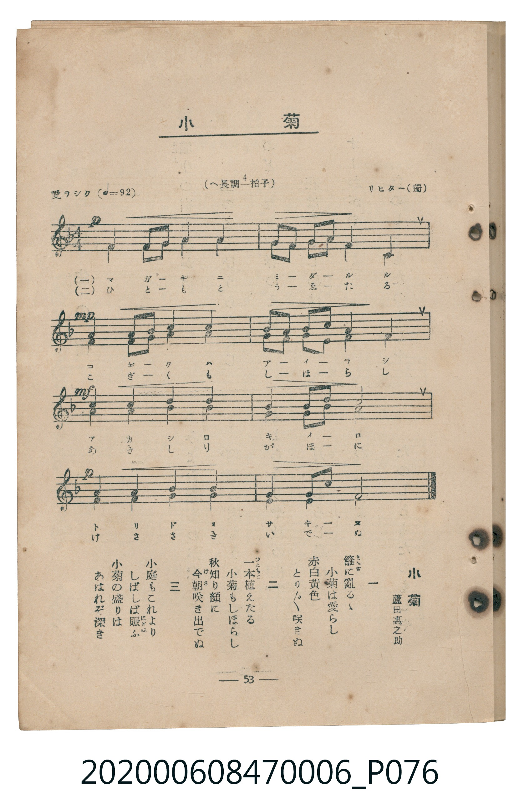

# 小菊

> Re:Shōka 使用 AI 協助辨識與重建樂譜，可能會有錯誤。歡迎回報。

- **鋼琴伴奏版**：<br><audio controls src="kogiku.mp3"></audio>
- **NEUTRINO 歌聲合成版**：<br><audio controls src="kogiku_neutrino.mp3"></audio>

- lyrics: 蘆田惠之助
- composer: リヒター（獨）
- 臺灣教育會公認《新定兒童唱歌》尋常科第六學年用（2020.006.0847.0006）

## 說明

原書資訊與歌詞全文（對應 P076.jpg，書頁 p. 53，參考教材第 12 首）：
速度與表情：愛ラシク（♩=92）
調性與拍號：へ長調四分之四拍子（F 大調 4/4 拍，二部合唱）
作詞：蘆田惠之助
作曲：リヒター（獨）


## 歌詞

```text
一
籬（まがき）に亂るゝ　小菊は愛らし
赤白黄色　とり／″＼咲きぬ

二
一本（ひともと）植えたる　小菊もしほらし
秋知り顔に　今朝（けさ）咲き出でぬ

三
小庭もこれより　しばしば賑（にぎは）ふ
小菊の盛りは　あはれぞ深き
```

## ABC

<div class="abc-score" data-abc-src="kogiku.abc" aria-label="五線譜載入中"></div>

[下載 ABC 原始檔](kogiku.abc)

## TMD 檔案連結

- [主旋律 TMD 檔案](kogiku.tmd) [[在 TMD Studio 編輯](https://tmdlang.github.io/Tmd-TS/#tmd=s7IKdvYPcrWy4qpTUCpJTLdSSM7PyUlNLsnMz7MqzsjMK0nNjM_KTMmPL87Iz05Ugisry88pzU21Si9KTEmNN4s3MjAyiDcwMIs3sDAxBzIMzBBKi_NLi5JTrYqTM_Lzc-JLUitKkvLzsxHyBUX5Zal5iXlANQVFIBtTwIrQDYgvSExPtQowMDdFyKSWZaakgjQWJyfmxZelFmWmZaamIOTzi0oy8oFuLMiotMrILC7JL8pMTsyJz07MQ_ZKalEx2LsQa0qKEvOKk4syC0BhgFBVkpEK9G9BTmIeksuA5qVn5lnlpmZmZSL5TEtL4emG_hf9XQpaWlyKtgqWRlz2tgpuXDYm-iZ2IM05lUCHFFspvJjR9nzKhmfNC57s7H7atRJscHJ-bkF-cWqRlcLj5lWPmyc9btr_uHnP-z0dz3tXvN_TCVbzon3X88bFz6bOfNG06dmc5qeta16s6n3c0PVs2oan62Y9bZ30fPXSp1M2Plvb87ih--mG7qc7djxfPvH5mjVPW9c-Xbvj6c4tz6cADesARZseMLL0QNEGZBiYgW3g0tdSsKUW4FJQUHjaN__Z7B0vNre_WNH1oqMd6K4XK-c9bV3xbFo70BVPN_Q-a-9UAEatmV5WQfr7PT1AxS8XNCoU6CmYGgO5T_ubXzQ0A737bO4EoCcUDI0UXi6bBnTq-z2zQMa_bJj_dNcyoMEvFq541twKFH3WMvtx88rHTdsfN60H2vBo5kpbSyOgBpDqF6v2P2tYDnJGd--LmfOBqh837ng5dTtQ_Ons2U872kCRMXs2UPbp2glAzW4KT5csB0oqAGNPASgKdNCTXT0vm1c8ndABDGSoqU_2zgH6CWgYWpxC5Z7N3gSyCFuMcoGV7GgAUc83rgGKP27c97ix53Ej0KrOx42rn-xqetzU_bhp7uOGBki6ety4HuTDJqDsdLCXti55PnPvy90tLzo3ARU9blzxuKnr_Z7-Rw2b3-_Z83TSJqBZjxvXQGza1QO18NkciGVAWaD6JiAJtO_ZEqBKoOB8kJVw-0Cy0x837kZY-Xx59_P5S4HWvFw4BehGoNInu7uezZkLNnHi48apQLMgFj9t3_W4cTnc-h3g4AKa-3TXWrC5kx839Txu6gAaBXY60JoNEPLF5olg01Y_buwD-hgcGFuhmsGBsO75bGAggEIDrBNo1nqQWY3znm3fCLQYpJTy9AsFClr6XFze-emZ2aVWAZmJefkONQY11SArFGwstOzADGzZRgGYYIFh_WJhj4KGEcjlz9c36IDSuikorWti0QC0CGRYjUJ1Qa2CoYIuEBspGANpEK4BsiF8kIxpPEgIrNzHsEYBmG6AfGDSAZO9YHI1WNPjxv1g3gIQ2dQNJ6F6jUAqNoFVrADLNcHZIJk2sNhEsNh8dL3GIBWT4XYB4wBuAlymCeyipg4w2QXWiz_AdvWQFWC5wBCDhJSJgikofMCOMAHzzcAyoFBDDjCIw_vAZD_c-SAZSBC0gJ3cCWZPRwswDL1wT4NUAnMLdr3gAIOo2ACXg7BBMpBAhJgKDsrGrUQE2I5O8gIsrRYeUGZQDAowXXCAgURBEDnAIMECTkEQhzeB0hlIBpLeIAEGYiPpBAcXRCdEFUQnOCXA0ys4uMDeR9KJlLqQI2kdVOdUhGuApkECjGBgAQt3crMjLBtCQgiSHXWB2BScsNDDCpKXQL583LgSxccQd0PCYg2WsILkNYgqhFqQDDh8G5dj0wkOK0goQ_IgJFznQXWCkhEs5hDxU4taqvl4YC_XgDX4i7VznuzoftG4CVj1Actl5Drwyd6-l_M3g8U7ySy_oLkXl3rzeKgUsnpg4sUVIaA8jxw4yK4ByUNwDchcXRCBHIHAING1U4CESrSPYawCEs8IhWcM5ilzAQA)]
- [鋼琴伴奏 TMD 檔案](kogiku_piano.tmd) [[在 TMD Studio 編輯](https://tmdlang.github.io/Tmd-TS/#tmd=s7IKdvYPcrWy4tLSUni6of9Ff9f7PR0vu_c8n7DlyZ4tT5f2P-_seL-nU0FLi0vRVsHSiMveVsGNy8ZE38SOq05BKaeyKDO52ErhxYy251M2PGte8GRn99OulUogueT83IL84tQiK4XHzaseN0963LT_cfMeoPHPe1cAjQSredG-63nj4mdTZ75o2vRsTvPT1jUvVvU-buh6Nm3D03WznrZOer566dMpG5-t7Xnc0P10Q_fTHTueL5_4fM2ap61rn67d8XTnludTgIZ1GBkYGegZGJjpGViYmAMZBmZgG7i889Mzs0utAjIT8_KDPBxqDGqquRSAwMZCyw7M0NdSsEUHCkDzn-xoeLGwR0HDCBQqz9c36CgEGJib6mUVpGti0aClDzasRqG6oFbBUEEXiI0UjIE0CNcA2RA-SMY0HiQEVu5jWKPwuHEfkP-4sQdM9oLJ1WBNjxv3g3kLQGRTN5yE6jUCqdgEVrECLNcEZ4Nk2sBiE8Fi89H1GoNUTIbb9bhxPdwEuEwT2EVNHWCyC6wXf4Dt6iErwHKBIQYJKRMFU1D4gB1hAuabgWVAoYYcYBCH94HJfrjzQTKQIGgBO7kTzJ6OFmAYeuGeBql83Lgbu15wgEFUbIDLQdggGUggQkwFB2XjViICbEcneQGWVgsPKDMoBgWYLjjAQKIgiBxgkGABpyCIw5tA6QwkA0lvkAADsZF0goMLohOiCqITnBLg6RUcXGDvI-lESl3IkbQOqnMqwjVA0yABRjCwns6eTW52hGVDSAhBsqMuEJuCExZ6WEHyEsiXjxtXovgY4m5IWKzBElaQvAZRhVALkgGHb-NybDrBYQUJZUgehITrPKhOUDKCxRwifmpRyzUfHOXa0775L9bOebKj-0XjppfNoFISmEeBjKcTOoBF6pO9fS_nbwaLA0t3ssovaO7Fpd48HiqFrB6YeHFFCCjPIwcOsmtA8hBcAzJXF0QgRyAwSHTtFCChEu1jGKuAxDNC4RmDecpcAA)]

## 分析

```text
================================================================================
📊 TMD Song Profile: [ 小菊 ]
================================================================================
⏱  Duration:       1:02 (62.6s), 24 measures total
🎼 Key & Tempo:    首調基準 F, != 92.0 BPM, <4/4>
   - 分析範圍：      由實際發聲的音符與和弦推測調性；播放脈絡另行呈現
🎤 人聲音域:    C4 (MIDI 60) – D5 (MIDI 74) [跨度: 14 個半音 / 1.2 個八度, 難度: moderate]
   - 最低音:  C4 in [Kogiku[L1] #1 @ m.2, 0:04]
   - 最高音: D5 in [Kogiku[L1] #1 @ m.4, 0:08]
   - 適合: soprano, mezzo-soprano, contralto, tenor, baritone, bass
🏛  結構:      Kogiku[L1] (20.9s) -> Kogiku[L2] (20.9s) -> Kogiku[L3] (20.9s)
⚡ 編曲密度:        Peak 2 軌道同時演奏
🗝  調性診斷：       F 大調（純淨自然大調，未偵測到可信轉調）
   - 風格氣質:    純淨自然大調（陽光明朗、易唱易記，無明顯調外色彩）
   - 轉調歷程:    全曲維持單一推測調性（未偵測到可信轉調）
   - 核心骨幹音:  F, A, G, C, A#
   - 調性數值:    F 大調 [相關度: 0.89, 穩定度: High, 自然音純度: 100.0%]
   - 候選調性 (K-S): F 大調 (0.89), A 小調 (0.62), D 小調 (0.59)
   - 五度圈歷程:   -1 -> -1 -> -1
   - 各段落調性細節:
     • [Kogiku[L1] #1]: F 大調 (r: 0.89, 自然音純度: 100.0%)
     • [Kogiku[L2] #1]: F 大調 (r: 0.89, 自然音純度: 100.0%)
     • [Kogiku[L3] #1]: F 大調 (r: 0.89, 自然音純度: 100.0%)

  [ 五度圈游移軌跡 ]
               C  
        [F ]*          G  
      Bb               D  
      Eb               A  
         Ab           E  
            Db       B  
               F# 
     (* = active key center)

  [ 十二半音累積音高分佈 ]
     C  : █████████████             14.1%
     C# :                            0.0%
     D  : ████                       4.7%
     D# :                            0.0%
     E  : ███                        3.1%
     F  : ████████████████████████  26.6%
     F# :                            0.0%
     G  : █████████████             14.8%
     G# :                            0.0%
     A  : ███████████████████████   25.0%
     A# : ███████████               11.7%
     B  :                            0.0%
--------------------------------------------------------------------------------
Assignment 軌道音域：
  - Piano         : C4 – D5 (14 個半音 / 1.2 個八度, 114 個音符)
  - PianoLH       : C4 – C5 (12 個半音 / 1.0 個八度, 114 個音符)
================================================================================
```


## 原書掃描頁




