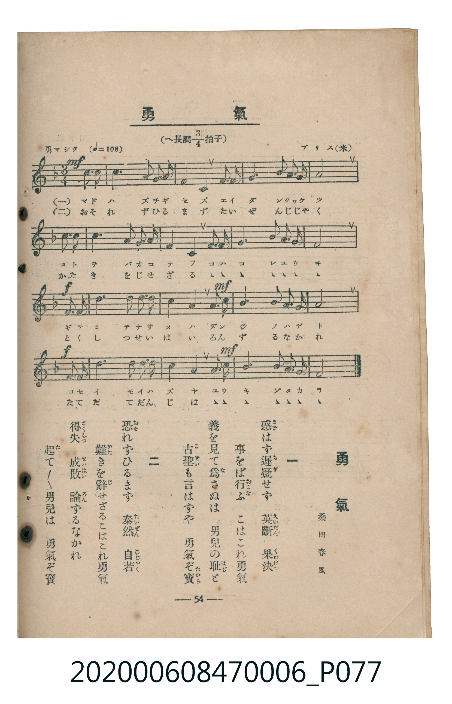

# 勇氣

<audio controls src="yuki.mp3"></audio>

- lyrics: 桑田春風
- composer: ブリス（米）
- 臺灣教育會公認《新定兒童唱歌》尋常科第六學年用（2020.006.0847.0006）

## 說明

原書資訊與歌詞全文（對應 P077.jpg，書頁 p. 54，參考教材第 13 首）：
速度與表情：勇マシク（♩=108）
調性與拍號：へ長調四分之三拍子（F 大調 3/4 拍，二部合唱）
作詞：桑田春風
作曲：ブリス（米）

## 歌詞

```text
一
惑（まど）はず遲疑（ちぎ）せず　英斷（えいだん）果決（くわけつ）
事をば行（おこな）ふ　こはこれ勇氣
義を見て爲（な）さぬは　男兒の耻（はぢ）と
古聖（こせい）も言はずや　勇氣ぞ寶（たから）

二
恐（おそ）れずひるまず　泰然（たいぜん）自若（じじやく）
難（かた）きを辭（じ）せざるこはこれ勇氣
得失（とくしつ）成敗（せいはい）　論（ろん）ずるなかれ
起（た）て／＼男兒は　勇氣ぞ寶
```

## 原書掃描頁



## 分析

```text
================================================================================
📊 TMD Song Profile: [ 勇氣 ]
================================================================================
⏱  Duration:       0:28 (28.3s), 17 measures total
🎼 Key & Tempo:    首調基準 F, != 108.0 BPM, <3/4>
   - 分析範圍：      由實際發聲的音符與和弦推測調性；播放脈絡另行呈現
🎤 人聲音域:    C4 (MIDI 60) – F5 (MIDI 77) [跨度: 17 個半音 / 1.4 個八度, 難度: challenging]
   - 最低音:  C4 in [Yuki #1 @ m.1, 0:01]
   - 最高音: F5 in [Yuki #1 @ m.11, 0:16]
   - 適合: soprano, mezzo-soprano, contralto, tenor, baritone, bass
🏛  結構:      Yuki (28.3s)
⚡ 編曲密度:        Peak 1 軌道同時演奏
🗝  調性診斷：       F 大調（純淨自然大調，未偵測到可信轉調）
   - 風格氣質:    純淨自然大調（陽光明朗、易唱易記，無明顯調外色彩）
   - 轉調歷程:    全曲維持單一推測調性（未偵測到可信轉調）
   - 核心骨幹音:  C, F, A, A#, E
   - 調性數值:    F 大調 [相關度: 0.95, 穩定度: High, 自然音純度: 100.0%]
   - 候選調性 (K-S): F 大調 (0.95), C 大調 (0.70), A 小調 (0.63)
   - 五度圈歷程:   -1
   - 各段落調性細節:
     • [Yuki #1]: F 大調 (r: 0.95, 自然音純度: 100.0%)

  [ 五度圈游移軌跡 ]
               C  
        [F ]*          G  
      Bb               D  
      Eb               A  
         Ab           E  
            Db       B  
               F# 
     (* = active key center)

  [ 十二半音累積音高分佈 ]
     C  : ████████████████████████  26.0%
     C# :                            0.0%
     D  : ███████                    7.3%
     D# :                            0.0%
     E  : ██████████                10.4%
     F  : ████████████████████████  26.0%
     F# :                            0.0%
     G  : █████                      5.7%
     G# :                            0.0%
     A  : ████████████              13.0%
     A# : ███████████               11.5%
     B  :                            0.0%
--------------------------------------------------------------------------------
Assignment 軌道音域：
  - Piano         : C4 – F5 (17 個半音 / 1.4 個八度, 60 個音符)
================================================================================
```

## ABC

```abc
X:1
T:勇氣
C:TMD (Chen, Chih-Han / aguai)
M:3/4
L:1/16
Q:1/4=108
K:F
V:V1 name="Piano" snm="Pia"
[V:V1]
!mf! z4 z4 c3 c | f6 g2 f2 e2 | f4 g4 a3 a | b6 d2 c2 b2 |
a8 c3 c | c6 a2 b2 c2 | d4 c4 b3 b | a6 c2 b2 g2 |
!f! f8 c3 c | e6 e2 e2 e2 | !mf! f4 c4 a3 b | c6 f2 e2 d2 |
!f! c8 c3 c | f6 e2 d2 e2 | !mf! f4 d4 b3 g | f6 a2 b2 g2 |
f8 z4 |
```

- [主旋律 TMD 檔案](yuki.tmd)
- [鋼琴伴奏 TMD 檔案](yuki_piano.tmd)
