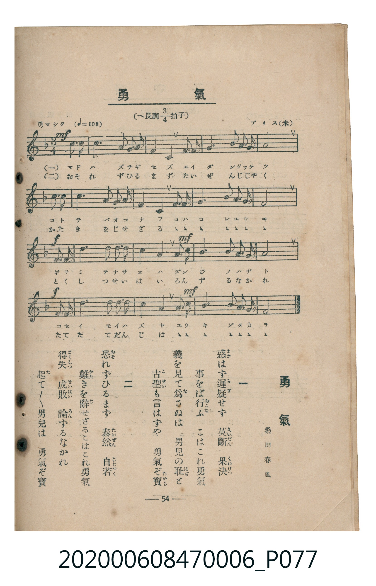

# 勇氣

> Re:Shōka 使用 AI 協助辨識與重建樂譜，可能會有錯誤。歡迎回報。

- **鋼琴伴奏版**：<br><audio controls src="yuki.mp3"></audio>
- **NEUTRINO 歌聲合成版**：<br><audio controls src="yuki_neutrino.mp3"></audio>

- lyrics: 桑田春風
- composer: ブリス（米）
- 臺灣教育會公認《新定兒童唱歌》尋常科第六學年用（2020.006.0847.0006）

## 說明

原書資訊與歌詞全文（對應 P077.jpg，書頁 p. 54，參考教材第 13 首）：
速度與表情：勇マシク（♩=108）
調性與拍號：へ長調四分之三拍子（F 大調 3/4 拍，二部合唱）
作詞：桑田春風
作曲：ブリス（米）


## 歌詞

```text
一
惑（まど）はず遲疑（ちぎ）せず　英斷（えいだん）果決（くわけつ）
事をば行（おこな）ふ　こはこれ勇氣
義を見て爲（な）さぬは　男兒の耻（はぢ）と
古聖（こせい）も言はずや　勇氣ぞ寶（たから）

二
恐（おそ）れずひるまず　泰然（たいぜん）自若（じじやく）
難（かた）きを辭（じ）せざるこはこれ勇氣
得失（とくしつ）成敗（せいはい）　論（ろん）ずるなかれ
起（た）て／＼男兒は　勇氣ぞ寶
```

## ABC

```abc
X:1
T:勇氣
M:3/4
L:1/16
Q:1/4=108
K:F
V:V1 name="Piano" snm="Pia"
[V:V1]
!mf! z4 z4 c3 c | c6 A2 G2 A2 | F4 C4 F3 F | G6 B2 A2 G2 |
w: ま ど | は ず ち ぎ | せ ず え い | だ ん くゎ け
A8 c3 c | c6 A2 G2 A2 | F4 C4 F3 F | G6 B2 A2 G2 |
w: つ こ と | を ば お こ | な ふ こ は | こ れ ゆ う
!f! F8 F3 F | d6 d2 d3 d | !mf! c4 A4 A3 c | B6 B2 A2 G2 |
w: き ぎ を | み て な さ | ぬ は だ ん | じ の は ぢ
!f! A8 F3 F | d6 d2 d3 d | !mf! c4 A4 A3 c | B6 B2 A2 G2 |
w: と こ せ | い も い は | ず や ゆ う | き ぞ た か
F8 z4 | !mf! z4 z4 c3 c | c6 A2 G2 A2 | F4 C4 F3 F |
w: ら | お そ | れ ず ひ る | ま ず た い
G6 B2 A2 G2 | A8 c3 c | c6 A2 G2 A2 | F4 C4 F3 F |
w: ぜ ん じ じゃ | く か た | き を じ せ | ざ る こ は
G6 B2 A2 G2 | !f! F8 F3 F | d6 d2 d3 d | !mf! c4 A4 A3 c |
w: こ れ ゆ う | き と く | し つ せ い | は い ろ ん
B6 B2 A2 G2 | !f! A8 F3 F | d6 d2 d3 d | !mf! c4 A4 A3 c |
w: ず る な か | れ た て | た て だ ん | じ は ゆ う
B6 B2 A2 G2 | F8 z4 |
w: き ぞ た か | ら
```

## TMD 檔案連結

- [主旋律 TMD 檔案](yuki.tmd) [[在 TMD Studio 編輯](https://tmdlang.github.io/Tmd-TS/#tmd=s7IKdvYPcrWy4qpTUCpJTLdSSM7PyUlNLsnMz7MqzsjMK0nNjM_KTMmPL87Iz05Ugisry88pzU21Si9KTEmNN4s3MjAyiDcwMIs3sDAxBzIMzBBKi_NLi5JTrYqTM_Lzc-JLUitKkvLzsxHyBUX5Zal5iXlANQVFIBtTwIrQDYgvSExPtQowMEcyOrUsMyUVpLE4OTEvviy1KDMtMzUFIZ9fVJKRD3RjQUalVUZmcUl-UWZyYk58dmIesldSi4rB3oVYU1KUmFecXJRZAAoDhKqSjFSgf1Nz81GFgSamZ-ZZlSRmAgMIFEjlifG5iZl5OYl5QHdoaSk87W5_tmGxgpYWl6KtgqGBBZe9rYIbl42xvokdyJCcSqCTiq0Uni2c-HzKhmczlr5ctAJsenJ-bkF-cWqRlcLj5mmPm1c9btr5fk_H842b3-_pBCt40b7reePiZ1Nnvmja9GxO89PWNS9W9T5u6Ho2bcPTdbOetk56vnrp0ykbn63tedzQ_XRD99MdO54vn_h8zZqnrWufrt3xdOeW51NWAI0ERZ0eMML0QFEHZBiYgW3g0tdSsKUW4FJQUHjaN__Z7B0vNre_WNH1oqMd6K4XK-c9bV3xbFo70BVPN_Q-a-9UAEavuV5WQfr7PT1AxS8XNCoU6CmYmgC5T_ubXzQ0A737bO4EoCcUDI0VXi6bBnTq-z2zQMa_bJj_dNcyoMEvFq541twKFAWG_OPmeY-btj9uWg-04dHMlbbA8AfqACl_sWr_s4blIHd0976YOR-o_HHjjpdTtwPFn86e_bSj7cnO7ic7OoGyT9dOAOp2U3i6ZDlQUgEYcQpAUaCLnuzqedm84umEDmAoQ019sncO0FNAw5CjEyrxbPYmkC0YkckFlt_RAKKeNU8Eij9u3Pe4cSVQ6nHj-seNs142bno-DSK-8HFjH1h8NlD8cUPDi-6Nz6ZtB0sBUcvjxgWPmyYDFTybN-fZxl1g8f7HTf2PGyc-blwCc-Ou7sdNkx43bnixsAesoutx4-THjavA5m4FGgrmAi2e_LipB5J6Qdqe71sJ1PZiWffjxmXPO4BeAeqE6Jn6uHENSENDw_Mp24Hp7nHjuhcNu8EKgKYsAqsBB8LT_iUvGoFRBpQA2gD0QgtIrqnpxQqgnSCfPm5qAZoCsfNx47yn67eBFc9_3Ah0MjCioWG1qwccVo2geAE7fy7YnB6QCY2bHjcBnQgMQFD4PNu84XkL3BBg-MyBhM-L9lUvupeCxWeAENDexn5o-LycvRgsATQFmCyAbu8F-XvfWohqWOhPA1uDLaCe7pv-dAkwQQBVrwAFf-N0SNg_65jwbOp0sDjI62Cd4AAARuNqcKg0AW0CuQ4cEkDTV4H9Dfbsi62QWIa4aNn7PUDX7oEFNyjokQMNpIHyPAsFClr6XFyRpdmZVgGZiXn5DjUGNdUgCxRsDM207MAsbCWFAjCPAhM1MI0paDzdsxHofgVtBROFpxv6n69v0AHlczNQPtfEohNoIcjUGgUDBV0whNHVuWm1CqZgpilQGsKCQGMgNoLSNQqGUFHTeCgDImAIlAIpgkETJI01YBYyhFsEdo2PYY0CzDQYDUxmUHolUD8wHpB0A-MQTC4Ek31gG4ARjyILYXVA6RawigXIZjRNBssAszDIAGAuhhqzBM2pwCQIpVfAnGuEzbldUHouyJSmHizO3QS2thtqD8R7qM6dj-LcOVicOwNCPm5qhhrTj-FckAUQw2rAWRp3EtrVA05CJKYcKicNmCYYrAamQ7g-ePIAFhMontwAJkFhDokfUFCsgstuhbNgcbcerALCg4UoKI4eN7WB5UEkSEUvmmsgyQukbhJS7KOqg7gNFjegZAhSMQ0uC4kQ6rhmBZTuJxi5OzrJiVwzJNtAbAjfDCnaYVkZXGBAOKACAxSp2CMYPe_jiODG_SgeXQYmIVEKrAbBwbEGLgsrDWB5GpQ9QCpAUYAwYx1cLbCqBLsFFoDIqmCRMhslgqejqAEVCrASBpY9EW5ogbGaIBEGcw0sY0PEQMkA4iNIHkUvJiBmwYqAZYQiGNiSGiQRjJ6DYVUKcuTCgggSFE1IwQbLDfBSsAkRnKB8AMkPGHmucR48uBDB2YnmElg5hByxkACGmQJJZtgTEVIUU9EltVxcunYKoEo_2scwVgHONgKzlbkA)]
- [鋼琴伴奏 TMD 檔案](yuki_piano.tmd) [[在 TMD Studio 編輯](https://tmdlang.github.io/Tmd-TS/#tmd=s7IKdvYPcrWy4tLSUnja3f5sw-L3ezpedu95PmHLkz1bni7tf97Z8X5Pp4KWFpeirYKhgQWXva2CG5eNsb6JHVedglJOZVFmcrGVwrOFE59P2fBsxtKXi1YogSSS83ML8otTi6wUHjdPe9y86nHTTqDJzzduBpoGVvCifdfzxsXPps580bTp2Zzmp61rXqzqfdzQ9WzahqfrZj1tnfR89dKnUzY-W9vzuKH76Ybupzt2PF8-8fmaNU9b1z5du-Ppzi3Pp6wAGmlkYGSgZ2BgpmdgYWIOZBiYgW3giizNzrQKyEzMyw_ycKgxqKnmUgACG0MzLTswS19LwRYdKACNf7Kj4cXCHgWNp3s2vti6XUFbwUTh6Yb-5-sbdBQCDMzN9LIK0jWx6NTSB5tao2CgoAuGMLo6N61WwRTMNAVKQ1gQaAzERlC6RsEQKmoaD2VABAyBUiBFMGiCpLEGzEKGcIvArvExrFGAmQajHzfug9IrgfofN65H0v24cRaYXAgm-8A2PG6cjSILYXVA6RawigXIZjRNBsv0P24CGfC4cSLUmCVoTn3cCFIIolfAnGuEzbldUHouyJSmHizO3QS2thtqD8R7qM6dj-LcOVicOwNCPm5qhhrTj-FckAUQw2q48CehXT3gJERiyqFy0oBpgsFqYDqE64Mnj8dNk1A8uQFMgsIcEj-goFgFl90KZ8Hibj1YBYQHC1FQHD1uagPLg0iQil4010CSF0jdJKTYR1UHcRssbkDJEKRiGlwWEiHUcc0KKN1PMHJ3dJITuWZItoHYEL4ZUrTDsjK4wIBwQAUGKFKxRzB63scRwY37UTy6DExCovRx41RwcKyBy8JKA1ieBmUPkApQFCDMWAdX-7hxEdgtsABEVgWLlNkoETwdRQ2oUICVMLDsiXBDC4zVBIkwmGtgGRsiBkoGEB9B8ih6MQExC1YELCMUwU9nzx4kEYyeg2FVCnLkwoIIEhRNSMEGyw3wUrAJEZygfADJDxh5rnEePLgQwdmJ5hJYOYQcsZAAhpkCSWbYExFSFFPRJbXIdb4Pcp1vAq3yQZUzCAJDNl4h2jAWjNE4pvFAnmk8kAsi4JJATVAjKNBqAlJgAlIAIuilGxguunYKoKCJ9gEKwdlGYLYyFwA)]

## 分析

```text
================================================================================
📊 TMD Song Profile: [ 勇氣 ]
================================================================================
⏱  Duration:       0:56 (56.7s), 34 measures total
🎼 Key & Tempo:    首調基準 F, != 108.0 BPM, <3/4>
   - 分析範圍：      由實際發聲的音符與和弦推測調性；播放脈絡另行呈現
🎤 人聲音域:    C4 (MIDI 60) – D5 (MIDI 74) [跨度: 14 個半音 / 1.2 個八度, 難度: moderate]
   - 最低音:  C4 in [Yuki[L1] #1 @ m.3, 0:03]
   - 最高音: D5 in [Yuki[L1] #1 @ m.10, 0:15]
   - 適合: soprano, mezzo-soprano, contralto, tenor, baritone, bass
🏛  結構:      Yuki[L1] (28.3s) -> Yuki[L2] (28.3s)
⚡ 編曲密度:        Peak 1 軌道同時演奏
🗝  調性診斷：       F 大調（純淨自然大調，未偵測到可信轉調）
   - 風格氣質:    純淨自然大調（陽光明朗、易唱易記，無明顯調外色彩）
   - 轉調歷程:    全曲維持單一推測調性（未偵測到可信轉調）
   - 核心骨幹音:  A, F, C, D, G
   - 調性數值:    F 大調 [相關度: 0.90, 穩定度: High, 自然音純度: 100.0%]
   - 候選調性 (K-S): F 大調 (0.90), D 小調 (0.68), A 小調 (0.67)
   - 五度圈歷程:   -1 -> -1
   - 各段落調性細節:
     • [Yuki[L1] #1]: F 大調 (r: 0.90, 自然音純度: 100.0%)
     • [Yuki[L2] #1]: F 大調 (r: 0.90, 自然音純度: 100.0%)

  [ 五度圈游移軌跡 ]
               C  
        [F ]*          G  
      Bb               D  
      Eb               A  
         Ab           E  
            Db       B  
               F# 
     (* = active key center)

  [ 十二半音累積音高分佈 ]
     C  : ████████████████████      19.8%
     C# :                            0.0%
     D  : █████████████             12.5%
     D# :                            0.0%
     E  :                            0.0%
     F  : █████████████████████     20.8%
     F# :                            0.0%
     G  : █████████████             12.5%
     G# :                            0.0%
     A  : ████████████████████████  24.0%
     A# : ██████████                10.4%
     B  :                            0.0%
--------------------------------------------------------------------------------
Assignment 軌道音域：
  - Piano         : C4 – D5 (14 個半音 / 1.2 個八度, 120 個音符)
================================================================================
```


## 原書掃描頁




