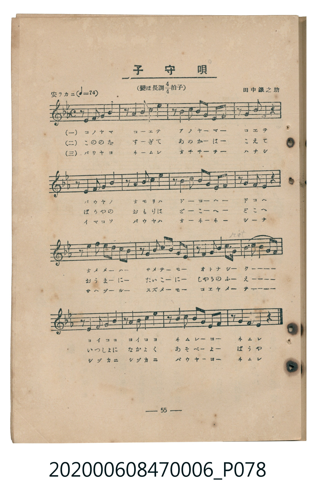
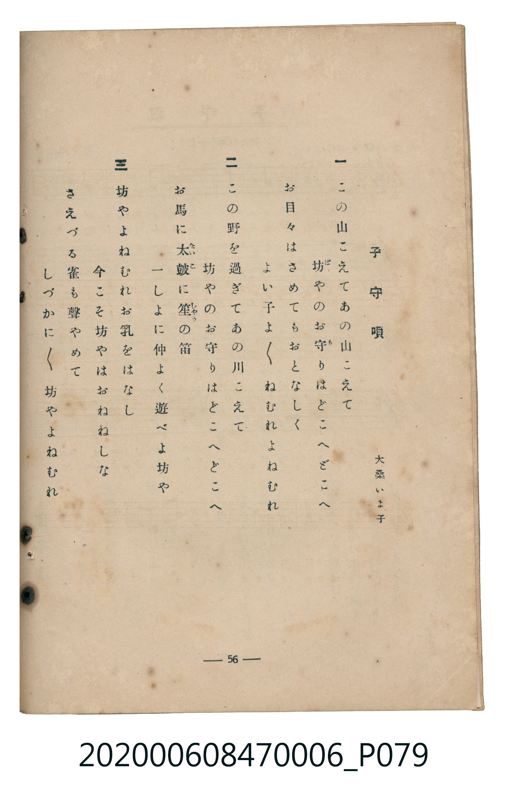

# 子守唄

<audio controls src="komoriuta.mp3"></audio>

- lyrics: 大桑いよ子
- composer: 田中銀之助
- 臺灣教育會公認《新定兒童唱歌》尋常科第六學年用（2020.006.0847.0006）

## 說明

原書資訊與歌詞全文（對應 P078.jpg – P079.jpg，書頁 pp. 55–56，參考教材第 14 首）：
速度與表情：安ラカニ（♩=74）
調性與拍號：變ほ長調四分之四拍子（E♭ 大調 4/4 拍）
作詞：大桑いよ子
作曲：田中銀之助

## 歌詞

```text
一
この山こえてあの山こえて
坊（ぼ）やのお守（も）りはどこへどこへ
お目々はさめてもおとなしく
よい子よ／＼ねむれよねむれ

二
この野を過ぎてあの川こえて
坊やのお守りはどこへどこへ
お馬に太鼓（たいこ）に笙（しやう）の笛
一しよに仲よく遊べよ坊や

三
坊やよねむれお乳をはなし
今こそ坊やはおねねしな
さえずる雀も聲やめて
しづかに／＼坊やよねむれ
```

## 原書掃描頁





## 分析

```text
================================================================================
📊 TMD Song Profile: [ 子守唄 ]
================================================================================
⏱  Duration:       0:51 (51.9s), 16 measures total
🎼 Key & Tempo:    首調基準 E,, != 74.0 BPM, <4/4>
   - 分析範圍：      由實際發聲的音符與和弦推測調性；播放脈絡另行呈現
🎤 人聲音域:    A#3 (MIDI 58) – D#5 (MIDI 75) [跨度: 17 個半音 / 1.4 個八度, 難度: challenging]
   - 最低音:  A#3 in [Komoriuta #1 @ m.4, 0:12]
   - 最高音: D#5 in [Komoriuta #1 @ m.10, 0:30]
   - 適合: soprano, mezzo-soprano, contralto, tenor, baritone, bass
🏛  結構:      Komoriuta (51.9s)
⚡ 編曲密度:        Peak 1 軌道同時演奏
🗝  調性診斷：       G 小調（純淨自然小調，未偵測到可信轉調）
   - 風格氣質:    純淨自然小調（陰鬱抒情、旋律集中，無明顯調外色彩）
   - 轉調歷程:    全曲維持單一推測調性（未偵測到可信轉調）
   - 核心骨幹音:  G, A#, C, F, D#
   - 調性數值:    G 小調 [相關度: 0.75, 穩定度: Moderate, 自然音純度: 100.0%]
   - 候選調性 (K-S): G 小調 (0.75), C 小調 (0.62), A# 大調 (0.60)
   - 五度圈歷程:   +1
   - 各段落調性細節:
     • [Komoriuta #1]: G 小調 (r: 0.75, 自然音純度: 100.0%)

  [ 五度圈游移軌跡 ]
               C  
         F           [G ]*
      Bb               D  
      Eb               A  
         Ab           E  
            Db       B  
               F# 
     (* = active key center)

  [ 十二半音累積音高分佈 ]
     C  : ███████████████           20.2%
     C# :                            0.0%
     D  :                            0.0%
     D# : ████████                  10.6%
     E  :                            0.0%
     F  : ████████████              16.1%
     F# :                            0.0%
     G  : ████████████████████████  32.6%
     G# :                            0.0%
     A  :                            0.0%
     A# : ███████████████           20.6%
     B  :                            0.0%
--------------------------------------------------------------------------------
Assignment 軌道音域：
  - Piano         : A#3 – D#5 (17 個半音 / 1.4 個八度, 74 個音符)
================================================================================
```

## ABC

```abc
X:1
T:子守唄
C:TMD (Chen, Chih-Han / aguai)
M:4/4
L:1/16
Q:1/4=74
K:Eb

V:V1 name="Piano" snm="Pia"

[V:V1]
z2 g2 g4 b4 c4 | z2 c2 b4 g4 b4 | z2 g2 b2 b2 g4 f2 g2 | z2 f2 e4 c4 B2 z2 |
z2 B2 c4 e4 f4 | z2 f2 g4 f4 g4 | z2 b2 c2 c2 g4 f2 g2 | z2 f2 g4 f4 e2 z2 |
z2 c2 c2 c2 c4 b2 g2 | z2 b2 c2 e2 c4 b4 | z2 g2 g4 f4 e3 f | g3 b c2 b2 g8 |
z2 g2 f4 g4 b4 | z2 b2 g4 b4 c4 | z2 b2 c2 c2 g4 f2 g2 | z2 f2 e4 e4 z4 |
```

- [主旋律 TMD 檔案](komoriuta.tmd)
- [鋼琴伴奏 TMD 檔案](komoriuta_piano.tmd)
