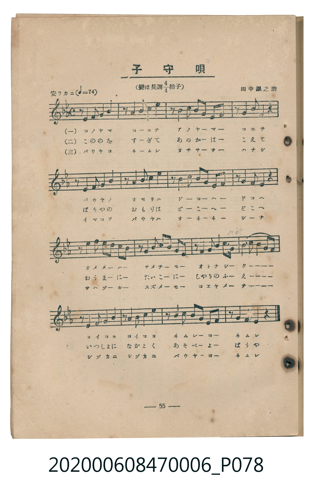
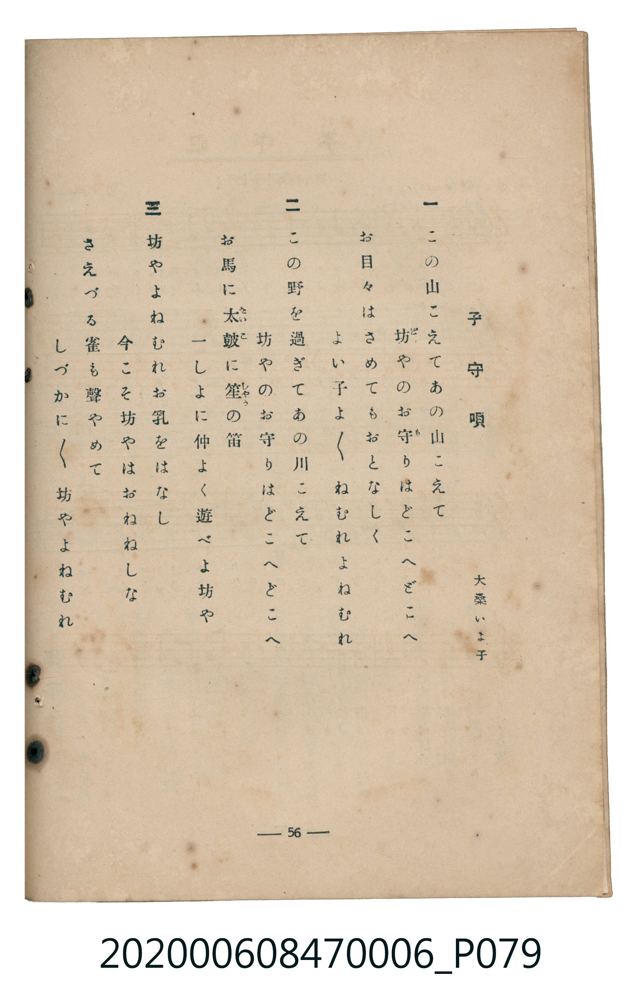

# 子守唄

> Re:Shōka 使用 AI 協助辨識與重建樂譜，可能會有錯誤。歡迎回報。

- **鋼琴伴奏版**：<br><audio controls src="komoriuta.mp3"></audio>

- lyrics: 大桑いよ子
- composer: 田中銀之助
- 臺灣教育會公認《新定兒童唱歌》尋常科第六學年用（2020.006.0847.0006）

## 說明

原書資訊與歌詞全文（對應 P078.jpg – P079.jpg，書頁 pp. 55–56，參考教材第 14 首）：
速度與表情：安ラカニ（♩=74）
調性與拍號：變ほ長調四分之四拍子（E♭ 大調 4/4 拍）
作詞：大桑いよ子
作曲：田中銀之助


## 歌詞

```text
一
この山こえてあの山こえて
坊（ぼ）やのお守（も）りはどこへどこへ
お目々はさめてもおとなしく
よい子よ／＼ねむれよねむれ

二
この野を過ぎてあの川こえて
坊やのお守りはどこへどこへ
お馬に太鼓（たいこ）に笙（しやう）の笛
一しよに仲よく遊べよ坊や

三
坊やよねむれお乳をはなし
今こそ坊やはおねねしな
さえずる雀も聲やめて
しづかに／＼坊やよねむれ
```

## ABC

```abc
X:1
T:子守唄
M:4/4
L:1/16
Q:1/4=74
K:Eb
V:V1 name="Piano" snm="Pia"
[V:V1]
z2 G2 G4 B4 c4 | z2 c2 B4 G4 B4 | z2 G2 B2 B2 G4 F2 G2 | z2 F2 E4 C4 B,2 z2 |
w: 1.~こ の や ま | こ _ え て | あ の や _ ま _ | こ え て _
w: 2.~こ の の を | す _ ぎ て | あ の か _ は _ | こ え て _
w: 3.~ば う や よ | ね _ む れ | お ち ち _ を _ | は な し _
z2 B,2 C4 E4 F4 | z2 F2 G4 F4 G4 | z2 B2 c2 c2 G4 F2 G2 | z2 F2 G4 F4 E2 z2 |
w: 1.~ば う や の | お も り は | ど _ こ _ へ _ | ど こ へ _
w: 2.~ば う や の | お も り は | ど _ こ _ へ _ | ど こ へ _
w: 3.~い ま こ そ | ば う や は | お _ ね _ ね _ | し _ な _
z2 c2 c2 c2 c4 B2 G2 | z2 B2 c2 e2 c4 B4 | z2 G2 G4 F4 E3 F | G3 B c2 B2 G8 |
w: 1.~お め め _ は _ | さ め て _ も | お と な し _ | く _ _ _ _
w: 2.~お う ま _ に _ | た い こ _ に | しゃ う の ふ _ | え _ _ _ _
w: 3.~さ へ づ _ る _ | す ず め _ も | こ え や め _ | て _ _ _ _
z2 G2 F4 G4 B4 | z2 B2 G4 B4 c4 | z2 B2 c2 c2 G4 F2 G2 | z2 F2 E4 E4 z4 |
w: 1.~よ い こ よ | よ い こ よ | ね む れ _ よ _ | ね む れ
w: 2.~い つ しょ に | な か よ く | あ そ べ _ よ _ | ば う や
w: 3.~し づ か に | し づ か に | ば う や _ よ _ | ね む れ
```

## TMD 檔案連結

- [主旋律 TMD 檔案](komoriuta.tmd) [[在 TMD Studio 編輯](https://tmdlang.github.io/Tmd-TS/#tmd=s7IKdvYPcrWy4qpTUCpJTLdSSM7PyUlNLsnMz7MqzsjMK0nNjM_KTMmPL87Iz05Ugisry88pzU21Si9KTEmNN4s3MjAyiDcwMIs3sDAxBzIMzBBKi_NLi5JTrYqTM_Lzc-JLUitKkvLzsxHyBUX5Zal5iXlANQVFIBtTwIoQClLLMlNSQdKpKZkl-UWZiTlI7kgtKga7FWxJfElRYl5xclFmAcgDCFUlGalAx6Yl5mbmVCJEgUalZ-ZZ5aZmZmUiuUtLS-Hp2glP13U8ndKioKXFpWirYG7CZW-r4KrDZWOib2IHMiCnsigzudhK4emS5c8WTnzc2PK4qQOoC2x4cn5uQX5xapGVwvMpG57sWPuyq-HJzu6nXSvBsi_adz1vXPxs6swXTZuezWl-2rrmxarexw1dz6ZteLpu1tPWSc9XL306ZeOztT2PG7qfbuh-umPH8-UTn69Z87R17dO1O57u3PJ8yor3ezpAQa4HDGg9UJADGQZm7_d0KnFx6Wsp2FILcCkoKDztm_9s9o4Xm9tfrOh60dEOdNeLlfOetq54Nq0d6IqnG3qftXcqBBiYW-hlFaQrPGqYDOJYgjjv9_QAdb5c0KhQUKCnYGoKlDMFOrLnaX_zi4ZmYAg8mzsB6C8FQxOFl8umAV3_fs8skI0vG-Y_3bUMaNeLhSueNbcCRZ-u63zcvPJx0-rHzd1ASx_NXGlrbgLUAFL9YtX-Zw3LQS7r7n0xcz5Q9Yt1XY8bd7-cuh0o9XT27KcdbaDgnz0bqAAYRUD9ro9mrgXFHFBeARihCkAJqGFP9s4B-g5kI2q8QuWezd4ElEOLVS6w5I4GEPW4cfLjxnVPN24EMzoeNy573NiEJgIO1LldQHc8btwDtPdxUwtQxePGLmCSAwk2NYEFgX5Y_7hxJVjbDjgDYknX89nrHje0glVMfdzUCLKnCWgPUM-Kx42rHjdOf9zYD1baBLSkBegBIOP9nv73e_Y8blz7uKnhcVMPWArKhnhhVw_CCy_b-x43TXrZ2PcYhGC-2D4X3RfIjifg5pfL1jxuXP10yaqXeyaDPT8fFLyNQHYnUPz5mplgwelgE9vAguuer5kNDVywBFB69ZPdm8CM_pcg3-4ERQ_YFdBYAMci1F1IHgRa_2TnZqCPwA4EBRBY-W6gEUAXzoV5BCgHFFkLRsAgXAVx-VSwj2c9bup-ORtoWNOLRqATgMaDgh2iAqh26ePGbqDzIIGM6QCQOsrzIxQoaOlzcXnn5wILsNKSRKuAzMS8fIcag5pqkC0KNoZmWnZgFraiQAGY44Dh-WJhj4KGicLTDf3P1zfowPOvJhYNQMughmkANWpaARPVZoXHzX1AvASI5ynUQEX2AOkVQLoNLLIISQ1QBqgOREPVQtUhG72rB2R042QgXgfBTZNAyhtnQgxoBBrWuAws0gRV0w2VWQ8zGqy7A6wOxdWdIKObJwCNXAZ10QqQ8uZeqNsWAPEasNtWAVmNUAyS2QQzurkfiLuAKrbDjK5RMFDQVTCGYhA0hdJmUBqiAsSDyaCrRJgBEgFhmAojKBuiAsQzhJkeDzMExADJ1oDd42NYowASAYUCiFwHVQZMiTBW4z64vQiVMAgKORhrGZq6JriJCNNwm4jNJBAEqYC61QiHW5FcPQnN5Jko9vYR41ZgCkHWs548txrD1G8Ak21wF8LDtQlmBkzlWmR7mxrgrB40dV1gciGcROhB9z3I7cASCe7W6RhuxZ_ld_VQlOVRMk8fPKuAMjmI7gdnkU5oIQAtDJpnwDMPUAYsOgNblt8ADlRQcIKiDZSNQfkMmMmbgDTQ4yCRldCsDszgYHoHPMsDZcDZfgeWLN8EKaAgRc5esEuQ_QF2NdgfINfCCgMIDZLZDhXpQs3y4HwHz4WwbAnKopAIg2VY5KwMgjA-1BSQIVCMO9OjmwGyDVuWx5k04RkKJckBQxemEsTHnj1WwmVQi4kdWNQh1CDkEUkTNcsPAbfCszzIbYhCDlnnXDSTcfsK3a0IX6xFcSuMB1OHnMURWR_hUgJ1fCdldTwoWyyEYlAmANV_kGyxFSoKzLNgGVAhAJEB6QFWv9B6EiYKqZ6RMZZCAJTVgQYCgxqSwVfDM_h8cDQgsj5CZjrQ8GaoPlB7AOQwiAzIEbithBYOIOWgIqoVqghucNNOIN6F5HeED2FtF1DxAZEFFSqwkMCwDtECQMYgCKvrUQsDwzg0JZD0gN7QQC4NQLwaqIwpvLEBUwmD6OUFJGc1wklEOkNPrVMRKlEqSES-RK3MVsBNwqysQFHTj-YydIheWkBMBeUrRD6EmLoazf75YBKSY1FLAXSVwL5EM9xYiBJEC2QrkmNh9ToBx8KLC3BggQsVYI8A2QlNsJYIcmsG2KkAy6FEAEaworVSkFodMH0glyJHDXaX4i0ugN1jytoHwEwBqm3BtTykcY0p0gvEkKY2JJuAMhIkAyFksBQNoMwPNAic3dvBsQnyMLCsAXUAgE0vUJqCdQvmAjEw94KbIZBCACSDaGFgKQZABRWwCGgCZf9ueL2PIoLSaiDgckRuRa_3UfMzci7F3nEgroUAa3_AaJA4UtKE5XhwExWSO8CJB1GToTdeiVcJrrEgzVtE05aQSog8TDWsFYWe6yG5eAncDcAc2w7noGdnUEGDaOsjLEcUNqh9A1DVDUom-ByMqzpHczA854OKOESeR3INZuFDtEqEG9B6XWQEby0Xl66dAnzQQAHIUeYCAA)]
- [鋼琴伴奏 TMD 檔案](komoriuta_piano.tmd) [[在 TMD Studio 編輯](https://tmdlang.github.io/Tmd-TS/#tmd=s7IKdvYPcrWy4tLSUni6dsLTdR1Pp7S839PxsnvP8wlbnuzZ8nRp__POjvd7OhW0tLgUbRXMTbjsbRVcdbhsTPRN7LjqFJRyKosyk4utFJ4uWf5s4cTHjS2PmzqARimB5JLzcwvyi1OLrBSeT9nwZMfal10NT3Z2P-1aCZZ90b7reePiZ1Nnvmja9GxO89PWNS9W9T5u6Ho2bcPTdbOetk56vnrp0ykbn63tedzQ_XRD99MdO54vn_h8zZqnrWufrt3xdOeW51NWAB1rZGBkoGdgYKZnYGFiDmQYmAHdq8TF5Z2fm1-UWVqSaBWQmZiXH-ThUGNQU82lAAQ2hmZadmCWvpaCLTpQANrxZEfDi4U9ChomCk839D9f36CjEGBgbqGXVZCuiUWDlj7YsBoFAwVdBWMoBkFTKG0GpSEqQDyYDLpKhBkgERCGqTCCsiEqQDxDmOnxMENADJBsDdg9PoY1CiCRx42TweQ6qLLHTS0wVuM-uL0IlTD4uLEDzlqGpq4JbiLCNNwmYjMJBEEqoG41wuFWJFdPQjN5Joq9fcS4tbEbRc968txqDFO_AUy2wV0ID9cmmBkwlWuR7W1qgLN60NR1gcmFcBKhB933ILc_blwFd-t0DLfiT-G7eshN4eBkBk90sFQISpEQ98HSJ3LKBUEYH2oKyBAoxp3G0c0A2YYtheOMCXj6QQnhJlCagKgE8bGnhpVwGdRcsQOLOoQahDwiJlBT-BBwKzyFg9yGyNPIOueimYzbV-huRfhiLYpbYTyYOuQUjUjpCJcSKME7yU3fsFQJwyAIK4lR065hHJoSiPPRqwHkxAvi1UBlTOFVAUwlDKInb0hCaISTiGBBD9ypCJUoxRciGaEWNSvgJmEWJTVAdj-ay9AheuKGmApKBohkAzF1NZr988EkJIGhJlp0ldMfNzXDjYUoQdQPW5EcCyt1CTgWnrrBgQXOA48blyI7oQlWTyDXNY8bZ4HlUCIAI1jR6hCkOgGmD-RS5KjB7lK8qfvp7NmUtE_QS2TUpIucILG3YIgru2E1A4wGiSPFAixxg-tKSEIAhxOijEGvRYlXCS5LIPUsoo4lpBIiD1MNq9_QEzgkwS6BuwGYONvhHPSUC8pTiEYHwnJEvkJtpIAK1ceNO_E6GFdBi-ZgeCIH5WZE8kZyDWY-I1olwg1ozT8ygrcWo63ug9xWN4E21WsUDOMVog1jFUzigbRJfCxCBErB-aYgFabIKkAiBtCQwaYMzsRjFLIahFlw18B1YorgcCaMDzUJpxswPYzHVcDQ1LVTgAdotA9QOaqAEbqAMVhAmQsA)]

## 分析

```text
================================================================================
📊 TMD Song Profile: [ 子守唄 ]
================================================================================
⏱  Duration:       0:51 (51.9s), 16 measures total
🎼 Key & Tempo:    首調基準 E,, != 74.0 BPM, <4/4>
   - 分析範圍：      由實際發聲的音符與和弦推測調性；播放脈絡另行呈現
🎤 人聲音域:    A#3 (MIDI 58) – D#5 (MIDI 75) [跨度: 17 個半音 / 1.4 個八度, 難度: challenging]
   - 最低音:  A#3 in [Komoriuta #1 @ m.4, 0:12]
   - 最高音: D#5 in [Komoriuta #1 @ m.10, 0:30]
   - 適合: soprano, mezzo-soprano, contralto, tenor, baritone, bass
🏛  結構:      Komoriuta (51.9s)
⚡ 編曲密度:        Peak 1 軌道同時演奏
🗝  調性診斷：       G 小調（純淨自然小調，未偵測到可信轉調）
   - 風格氣質:    純淨自然小調（陰鬱抒情、旋律集中，無明顯調外色彩）
   - 轉調歷程:    全曲維持單一推測調性（未偵測到可信轉調）
   - 核心骨幹音:  G, A#, C, F, D#
   - 調性數值:    G 小調 [相關度: 0.75, 穩定度: Moderate, 自然音純度: 100.0%]
   - 候選調性 (K-S): G 小調 (0.75), C 小調 (0.62), A# 大調 (0.60)
   - 五度圈歷程:   +1
   - 各段落調性細節:
     • [Komoriuta #1]: G 小調 (r: 0.75, 自然音純度: 100.0%)

  [ 五度圈游移軌跡 ]
               C  
         F           [G ]*
      Bb               D  
      Eb               A  
         Ab           E  
            Db       B  
               F# 
     (* = active key center)

  [ 十二半音累積音高分佈 ]
     C  : ███████████████           20.2%
     C# :                            0.0%
     D  :                            0.0%
     D# : ████████                  10.6%
     E  :                            0.0%
     F  : ████████████              16.1%
     F# :                            0.0%
     G  : ████████████████████████  32.6%
     G# :                            0.0%
     A  :                            0.0%
     A# : ███████████████           20.6%
     B  :                            0.0%
--------------------------------------------------------------------------------
Assignment 軌道音域：
  - Piano         : A#3 – D#5 (17 個半音 / 1.4 個八度, 74 個音符)
================================================================================
```


## 原書掃描頁






