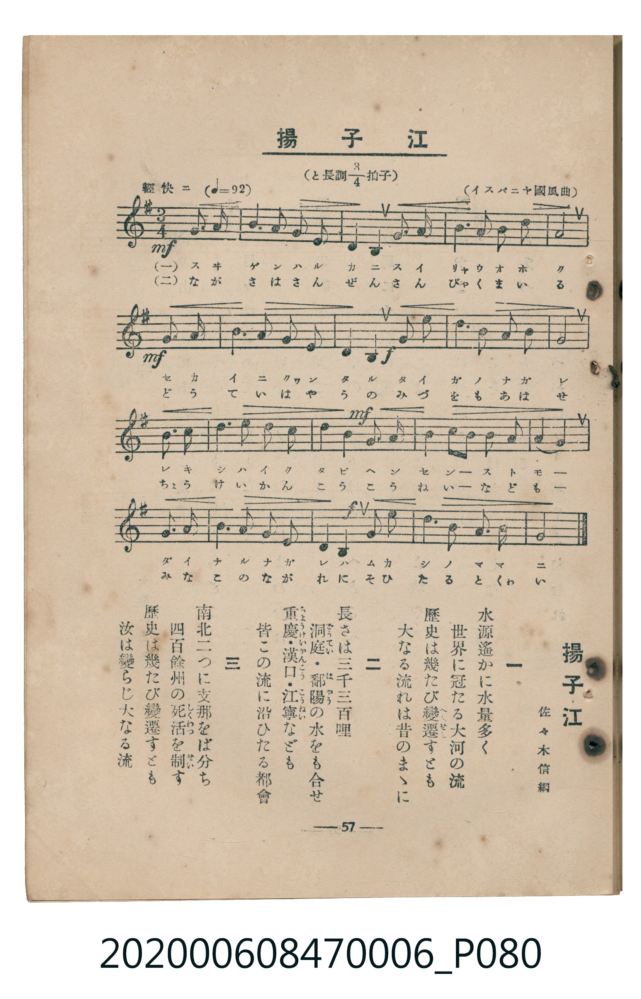

# 揚子江

> Re:Shōka 使用 AI 協助辨識與重建樂譜，可能會有錯誤。歡迎回報。

- **鋼琴伴奏版**：<br><audio controls src="yosuko.mp3"></audio>
- **NEUTRINO 歌聲合成版**：<br><audio controls src="yosuko_neutrino.mp3"></audio>

- lyrics: 佐々木信綱
- composer: イスパニヤ國風曲
- 臺灣教育會公認《新定兒童唱歌》尋常科第六學年用（2020.006.0847.0006）

## 說明

原書資訊與歌詞全文（對應 P080.jpg，書頁 p. 57，參考教材第 15 首）：
速度與表情：輕快ニ（♩=92）
調性與拍號：と長調四分之三拍子（G 大調 3/4 拍）
作詞：佐々木信綱
出處：（イスパニヤ國風曲）


## 歌詞

```text
一
水源遙かに水量多く
世界に冠たる大河の流
歴史は幾たび變遷（へんせん）すとも
大なる流れは昔のまゝに

二
長さは三千三百哩
洞庭（どうてい）・鄱陽（はゝやう）の水をも合せ
重慶（ちようけい）・漢口（かんこう）・江寧（こうねい）なども
皆この流に沿ひたる都會

三
南北二つに支那をば分ち
四百餘州の死活（しくわつ）を制（せい）す
歴史は幾たび變遷すとも
汝は變らじ大なる流
```

## ABC

<div class="abc-score" data-abc-src="yosuko.abc" aria-label="五線譜載入中"></div>

[下載 ABC 原始檔](yosuko.abc)

## TMD 檔案連結

- [主旋律 TMD 檔案](yosuko.tmd) [[在 TMD Studio 編輯](https://tmdlang.github.io/Tmd-TS/#tmd=s7IKdvYPcrWy4qpTUCpJTLdSSM7PyUlNLsnMz7MqzsjMK0nNjM_KTMmPL87Iz05Ugisry88pzU21Si9KTEmNN4s3MjAyiDcwMIs3sDAxBzIMzBBKi_NLi5JTrYqTM_Lzc-JLUitKkvLzsxHyBUX5Zal5iXlANQVFIBtTwIrQDYgvSExPtQowMLdEyKSWZaakgjQWJyfmxZelFmWmZaamIOTzi0oy8oFuLMiotMrILC7JL8pMTsyJz07MQ_ZKalEx2LsQa0qKEvOKk4syC0BhgFBVkpEK9G95YklqEbL5memZeVa5qZlZmUg-09JSeNY_6-naCc82zlfQ0uJStFWwNOKyt1Vw57Ix1jexA-nPqQS6pdhK4cneCY8bWp_NWfFk_8Ln2zaCzU7Ozy3IL04tslJ43LTkcdPOx80THzd3P25e8nRO98tFK57N3gRW9qJ91_PGxc-mznzRtOnZnOanrWterOp93ND1bNqGp-tmPW2d9Hz10qdTNj5b2_O4ofvphu6nO3Y8Xz7x-Zo1T1vXPl274-nOLc-nrHi_pwMUeXrAKNMDRR6QYWD2fk-nEheXvpaCLbUAl4KCwtO--c9m73ixuf3Fiq4XHe1Ad71YOe9p64pn09qBrni6ofdZe6dCgIGFgV5WQfr7PT1AxS8XNCoU6CmYmgO5T_ubXzQ0A737bO4EoCcUDE0VXi6bBnTq-z2zQMa_bJj_dNcyoMEvFq541twKFH2xZ-rT_auBQQc0_tHMlbaWRkDVIKUvVu1_1rAc5Ibu3hcz5wOVPm5c8XLqdqD409mzn3a0PdnZ_WRHJ1AWGIlAze4KT5csB0oqAGNPASgKNebJ3jlAHwB1o0Ui2LPtu17MnAqUA2rHFYsgY8Dm7GgAUc82bHm2a8LLxpmPG7sfN64Gcl-29z9dAnRbP0TVtOdTe4AST9sWPG6c_7ipG-ioZ5s2P25c92xrI9iAtVue9m963Lj-6c59IBWNm1-s63rZuB3khMYdj5smP26cDSSB1j4GWbLicVMT2KlLlj9uXAU0D2jM4yagDeufzZgCNPVx477HTXOBFkIcuasHHMpTtz9unApUAwyfp73NQPL5zH1PJ68E279l3tNda8G2rXzc2Pa4cdnjxhaQbc27X7ZsfDlzL1hqPcjQphagArBD1gH9-bhpEtAtTycAZWeDLWnvfda6Dax64eMmIAk0ayLcrGd7Fj3tXwyW7QZ7CojAZgGlNs5_un45WAok-LhxLVQX0H9AN0H8-3wWUAIoDQo2UDhv2v-4ERhqoBB92bwXmJOgkQKO46e905_2TAd6_nHjEpDiKetfNi0GubdxAzCdAN0HVjR7NjAUXi6Z8XT7PJC5a3c_27Ib7IrpwMh73NQP1AxyRdOkpx0Qb82GuWsmvohDiaZnG4FxsR4o8bgJqG8GcqyBpCnPo1CgoKXPxRWZX1yanW8VkJmYl-9QY1BTDbJCwcbQTMsOzMJWNigAcyUwKb9Y2KOg8XTPxhdbtytoK5goPN3Q_3x9gw4wZ5tbgnK2JhadQCtBptYoGCjogiGMrs5Nq1UwBDONgNLGUGEIXxcsYxYPJGoUTEEUCBrDGLi1gfimYF0gHjJEtQ_sKB_DGgWYkTAaGDEQumkC0JDHjZOQjAAmSbCK9WB2N9gaYEqF61yNbkZjC0hFEzBem5GNaWwDk11gcjfUmH409wJTEpTuhjnXCJtzV0HpHrApU1FMADsULAZxOkjFHBTPQNRBdIFEQCo2ozsX5DRgkQH1EdgYsO9RnbsS7jmoc43xOBdq1R4s9mwFk_Ohzl0Cl0WE7nS4WSCXoMRQ4waw6RCTYDG0EMOtMBM2gbxaAy4VcCf8XT3ghE9ieicpQVdD06YZRB5JK8gYWMKugaZfVFldYE5EpGdIDCF8Cgo1cEnVBw4YWCoABS8kIhDJFyQGj2BgekI2Zh2YBEUeRAYU8MgqIGZBRB439iKlWGBdgWISyHxYFoLZBcoPCHsgrP1gcinULtRs2ASWg5Agk0BmQHILsk3ACqYdykROk6hZDVgJgVVMf9zUClUKMQ_mEoR5oEQDD0rktAkxB-REiDMQgQgpB3AFEYHytpOcZIecdkCpCcQ3AbsGJgNLmDgKYJBiEBuW8BAlKSzxYRaisAwFCylIuQOJaVBgo6S4xs1w1g5ooEAKA1gMIpdMoAAEVpQQM8DxjhonC6A0sKBFSnETUdRA3AFK54j0j7ABkfYgYuDEAiTXouiHsCDpH1TQYXcNKM1CCyak5DZQYYNU1OJPasBGziAo4UAszBIO1lxATmwQj8ECBByxOIomSHBD1DWA-bA6ATVSIMUbqIaD0CAVsPoGBmE-QU5osMhANgWXSxD111wwuQnqEljkI_sGFKnwwga9UMfiGHA6W4TiGEg6gxgHLSObOuGyM-AsUA5CFFi4ghbiJWylPsIltVxcunYKkPZltI9hrAISzwiFZwzmKXMBAA)]
- [鋼琴伴奏 TMD 檔案](yosuko_piano.tmd) [[在 TMD Studio 編輯](https://tmdlang.github.io/Tmd-TS/#tmd=s7IKdvYPcrWy4qpTUCpJTLdSyC8qychPL0osyKi0ysgsLskvykxOzInPTsxLVIIrKs4vLUpOjS9ITE-1CjCwMFDi0tJSeNY_6-naCc82zn-_p-Nl957nE7Y82bPl6dL-550d7_d0KmhpcSnaKlgacdnbKrhz2Rjrm9iBzMupBFpQbKXwZO-Exw2tz-aseLJ_4fNtG8F2JefnFuQXpxZZKTxuWvK4aefj5omPm7sfNy95Oqf75aIVz2ZvAit70b7reePiZ1Nnvmja9GxO89PWNS9W9T5u6Ho2bcPTdbOetk56vnrp0ykbn63tedzQ_XRD99MdO54vn_h8zZqnrWufrt3xdOeW51NWAB1tZGBkoGdgYKZnYGFiDmQYmAHdrcTFFZlfXJqdbxWQmZiXH-ThUGNQU82lAAQ2hmZadmCWvpaCLTpQAFrwZEfDi4U9ChpP92x8sXW7graCicLTDf3P1zfoKAQYmFvqZRWka2LRqaUPNrVGwUBBFwxhdHVuWq2CIZhpBJQ2hgpD-LpgGbN4IFGjYAqiQNAYxsCtDcQ3BesC8ZAhqn1gR_kY1ijAjITRjxtnQuimCUBDHjdOQjLicdNksIr1YHY32JrHjSAaonM1uhmNLSAVTV2Pm5qRjWlsA5NdYHI31Jh-NPc-bpwNpbthzjXC5txVULoHbMpUFBPADgWLQZwOUjEHxTMQdRBdIBGQis3ozgU57XHjPqiPwMaAfY_q3JVwz0Gda4zHuVCr9mCxZyuYnA917hK4LCJ0p8PNArkEJYYaN4BNh5gEi6GFGG6FmbAJ5NUaLvwJf1cPOOGTmN5JStDV0LRpBpFH0goyBpawa6DpF1VWF5gTEekZEkMIn4JCDRiyj5v6wAEDSwWg4IVEBCL5gsTgEQxMT8jGrAOToMiDyIACHlkFxCyIyOPGXqQU-7hxGYpJIPNhWQhmFyg_IOyBsPaDyaVQu1CzYRNYDkKCTAKZAcktyDYtfNzUDmUip0nUrPa4qQOsYvrjplaoUoh5MJcgzAMlGnhQIqdNiDkgJ0KcgQhESDmAK4gIlLed5CQ75LQDSk0gvgnYNTAZWMLEUQCDFIPYsISHKElhiQ-zEIVlKFhIQcodSEyDAhslxTVuhrN2QAMFUhjAYhC5ZAIF4OPGFRAzwPGOGicLoDSwoEVKcRNR1EDcAUrniPSPsAGR9iBi4MQCJNei6IewIOkfVNBhdw0ozUILJqTkNlBhg1TU4k9qT2fPHgQlHIiFWcLBmgvIiQ3iMViAgCMWR9EECW6IugYwH1YnoEYKpHgD1XAQGqQCVt_AIMwnyAkNFhnIpuByCaL-mgsmN0FdAot8ZN-AIhVe2KAX6lgcA05ni1AcA0lnEOOgZWRTJ1x2BpwFykGIAgtX0EK8hK3UR7ikFrV56YPcvDSBti5B7UAQBEZ0vEK0YSwYo3FM44E803ggF0RAfIgkSo5mqBKQVjQFGHwzEN8sPhcoACaxGIHbdhOQZhOgOSBTkfWAAkfXTgESPtE-QEEknhEKzxjMU-YCAA)]

## 分析

```text
================================================================================
📊 TMD Song Profile: [ 揚子江 ]
================================================================================
⏱  Duration:       1:39 (99.8s), 51 measures total
🎼 Key & Tempo:    首調基準 G, != 92.0 BPM, <3/4>
   - 分析範圍：      由實際發聲的音符與和弦推測調性；播放脈絡另行呈現
🎤 人聲音域:    B3 (MIDI 59) – E5 (MIDI 76) [跨度: 17 個半音 / 1.4 個八度, 難度: challenging]
   - 最低音:  B3 in [Yosuko[L1] #1 @ m.3, 0:04]
   - 最高音: E5 in [Yosuko[L1] #1 @ m.7, 0:13]
   - 適合: soprano, mezzo-soprano, contralto, tenor, baritone, bass
🏛  結構:      Yosuko[L1] (33.3s) -> Yosuko[L2] (33.3s) -> Yosuko[L3] (33.3s)
⚡ 編曲密度:        Peak 1 軌道同時演奏
🗝  調性診斷：       G 大調（純淨自然大調，未偵測到可信轉調）
   - 風格氣質:    純淨自然大調（陽光明朗、易唱易記，無明顯調外色彩）
   - 轉調歷程:    全曲維持單一推測調性（未偵測到可信轉調）
   - 核心骨幹音:  B, G, D, A, E
   - 調性數值:    G 大調 [相關度: 0.80, 穩定度: Moderate, 自然音純度: 100.0%]
   - 候選調性 (K-S): G 大調 (0.80), B 小調 (0.74), D 大調 (0.62)
   - 五度圈歷程:   +1 -> +1 -> +1
   - 各段落調性細節:
     • [Yosuko[L1] #1]: G 大調 (r: 0.80, 自然音純度: 100.0%)
     • [Yosuko[L2] #1]: G 大調 (r: 0.80, 自然音純度: 100.0%)
     • [Yosuko[L3] #1]: G 大調 (r: 0.80, 自然音純度: 100.0%)

  [ 五度圈游移軌跡 ]
               C  
         F           [G ]*
      Bb               D  
      Eb               A  
         Ab           E  
            Db       B  
               F# 
     (* = active key center)

  [ 十二半音累積音高分佈 ]
     C  : ██                         2.6%
     C# :                            0.0%
     D  : ███████████████           19.8%
     D# :                            0.0%
     E  : █████                      6.2%
     F  :                            0.0%
     F# :                            0.0%
     G  : ██████████████████        23.4%
     G# :                            0.0%
     A  : █████████████             16.7%
     A# :                            0.0%
     B  : ████████████████████████  31.2%
--------------------------------------------------------------------------------
Assignment 軌道音域：
  - Piano         : B3 – E5 (17 個半音 / 1.4 個八度, 186 個音符)
================================================================================
```


## 原書掃描頁




