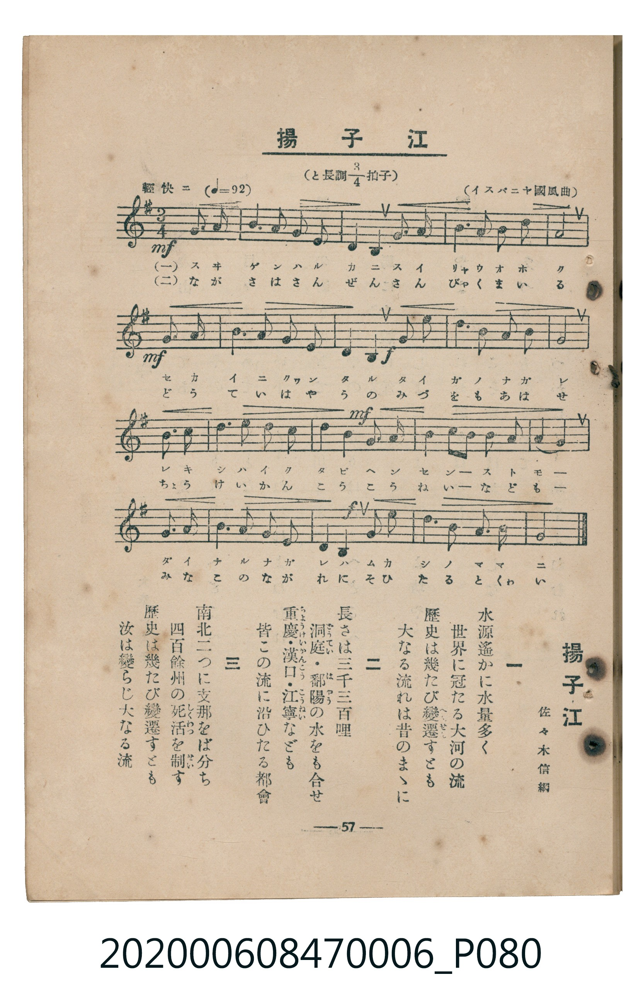

# 揚子江

> Re:Shōka 使用 AI 協助辨識與重建樂譜，可能會有錯誤。歡迎回報。

<audio controls src="yosuko.mp3"></audio>

- lyrics: 佐々木信綱
- composer: イスパニヤ國風曲
- 臺灣教育會公認《新定兒童唱歌》尋常科第六學年用（2020.006.0847.0006）

## 說明

原書資訊與歌詞全文（對應 P080.jpg，書頁 p. 57，參考教材第 15 首）：
速度與表情：輕快ニ（♩=92）
調性與拍號：と長調四分之三拍子（G 大調 3/4 拍）
作詞：佐々木信綱
出處：（イスパニヤ國風曲）

## 歌詞

```text
一
水源遙かに水量多く
世界に冠たる大河の流
歴史は幾たび變遷（へんせん）すとも
大なる流れは昔のまゝに

二
長さは三千三百哩
洞庭（どうてい）・鄱陽（はゝやう）の水をも合せ
重慶（ちようけい）・漢口（かんこう）・江寧（こうねい）なども
皆この流に沿ひたる都會

三
南北二つに支那をば分ち
四百餘州の死活（しくわつ）を制（せい）す
歴史は幾たび變遷すとも
汝は變らじ大なる流
```

## ABC

```abc
X:1
T:揚子江
M:3/4
L:1/16
Q:1/4=92
K:G
V:V1 name="Piano" snm="Pia"
[V:V1]
!mf! z4 z4 D3 G | G3 F E3 D D3 B, | D4 B,4 D3 G | A3 B A3 G F3 G |
w: 1.~す ゐ | げ ん は _ る _ | か に す い | りゃ う お _ ほ _
w: 2.~な が | さ は さ _ ん _ | ぜ ん さ ん | びゃ く ま _ い _
w: 3.~な ん | ぼ く ふ _ た _ | つ に し な | を ば わ _ か _
!mf! A8 D3 G | G3 F E3 D D3 B, | !f! D4 B,4 G3 A | B3 c B3 A G3 F |
w: 1.~く せ か | い に くゎ _ ん _ | た る た い | が の な _ が _
w: 2.~る ど う | て い は _ や _ | う の み づ | を も あ _ は _
w: 3.~ち し ひゃ | く よ しゅ _ う _ | の _ し くゎ | つ を せ _ い _
G8 A3 B | c3 B A3 G F3 A | !mf! c4 A4 B3 A | G3 F E3 F G3 E |
w: 1.~れ れ き | し は い く た び | へ ん せ ん | _ _ す と も _
w: 2.~せ ちょ う | け い か ん こ う | こ う ね い | _ _ な ど も _
w: 3.~す れ き | し は い く た び | へ ん せ ん | _ _ す と も _
D4 B,4 D3 G | G3 F E3 D D3 B, | !f! D4 G4 A3 B | c3 E E3 F G3 A |
w: 1.~_ _ だ い | な る な _ が _ | れ は む か | し の ま _ ま _
w: 2.~_ _ み な | こ の な _ が _ | れ に そ ひ | た る と _ くゎ _
w: 3.~_ _ な ん | ぢ は か _ は _ | ら じ だ い | な る な _ が _
G8 z4 |
w: 1.~に
w: 2.~い
w: 3.~れ
```

## TMD 檔案連結

- [主旋律 TMD 檔案](yosuko.tmd) [[在 TMD Studio 編輯](https://tmdlang.github.io/Tmd-TS/#tmd=s7IKdvYPcrWy4qpTUCpJTLdSSM7PyUlNLsnMz7MqzsjMK0nNjM_KTMmPL87Iz05Ugisry88pzU21Si9KTEmNN4s3MjAyiDcwMIs3sDAxBzIMzBBKi_NLi5JTrYqTM_Lzc-JLUitKkvLzsxHyBUX5Zal5iXlANQVFIBtTwIoQClLLMlNSQdKpKZkl-UWZiTlI7kgtKga7FWxJfElRYl5xclFmAcgDCFUlGalAx5YnlqQWKXFpaSk865_1dO2EZxvnK2hpcSnaKlgacdnbKrhz2Rjrm9iBdOVUFmUmF1spPNk74XFD67M5K57sX_h820awicn5uQX5xalFVgqPm5Y8btr5uHni4-bux81Lns7pfrloxbPZm8DKXrTvet64-NnUmS-aNj2b0_y0dc2LVb2PG7qeTdvwdN2sp62Tnq9e-nTKxmdrex43dD_d0P10x47nyyc-X7Pmaevap2t3PN255fmUFe_3dICCVg8YoHqgoAUyDMze7-lU4uLS11KwpRbgUlBQeNo3_9nsHS82t79Y0fWiox3orhcr5z1tXfFsWjvQFU839D5r71QIMLAw0MsqSH-_pweo-OWCRoUCPQVTcyD3aX_zi4ZmoHefzZ0A9ISCoanCy2XTgE59v2cWyPiXDfOf7loGNPjFwhXPmluBoi_2TH26fzUw6IDGP5q50tbSCKgapPTFqv3PGpaD3NDd-2LmfKDSx40rXk7dDhR_Onv20462Jzu7n-zoBMoCIxGo2V3h6ZLlQEkFYOwpAEWhxjzZOwfoA6ButEgEe7Z914uZU4FyQO24YhFkDNicHQ0g6tmGLc92TXjZOPNxY_fjxtVA7sv2_qdLgG7rh6ia9nxqD1DiaduCx43zHzd1Ax31bNPmx43rnm1tBBuwdsvT_k2PG9c_3bkPpKJx84t1XS8bt4Oc0LjjcdPkx42zgSTQ2scgS1Y8bmoCO3XJ8seNq4DmAY153AS0Yf2zGVOApj5u3Pe4aS7QQogjd_WAQ3nq9seNU4FqgOHztLcZSD6fue_p5JVg-7fMe7prLdi2lY8b2x43Lnvc2AKyrXn3y5aNL2fuBUutBxna1AJUAHbIOqA_HzdNArrl6QSg7GywJe29z1q3gVUvfNwEJIFmTYSb9WzPoqf9i8Gy3WBPARHYLKDUxvlP1y8HS4EEHzeuheoC-g_oJoh_n88CSgClQcEGCudN-x83AkMNFKIvm_cCcxI0UsBx_LR3-tOe6UDPP25cAlI8Zf3LpsUg9zZuAKYToPvAimbPBobCyyUznm6fBzJ37e5nW3aDXTEdGHmPm_qBmkGuaJr0tAPirdkwd83EF3Eo0fRsIzAu1gMlHjcB9c1AjjWQNOV5FAoUtPS5uCLzi0uz860CMhPz8h1qDGqqQVYo2BiaadmBWdjKBgVgrgQm5RcLexQ0TBSebuh_vr5BB56hNbFoANoENUwDqFETVN7tVHjcvEGhBsjaBGRtBuJ-IF4NFlkNZHVD1DQtAYk0r3rcvBjIWQbEq4Dc2WBl64F4N1g5svm7ekDmNwKVNfaAlDVOBWKgUhDdNBksMgfMQhbZ_LipGUgBndC4D4hbwOYDndC4EojbYObXKFTnptUqGCjogiGMNo0HU4ZAeUMwyzxewQwiBpSCyhrHA6WhbDAPQ68RRAZKG4JMgUqBLfcxrFGA6YLRwHQDoZsmgL0xCcoDeW49TA3QHxAWSAWMDUzi6GZAfQ1Mds1QgTYg7oIr2w0zBuIcI2zOWQWlYSEP4UFCH-acyUjOmYMhCteFHDMQCUjswJS1oDrHGI9zoEbtQTJnK1zNfCTnLMESOtPhZoFCBxrCjRuA7H64GngIg0sU3JlmVw9lmWYJNGOsf9y8DpxrQE7aD843YBqSW5rWAEX6gLgLzAblH5AIEDetxZZVgLkKGJrgaGoCpwFwxAMtaAQa2bgU6m9g6QTkgfB6sJrZQAwstNtRMwgk8SIgOMNQkkGqgfohmoyA8sZglgmUNkIYh8gjoPhFdQPIrbB4AslDUg4ojsGFdh9MGUrKhCULRPaBiUEzCjCNQ3iggIIkNEjKR0mWwFyCMAHhoJVQug1s0jK4ucjZFp7AwepgOtfBWfuhNCyCILogkQRTAzMNkUmAkYbhGlgS3wTKa4gQBNbIIMnHTa1wlTB3gBTBXIJpDjhQEfkJnHqgcYCacwlUMZ2U5ZbtkEoFlGuAdQUsqwDLxuYZ8MwDrD_Alc8eaJXUAc4uiyAizQ1g3ViyzERobIEyI6RwARW5oGwDoUEiayFqQAaBa6OVYAuB8QMWAWWtVYh8A0nICAirDGqAiR3CQqsWQLkBIgVTDM1ssKyBmdeALIgQkI-UX5pgSRYekVCRx429YI_AohVUjMPyDqgMhWUHcEg27oDrRhTl0HwHDiJEMoHVNyvAwYGSQEHZBZ5SEDrA5QwsBYKUTITyIHEAswQU-siqEA5B5J-1cJ3IToLVW8DqHt1J4DwDcfJABxHe7AJsm1KUXUC1BageQas1QK2yBeBGFiipgLIUqGaZB8YgNd3YsgcoKiDFIrQpAAwuSHk7F4g3QQtYSAsL6EVEgdGCyBF420rEViOI2gMzSwG1omcMRK5BQFgrD5FjUOVB0bQASkMqBlirA-Q7LBUDUo5DLu4boCKQOgqWoEChiGjzwFggFbAWCgzCvIzISZjuhFUZ4LYMPLPgqMBQ3IloD82F0rBYRPh1BVwNUq2KqHBxOhWYwzCditp0WwQVBeUvRH0Mr92A6jrhojPgLHKjBdOdtVxcunYKkM6SApClzAUA)]
- [鋼琴伴奏 TMD 檔案](yosuko_piano.tmd) [[在 TMD Studio 編輯](https://tmdlang.github.io/Tmd-TS/#tmd=s7IKdvYPcrWy4tLSUnjWP-vp2gnPNs5_v6fjZfee5xO2PNmz5enS_uedHe_3dCpoaXEp2ipYGnHZ2yq4c9kY65vYcdUpKOVUFmUmF1spPNk74XFD67M5K57sX_h820YlkFxyfm5BfnFqkZXC46Ylj5t2Pm6e-Li5-3Hzkqdzul8uWvFs9iawshftu543Ln42deaLpk3P5jQ_bV3zYlXv44auZ9M2PF0362nrpOerlz6dsvHZ2p7HDd1PN3Q_3bHj-fKJz9esedq69unaHU93bnk-ZQXQ0UYGRgZ6BgZmegYWJuZAhoEZ0N1KXFyR-cWl2flWAZmJeflBHg41BjXVXApAYGNopmUHZulrKdiiAwWgBU92NLxY2KOgYaLwdEP_8_UNOgoBBhYGelkF6ZpYNGjpgw2rUajOTatVMFDQBUMYbRoPpgyB8oZglnm8ghlEDCgFlTWOB0pD2WAehl4jiAyUNgSZApUCW-5jWKMA0wWjHzfOhNBNE4AGPG6cBOVNBrLXw9Q0dUNZIBUw9uPG1ehmNLaAVDR1PW5qhgq0AXEXXNlumDEQ5xhhc84qKN0DtmwqlLcezoY4DuGcORiicF1AEZCKzQjn9APxPriyFlTnGONxDtSoPUjmbIWrmY_knCVYQmc63CxQ6EBDuHEDkN0PVwMPYS78iW5XDzmJDpIgEBCcCClJdNVA_RBNRkB5YzDLBEobIYxDpDtQmKG64XHjbLjfQfKQ2ACFG1Dt46Y-mDKU2IYFNSJJwsSgiQ-YbiC8dfDIg6QmlKgGpjyECQgHrYTSbWCTlsHNRc4K8EQDVgfTuQ7O2g-llyJHdlMTUKQJrgZmGiLhPW5ciOEaWLLZBEq_iBB83NQBknzc1ApXCXMHSBHMJZjmgAMVkUZBjoPFAWpuIFDsdZKTAiFJAgFhRVUNMNlAWGiFFihdQaRgiqHJFpbIMFMtkAURAvKRUl4TLPLhQQIVedzYCw4PWACBChlYKgTlcFjC2gxWtQOuG1HQQFMwuHRABDisNFwBjniUqAYlPHiYI3QsfNzUDmVC0t5EKA-U9iDpFFIkQ6yGqUI4BJES18J1IjsJVqquxHQSOPVBnDzQQYQ34T2dPZuchIe3wiS23EMUd5gpF6gVPf0hEicCwqp6RMJElQeFxgIoDSnJYFVPN5yNUpIhJWzk8qkBKgIpVGHxBioNERUfjAVSAaumYBDmZUSCxXQnrIwDV2jwNImjxEVxJ6JSnAulNyGV6xC_roCrQaoGEDUETqcCEzKmU1Hr70VQUVAyRlQg8OIYqK4TLjoDziI3WjDdWYva4PRBbnCaQNubNcCkAoLAJBSvEG0YC8ZoHNN4IM80HsgFERD_I4mSoxmqBKQVTQEG3wzEN4vPBQqASSxG4LbdBKTZBGgOyFRkPaDA0bVTgIRPtA9QEIlnhMIzBvOUuQA)]

## 分析

```text
================================================================================
📊 TMD Song Profile: [ 揚子江 ]
================================================================================
⏱  Duration:       0:33 (33.3s), 17 measures total
🎼 Key & Tempo:    首調基準 G, != 92.0 BPM, <3/4>
   - 分析範圍：      由實際發聲的音符與和弦推測調性；播放脈絡另行呈現
🎤 人聲音域:    B3 (MIDI 59) – C5 (MIDI 72) [跨度: 13 個半音 / 1.1 個八度, 難度: moderate]
   - 最低音:  B3 in [Yosuko #1 @ m.2, 0:03]
   - 最高音: C5 in [Yosuko #1 @ m.8, 0:14]
   - 適合: soprano, mezzo-soprano, contralto, tenor, baritone, bass
🏛  結構:      Yosuko (33.3s)
⚡ 編曲密度:        Peak 1 軌道同時演奏
🗝  調性診斷：       G 大調（純淨自然大調，未偵測到可信轉調）
   - 風格氣質:    純淨自然大調（陽光明朗、易唱易記，無明顯調外色彩）
   - 轉調歷程:    全曲維持單一推測調性（未偵測到可信轉調）
   - 核心骨幹音:  G, D, A, B, E
   - 調性數值:    G 大調 [相關度: 0.93, 穩定度: High, 自然音純度: 100.0%]
   - 候選調性 (K-S): G 大調 (0.93), D 大調 (0.79), B 小調 (0.60)
   - 五度圈歷程:   +1
   - 各段落調性細節:
     • [Yosuko #1]: G 大調 (r: 0.93, 自然音純度: 100.0%)

  [ 五度圈游移軌跡 ]
               C  
         F           [G ]*
      Bb               D  
      Eb               A  
         Ab           E  
            Db       B  
               F# 
     (* = active key center)

  [ 十二半音累積音高分佈 ]
     C  : █████                      5.7%
     C# :                            0.0%
     D  : ███████████████████       20.8%
     D# :                            0.0%
     E  : ████████                   8.9%
     F  :                            0.0%
     F# : ██████                     6.8%
     G  : ████████████████████████  26.6%
     G# :                            0.0%
     A  : ███████████████           16.7%
     A# :                            0.0%
     B  : █████████████             14.6%
--------------------------------------------------------------------------------
Assignment 軌道音域：
  - Piano         : B3 – C5 (13 個半音 / 1.1 個八度, 77 個音符)
================================================================================
```


## 原書掃描頁




