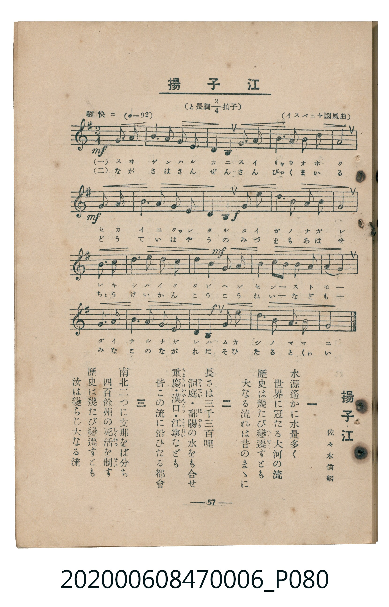

# 揚子江

<audio controls src="yosuko.mp3"></audio>

- lyrics: 佐々木信綱
- composer: イスパニヤ國風曲
- 臺灣教育會公認《新定兒童唱歌》尋常科第六學年用（2020.006.0847.0006）

## 說明

原書資訊與歌詞全文（對應 P080.jpg，書頁 p. 57，參考教材第 15 首）：
速度與表情：輕快ニ（♩=92）
調性與拍號：と長調四分之三拍子（G 大調 3/4 拍）
作詞：佐々木信綱
出處：（イスパニヤ國風曲）

## 歌詞

```text
一
水源遙かに水量多く
世界に冠たる大河の流
歴史は幾たび變遷（へんせん）すとも
大なる流れは昔のまゝに

二
長さは三千三百哩
洞庭（どうてい）・鄱陽（はゝやう）の水をも合せ
重慶（ちようけい）・漢口（かんこう）・江寧（こうねい）なども
皆この流に沿ひたる都會

三
南北二つに支那をば分ち
四百餘州の死活（しくわつ）を制（せい）す
歴史は幾たび變遷すとも
汝は變らじ大なる流
```

## ABC

```abc
X:1
T:揚子江
C:TMD (Chen, Chih-Han / aguai)
M:3/4
L:1/16
Q:1/4=92
K:G
V:V1 name="Piano" snm="Pia"
[V:V1]
!mf! z4 z4 D3 G | G3 F E3 D D3 B, | D4 B,4 D3 G | A3 B A3 G F3 G |
!mf! A8 D3 G | G3 F E3 D D3 B, | !f! D4 B,4 G3 A | B3 c B3 A G3 F |
G8 A3 B | c3 B A3 G F3 A | !mf! c4 A4 B3 A | G3 F E3 F G3 E |
D4 B,4 D3 G | G3 F E3 D D3 B, | !f! D4 G4 A3 B | c3 E E3 F G3 A |
G8 z4 |
```

## TMD 檔案連結

- [主旋律 TMD 檔案](yosuko.tmd) [[在 TMD Studio 編輯](https://tmdlang.github.io/Tmd-TS/#tmd=s7IKdvYPcrWy4tLSUnjWP-vp2gnPNs5X0NLiUrRVsDTisrdVcOeyMdY3seOqU1DKqSzKTC62Uniyd8LjhtZnc1Y82b_w-baNSiC55Pzcgvzi1CIrhcdNSx437XzcPPFxc_fj5iVP53S_XLTi2exNYGUv2nc9b1z8bOrMF02bns1pftq65sWq3scNXc-mbXi6btbT1knPVy99OmXjs7U9jxu6n27ofrpjx_PlE5-vWfO0de3TtTue7tzyfMqK93s6jAyMDPQMDMz0DCxMzIEMA7P3ezqVuLj0tRRsqQW4FBQUnvbNfzZ7x4vN7S9WdL3oaAe668XKeU9bVzyb1g50xdMNvc_aOxUCDCwM9LIK0t_v6QEqfrmgUaFAT8HUHMh92t_8oqEZ6N1ncycAPaFgaKrwctk0oFPf75kFMv5lw_ynu5YBDX6xcMWz5lag6Is9U5_uXw0MOqDxj2autLU0AqoGKX2xav-zhuUgN3T3vpg5H6j0ceOKl1O3A8Wfzp79tKPtyc7uJzs6gbLASARqdld4umQ5UFIBGHsKQFGoMU_2zgH6AKgbLRLBnm3f9WLmVKAcUDuuWAQZAzZnRwOIerZhy7NdE142znzc2P24cTWQ-7K9_-kSoNv6IaqmPZ_aA5R42rbgceP8x03dQEc927T5ceO6Z1sbwQas3fK0f9PjxvVPd-4DqWjc_GJd18vG7SAnNO543DT5ceNsIAm09jHIkhWPm5rATl2y_HHjKqB5QGMeNwFtWP9sxhSgqY8b9z1umgu0EOLIXT3gUJ66_XHjVKAaYPg87W0Gks9n7ns6eSXY_i3znu5aC7Zt5ePGtseNyx43toBsa979smXjy5l7wVLrQYY2tQAVgB2yDujPx02TgG55OgEoOxtsSXvvs9ZtYNULHzcBSaBZE-FmPduz6Gn_YrBsN9hTQAQ2Cyi1cf7T9cvBUiDBx41robqA_gO6CeLf57OAEkBpULCBwnnT_seNwFADhejL5r3AnASNFHAcP-2d_rRnOtDzjxuXgBRPWf-yaTHIvY0bgOkE6D6wotmzgaHwcsmMp9vngcxdu_vZlt1gV0wHRt7jpn6gZpArmiY97YB4azbMXTPxRRxKND3bCIyL9UCJx01AfTOQYw0kTXkehQIFLX0ursj84tLsfKuAzMS8fIcagxqFapAdCjaGZlp2YBa2wkEBmC2BafnFwh4FDROFpxv6n69v0IHnaE0sGoBWQQ3TAGrUBBV4OxUeN29QqAGyNgFZm4G4H4hXg0VWA1ndEDVNS0AizaseNy8GcpYB8SogdzZY2Xog3g1Wjmz-rh6Q-Y1AZY09IGWNU4EYqBREN00Gi8wBs5BFNj9uagZSQCc07gPiFrD5QCc0rgTiNpj5wODJTatVMFDQBUMYbRoPpgyB8oZglnm8ghlEDCgFlTWOB0pD2WAehl4jiAyUNgSZApUCJ1TcUbGrh7KoWAIN7vWPm9eB4wLk-f3g2ADTkDhoWgMU6QPiLjAbFCsgESBuWostAoBxBQxHcNA3gcMTGI7ATAPEQCMbl4KNnATETUAeCK8Hq5kNxMCyoB012CFBgoDgaKAk2KuB-iGajIDyxmCWCZQ2QhhHKOR3dFIW8tshyR4UA8DUDAt2YNJsngGPCGAKB2ePPdBM0wEO-kUQkeYGsG4swT8RGvygiIWkcVCKB0UBhAaJrIWoARkEzi8rwRYCIwMsAoqmVYg4gAQKAsKSaw0w4LAmXFDIQqRgiqERBwtmzHgDsiBCQD6BsAeWxRSFPSgZgxI4WnIGFUILwGUKKChA8QNK8vPAGKSmG1tYg0IUlLDhZU5TD5AFNLxxLhBvAof1fGiBsgJUzDxu6gMLtiCCF2_RQGz6RiRrzPgBakUPZUQUICCsUKvhquXi0rVTgNQQCkCWMhcXAA)]
- [鋼琴伴奏 TMD 檔案](yosuko_piano.tmd) [[在 TMD Studio 編輯](https://tmdlang.github.io/Tmd-TS/#tmd=s7IKdvYPcrWy4tLSUnjWP-vp2gnPNs5_v6fjZfee5xO2PNmz5enS_uedHe_3dCpoaXEp2ipYGnHZ2yq4c9kY65vYcdUpKOVUFmUmF1spPNk74XFD67M5K57sX_h820YlkFxyfm5BfnFqkZXC46Ylj5t2Pm6e-Li5-3Hzkqdzul8uWvFs9iawshftu543Ln42deaLpk3P5jQ_bV3zYlXv44auZ9M2PF0362nrpOerlz6dsvHZ2p7HDd1PN3Q_3bHj-fKJz9esedq69unaHU93bnk-ZQXQ0UYGRgZ6BgZmegYWJuZAhoEZ0N1KXFyR-cWl2flWAZmJeflBHg41BjUK1VwKQGBjaKZlB2bpaynYogMFoA1PdjS8WNijoGGi8HRD__P1DToKAQYWBnpZBemaWDRo6YMNAxqfm1arYKCgC4Yw2jQeTBkC5Q3BLPN4BTOIGFAKKmscD5SGssE8DL1GEBkobQgyBSrFhd8ru3rI8QrEGgQEe40Sr1QD9UM0GQHljcEsEyhthDCOkG92dJLjG4jxCAgLzBqgE7AGK8iNECmYYmgQwByMGQJAFkQIyCfgi6ezZ5PjC7zpg9gIQcQDZjAAtaJ7BuFTBISl7BquWtRc5oOSy0ygmawGqAEEgQbFK0QbxoIxGsc0HsgzjQdyQUQN3MNQUXI0Q5WAtKIpwOCbgfhm8blAATCJxQjctpuANJsAzQGZiqwHFDq6dgqQAFJAYSlzcQEA)]

## 分析

```text
================================================================================
📊 TMD Song Profile: [ 揚子江 ]
================================================================================
⏱  Duration:       0:33 (33.3s), 17 measures total
🎼 Key & Tempo:    首調基準 G, != 92.0 BPM, <3/4>
   - 分析範圍：      由實際發聲的音符與和弦推測調性；播放脈絡另行呈現
🎤 人聲音域:    B3 (MIDI 59) – C5 (MIDI 72) [跨度: 13 個半音 / 1.1 個八度, 難度: moderate]
   - 最低音:  B3 in [Yosuko #1 @ m.2, 0:03]
   - 最高音: C5 in [Yosuko #1 @ m.8, 0:14]
   - 適合: soprano, mezzo-soprano, contralto, tenor, baritone, bass
🏛  結構:      Yosuko (33.3s)
⚡ 編曲密度:        Peak 1 軌道同時演奏
🗝  調性診斷：       G 大調（純淨自然大調，未偵測到可信轉調）
   - 風格氣質:    純淨自然大調（陽光明朗、易唱易記，無明顯調外色彩）
   - 轉調歷程:    全曲維持單一推測調性（未偵測到可信轉調）
   - 核心骨幹音:  G, D, A, B, E
   - 調性數值:    G 大調 [相關度: 0.93, 穩定度: High, 自然音純度: 100.0%]
   - 候選調性 (K-S): G 大調 (0.93), D 大調 (0.79), B 小調 (0.60)
   - 五度圈歷程:   +1
   - 各段落調性細節:
     • [Yosuko #1]: G 大調 (r: 0.93, 自然音純度: 100.0%)

  [ 五度圈游移軌跡 ]
               C  
         F           [G ]*
      Bb               D  
      Eb               A  
         Ab           E  
            Db       B  
               F# 
     (* = active key center)

  [ 十二半音累積音高分佈 ]
     C  : █████                      5.7%
     C# :                            0.0%
     D  : ███████████████████       20.8%
     D# :                            0.0%
     E  : ████████                   8.9%
     F  :                            0.0%
     F# : ██████                     6.8%
     G  : ████████████████████████  26.6%
     G# :                            0.0%
     A  : ███████████████           16.7%
     A# :                            0.0%
     B  : █████████████             14.6%
--------------------------------------------------------------------------------
Assignment 軌道音域：
  - Piano         : B3 – C5 (13 個半音 / 1.1 個八度, 77 個音符)
================================================================================
```


## 原書掃描頁




