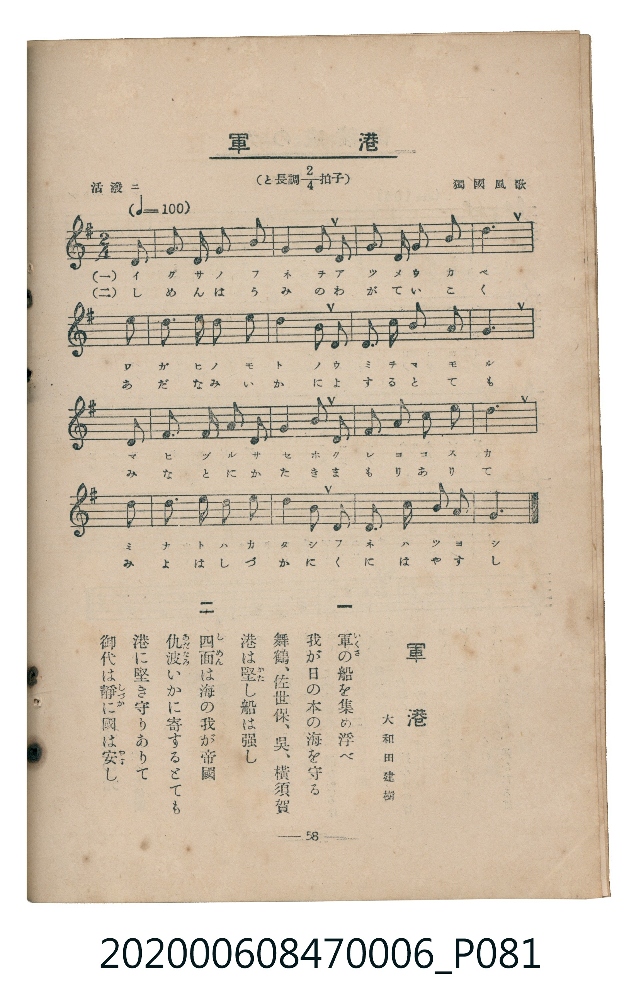

# 軍港

> Re:Shōka 使用 AI 協助辨識與重建樂譜，可能會有錯誤。歡迎回報。

- **鋼琴伴奏版**：<br><audio controls src="gunko.mp3"></audio>
- **NEUTRINO 歌聲合成版**：<br><audio controls src="gunko_neutrino.mp3"></audio>

- lyrics: 大和田建樹
- composer: 獨國風歌
- 臺灣教育會公認《新定兒童唱歌》尋常科第六學年用（2020.006.0847.0006）

## 說明

原書資訊與歌詞全文（對應 P081.jpg，書頁 p. 58，參考教材第 16 首）：
速度與表情：活潑ニ（♩=100）
調性與拍號：と長調四分之二拍子（G 大調 2/4 拍）
作詞：大和田建樹
出處：獨國風歌


## 歌詞

```text
一
軍（いくさ）の船を集め浮べ
我が日の本の海を守る
舞鶴、佐世保、呉、横須賀
港は堅（かた）し船は強し

二
四面（しめん）は海の我が帝國
仇波（あだなみ）いかに寄するとても
港に堅き守りありて
御代は靜（しづか）に國は安（やす）し
```

## ABC

```abc
X:1
T:軍港
M:2/4
L:1/16
Q:1/4=100
K:G
V:V1 name="Piano" snm="Pia"
[V:V1]
z4 z2 D2 | G3 D G2 B2 | G4 G2 D2 | A3 D A2 c2 |
w: い | く さ の ふ | ね を あ | つ め う か
B6 c2 | B3 c B2 c2 | B4 G2 D2 | D3 c B2 A2 |
w: べ わ | が ひ の も | と の う | み を ま も
G6 D2 | F3 F A2 D2 | G4 B2 D2 | F2 A2 c2 e2 |
w: る ま | ひ づ る さ | せ ほ く | れ よ こ す
d6 B2 | B3 c B2 c2 | B4 G2 D2 | D3 c B2 A2 |
w: か み | な と は か | た し ふ | ね は つ よ
G6 z2 | z4 z2 D2 | G3 D G2 B2 | G4 G2 D2 |
w: し | し | め ん は う | み の わ
A3 D A2 c2 | B6 c2 | B3 c B2 c2 | B4 G2 D2 |
w: が て い こ | く あ | だ な み い | か に よ
D3 c B2 A2 | G6 D2 | F3 F A2 D2 | G4 B2 D2 |
w: す る と て | も み | な と に か | た き ま
F2 A2 c2 e2 | d6 B2 | B3 c B2 c2 | B4 G2 D2 |
w: も り あ り | て み | よ は し づ | か に く
D3 c B2 A2 | G6 z2 |
w: に は や す | し
```

## TMD 檔案連結

- [主旋律 TMD 檔案](gunko.tmd) [[在 TMD Studio 編輯](https://tmdlang.github.io/Tmd-TS/#tmd=s7IKdvYPcrWy4qpTUCpJTLdSSM7PyUlNLsnMz7MqzsjMK0nNjM_KTMmPL87Iz05Ugisry88pzU21Si9KTEmNN4s3MjAyiDcwMIs3sDAxBzIMzBBKi_NLi5JTrYqTM_Lzc-JLUitKkvLzsxHyBUX5Zal5iXlANQVFIBtTwIrQDYgvSExPtQowsDBAyKSWZaakgjQWJyfmxZelFmWmZaamIOTzi0oy8oFuLMiotMrILC7JL8pMTsyJz07MQ_ZKalEx2LsQa0qKEvOKk4syC0BhgFBVkpEK9G9uZk5mSWJRJbIVmemZeVa5qZlZmVg8B5UuTy0uSS3Ki89NzclPAerW0lJ4sbv32Y71ClpaXIq2CoYGBlz2tgruXDZG-iZ2IN05lUC3FlspPF2y_OmknudTNjzdvevZip1gk5Pzcwvyi1OLrBSe9654Oqf75aIVz9b2gKVetO963rj42dSZL5o2PZvT_LR1zYtVvY8bup5N2_B03aynrZOer176dMpGoPLHDd1PN3Q_3bHj-fKJz9esedq69unaHU93bnk-ZcX7PR2gCNUDRqMeKEKBDAOz93s6lbi49LUUbKkFuBQUFJ72zX82e8eLze0vVnS96GgHuuvFynlPW1c8m9YOdMXTDb3P2jsVgJFuqJdVkP5-Tw9Q8csFjQoFegqmFkDu0_7mFw3NQO8-mzsB6AkFQzOFl8umAZ36fs8skPEvG-Y_3bUMaPCLhSueNbcCRZ9t2f1s78THzd1A4x_NXGkLDHmgcpDaF6v2P2tYDnJEd--LmfOBah83rng5dTtQ_Ons2U872p7s7H6yqwco-3TtBKBud1DcACUVgFGmABSFGvNk7xygF4C60WIO7Nv2XS9mTgXKIccbF1jXjgawG3YDjel43NjyuLH_cSNQZefjxnUvOnY-bpr0cnbb46bGZ1vXPW4Em_WsY-Ljxp5n05cCVTybswZEbt0OVPd0Xcfjpm6wYR3zXm7b8rih8cneCU92THuyfy6Q_XRiJ5B8tmLVywUdLzaDLQUmw8eN658uAAYP0Orux41AvwPtnQ6yFyi-ZzuQDXHkrh6wL2bPfjl3EVjxdKCTHjdNBqtfD7If6Aqwu57umAv0IFjT7vZnmyGqmx43LnjcuOpx436wBqAngZatfroeyJgJdDMwuB83Lnvc1AR31Gqgox439oK91AXSDyKXgd2wb-GT3YuBlr6cOwfqkkZgSABjFWjwaqDVIJevAyYDoE6Q8RAfgXRSnm6hQEFLn4vLvTQvO98qIDMxL9-hxqCmGmSDgo2hmZYdmIUtuygAEyowul8s7FHQeLpn44ut2xW0FUwUnm7of76-QQeU2A1AiV0Ti06gjSBTaxQMFHTBEESbxgOJGgVDsACQA2IYIwnpgmmoKiOYKhDDBCwEUguDYBGwHT6GNQogLSAIooHRBVYNTJhgMWDqBOJ1YNZWqMxaqHpgKgSLN0HFl0BFG4HsNrBMN1RmJ5Ldj5tAJkNtN0K3fTpEB9AMiNrJQLH1YBmQiSCz9sPMgbgKYhqQ1wMVXQb1w-PGySg-gekCuxacznFH264ecLSRGFuQEDYB06hhjhQzYAqmChQ7iPiDRhly1CC8tQnuYVhwr0ANCLQAAkXO48Z9yDqaQNGBCAiQHCIagHkWKr4KagYiKcD0AbMc2LwOqPhMqE3dUNeAAh9iE8hGhE0g0wgF-Y5OcoLcHBKaQAoUlChZBJI7oEJgdbC8YAaJCCQngvMRUqBvgjp8KTTQQLkA4uXZcE_tBpPQ1NcEiiZIwEDSHSRwkAMPOSgQgb4KKr4CFrjwPDMfrqcXTIKjCxq0wAISLIZgg3SAAp-kQAeW8AOVzkElGnKII4cDJL9jhgOobEAvhUCqISUPIlmC1MEgUnYChTdYDUwXxLylUF1oiRwWs2AeVEcTpFyBxSymPbVcXLp2CuDKItrHMFYBwTECc5S5AA)]
- [鋼琴伴奏 TMD 檔案](gunko_piano.tmd) [[在 TMD Studio 編輯](https://tmdlang.github.io/Tmd-TS/#tmd=s7IKdvYPcrWy4tLSUnixu_fZjvXv93S87N7zfMKWJ3u2PF3a_7yz4_2eTgUtLS5FWwVDAwMue1sFdy4bI30TO646BaWcyqLM5GIrhadLlj-d1PN8yoanu3c9W7FTCSSXnJ9bkF-cWmSl8Lx3xdM53S8XrXi2tgcs9aJ91_PGxc-mznzRtOnZnOanrWterOp93ND1bNqGp-tmPW2d9Hz10qdTNgKVP27ofrqh--mOHc-XT3y-Zs3T1rVP1-54unPL8ykrgC41MjAy0DMwMNMzsDAxBzIMzICOVeLici_Ny863CshMzMsP8nCoMaip5lIAAhtDMy07MEtfS8EWHSgAzX-yo-HFwh4Fjad7Nr7Yul1BW8FE4emG_ufrG3QUAgwsDPSyCtI1sejU0gebWqNgoKALhiDaNB5I1CgYggWAHBDDGElIF0xDVRnBVIEYJmAhkFoYBIuA7fAxrFEAaQFBEP24sQWs-nFjP1jsceNUIF4HZm2FyqyFqn_cNAks3gQVXwIVbQSy28Ay3VCZnUh2P24CmQy13Qjd9ukQHUAzIGonA8XWg2VAJoLM2g8zB-IqiGlAXg9UdBnUD48bJ6P4BKYL7Fou_NG2qwccbSTGFiSETcA0apgjxQyYgqkCxQ4i_qBRhhw1CG9tgnsYFtwrUAMCLYBAkfO4cR-yjiZQdCACAiSHiIbHjQug4qugZiCSAkzf48bVYPM6oOIzoTZ1Q10DCnyITSAbETaBTCMU5Ds6yQlyc0hoAilQUKJkEUjugAqB1cHyghkkIpCcCM5HSIG-CerwpdBAA-UCiJdnwz21G0xCU18TKJogAQNJd5DAQQ485KBABPoqqPgKWODC88x8uJ5eMAmOLmjQPm7qAosh2CAdoMAnKdCfzp49UOkcVKIhhzhyOEDyO2Y4gMoG9FIIpBpS8iCSJUgdDCJlJ1B4g9XAdEHMWwrVhZbIYTEL5kF1NEHKFVjMYtpTi1JX-CDXFSbQqgJUqBuAAiNeIdowFplhEh8PDLV4iBBQCVQ5SCjaNB5FqRFIzAgsBpLGqhibPlwGg6yONsGiDaQa6CldOwWwv6J9gMYgOEZgjjIXAA)]

## 分析

```text
================================================================================
📊 TMD Song Profile: [ 軍港 ]
================================================================================
⏱  Duration:       0:40 (40.8s), 34 measures total
🎼 Key & Tempo:    首調基準 G, != 100.0 BPM, <2/4>
   - 分析範圍：      由實際發聲的音符與和弦推測調性；播放脈絡另行呈現
🎤 人聲音域:    D4 (MIDI 62) – E5 (MIDI 76) [跨度: 14 個半音 / 1.2 個八度, 難度: moderate]
   - 最低音:  D4 in [Gunko[L1] #1 @ m.1, 0:00]
   - 最高音: E5 in [Gunko[L1] #1 @ m.12, 0:14]
   - 適合: soprano, mezzo-soprano, contralto, tenor, baritone, bass
🏛  結構:      Gunko[L1] (20.4s) -> Gunko[L2] (20.4s)
⚡ 編曲密度:        Peak 1 軌道同時演奏
🗝  調性診斷：       G 大調（純淨自然大調，未偵測到可信轉調）
   - 風格氣質:    純淨自然大調（陽光明朗、易唱易記，無明顯調外色彩）
   - 轉調歷程:    全曲維持單一推測調性（未偵測到可信轉調）
   - 核心骨幹音:  B, G, D, C, A
   - 調性數值:    G 大調 [相關度: 0.89, 穩定度: High, 自然音純度: 100.0%]
   - 候選調性 (K-S): G 大調 (0.89), B 小調 (0.74), D 大調 (0.60)
   - 五度圈歷程:   +1 -> +1
   - 各段落調性細節:
     • [Gunko[L1] #1]: G 大調 (r: 0.89, 自然音純度: 100.0%)
     • [Gunko[L2] #1]: G 大調 (r: 0.89, 自然音純度: 100.0%)

  [ 五度圈游移軌跡 ]
               C  
         F           [G ]*
      Bb               D  
      Eb               A  
         Ab           E  
            Db       B  
               F# 
     (* = active key center)

  [ 十二半音累積音高分佈 ]
     C  : ██████████                10.9%
     C# :                            0.0%
     D  : ████████████████████      21.9%
     D# :                            0.0%
     E  : █                          1.6%
     F  :                            0.0%
     F# : ████                       4.7%
     G  : ██████████████████████    24.2%
     G# :                            0.0%
     A  : █████████                 10.2%
     A# :                            0.0%
     B  : ████████████████████████  26.6%
--------------------------------------------------------------------------------
Assignment 軌道音域：
  - Piano         : D4 – E5 (14 個半音 / 1.2 個八度, 104 個音符)
================================================================================
```


## 原書掃描頁




