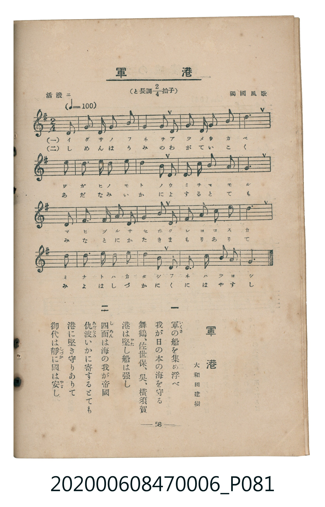

# 軍港

<audio controls src="gunko.mp3"></audio>

- lyrics: 大和田建樹
- composer: 獨國風歌
- 臺灣教育會公認《新定兒童唱歌》尋常科第六學年用（2020.006.0847.0006）

## 說明

原書資訊與歌詞全文（對應 P081.jpg，書頁 p. 58，參考教材第 16 首）：
速度與表情：活潑ニ（♩=100）
調性與拍號：と長調四分之二拍子（G 大調 2/4 拍）
作詞：大和田建樹
出處：獨國風歌

## 歌詞

```text
一
軍（いくさ）の船を集め浮べ
我が日の本の海を守る
舞鶴、佐世保、呉、横須賀
港は堅（かた）し船は強し

二
四面（しめん）は海の我が帝國
仇波（あだなみ）いかに寄するとても
港に堅き守りありて
御代は靜（しづか）に國は安（やす）し
```

## ABC

```abc
X:1
T:軍港
C:TMD (Chen, Chih-Han / aguai)
M:2/4
L:1/16
Q:1/4=100
K:G
V:V1 name="Piano" snm="Pia"
[V:V1]
z4 z2 d2 | d2 B2 d2 g2 | g4 d2 d2 | e2 e2 f2 f2 |
g6 g2 | a2 a2 a2 a2 | b4 g2 g2 | a2 a2 e2 f2 |
d6 d2 | f2 f2 a2 a2 | c4 f2 f2 | g2 g2 b2 b2 |
d6 b2 | c2 b2 a2 b2 | c4 e2 e2 | d2 b2 a2 f2 |
g6 z2 |
```

## TMD 檔案連結

- [主旋律 TMD 檔案](gunko.tmd)
- [鋼琴伴奏 TMD 檔案](gunko_piano.tmd)

## 分析

```text
================================================================================
📊 TMD Song Profile: [ 軍港 ]
================================================================================
⏱  Duration:       0:20 (20.4s), 17 measures total
🎼 Key & Tempo:    首調基準 G, != 100.0 BPM, <2/4>
   - 分析範圍：      由實際發聲的音符與和弦推測調性；播放脈絡另行呈現
🎤 人聲音域:    B3 (MIDI 59) – D5 (MIDI 74) [跨度: 15 個半音 / 1.2 個八度, 難度: moderate]
   - 最低音:  B3 in [Gunko #1 @ m.2, 0:01]
   - 最高音: D5 in [Gunko #1 @ m.13, 0:14]
   - 適合: soprano, mezzo-soprano, contralto, tenor, baritone, bass
🏛  結構:      Gunko (20.4s)
⚡ 編曲密度:        Peak 1 軌道同時演奏
🗝  調性診斷：       G 大調（純淨自然大調，未偵測到可信轉調）
   - 風格氣質:    純淨自然大調（陽光明朗、易唱易記，無明顯調外色彩）
   - 轉調歷程:    全曲維持單一推測調性（未偵測到可信轉調）
   - 核心骨幹音:  G, D, A, B, F#
   - 調性數值:    G 大調 [相關度: 0.89, 穩定度: Moderate, 自然音純度: 100.0%]
   - 候選調性 (K-S): G 大調 (0.89), D 大調 (0.84), B 小調 (0.67)
   - 五度圈歷程:   +1
   - 各段落調性細節:
     • [Gunko #1]: G 大調 (r: 0.89, 自然音純度: 100.0%)

  [ 五度圈游移軌跡 ]
               C  
         F           [G ]*
      Bb               D  
      Eb               A  
         Ab           E  
            Db       B  
               F# 
     (* = active key center)

  [ 十二半音累積音高分佈 ]
     C  : █████████                  7.8%
     C# :                            0.0%
     D  : ██████████████████████    20.3%
     D# :                            0.0%
     E  : █████████                  7.8%
     F  :                            0.0%
     F# : ██████████████            12.5%
     G  : ████████████████████████  21.9%
     G# :                            0.0%
     A  : █████████████████         15.6%
     A# :                            0.0%
     B  : ███████████████           14.1%
--------------------------------------------------------------------------------
Assignment 軌道音域：
  - Piano         : B3 – D5 (15 個半音 / 1.2 個八度, 52 個音符)
================================================================================
```


## 原書掃描頁




