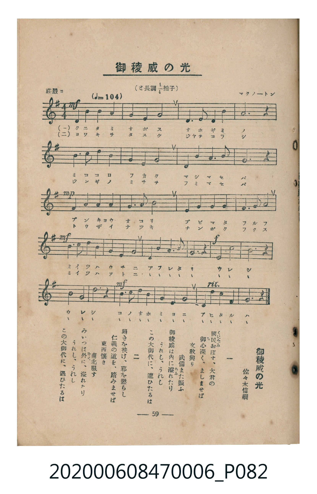

# 御稜威の光

> Re:Shōka 使用 AI 協助辨識與重建樂譜，可能會有錯誤。歡迎回報。

- **鋼琴伴奏版**：<br><audio controls src="miitsu_no_hikari.mp3"></audio>

- lyrics: 佐々木信綱
- composer: マクノートン
- 臺灣教育會公認《新定兒童唱歌》尋常科第六學年用（2020.006.0847.0006）

## 說明

原書資訊與歌詞全文（對應 P082.jpg，書頁 p. 59，參考教材第 17 首）：
速度與表情：莊嚴ニ（♩=104）
調性與拍號：と長調四分之四拍子（G 大調 4/4 拍）
作詞：佐々木信綱
作曲：マクノートン


## 歌詞

```text
一
國民（くにたみ）おぼす、大君の
御心（みこゝろ）深く、ましまさば
文教興り　武備また振ふ
御稜威は内に溢（あふ）れたり
うれし、うれし
この大御代に、遭ひたるは

二
弱きを扶け、邪を懲らし
仁義の道を、踏みませば
東西懷き　南北服（まつろ）ふ
みいつは外に、溢れたり
うれし、うれし
この大御代に、遭ひたるは
```

## ABC

```abc
X:1
T:御稜威の光
M:4/4
L:1/16
Q:1/4=104
K:G
V:V1 name="Piano" snm="Pia"
[V:V1]
!mf! D3 D D4 G4 G4 | B4 A4 G8 | E3 E E4 c4 c4 | G12 z4 |
w: 1.~く に _ た み | お ぼ す | お ほ _ ぎ み | の
w: 2.~よ わ _ き を | た す け | じゃ _ を こ ら | し
F3 F F4 G4 G4 | A4 d4 B8 | A3 A B4 A4 A4 | D12 z4 |
w: 1.~み こ _ こ ろ | ふ か く | ま し _ ま せ | ば
w: 2.~じ ん _ ぎ の | み ち を | ふ み _ ま せ | ば
!mp! D3 D D4 G4 G4 | G3 A B4 d8 | E3 E E4 c4 c4 | A3 G F4 A8 |
w: 1.~ぶ ん _ きょ う | お _ こ り | ぶ び _ ま た | ふ _ る ふ
w: 2.~と う _ ざ い | な _ つ き | な ん _ ぼ く | ふ _ く す
!mf! d3 c B4 c4 A4 | G4 E3 F G3 E D4 | !f! D4 z4 G4 B4 | B4 G4 z4 B4 |
w: 1.~み い つ は う | ち に あ ふ れ た | り う れ | し _ う
w: 2.~み い つ は そ | と に あ ふ れ た | り う れ | し _ う
!mf! d4 B4 G3 A B4 | G4 A4 c4 B3 c | A4 G8 z4 |
w: 1.~れ し こ の おほ | み よ に あひ た | る は
w: 2.~れ し こ の おほ | み よ に あひ た | る は
```

## TMD 檔案連結

- [主旋律 TMD 檔案](miitsu_no_hikari.tmd) [[在 TMD Studio 編輯](https://tmdlang.github.io/Tmd-TS/#tmd=s7IKdvYPcrWy4qpTUCpJTLdSSM7PyUlNLsnMz7MqzsjMK0nNjM_KTMmPL87Iz05Ugisry88pzU21Si9KTEmNN4s3MjAyiDcwMIs3sDAxBzIMzBBKi_NLi5JTrYqTM_Lzc-JLUitKkvLzsxHyBUX5Zal5iXlANQVFIBtTwIoQClLLMlNSQdKpKZkl-UWZiTlI7kgtKga7FWxJfElRYl5xclFmAcgDCFUlGalAx2bmFqSi6oaIF6XmZKajqAdakp6ZZ5WbmpmVieRiLS2Fp_sWPl8x5-mKxseN6562dipoaXEp2ioYGphw2dsquHPZmOib2IGMyaksykwutlJ4snfC44bWZ3NWPNm_8Pm2jWArkvNzC_KLU4usFB43z3vctP5xc9_j5j2PmzseN28GK3jRvut54-JnU2e-aNr0bE7z09Y1L1b1Pm7oejZtw9N1s562Tnq-eunTKRufre153ND9dEP30x07ni-f-HzNmqeta5-u3fF055bnU1a839MBihU9YFzogWIFyDAwe7-nU4mLS19LwZZagEtBQeFp3_xns3e82Nz-YkXXi452oLterJz3tHXFs2ntQFc83dD7rL1TIcDAwkgvqyD9_Z4eoOKXCxoVCvQUTC2B3Kf9zS8amoHefTZ3AtATCobmCi-XTQM69f2eWSDjXzbMf7prGdDgFwtXPGtuBYq-6Ot6OmvL4-ZuoPGPZq60BYY_UDlI7YtV-581LAc5orv3xcz5QLWPG1e8nLodKP509uynHW1PdnYDGUDZp2snAHW7KzxdshwoqQCMOAWgKNSYJ3vnAL0A1I0Wf1C5Z7M3gUzGiD0usPyOBnCgzOl-tmEi0IrHjf2PG1c_bpz_uHE_0PjHjV2PG_c8bpz5uKERaPfTCbOBSQmsYd_Cp_ubwRr2P26c_Lhp7uMmkHuebd8IMqIBmOT2PW6cDianPm7cANIDDGFQMunoeNzU9bih4dnaZU-bZoJVzH_Ws_5x41aowbA0u_5pWyvQMc92LQLb0wRUAXJSUw_IeU1dINWPG9vA_OlgG6FsiMRkUKIHOnnfwie7F4P81ND4snHt48ZNYN3dQOMhAbCrB2ztHqC7ex83TXrWue1x40SQ4qZVIG77psdNwGAAG_pkd-PzfSuB5r4E-XgSUNGLHcDgAgYA0A_AkIH4cu7GF0v3P2vfDjKvoeFp7_SnPdOfzQEGDtAPQHVLIAEF9S5YdwtIFOjdJdMg7gT6mIq-BKqjPOdAgYKWPheXb2ZmSXGpX75HZnZiUaZVQGZiXr5DjUFNNcgqBRtDMy07MAtbzlUA5hlgmnuxsEdBw0Th6Yb-5-sbdODZTROLBqCNUMM0gBo1geVQ03pgWdQNpPcD6fkKNUDWKiBrDpDeCefNBtLrYPLNfSjG7OoBGdO8AoiBRjWtBdKbwBqBBgKNeNy0Eczb8bh5MVjqcdNmIL0SLLgdZlKNQnVuWq2CabyCLhACKShLV8EQja5RMIayjNBkYLBGwQyiGUhBWboKJmh0DYY2GDSAqQA7zMcQ6M7GfrAIMEXAVQFTBJy1H24mMIfDRffAWTMxHAhT97hxN5KJfVhNXIfDnTCfQd1pBArPDoj-Joh7IWb1wlhNk5BMRbge5jpgRsXizhmPm5oxDADmFLhYJ5Li6QSdij8p7-qhKCkDkyc4cYET2FpwUp0K5K0GJ3IQbx44yUHo3WCRCViSctMOoATIGFCK7wMrAxrc3AhL2CBDwSJYjKlRMId4FkhBWdiSMCzpmkJpWJJGhDxEhRFGYofRNYgcgg6xJWBIgkLEG2oc9sINBRakcPluOAuRnBDq9kHlEHEOEwOxZiOp3IDDnVgScOMMqIuQ3YnIFrCsgPARSHQh3B-w9InsToh_EOopcSeBgriTstQ7DZrs1j5uXg6klsFKX3ByXgVOZyAlk6Epbz88LQITOJDGUiZ3gI153LQNiJeAlXcBcQu4lIbxQIaDCntIDgHlF1ApvhO5YC4gsmCGsBBpFpa6EdFBVMEMSeKGiPwDS_Nwc5AS9jawCGqCAbY82uGcNri5yIUzIu3DxBCOhBvauBnJUESagRWdKLmlCZFbYGJozgWn7xVorgKxp8FZLUgmr4KLLkF4DItbIepQAwBR9cByLmrOholiqZrwp3Fg-5nyEnoJJA0294MTODB9govWbjBvETRJr4EncFAGAKlZg9pgQE7mmIbuhSR-Ug2FtULAQWECT8ewpIkoe2FpHpqKgSkVIgLkw_MHUgkNK5GrgYbDtMIMR7RnYDIw1XAVWMpxoFeR0sV6OAs5tcPLRWizBdjoR5SHTT2oKRmeD2BuRpgFUoswFb2Ox1SPnN4JuXcuksmQvDEQ7iXQKpkCTvPG5DawIQkNlMxA7gaVt32Qgh3YrIY1LkCtZ0RinQROqKCCHSTfj62NQjVDgckUGg6w9AbOA-hlOSLNw3IBLFdAVJggtWrQW9ZYGiTwKEJEEKxQBlXz4J4yrGmMUttDm7iIVAJOJ8AuGpQJ6cEgCmNYUkOPfuRW88C7pZaLS9dOAbUrqAAUUeYCAA)]
- [鋼琴伴奏 TMD 檔案](miitsu_no_hikari_piano.tmd) [[在 TMD Studio 編輯](https://tmdlang.github.io/Tmd-TS/#tmd=s7IKdvYPcrWy4tLSUni6b-HzFXOermh83LjuaWvn-z0dL7v3PJ-w5cmeLU-X9j_v7Hi_p1NBS4tL0VbB0MCEy95WwZ3LxkTfxI6rTkEpp7IoM7nYSuHJ3gmPG1qfzVnxZP_C59s2KoHkkvNzC_KLU4usFB43z3vctP5xc9_j5j2PmzseN28GK3jRvut54-JnU2e-aNr0bE7z09Y1L1b1Pm7oejZtw9N1s562Tnq-eunTKRufre153ND9dEP30x07ni-f-HzNmqeta5-u3fF055bnU1YA3WtkYGSgZ2BgpmdgYWIOZBiYAZ2sxMXlm5lZUlzql--RmZ1YlGkVkJmYlx_k4VBjUFPNpQAENoZmWnZglr6Wgi06UABa9GRHw4uFPQoaJgpPN_Q_X9-goxBgYGGkl1WQrolFg5Y-2LAaherctFoF03gFXSAEUlCWroIhGl2jYAxlGaHJwGCNghlEM5CCsnQVTNDoGgxtMGgAUwF2mI9hjcLjxn6wyOPG1XBVjxvnw1n74WY-buyCi-6Bs2ZiOBCm7nHjbiQT-7CauA6HO2E-g7rTCKi2qQOivwniXohZvTBW0yQkUxGuh7nuceNELO6c8bipGcOAx42T4WKdSIqnE3Qq_pSzq4eclGMOMR5IQVnYEg0ssZhCaVgiQvgVosIII3nB6BpEmkSH2JIMJAoRIYUaar1wQx83boXLd8NZiAhEqNsHlUOEMkwMxJqNpHIDDndiSTKNM6AuQnYnIiHCEh_CRyDRhXB_wFIEsjsh_kGop8SdBEqaTvJKmgIiSxoIC5EkYIkH4VuiShpICjJEJE9YkoKbg5RutoFFUOOj93FTO5zTBjcXubRBJC2YGMKRcEMbNyMZiogSWFmAkhibEIkRJobmXHDyWYHmKhB7GpzVgmTyKrjoEoTHsLgVog41ABBlKSxjoGYcmCiWshZ_Eno6ezb5lRXYAhN46oBFOKLAgKUkaNoAxj9EBMiHpzqkYgVWjFQDDYdphRmOqPZgMjDVcBVYCp8WlNBeD2chpyF4ZobWbo8bmxCZuKkHNX3AUxfMzQizQGoRpqJXBZjqkVMRIffORTIZkuIGwr0EKq8p5KQk9PoInLLQyx1ESoKlLVhag6gwQarg0Js1WOomuMcR3oYVIKASH1isINolKAU_tH2BCHtw6D9u3ARlzgcHOaLggEUgeqAiN1kG3i212Fu9PsitXhNooxcYE_EK0YaxMAqUe4Es03gkEROQiAlQBM5A1mUA9T02nZgiRiARI6AInIGkCsRAGIfuMHQ-NmehGAVmoJmGEIeJgHQDmWC-AYZtYBECLoKbADIcrg8cD7p2CqhREe0DlMQiagQWVeYCAA)]

## 分析

```text
================================================================================
📊 TMD Song Profile: [ 御稜威の光 ]
================================================================================
⏱  Duration:       0:43 (43.8s), 19 measures total
🎼 Key & Tempo:    首調基準 G, != 104.0 BPM, <4/4>
   - 分析範圍：      由實際發聲的音符與和弦推測調性；播放脈絡另行呈現
🎤 人聲音域:    D4 (MIDI 62) – D5 (MIDI 74) [跨度: 12 個半音 / 1.0 個八度, 難度: easy]
   - 最低音:  D4 in [MiitsuNoHikari #1 @ m.1, 0:00]
   - 最高音: D5 in [MiitsuNoHikari #1 @ m.6, 0:12]
   - 適合: soprano, mezzo-soprano, contralto, tenor, baritone, bass
🏛  結構:      MiitsuNoHikari (43.8s)
⚡ 編曲密度:        Peak 1 軌道同時演奏
🗝  調性診斷：       G 大調（純淨自然大調，未偵測到可信轉調）
   - 風格氣質:    純淨自然大調（陽光明朗、易唱易記，無明顯調外色彩）
   - 轉調歷程:    全曲維持單一推測調性（未偵測到可信轉調）
   - 核心骨幹音:  G, D, B, A, C
   - 調性數值:    G 大調 [相關度: 0.96, 穩定度: High, 自然音純度: 100.0%]
   - 候選調性 (K-S): G 大調 (0.96), D 大調 (0.70), E 小調 (0.59)
   - 五度圈歷程:   +1
   - 各段落調性細節:
     • [MiitsuNoHikari #1]: G 大調 (r: 0.96, 自然音純度: 100.0%)

  [ 五度圈游移軌跡 ]
               C  
         F           [G ]*
      Bb               D  
      Eb               A  
         Ab           E  
            Db       B  
               F# 
     (* = active key center)

  [ 十二半音累積音高分佈 ]
     C  : ████████                   9.2%
     C# :                            0.0%
     D  : █████████████████         19.4%
     D# :                            0.0%
     E  : ██████                     7.0%
     F  :                            0.0%
     F# : ████                       4.6%
     G  : ████████████████████████  27.5%
     G# :                            0.0%
     A  : ██████████████            15.8%
     A# :                            0.0%
     B  : ██████████████            16.5%
--------------------------------------------------------------------------------
Assignment 軌道音域：
  - Piano         : D4 – D5 (12 個半音 / 1.0 個八度, 75 個音符)
================================================================================
```


## 原書掃描頁




