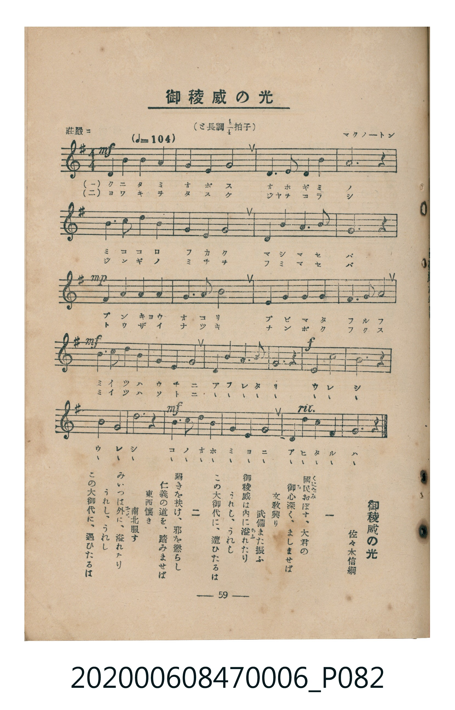

# 御稜威の光

<audio controls src="miitsu_no_hikari.mp3"></audio>

- lyrics: 佐々木信綱
- composer: マクノートン
- 臺灣教育會公認《新定兒童唱歌》尋常科第六學年用（2020.006.0847.0006）

## 說明

原書資訊與歌詞全文（對應 P082.jpg，書頁 p. 59，參考教材第 17 首）：
速度與表情：莊嚴ニ（♩=104）
調性與拍號：と長調四分之四拍子（G 大調 4/4 拍）
作詞：佐々木信綱
作曲：マクノートン

## 歌詞

```text
一
國民（くにたみ）おぼす、大君の
御心（みこゝろ）深く、ましまさば
文教興り　武備また振ふ
御稜威は内に溢（あふ）れたり
うれし、うれし
この大御代に、遭ひたるは

二
弱きを扶け、邪を懲らし
仁義の道を、踏みませば
東西懷き　南北服（まつろ）ふ
みいつは外に、溢れたり
うれし、うれし
この大御代に、遭ひたるは
```

## ABC

```abc
X:1
T:御稜威の光
M:4/4
L:1/16
Q:1/4=104
K:G
V:V1 name="Piano" snm="Pia"
[V:V1]
!mf! D3 D D4 G4 G4 | B4 A4 G8 | E3 E E4 c4 c4 | G12 z4 |
F3 F F4 G4 G4 | A4 d4 B8 | A3 A B4 A4 A4 | D12 z4 |
!mp! D3 D D4 G4 G4 | G3 A B4 d8 | E3 E E4 c4 c4 | A3 G F4 A8 |
!mf! d3 c B4 c4 A4 | G4 E3 F G3 E D4 | !f! D4 z4 G4 B4 | B4 G4 z4 B4 |
!mf! d4 B4 G3 A B4 | G4 A4 c4 B3 c | A4 G8 z4 |
```

## TMD 檔案連結

- [主旋律 TMD 檔案](miitsu_no_hikari.tmd) [[在 TMD Studio 編輯](https://tmdlang.github.io/Tmd-TS/#tmd=s7IKdvYPcrWy4tLSUni6b-HzFXOermh83LjuaWungpYWl6KtgqGBCZe9rYI7l42JvokdV52CUk5lUWZysZXCk70THje0Ppuz4sn-hc-3bVQCySXn5xbkF6cWWSk8bp73uGn94-a-x817Hjd3PG7eDFbwon3X88bFz6bOfNG06dmc5qeta16s6n3c0PVs2oan62Y9bZ30fPXSp1M2Plvb87ih--mG7qc7djxfPvH5mjVPW9c-Xbvj6c4tz6eseL-nw8jAyEDPwMBMz8DCxBzIMDB7v6dTiYtLX0vBllqAS0FB4Wnf_Gezd7zY3P5iRdeLjnagu16snPe0dcWzae1AVzzd0PusvVMhwMDCSC-rIP39nh6g4pcLGhUK9BRMLYHcp_3NLxqagd59NncC0BMKhuYKL5dNAzr1_Z5ZIONfNsx_umsZ0OAXC1c8a24Fir7o63o6a8vj5m6g8Y9mrrQFhj9QOUjti1X7nzUsBzmiu_fFzPlAtY8bV7ycuh0o_nT27KcdbU92dgMZQNmnaycAdbsrPF2yHCipAIw4BaAo1Jgne-cAvQDUjRZ_ULlnszeBTMaIPS6w_I4GcKDM6X62YSLQiseN_Y8bVz9unP-4cT_Q-MeNXY8b9zxunPm4oRFo99MJs4FJCaxh38Kn-5vBGvY_bpz8uGnu4yaQe55t3wgyogGY5PY9bpwOJqc-btwA0gMMYVAy6eh43NT1uKHh2dplT5tmglXMf9az_nHjVqjBsDS7_mlbK9Axz3YtAtvTBFQBclJTD8h5TV0g1Y8b28D86WAboWyIxGRQogc6ed_CJ7sXg_zU0Piyce3jxk1g3d1A4yEBsKsHbO0eoLt7HzdNeta57XHjRJDiplUgbvumx03AYAAb-mR34_N9K4HmvgT5eBJQ0YsdwOACBgDQD8CQgfhy7sYXS_c_a98OMq-h4Wnv9Kc905_NAQYO0A9AdUsgAQX1Llh3C0gU6N0l0yDuBPqYir4EqqM850CBgpY-F5dvZmZJcalfvkdmdmJRplVAZmJevkONQY1CNcguBRtDMy07MAtb1lUAZhpgonuxsEdBw0Th6Yb-5-sbdOD5TROLBqCVUMM0gBo1gQVR03pgYdQNpPcD6fkKNUDWKiBrDpDeCefNBtLrYPLNfSjG7OoBGdO8AoiBRjWtBdKbwBqBBgKNeNy0Eczb8bh5MVjqcdNmIL0SLLgdZhLQv7lptQqm8Qq6QAikoCxdBUM0ukbBGMoyQpOBwRoFM4hmIAVl6SqYoNE1GNpg0ACmApykcYf7rh6Kwh0YluCQAIfGWnC4TgXyVoNjBMSbBw4fCL0bLDIBS7g37QBKgIwBRU8fWBnQ4OZGWCyADAWLYDGmRsEcEjxACsrCFt6wcDaF0rDwR4Q3RIURRszA6BpEdJIb2js6KQvtadBgWvu4eTmQWgZL2uDgXwUOF5CSydCQ2g8PO2CEAGksCb4DbMzjpm1AvASsvAuIW8BZAMYDGQ7KSZAYBcUvKIvsRE71BUSmeggLEcaw2EDEAlGpHhIlhoj4hsUR3Bz8EQGsQilP9ksgAdXcD44FYCCC02s3mLcIGu5r4LEAiiWQmjWoRQZyXGAauhcSQ6QaCiuHoKEGC2xY-CESNCxioEENDE6ICJAPj0SkZA9L5tVAw2FaYYYjSjSYDEw1XAWhomgKOE6Mya0CIAEBCgZQYIASbR-84IeVKKDyHRGYk6AVxmqwfD-2golqhgKDES08wHGEniEQcQKLJVisQVSYIBVl6GU_ohSq5eLStVNArZUVgCLKXFwA)]
- [鋼琴伴奏 TMD 檔案](miitsu_no_hikari_piano.tmd) [[在 TMD Studio 編輯](https://tmdlang.github.io/Tmd-TS/#tmd=s7IKdvYPcrWy4tLSUni6b-HzFXOermh83LjuaWvn-z0dL7v3PJ-w5cmeLU-X9j_v7Hi_p1NBS4tL0VbB0MCEy95WwZ3LxkTfxI6rTkEpp7IoM7nYSuHJ3gmPG1qfzVnxZP_C59s2KoHkkvNzC_KLU4usFB43z3vctP5xc9_j5j2PmzseN28GK3jRvut54-JnU2e-aNr0bE7z09Y1L1b1Pm7oejZtw9N1s562Tnq-eunTKRufre153ND9dEP30x07ni-f-HzNmqeta5-u3fF055bnU1YA3WtkYGSgZ2BgpmdgYWIOZBiYAZ2sxMXlm5lZUlzql--RmZ1YlGkVkJmYlx_k4VBjUKNQzaUABDaGZlp2YJa-loItOlAA2vRkR8OLhT0KGiYKTzf0P1_foKMQYGBhpJdVkK6JRYOWPtgwoPG5abUKpvEKukAIpKAsXQVDNLpGwRjKMkKTgcEaBTOIZiAFZekqmKDRNRjaYNAApoILvzd39ZDjTXOIg4AUlIXNhzCfmUJpmI8RPoSoMMIICxhdgwhAcv23o5O8aCwgMhohLIQXYJ5FeJKoaIT42BARnLAggJuD359PZ88mP7lC3QLzAsxViFiAeRfqAaAjISJAPjxokOIKFjfVQMNhWmGGIxI-TAamGq6CUIqdQo5P0RMh2OfokYfwKczvsLCAqDBBStXoGQ-RIGuxF0A-KAWQCbT8AVoZrxBtGAujQMEIZJnGI4mYgERMgCJwBrIuA6CVUD9i6MQUMQKJGAFF4AwkVSAGwjh0h6HzsTkLxSgwA800hDhMBKQbyATzDTBsA4sQcBHcBJDhcH3giNC1U0CNCwWsIspcXAA)]

## 分析

```text
================================================================================
📊 TMD Song Profile: [ 御稜威の光 ]
================================================================================
⏱  Duration:       0:43 (43.8s), 19 measures total
🎼 Key & Tempo:    首調基準 G, != 104.0 BPM, <4/4>
   - 分析範圍：      由實際發聲的音符與和弦推測調性；播放脈絡另行呈現
🎤 人聲音域:    D4 (MIDI 62) – D5 (MIDI 74) [跨度: 12 個半音 / 1.0 個八度, 難度: easy]
   - 最低音:  D4 in [MiitsuNoHikari #1 @ m.1, 0:00]
   - 最高音: D5 in [MiitsuNoHikari #1 @ m.6, 0:12]
   - 適合: soprano, mezzo-soprano, contralto, tenor, baritone, bass
🏛  結構:      MiitsuNoHikari (43.8s)
⚡ 編曲密度:        Peak 1 軌道同時演奏
🗝  調性診斷：       G 大調（純淨自然大調，未偵測到可信轉調）
   - 風格氣質:    純淨自然大調（陽光明朗、易唱易記，無明顯調外色彩）
   - 轉調歷程:    全曲維持單一推測調性（未偵測到可信轉調）
   - 核心骨幹音:  G, D, B, A, C
   - 調性數值:    G 大調 [相關度: 0.96, 穩定度: High, 自然音純度: 100.0%]
   - 候選調性 (K-S): G 大調 (0.96), D 大調 (0.70), E 小調 (0.59)
   - 五度圈歷程:   +1
   - 各段落調性細節:
     • [MiitsuNoHikari #1]: G 大調 (r: 0.96, 自然音純度: 100.0%)

  [ 五度圈游移軌跡 ]
               C  
         F           [G ]*
      Bb               D  
      Eb               A  
         Ab           E  
            Db       B  
               F# 
     (* = active key center)

  [ 十二半音累積音高分佈 ]
     C  : ████████                   9.2%
     C# :                            0.0%
     D  : █████████████████         19.4%
     D# :                            0.0%
     E  : ██████                     7.0%
     F  :                            0.0%
     F# : ████                       4.6%
     G  : ████████████████████████  27.5%
     G# :                            0.0%
     A  : ██████████████            15.8%
     A# :                            0.0%
     B  : ██████████████            16.5%
--------------------------------------------------------------------------------
Assignment 軌道音域：
  - Piano         : D4 – D5 (12 個半音 / 1.0 個八度, 75 個音符)
================================================================================
```


## 原書掃描頁




