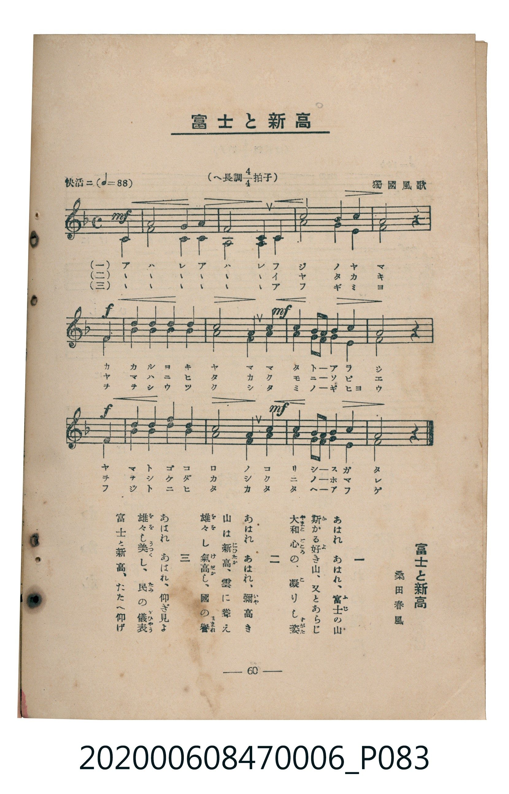

# 富士と新高

<audio controls src="fuji_to_niitaka.mp3"></audio>

- 詞：桑田春風
- 曲：獨國風歌
- 臺灣教育會公認《新定兒童唱歌》尋常科第六學年用（2020.006.0847.0006）

- note

原書資訊與歌詞全文（對應 P083.jpg，書頁 p. 60，參考教材第 18 首，二部合唱）：
調性與拍號：へ長調四分之四拍子（F 大調 4/4 拍，弱起 1 拍），「快活ニ」（♩=88）

## 歌詞

```text
一　あはれ　あはれ、富士（ふじ）の山
斯（か）かる好（よ）き山、又とあらじ
大和心（やまとごころ）の、凝（こ）りし姿（すがた）

二　あはれ　あはれ、彌（いや）高き
山は新高（にひたか）、雲に聳（そび）え
雄々（をを）し氣高（けだか）し、國の譽（ほまれ）

三　あはれ　あはれ、仰ぎ見よ
雄々（をを）し美（うつく）し、民（たみ）の儀表（ぎひやう）
富士と新高、たたへ仰げ
```

## 原書掃描頁



## 調性分析

```text
================================================================================
📊 TMD Song Profile: [ 富士と新高 ]
================================================================================
⏱  Duration:       0:35 (35.5s), 13 measures total
🎼 Key & Tempo:    首調基準 F, != 88.0 BPM, <4/4>
   - 分析範圍：      由實際發聲的音符與和弦推測調性；播放脈絡另行呈現
🎤 人聲音域:    C4 (MIDI 60) – D5 (MIDI 74) [跨度: 14 個半音 / 1.2 個八度, 難度: moderate]
   - 最低音:  C4 in [FujiToNiitaka #1 @ m.1, 0:02]
   - 最高音: D5 in [FujiToNiitaka #1 @ m.4, 0:08]
   - 適合: soprano, mezzo-soprano, contralto, tenor, baritone, bass
🏛  結構:      FujiToNiitaka (35.5s)
⚡ 編曲密度:        Peak 2 軌道同時演奏
🗝  調性診斷：       F 大調（純淨自然大調，未偵測到可信轉調）
   - 風格氣質:    純淨自然大調（陽光明朗、易唱易記，無明顯調外色彩）
   - 轉調歷程:    全曲維持單一推測調性（未偵測到可信轉調）
   - 核心骨幹音:  F, C, A, G, E
   - 調性數值:    F 大調 [相關度: 0.90, 穩定度: Moderate, 自然音純度: 100.0%]
   - 候選調性 (K-S): F 大調 (0.90), C 大調 (0.81), A 小調 (0.71)
   - 五度圈歷程:   -1
   - 各段落調性細節:
     • [FujiToNiitaka #1]: F 大調 (r: 0.90, 自然音純度: 100.0%)

  [ 五度圈游移軌跡 ]
               C  
        [F ]*          G  
      Bb               D  
      Eb               A  
         Ab           E  
            Db       B  
               F# 
     (* = active key center)

  [ 十二半音累積音高分佈 ]
     C  : ██████████████████████    21.1%
     C# :                            0.0%
     D  : █████                      5.0%
     D# :                            0.0%
     E  : ██████████                10.0%
     F  : ████████████████████████  23.3%
     F# :                            0.0%
     G  : █████████████████         16.1%
     G# :                            0.0%
     A  : ██████████████████        17.8%
     A# : ███████                    6.7%
     B  :                            0.0%
--------------------------------------------------------------------------------
Assignment 軌道音域：
  - Piano1        : C4 – D5 (14 個半音 / 1.2 個八度, 39 個音符)
  - Piano2        : C4 – A#4 (10 個半音 / 0.8 個八度, 39 個音符)
================================================================================
```

## ABC

```abc
X:1
T:富士と新高
C:曲：獨國風歌
M:4/4
L:1/16
Q:1/4=88
K:F

V:V1 name="Piano1" snm="Pia"
V:V2 name="Piano2" snm="Pia"

[V:V1]
!mf! z4 z4 z4 c4 | a8 g4 f4 | g8 e4 f4 | d8 c4 b4 |
!f! a8 z4 c4 | c4 a4 d4 c4 | !mf! c8 b4 g4 | a4 b2 a2 g4 a4 |
!f! g8 z4 c4 | c4 a4 d4 c4 | !mf! c8 b4 a4 | g4 a2 b2 a4 g4 |
f8 z4 z4 |


[V:V2]
!mf! z4 z4 z4 c4 | f8 c4 c4 | c8 c4 c4 | b8 a4 g4 |
!f! f8 z4 f4 | a4 f4 f4 a4 | !mf! g8 e4 e4 | f4 g2 f2 e4 f4 |
!f! e8 z4 f4 | a4 f4 f4 a4 | !mf! g8 e4 f4 | e4 f2 d2 f4 e4 |
f8 z4 z4 |
```

- [主旋律 TMD 檔案](fuji_to_niitaka.tmd)
- [鋼琴伴奏 TMD 檔案](fuji_to_niitaka_piano.tmd)
