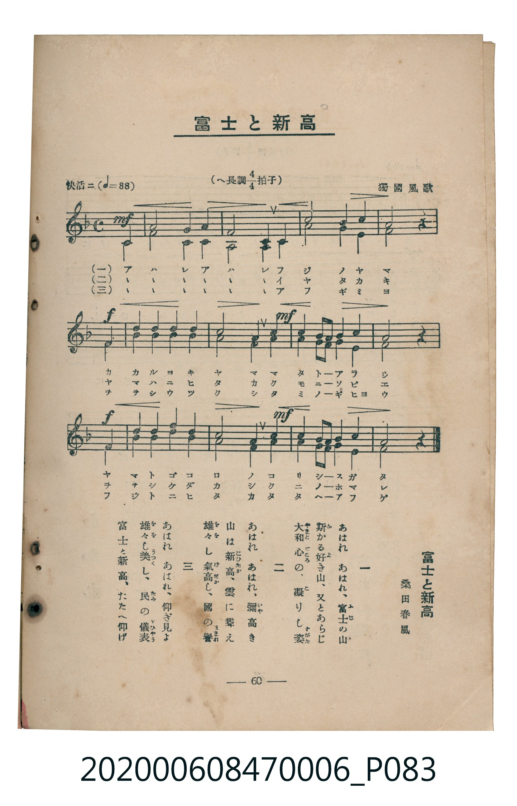

# 富士と新高

> Re:Shōka 使用 AI 協助辨識與重建樂譜，可能會有錯誤。歡迎回報。

- **鋼琴伴奏版**：<br><audio controls src="fuji_to_niitaka.mp3"></audio>
- **NEUTRINO 歌聲合成版**：<br><audio controls src="fuji_to_niitaka_neutrino.mp3"></audio>

- 詞：桑田春風
- 曲：獨國風歌
- 臺灣教育會公認《新定兒童唱歌》尋常科第六學年用（2020.006.0847.0006）

## 說明

原書資訊與歌詞全文（對應 P083.jpg，書頁 p. 60，參考教材第 18 首，二部合唱）：
調性與拍號：へ長調四分之四拍子（F 大調 4/4 拍，弱起 1 拍），「快活ニ」（♩=88）


## 歌詞

```text
一　あはれ　あはれ、富士（ふじ）の山
斯（か）かる好（よ）き山、又とあらじ
大和心（やまとごころ）の、凝（こ）りし姿（すがた）

二　あはれ　あはれ、彌（いや）高き
山は新高（にひたか）、雲に聳（そび）え
雄々（をを）し氣高（けだか）し、國の譽（ほまれ）

三　あはれ　あはれ、仰ぎ見よ
雄々（をを）し美（うつく）し、民（たみ）の儀表（ぎひやう）
富士と新高、たたへ仰げ
```

## ABC

```abc
X:1
T:富士と新高
C:曲：獨國風歌
M:4/4
L:1/16
Q:1/4=88
K:F
V:V1 name="Piano" snm="Pia"
V:V2 name="Piano2" snm="Pia"
[V:V1]
!mf! z4 z4 z4 C4 | A8 G4 A4 | F8 C4 C4 | c8 B4 c4 |
w: あ | は れ あ | は れ ふ | じ の や
!f! A8 z4 F4 | d4 d4 d4 d4 | !mf! c8 A4 c4 | c4 B2 A2 B4 c4 |
w: ま か | か る よ き | や ま ま | た と _ あ ら
!f! A8 z4 F4 | d4 d4 f4 d4 | !mf! c8 A4 c4 | c4 B2 A2 B4 c4 |
w: じ や | ま と ご こ | ろ の こ | り し _ す が
!mf! A8 z4 C4 | A8 G4 A4 | F8 C4 C4 | c8 B4 c4 |
w: た あ | は れ あ | は れ い | や た か
!f! A8 z4 F4 | d4 d4 d4 d4 | !mf! c8 A4 c4 | c4 B2 A2 B4 c4 |
w: き や | ま は に ひ | た か く | も に _ そ び
!f! A8 z4 F4 | d4 d4 f4 d4 | !mf! c8 A4 c4 | c4 B2 A2 B4 c4 |
w: え を | を し け だ | か し く | に の _ ほ ま
!mf! A8 z4 C4 | A8 G4 A4 | F8 C4 C4 | c8 B4 c4 |
w: れ あ | は れ あ | は れ あ | ふ ぎ み
!f! A8 z4 F4 | d4 d4 d4 d4 | !mf! c8 A4 c4 | c4 B2 A2 B4 c4 |
w: よ を | を し う つ | く し た | み の _ ぎ ひょ
!f! A8 z4 F4 | d4 d4 f4 d4 | !mf! c8 A4 c4 | c4 B2 A2 B4 c4 |
w: う ふ | じ と に ひ | た か た | た へ _ あ ふ
A8 z4 z4 |
w: げ
[V:V2]
!mf! z4 z4 z4 C4 | F8 C4 C4 | A,8 A,4 C4 | A8 G4 E4 |
!f! F8 z4 F4 | B4 B4 B4 B4 | !mf! A8 F4 A4 | A4 G2 F2 G4 E4 |
!f! F8 z4 F4 | B4 B4 d4 B4 | !mf! A8 F4 A4 | A4 G2 F2 G4 E4 |
!mf! F8 z4 C4 | F8 C4 C4 | A,8 A,4 C4 | A8 G4 E4 |
!f! F8 z4 F4 | B4 B4 B4 B4 | !mf! A8 F4 A4 | A4 G2 F2 G4 E4 |
!f! F8 z4 F4 | B4 B4 d4 B4 | !mf! A8 F4 A4 | A4 G2 F2 G4 E4 |
!mf! F8 z4 C4 | F8 C4 C4 | A,8 A,4 C4 | A8 G4 E4 |
!f! F8 z4 F4 | B4 B4 B4 B4 | !mf! A8 F4 A4 | A4 G2 F2 G4 E4 |
!f! F8 z4 F4 | B4 B4 d4 B4 | !mf! A8 F4 A4 | A4 G2 F2 G4 E4 |
F8 z4 z4 |
```

## TMD 檔案連結

- [主旋律 TMD 檔案](fuji_to_niitaka.tmd) [[在 TMD Studio 編輯](https://tmdlang.github.io/Tmd-TS/#tmd=s7IKdvYPcrWy4qpTUCpJTLdSSM7PyUlNLsnMz7MqzsjMK0nNjM_KTMmPL87Iz05Ugisry88pzU21Si9KTEmNN4s3MjAyiDcwMIs3sDAxBzIMzBBKi_NLi5JTrYqTM_Lzc-JLUitKkvLzsxHyBUX5Zal5iXlANQVFIBtTwIrQDYgvSExPtQowsDBCyKSWZaakgjQWJyfmxZelFmWmZaamIOTzi0oy8oFuLMiotMrILC7JL8pMTsyJz07MQ_ZKalEx2LsQa0qKEvOKk4syC0BhgFBVkpEK9G9eYklpUSqyBZnpmXlW5anFJalFefG5qTn5KZUY0iWJmcDgAwVheWJ8bmJmXk5iHtCVWloKT9f3PF28-nHjimfTNrxcPUNBS4tL0VbBwoLL3lbBjcvGRN_EDmTYi5Xz3u-Z9WzhxOdTNjybsfTlohVgO57N3gQUft674umcbqDYs7U9YOEX7bueNy5-NnXmi6ZNz-Y0P21d82JV7-OGLqAdT9fNeto66fnqpU-nbAQqf9zQ_XRD99MdO54vn_h8zZqnrWufrt3xdOeW51NWvN_TAYpUPWBU6oEiFcgwMHu_p1OJi0tfS8GWWoBLQUHhad_8Z7N3vNjc_mJF14uOdqC7gP592goMk3agK55u6H3W3qkAjHhjvayC9Pd7eoCKXy5oVCjQUzAzAHKf9je_aGgGevfZ3AlATygYWii8XDYNKPFkV8_L5hVPJ3QAPQt0OTCoQLa9WLX_WcNykD3dvS9mzgeKPm7c8XLqdqD409mzn3a0PdnZDWQAZZ-unQC0303h6ZLlQEkFYGQoAEVBNu7Z-GLrdgVDCBdoMDAge57uX_1sy-7Hzd2PG4CCHY9mrrS1sADKcoEsfbKj4XFDw-PGpseN6x83AZUjsxshqQCo6XHj1seNM4CaHjeue7pxI0jns2nrwRLdYNHux03dT5fuBYk0dYBFeoHqQEb0A9WsABnaBBScAQ7WJcufTgI6qxmsuuVx4z6wiimPGyc_bgK5G2gJSGf7XLAFk0EiTV2PG6c_Xb4fLDLzcWPP40ZgCEH9sAvN3ah-2NsD1tQCtAqoA5iYgW4DOwPovsb1kPQNVgFM7puAxkK91ND4cjaQu_pF42aw7NzHIAbQbR0gzS9ntzxuaAV7YBIQgSWmP9uwGGbWxMeNC2BhMx3kijndQF-9WAsOocbdID83Ad0FiwSgdTg98GT3hseNfS-WAYMYt9XP9_WBTW573LjkcWM_3N5nGyaCxYG-AoYdOPpaGl4sBOUioKEgD4MioA3kElCQoOZ6oH6wTiDaAXbFJJAiyvMWFCho6XNxuZVmZYbk-2VmliRmJ1oFZCbm5TvU6BrWVIOsUrCx0LIDM7BlbQVgpgKm3xcLexQ0oClfW8FE4emG_ufrG3RAGdMIlDE1segE2gwytUbBQEEXjqtz02oVTOOBrBoFYyAJgkZADGLXADMVRASsAKrKFCpmAhJC0Qc2D2gcSFcN2C4fwxoFkC4YBkYxWAcwnqF6gNGNV3wrVHwGTLxxHVi2BSq-DyoOMb0bYbMRpTZDbQDbBLF5PsIOIN2LbDPEPRCbjSm1GSYO8jvE5j4wuR_qog4UmyeBbcafYHb1gBMMienEDGgyMkbEPSjGISkHLmwCFCQ2SUACEVh6gkmQdyDBiRrcoKiFkCAdkMBfAQ8gYNEKlYElDYyIACYBmCmgIAaWa2ByE5KJEJvA7mjsh7oAbDpU7VwwuRmqA1vAw6IcwgcWQGCyDUwugeoDmQyxCSILshkkDopQaIKGRjGwaGqHSoKMQKRscD4gEMs7OimJZcM4KIPMaAZh5CiGBDwkwqaAycnQAIblHJjXYeJdSEE0E0yC8gNyVMHyFFIEowT7RDC5AKoLFK3IwQ6NYGjUQuzeDSahiQyc_7DYA4pecDKD-Qd_QoJFLyTJ7gCTkEQFK81Abka1pxZrrWBETrUAaWk92dH9onETkEFhpYCtCjAGUeAEgiwIFQPVHuaoelFLAaKKKvI8AUqZyBjhKpDVYG9BKjYQaQQUpNCx0BxHmWNBeY4Sx0IyHjAB6dopoKShaB_DWAVMQSNsgsZgQWUuAA)]
- [鋼琴伴奏 TMD 檔案](fuji_to_niitaka_piano.tmd) [[在 TMD Studio 編輯](https://tmdlang.github.io/Tmd-TS/#tmd=s7IKdvYPcrWy4tLSUni6vufp4tWPG1c8m7bh5eoZ7_d0vOze83zClid7tjxd2v-8s-P9nk4FLS0uRVsFCwsue1sFNy4bE30TO646BaUXK-e93zPr2cKJz6dseDZj6ctFK5RAws9mbwIKP-9d8XRON1Ds2doesPCL9l3PGxc_mzrzRdOmZ3Oan7auebGq93FDF9Dip-tmPW2d9Hz10qdTNgKVP27ofrqh--mOHc-XT3y-Zs3T1rVP1-54unPL8ykrgO4zMjAy0DMwMNMzsDAxBzIMzIBOVOLicivNygzJ98vMLEnMTrQKyEzMyw_ycKjRNayp5lIAAhsLLTswQ19LwRYdKADtebKj4cXCHgUNE4WnG_qfr2_QUQgwsDDSyypI18SiQUsfbFiNgoGCLhxX56bVKpjGA1k1CsZAEgSNgBjErlEwhIqAFUBVmULFTEBCKPrA5gGNA-mqAdvlY1ijANIFw48bm8A6Hjeuh-p53NSDV3wrVHwGTLxxHVi2BSq-DyoOMb0bYbMRpTZDbQDbBLF5PsIOIN2LbDPEPRCbjSm1GSYO8jvE5j4wuR_qog4UmyeBbcafTnb1kJNOzIAmI2NE3INiHJJy4MImQEFikwQkEB83QUiQdyDBiRrcoKiFkCAdkMBfAQ-gx02dUBlY0sCICGASgJkCCuLHjavB5CYkEyE2gd3R2A91Adh0qNq5YHIzVAe2gIdFOYT_uHE6mGwDk0ug-kAmQ2yCyIJsBomDIhSaoKFRvOlxUztUEmQEImWD8wGBWN7RSUksG8ZBGWRGMwgjRzEk4CERNgVMToYGMCznwLwOE-9CCqKZYBKUH5CjCpankCIYJdgngskFUF2gaEUOdmgEQ6MWYvduMAlNZOD8h8UeUPSCkxnMP_gTEix6IUl2B5iEJCpYaQZyM6o9tVirAyNyagNgbn_ZvOLJju4XjZuADAorBWxVgDGIAicQZEGoGKj2MEfVi1oKEFVUkecJUMpExghXgawGewtSsYFII6AghY6F5jjKHAvKc5Q4FpLxsCcgH5T2hAk0BYFiGwSh8RwPMjBeIdowFkYB8zpQNNo0PhbCAAuZABkmUAGQDFwT0CBQeAGNgZoOFQdpwDQMbCmqAQg74CrJMROLw9HcaQAJKF07BZSwivYBymIKGmETNAYLKnMBAA)]

## 分析

```text
================================================================================
📊 TMD Song Profile: [ 富士と新高 ]
================================================================================
⏱  Duration:       1:38 (98.2s), 36 measures total
🎼 Key & Tempo:    首調基準 F, != 88.0 BPM, <4/4>
   - 分析範圍：      由實際發聲的音符與和弦推測調性；播放脈絡另行呈現
🎤 人聲音域:    C4 (MIDI 60) – F5 (MIDI 77) [跨度: 17 個半音 / 1.4 個八度, 難度: challenging]
   - 最低音:  C4 in [FujiToNiitaka[L1] #1 @ m.1, 0:02]
   - 最高音: F5 in [FujiToNiitaka[L1] #1 @ m.10, 0:25]
   - 適合: soprano, mezzo-soprano, contralto, tenor, baritone, bass
🏛  結構:      FujiToNiitaka[L1] (32.7s) -> FujiToNiitaka[L2] (32.7s) -> FujiToNiitaka[L3] (32.7s)
⚡ 編曲密度:        Peak 2 軌道同時演奏
🗝  調性診斷：       F 大調（純淨自然大調，未偵測到可信轉調）
   - 風格氣質:    純淨自然大調（陽光明朗、易唱易記，無明顯調外色彩）
   - 轉調歷程:    全曲維持單一推測調性（未偵測到可信轉調）
   - 核心骨幹音:  A, C, F, A#, D
   - 調性數值:    F 大調 [相關度: 0.88, 穩定度: Moderate, 自然音純度: 100.0%]
   - 候選調性 (K-S): F 大調 (0.88), A 小調 (0.77), D 小調 (0.60)
   - 五度圈歷程:   -1 -> -1 -> -1
   - 各段落調性細節:
     • [FujiToNiitaka[L1] #1]: F 大調 (r: 0.87, 自然音純度: 100.0%)
     • [FujiToNiitaka[L2] #1]: F 大調 (r: 0.88, 自然音純度: 100.0%)
     • [FujiToNiitaka[L3] #1]: F 大調 (r: 0.88, 自然音純度: 100.0%)

  [ 五度圈游移軌跡 ]
               C  
        [F ]*          G  
      Bb               D  
      Eb               A  
         Ab           E  
            Db       B  
               F# 
     (* = active key center)

  [ 十二半音累積音高分佈 ]
     C  : ███████████████████       22.2%
     C# :                            0.0%
     D  : ████████                   8.9%
     D# :                            0.0%
     E  : ███                        3.3%
     F  : █████████████████         20.0%
     F# :                            0.0%
     G  : █████                      5.6%
     G# :                            0.0%
     A  : ████████████████████████  27.8%
     A# : ███████████               12.2%
     B  :                            0.0%
--------------------------------------------------------------------------------
Assignment 軌道音域：
  - Piano         : C4 – F5 (17 個半音 / 1.4 個八度, 117 個音符)
  - Piano2        : A3 – D5 (17 個半音 / 1.4 個八度, 117 個音符)
================================================================================
```


## 原書掃描頁




