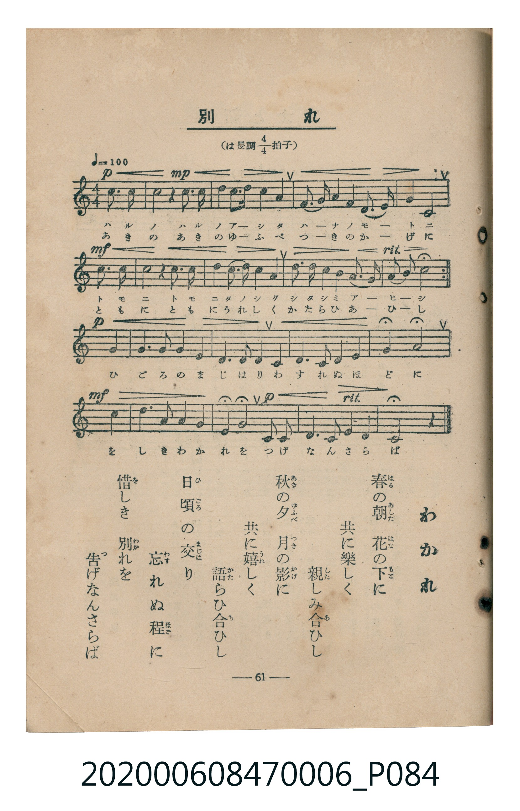

# 別れ

> Re:Shōka 使用 AI 協助辨識與重建樂譜，可能會有錯誤。歡迎回報。

<audio controls src="wakare.mp3"></audio>

- 詞：文部省
- 曲：文部省
- 臺灣教育會公認《新定兒童唱歌》尋常科第六學年用（2020.006.0847.0006）

## 說明

原書資訊與歌詞全文（對應 P084.jpg，書頁 p. 61，參考教材第 19 首）：
速度與表情：♩=100
調性與拍號：は長調四分之四拍子（C 大調 4/4 拍，弱起 1 拍）
曲式結構：第 1–2 行（前 8 小節）譜下印有上下兩行歌詞（上行片假名、下行平假名），第 2 行末附反覆記號（:||）；
第 3–4 行（後 8 小節）譜下印單行平假名歌詞。


## 歌詞

```text
春の朝（あした）　花の下（もと）に
共に楽しく　親しみ合ひし
秋の夕（ゆふべ）　月の影に
共に嬉しく　語らひ合ひし
日頃（ひごろ）の交（まじは）り　忘れぬ程に
惜（を）しき別（わか）れを　告げなんさらば
```

## ABC

```abc
X:1
T:別れ
C:曲：文部省
M:4/4
L:1/16
Q:1/4=100
K:C
V:V1 name="Piano" snm="Pia"
[V:V1]
!p! z4 z4 z4 c3 c | !mp! c8 z4 c3 c | d4 c3 d c4 A4 | F3 G A4 F4 D3 E |
w: 1.~ハ ル | ノ ハ ル | ノ ア ー シ タ | ハ ー ナ ノ モ ー
w: 2.~あ き | の あ き | の ゆ ー ふ べ | つ ー き の か ー
!mf! G4 C8 c3 c | c8 z4 c3 c | d4 c3 d c4 A4 | d3 d c4 B4 A3 G |
w: 1.~ト ニ ト モ | ニ ト モ | ニ タ ノ シ ク | シ タ シ ミ ア ー
w: 2.~げ に と も | に と も | に う れ し く | か た ら ひ あ ー
!p! A2 B2 c8 G4 | G6 G2 G4 E4 | D6 D2 D4 C4 | D6 C2 D4 E4 |
w: 1.~ヒ ー シ ひ | ご ろ の ま | じ は り わ | す れ ぬ ほ
w: 2.~ひ ー し ひ | ご ろ の ま | じ は り わ | す れ ぬ ほ
!mf! G4 A8 c4 | d6 A2 A4 G4 | !p! E4 G8 C2 C2 | D6 C2 E4 D4 |
w: 1.~ど に を | し き わ か | れ を つ げ | な ん さ ら
w: 2.~ど に を | し き わ か | れ を つ げ | な ん さ ら
C8 z4 z4 |
w: 1.~ば
w: 2.~ば
```

## TMD 檔案連結

- [主旋律 TMD 檔案](wakare.tmd) [[在 TMD Studio 編輯](https://tmdlang.github.io/Tmd-TS/#tmd=s7IKdvYPcrWy4qpTUCpJTLdSSM7PyUlNLsnMz7MqzsjMK0nNjM_KTMmPL87Iz05Ugisry88pzU21Si9KTEmNN4s3MjAyiDcwMIs3sDAxBzIMzBBKi_NLi5JTrYqTM_Lzc-JLUitKkvLzs9Hl4wsS01OtAoD6ETIFRfllqXmJeUDdBUUgt6SAtSMUpJZlpqSCpIuTE_Piy1KLMtMyU1OQXJlaVAz2CcSKkqLEvOLkoswCkPcQqvKLSjLygT4pyKi0ysgsLskvykxOzInPTsxD8nBJRirQv2lFmal5KcCAKUCXAYVEaSK6wZnpmXlWufl5SaXA8FPi0tJSeNqx9HFTj4KWFpeirYKhgQGXva2CM5eNib6JHUjfi5Xz3u-Z9Wxa-8vmFc_nNILNejZ7E4bYi_ZdzxsXP5s680XTpmdzmp-2rnmxqvdxQ9ezaRuerpv1tHXS89VLn07Z-Gxtz-OG7qcbup_u2PF8-cTna9Y8bV37dO2Opzu3PJ-y4v2eDlDE6QGjSw8UcUCGgdn7PZ1KXFz6Wgq21AJcCgoKT_vmP5u948Xm9hcrul50tAPdBfTp09YVQF8BXfF0Q--z9k4FUOzrZRWkv9_TA1T8ckGjQoGegpkhkPu0v_lFQzPQu8_mTgB6QsHQUuHlsmlApwIDBmT8y4b5T3ctAxr8YuGKZ82tQNFHM1fagoIXKPli1f5nDctBtnb3vpg5Hyj5uHH9y6nbgeJPZ89-2tH2ZGc3kAGUfbp2AtA1zgpPlywHSioAI0UBKAqyf8_GF1u3KxhCuJ0gU4Gx8nRP__OtE54t7wYaCXbVo4bJRgovFvaAvNTZq2Ch8HRD__P1DUAdL9bOebKj-2nvhmdzOp_s6AKxW1cCVUICAqgeKAjkPu9sf9rY_nQCMCobgWqAIk93boaIgD3bA7IGbMWzOatfzmx52t_7YlnbixUzwP7qsKqpASubDXIgAoA0GQPdZgJz274erG57Om0dso0Qtz1uaOIC-3fG0seN657NmQs04HFj0-PG6Y8bgXZ2Pm5oeNG1ESgFNAMk1QSUAqaszseNq8ER3wqUW_1s6V6whn6Q6mWrwOz9TycADdoEZIPUPV_eDTTj6ZKpYDPaHjdufdy4E2L8szlAdeue7gUZhDDy6RqgFTAjV8173ATkbkIx8tn0pS8XNIOdCxSa8rgJFIYgh-5aAhbc97hxBjAlgASbuoCmPN0_A5g1Hzeueb4C6BawVc-a54DdMwmsE2hbLzD_gkX6HzcCvQvU2QOUBWme2PW4cdLjxlWPmyY_bpwKds4GkBGU5x8oUNDS5-IKT8xOLAKWk5mJefkONQY11eCYtjE007IDs7DlW1D8P9nRAIxaBQ1IQgbygAlZQVvBGJoKwEygkA48D2piMQfoAJAdNQoGCrpgiE5XF9QqGMaBmUCqBsZGQLjCXDSVRjCVUEEgH67ZDErXKJiAaVO4CIQPVA0mjYEqTGHGoFlcnZuGYiHYIz6GNQrxUAXo9OPmfii9Gmjs4-Y-NAMJqXvctAgqvgfI3g4X3Q_3DEInUEVzF9w8uAnNCBNAqjvg4t1oboHJgXRAfWaEx2eNTVC6F2Ru4zpcPsOhDpg7Ee5u3ApXvRPhs8YlSCp64SrgJjRCfAD1WeMkuPhqdJ81roDa2QT0Gf4UvqsHksL7lwLLRlAkg8rH3dtABT24fARWAMjFpQKwsCQyueNMxqSnYKgqZElzFEWmQEUgFkgUw15Q_oKlcEQSxkwQiMSJlDCQ1MGSISixISfO9XB3wkRBKpFUNM-Hq0VNnKAoBLFBMjDViEjchOpmYOLEjGpEskOKciR1jxuhyQ7YegIWxXBRSCaCJDtosmqcD1TViWE7PEFDkx1IHOpmuHnY3EygYO0EJzuiEhIs7kAQxIbxjeF-gJRkEAhiw_iw8gxVBUgUxkeYATMVlupgELkMREk_jVOQfd7UC_Y_IrPug5sMrDCRVTaC0guw7oTrRI6LmShm9oDVr4Hr3I2kciVcFCP7N8GKBuSUMxRcizfNABubxKcZeLkCgqAohUUrvCCARz1y8gJBcHUMpEEYM-HAdMHEgeUcmn706h05ySBnGEgZjwhQWEaEFCSgwEQNHoQ-UD0BKf9BZq5ClmuaDJabCufDMjRI5QY0k9DrOOTkMthdWsvFpWunAGnYKQBZylwA)]
- [鋼琴伴奏 TMD 檔案](wakare_piano.tmd) [[在 TMD Studio 編輯](https://tmdlang.github.io/Tmd-TS/#tmd=s7IKdvYPcrWy4tLSUnjasfRxU8_7PR0vu_c8n7DlyZ4tT5f2P-_seL-nU0FLi0vRVsHQwIDL3lbBmcvGRN_EjqtOQenFynnv98x6Nq39ZfOK53MalUBiz2ZvwhB70b7reePiZ1Nnvmja9GxO89PWNS9W9T5u6Ho2bcPTdbOetk56vnrp0ykbn63tedzQ_XRD99MdO54vn_h8zZqnrWufrt3xdOeW51NWAJ1mZGBkoGdgYKZnYGFiDmQYmAFdp8TF5ZlXUpRvFZCZmJcf5OFQY1BTzaUABDaGZlp2YFaNQnVuWq2CUZyCLhyaQTEImkLpGgVjNBEYNITiGgUjNFGYDph4DVgUGRqg0TVctShu9kF2swmak-MVoo1yYxVM4hUM40FmxyuYxgPFTONjIQJABRA5kDBYPtowFmiVAcSa8MTsxKJU_GGD7j4YXV1Qq2AICTIgBTQbOfhQFOaiqYQHNFQQyIdrhoV5jYIJmDaFi0D4sJA0BqqAxQJ6iIKDBslCsEd8DGsU4qEK0OnHzf1QejXQ2MfNfWgGElL3uGkRVHwPkL0dLrof7hmETqCK5i64eXATmhEmgFR3wMW70dwCkwPpgPrMCI_PGpugdC_I3MZ1uHyGQ93jpjaEuxu3wlXvRPiscQmSil64CrgJjRAfQH3WOAkuvhrdZ40roHY2AX0GTX04UxXpCQqqClnSHEWRKVARiAUSxbAXlNzhBQE8RWHGDyKtIMUTkjpYqgDFPXJaWQ93J0wUpBJJRfN8uFrUtAIKURAbJANTjQjTTahuBqYVzJBHpAKkGEBS97gRmgqaeoDs6XBRSJqGpAJoLDfOB6rqxLAdnr6gqQAkDnUz3DxsboamAuTyFsSG8WGlK2q5C2LD-LCyAbNkhvERZsBMhSUZGEQuT1Aiv3EKsrObesGORyT8fXCTHzfOQFbZCIrsx03wYqAJOSBnopjZA1a_Bq5zN5LKlXBRjKzUBMtmyNE-FFwLjXAK6mJwvQSkqVcfI-IbOalCCjtEaMCyACQLg0IC1W8IfaACE1IQgsxchSzXNBksNxXOh2UlkMoNaCahF_bIcT3YXYrW-MDRyAE1VMCNFUisQlovkBYMqAUEKpKB7RqgOEjKJBbUaoAwgO0eSIsHKg_Vg9x2QjMN3SCYRuSmFKZBCFdBKYhGsC6oCRAR1GYZkIA6FM1R-Bp0sGAg0KbTtVMAtx4VgAxIEEf7AOWReEZgnjIXAA)]

## 分析

```text
================================================================================
📊 TMD Song Profile: [ 別れ ]
================================================================================
⏱  Duration:       0:40 (40.8s), 17 measures total
🎼 Key & Tempo:    首調基準 C, != 100.0 BPM, <4/4>
   - 分析範圍：      由實際發聲的音符與和弦推測調性；播放脈絡另行呈現
🎤 人聲音域:    C4 (MIDI 60) – D5 (MIDI 74) [跨度: 14 個半音 / 1.2 個八度, 難度: moderate]
   - 最低音:  C4 in [Wakare #1 @ m.5, 0:10]
   - 最高音: D5 in [Wakare #1 @ m.3, 0:04]
   - 適合: soprano, mezzo-soprano, contralto, tenor, baritone, bass
🏛  結構:      Wakare (40.8s)
⚡ 編曲密度:        Peak 1 軌道同時演奏
🗝  調性診斷：       C 大調（純淨自然大調，未偵測到可信轉調）
   - 風格氣質:    純淨自然大調（陽光明朗、易唱易記，無明顯調外色彩）
   - 轉調歷程:    全曲維持單一推測調性（未偵測到可信轉調）
   - 核心骨幹音:  C, D, G, A, E
   - 調性數值:    C 大調 [相關度: 0.83, 穩定度: High, 自然音純度: 100.0%]
   - 候選調性 (K-S): C 大調 (0.83), G 大調 (0.62), A 小調 (0.60)
   - 五度圈歷程:   +0
   - 各段落調性細節:
     • [Wakare #1]: C 大調 (r: 0.83, 自然音純度: 100.0%)

  [ 五度圈游移軌跡 ]
              [C ]*
         F            G  
      Bb               D  
      Eb               A  
         Ab           E  
            Db       B  
               F# 
     (* = active key center)

  [ 十二半音累積音高分佈 ]
     C  : ████████████████████████  36.9%
     C# :                            0.0%
     D  : ███████████████           22.5%
     D# :                            0.0%
     E  : █████                      7.0%
     F  : ██                         2.9%
     F# :                            0.0%
     G  : ██████████                15.6%
     G# :                            0.0%
     A  : ████████                  12.7%
     A# :                            0.0%
     B  : ██                         2.5%
--------------------------------------------------------------------------------
Assignment 軌道音域：
  - Piano         : C4 – D5 (14 個半音 / 1.2 個八度, 66 個音符)
================================================================================
```


## 原書掃描頁




