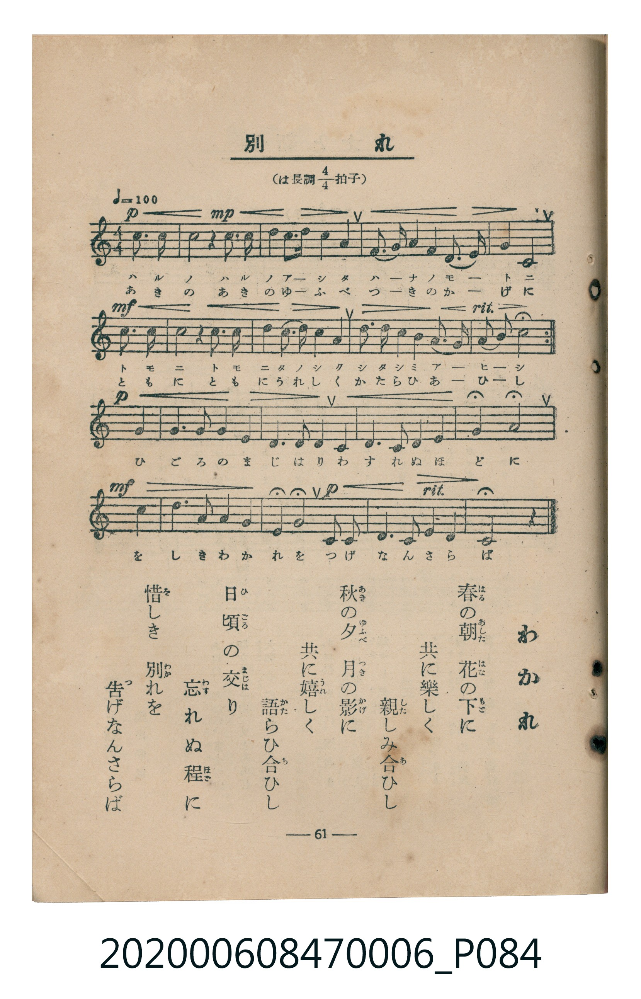

# 別れ

<audio controls src="wakare.mp3"></audio>

- 臺灣教育會公認《新定兒童唱歌》尋常科第六學年用（2020.006.0847.0006）

## 說明

原書資訊與歌詞全文（對應 P084.jpg，書頁 p. 61，參考教材第 19 首）：
速度與表情：♩=100
調性與拍號：は長調四分之四拍子（C 大調 4/4 拍）

## 歌詞

```text
春の朝（あした）　花の下（もと）に
共に楽しく　親しみ合ひし
秋の夕（ゆふべ）　月の影に
共に嬉しく　語らひ合ひし
日頃（ひごろ）の交（まじは）り　忘れぬ程に
惜（を）しき別（わか）れを　告げなんさらば
```

## ABC

```abc
X:1
T:別れ
C:TMD (Chen, Chih-Han / aguai)
M:4/4
L:1/16
Q:1/4=100
K:C
V:V1 name="Piano" snm="Pia"
[V:V1]
!p! z4 z4 z4 c3 d | !mp! e4 d3 e f4 f3 g | e4 d4 c3 d e3 f | !mf! d4 d3 G c4 c3 d |
e4 d3 e f4 f3 g | e4 d4 g3 f e3 d | !p! c4 d3 e c4 G3 G | e3 e d4 c3 c A3 A |
G4 G3 c B3 c d3 e | !mf! f4 a4 g4 c3 d | e3 f d4 g4 e4 | !p! d4 c3 d e3 f d4 |
d3 G c8 z4 |
```

## TMD 檔案連結

- [主旋律 TMD 檔案](wakare.tmd)
- [鋼琴伴奏 TMD 檔案](wakare_piano.tmd)

## 分析

```text
================================================================================
📊 TMD Song Profile: [ 別れ ]
================================================================================
⏱  Duration:       0:31 (31.2s), 13 measures total
🎼 Key & Tempo:    首調基準 C, != 100.0 BPM, <4/4>
   - 分析範圍：      由實際發聲的音符與和弦推測調性；播放脈絡另行呈現
🎤 人聲音域:    G3 (MIDI 55) – A4 (MIDI 69) [跨度: 14 個半音 / 1.2 個八度, 難度: moderate]
   - 最低音:  G3 in [Wakare #1 @ m.4, 0:08]
   - 最高音: A4 in [Wakare #1 @ m.10, 0:22]
   - 適合: mezzo-soprano, contralto, tenor, baritone, bass
🏛  結構:      Wakare (31.2s)
⚡ 編曲密度:        Peak 1 軌道同時演奏
🗝  調性診斷：       C 大調（純淨自然大調，未偵測到可信轉調）
   - 風格氣質:    純淨自然大調（陽光明朗、易唱易記，無明顯調外色彩）
   - 轉調歷程:    全曲維持單一推測調性（未偵測到可信轉調）
   - 核心骨幹音:  D, C, E, G, F
   - 調性數值:    C 大調 [相關度: 0.75, 穩定度: Moderate, 自然音純度: 100.0%]
   - 候選調性 (K-S): C 大調 (0.75), G 大調 (0.61), D 小調 (0.59)
   - 五度圈歷程:   +0
   - 各段落調性細節:
     • [Wakare #1]: C 大調 (r: 0.75, 自然音純度: 100.0%)

  [ 五度圈游移軌跡 ]
              [C ]*
         F            G  
      Bb               D  
      Eb               A  
         Ab           E  
            Db       B  
               F# 
     (* = active key center)

  [ 十二半音累積音高分佈 ]
     C  : ███████████████████       21.4%
     C# :                            0.0%
     D  : ████████████████████████  27.1%
     D# :                            0.0%
     E  : ██████████████████        20.8%
     F  : ██████████                11.5%
     F# :                            0.0%
     G  : ████████████              13.5%
     G# :                            0.0%
     A  : ████                       4.2%
     A# :                            0.0%
     B  : █                          1.6%
--------------------------------------------------------------------------------
Assignment 軌道音域：
  - Piano         : G3 – A4 (14 個半音 / 1.2 個八度, 71 個音符)
================================================================================
```


## 原書掃描頁




