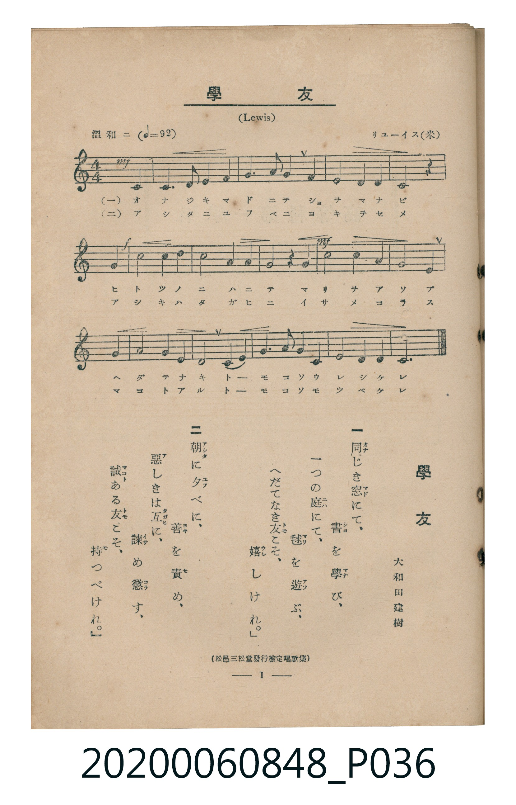

# 學友

> Re:Shōka 使用 AI 協助辨識與重建樂譜，可能會有錯誤。歡迎回報。

<audio controls src="gakuyu.mp3"></audio>

- 詞：大和田建樹
- 曲：Lewis（リユーイス）
- 臺灣教育會公認《新定兒童唱歌》高等科男子用（2020.006.0848）

## 說明

原書資訊與歌詞全文（對應 P036.jpg，書頁 p. 1，高一第一學期第 1 首）：
調性與拍號：ハ長調（無升降記號）、4/4 拍（溫和ニ ♩=92，弱起第 4 拍進入）
出處註記：（松邑三松堂發行檢定唱歌集）


## 歌詞

```text
一　同（おな）じき窓（まど）にて、書（しょ）を學（まな）び、
一つの庭（には）にて、毬（まり）を遊（あそ）ぶ、
へだてなき友（とも）こそ、嬉（うれ）しけれ。

二　朝（あした）に夕（ゆふ）べに、善（よき）を責（せ）め、
惡（あ）しきは互（たがひ）に、諫（いさ）め懲（こら）す、
誠（まこと）ある友（とも）こそ、持（も）つべけれ。
```

## ABC

```abc
X:1
T:學友
C:曲：Lewis（リユーイス）
M:4/4
L:1/16
Q:1/4=92
K:C
V:V1 name="Piano" snm="Pia"
[V:V1]
!mf! z4 z4 z4 C4 | E8 D2 C2 C4 | E6 F2 G4 C4 | D8 C4 D4 |
!f! E8 z4 G4 | c8 B2 A2 G4 | !mf! F4 E4 D4 G4 | A8 F4 G4 |
E8 D4 C4 | E8 D2 C2 C4 | E4 F3 G G4 C4 | D8 E4 D4 |
C12 z4 |
```

## TMD 檔案連結

- [主旋律 TMD 檔案](gakuyu.tmd) [[在 TMD Studio 編輯](https://tmdlang.github.io/Tmd-TS/#tmd=s7IKdvYPcrWy4qpTUCpJTLdSSM7PyUlNLsnMz7MqzsjMK0nNjM_KTMmPL87Iz05Ugisry88pzU21ys4vyY9Pyq8sjjcyMDKINzAwizewMLFAqCvOLy1KTrUqTs7Iz8-JL0mtKEnKz89GyBcU5Zel5iXmAdUUFIGsSwErQihILctMSQVJp6ZkluQXZSbmIDkitagY7FCwJfElRYl5xclFmQUg1yNUlWSkAl0KdUFOZloqulRaUWZqXgrQtwUIGaBN6Zl5VrmpmVmZWJwNlS5PLS5JLcqLz03NyU-pVOLS0lJ4unbH0_5uBS0tLkVbBUsjLntbBWcuGxN9EzuQ5hcr573fM-vpkuVPJ_U8n7Lh6e5dz1bsBBv7bPYmoIxPanlm8fs9HY-bVz1uXva4ec_jpiWPm3a-39MJVvSifdfzxsXPps580bTp2Zzmp61rXqzqfdzQ9WzahqfrZj1tnfR89dKnUzY-W9vzuKH75eoZz9d2Pl8-8fmU7U_XTng-ZQXQYFA06QGjSQ8UTWBjufS1FGypBbgUFBSe9s1_NnvHi83tL1Z0vehoBzoG6OunrSueTWsHOuDpht5n7Z0KAQbGZnpZBenv9_QAFb9c0KhQoKdgCOQBXf1kR8PzNWuAJDAsn82ZD2QrGCq8XDYN6FxgEIGseLFq_7OG5SDDu3tfzJwPFH3c3P9y6nagONCK5y0Ln_a2v5zZ-2LFDLBs5-OGRmAMKABVA6Wf7VoNDP3Hzd0Kj2autLU0Alr6dM_GF1u3gywCK3rZsOlp61KgPrB32ne9mDn1xYrdQNOAFoEMmLvvZdPEJzs6gYynC5qez9zzYmHPs1WLQFEADvyXs9tAmkG6gb543NDwdEIPKFIbux43rgI5p3HG48be56smgwX3PW5cCRZc_bhxGdClwPAAi09_3AQMsM7HTZOA4QBTCdG-GagMZnrjkseN657uWgtWATRiPYpZ69dAdTZ1Qcx62QhkAEWaHjfOBavcBjXrceOOx40LQNoaVwFdB0zEYHUrHjc1gdVNBmoAKn26BhgJQPG2x01APwHFpz9unAhkP25ognh4F5DZ8GwO0HCILUB5cBQ0rn66ZCpIsKntceNWsMhOkDuBRk5rAYsD1QPjB-TIF5sgzp4N5jZCXfiseSHEUJi9vUDfPtk1CSw4_3Fjz-NGYB4Ce76h8cXq1WDxlseNQFtBpjxrB8oCRSY_bgJ6AahsJtTcF6sWwIIX6ElgLgHKNT1u6sYVBM96GsHuhQgCgx_oD1gQAI2jPBdBgYKWPheXbyKwnAnITMzLd6gxqFGoBtmgYGNopmUHZgEzLyTxPt3Q_3x9Ayj1Y6RikDkgtTUKBgq6YIhOV-em1QLzGIRTA45HkMmQXAhM3EBjnRKLihUMHzVMNkEx0RiqCQaNgBhkEMIwTHUmQGwKZaOrA-lHhjB5mDg281B8AvQIzGxUj-zqQfKIKdAjoOIP4RHDODQTzYHYDMmlMJtBrgdBmAtgLgOHIbpikAHIEKYZXR22YEQNHpQ46UTyiiXQK4bAQoyCSIG4ypToSEH3OkwdTB86hEVODVctF5eunQIoTSsAaWUuLgA)]
- [鋼琴伴奏 TMD 檔案](gakuyu_piano.tmd) [[在 TMD Studio 編輯](https://tmdlang.github.io/Tmd-TS/#tmd=s7IKdvYPcrWy4tLSUni6dsfT_u73ezpedu95PmHLkz1bni7tf97Z8X5Pp4KWFpeirYKlEZe9rYIzl42JvokdV52C0ouV897vmfV0yfKnk3qeT9nwdPeuZyt2KoFkns3eBJTxSS3PLAaa-Lh51ePmZY-b9zxuWvK4aSfQRLCiF-27njcufjZ15oumTc_mND9tXfNiVe_jhq5n0zY8XTfraeuk56uXPp2y8dnanscN3S9Xz3i-tvP58onPp2x_unbC8ykrgAYbGRgZ6BkYmOkZWJhYgI3l8k3MzLMKyEzMyw_ycKgxqFGo5lIAAhtDMy07MEsf6NU9G19s3f50Q__z9Q0KWvpg4RoFAwVdMESnq3PTahUMoZwaLpghz9esebKj4cXCHoQJxlBFMGgExCCNCM2Y6kyA2BTKRlcH0o8MYfIwcWzmobgc6HCY2agO39WD4nDDODQTzIHYDMllMJtArgVBmI0wl4DDCF0xyABkCNOMrg5bsKEGB0qYd1IU5hBHmBId5ug-hamD6UOHsLCv4apFTow-KInRhHBahEC8yc0wXiHaMFbBNB5CwwWMYXywjGk8VAmIAVcDpNBNR08TaIaZINkGMQokYgJkGaEbDlKD4XbUaMPqdpBhCBGQ8UbxuXhcDwxhXTsFUCArAGllLi4A)]

## 分析

```text
================================================================================
📊 TMD Song Profile: [ 學友 ]
================================================================================
⏱  Duration:       0:33 (33.9s), 13 measures total
🎼 Key & Tempo:    首調基準 C, != 92.0 BPM, <4/4>
   - 分析範圍：      由實際發聲的音符與和弦推測調性；播放脈絡另行呈現
🎤 人聲音域:    C4 (MIDI 60) – C5 (MIDI 72) [跨度: 12 個半音 / 1.0 個八度, 難度: easy]
   - 最低音:  C4 in [Main #1 @ m.1, 0:01]
   - 最高音: C5 in [Main #1 @ m.6, 0:13]
   - 適合: soprano, mezzo-soprano, contralto, tenor, baritone, bass
🏛  結構:      Main (33.9s)
⚡ 編曲密度:        Peak 1 軌道同時演奏
🗝  調性診斷：       C 大調（純淨自然大調，未偵測到可信轉調）
   - 風格氣質:    純淨自然大調（陽光明朗、易唱易記，無明顯調外色彩）
   - 轉調歷程:    全曲維持單一推測調性（未偵測到可信轉調）
   - 核心骨幹音:  C, E, D, G, F
   - 調性數值:    C 大調 [相關度: 0.84, 穩定度: High, 自然音純度: 100.0%]
   - 候選調性 (K-S): C 大調 (0.84), E 小調 (0.60), A 小調 (0.57)
   - 五度圈歷程:   +0
   - 各段落調性細節:
     • [Main #1]: C 大調 (r: 0.84, 自然音純度: 100.0%)

  [ 五度圈游移軌跡 ]
              [C ]*
         F            G  
      Bb               D  
      Eb               A  
         Ab           E  
            Db       B  
               F# 
     (* = active key center)

  [ 十二半音累積音高分佈 ]
     C  : ████████████████████████  27.7%
     C# :                            0.0%
     D  : █████████████████         19.1%
     D# :                            0.0%
     E  : ███████████████████████   26.6%
     F  : ██████                     6.9%
     F# :                            0.0%
     G  : ████████████              13.3%
     G# :                            0.0%
     A  : █████                      5.3%
     A# :                            0.0%
     B  : █                          1.1%
--------------------------------------------------------------------------------
Assignment 軌道音域：
  - Piano         : C4 – C5 (12 個半音 / 1.0 個八度, 41 個音符)
================================================================================
```


## 原書掃描頁




