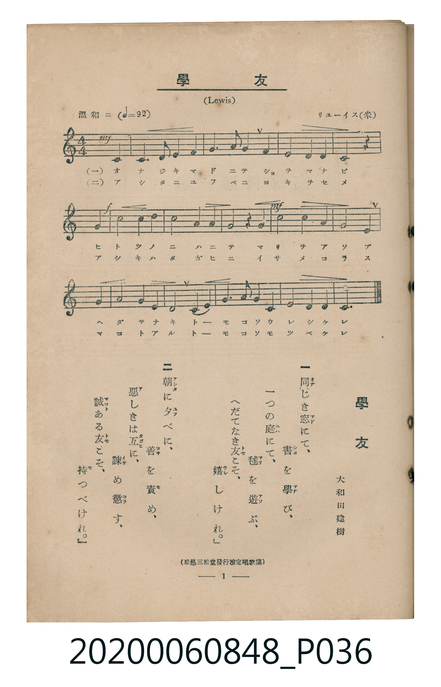

# 學友

<audio controls src="gakuyu.mp3"></audio>

- 詞：大和田建樹
- 曲：Lewis（リユーイス）
- 臺灣教育會公認《新定兒童唱歌》高等科男子用（2020.006.0848）

- note

原書資訊與歌詞全文（對應 P036.jpg，書頁 p. 1，高一第一學期第 1 首）：
調性與拍號：ハ長調（無升降記號）、4/4 拍（溫和ニ ♩=92，弱起第 4 拍進入）
出處註記：（松邑三松堂發行檢定唱歌集）

## 歌詞

```text
一　同（おな）じき窓（まど）にて、書（しょ）を學（まな）び、
一つの庭（には）にて、毬（まり）を遊（あそ）ぶ、
へだてなき友（とも）こそ、嬉（うれ）しけれ。

二　朝（あした）に夕（ゆふ）べに、善（よき）を責（せ）め、
惡（あ）しきは互（たがひ）に、諫（いさ）め懲（こら）す、
誠（まこと）ある友（とも）こそ、持（も）つべけれ。
```

## 原書掃描頁



## 調性分析

```text
================================================================================
📊 TMD Song Profile: [ 學友 ]
================================================================================
⏱  Duration:       0:33 (33.9s), 13 measures total
🎼 Key & Tempo:    首調基準 C, != 92.0 BPM, <4/4>
   - 分析範圍：      由實際發聲的音符與和弦推測調性；播放脈絡另行呈現
🎤 人聲音域:    C4 (MIDI 60) – C5 (MIDI 72) [跨度: 12 個半音 / 1.0 個八度, 難度: easy]
   - 最低音:  C4 in [Main #1 @ m.1, 0:01]
   - 最高音: C5 in [Main #1 @ m.6, 0:13]
   - 適合: soprano, mezzo-soprano, contralto, tenor, baritone, bass
🏛  結構:      Main (33.9s)
⚡ 編曲密度:        Peak 1 軌道同時演奏
🗝  調性診斷：       C 大調（純淨自然大調，未偵測到可信轉調）
   - 風格氣質:    純淨自然大調（陽光明朗、易唱易記，無明顯調外色彩）
   - 轉調歷程:    全曲維持單一推測調性（未偵測到可信轉調）
   - 核心骨幹音:  C, E, D, G, F
   - 調性數值:    C 大調 [相關度: 0.84, 穩定度: High, 自然音純度: 100.0%]
   - 候選調性 (K-S): C 大調 (0.84), E 小調 (0.60), A 小調 (0.57)
   - 五度圈歷程:   +0
   - 各段落調性細節:
     • [Main #1]: C 大調 (r: 0.84, 自然音純度: 100.0%)

  [ 五度圈游移軌跡 ]
              [C ]*
         F            G  
      Bb               D  
      Eb               A  
         Ab           E  
            Db       B  
               F# 
     (* = active key center)

  [ 十二半音累積音高分佈 ]
     C  : ████████████████████████  27.7%
     C# :                            0.0%
     D  : █████████████████         19.1%
     D# :                            0.0%
     E  : ███████████████████████   26.6%
     F  : ██████                     6.9%
     F# :                            0.0%
     G  : ████████████              13.3%
     G# :                            0.0%
     A  : █████                      5.3%
     A# :                            0.0%
     B  : █                          1.1%
--------------------------------------------------------------------------------
Assignment 軌道音域：
  - Piano         : C4 – C5 (12 個半音 / 1.0 個八度, 41 個音符)
================================================================================
```

## ABC

```abc
X:1
T:學友
C:曲：Lewis（リユーイス）
M:4/4
L:1/16
Q:1/4=92
K:C

V:V1 name="Piano" snm="Pia"

[V:V1]
!mf! z4 z4 z4 c4 | e8 d2 c2 c4 | e6 f2 g4 c4 | d8 c4 d4 |
!f! e8 z4 g4 | c8 b2 a2 g4 | !mf! f4 e4 d4 g4 | a8 f4 g4 |
e8 d4 c4 | e8 d2 c2 c4 | e4 f3 g g4 c4 | d8 e4 d4 |
c12 z4 |
```

- [主旋律 TMD 檔案](gakuyu.tmd)
- [鋼琴伴奏 TMD 檔案](gakuyu_piano.tmd)
