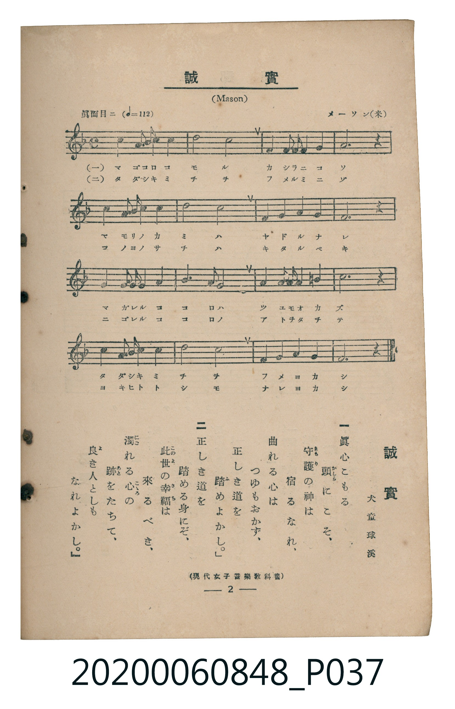

# 誠實

<audio controls src="seijitsu.mp3"></audio>

- 詞：犬童球溪
- 曲：Lowell Mason（メーソン）
- 臺灣教育會公認《新定兒童唱歌》高等科男子用（2020.006.0848）

## 說明

原書資訊與歌詞全文（對應 P037.jpg，書頁 p. 2，高一第一學期第 2 首）：
調性與拍號：ヘ長調（1 降記號）、4/4 拍（眞面目ニ ♩=112）
出處註記：（現代女子音樂教科書）

## 歌詞

```text
一　眞心（まごころ）こもる頭（かしら）にこそ、
守護（まもり）の神（かみ）は宿（やど）るなれ、
曲（まが）れる心（こころ）はつゆもおかず、
正（ただ）しき道（みち）を踏（ふ）めよかし。

二　正（ただ）しき道（みち）を踏（ふ）める身（み）にぞ、
此世（このよ）の幸福（さち）は來（きた）るべき、
濁（にご）れる心（こころ）の跡（あと）をたちて、
良（よ）き人（ひと）としもなれよかし。
```

## 原書掃描頁



## 分析

```text
================================================================================
📊 TMD Song Profile: [ 誠實 ]
================================================================================
⏱  Duration:       0:34 (34.3s), 16 measures total
🎼 Key & Tempo:    首調基準 F, != 112.0 BPM, <4/4>
   - 分析範圍：      由實際發聲的音符與和弦推測調性；播放脈絡另行呈現
🎤 人聲音域:    F4 (MIDI 65) – D5 (MIDI 74) [跨度: 9 個半音 / 0.8 個八度, 難度: easy]
   - 最低音:  F4 in [Main #1 @ m.1, 0:00]
   - 最高音: D5 in [Main #1 @ m.11, 0:21]
   - 適合: soprano, mezzo-soprano, contralto, tenor, baritone, bass
🏛  結構:      Main (34.3s)
⚡ 編曲密度:        Peak 1 軌道同時演奏
🗝  調性診斷：       F 大調（純淨自然大調，未偵測到可信轉調）
   - 風格氣質:    純淨自然大調（陽光明朗、易唱易記，無明顯調外色彩）
   - 轉調歷程:    全曲維持單一推測調性（未偵測到可信轉調）
   - 核心骨幹音:  A, F, G, C, B
   - 調性數值:    F 大調 [相關度: 0.75, 穩定度: Moderate, 自然音純度: 96.7%]
   - 候選調性 (K-S): F 大調 (0.75), A 小調 (0.67), C 大調 (0.64)
   - 五度圈歷程:   -1
   - 各段落調性細節:
     • [Main #1]: F 大調 (r: 0.75, 自然音純度: 96.7%, 調外音: B)

  [ 五度圈游移軌跡 ]
               C  
        [F ]*          G  
      Bb               D  
      Eb               A  
         Ab           E  
            Db       B  
               F# 
     (* = active key center)

  [ 十二半音累積音高分佈 ]
     C  : ███████████████           17.5%
     C# :                            0.0%
     D  : ██                         2.5%
     D# :                            0.0%
     E  :                            0.0%
     F  : ████████████████████      23.7%
     F# :                            0.0%
     G  : ███████████████████       22.5%
     G# :                            0.0%
     A  : ████████████████████████  28.7%
     A# : █                          1.7%
     B  : ███                        3.3%
--------------------------------------------------------------------------------
Assignment 軌道音域：
  - Piano         : F4 – D5 (9 個半音 / 0.8 個八度, 51 個音符)
================================================================================
```

## ABC

```abc
X:1
T:誠實
C:曲：Lowell Mason（メーソン）
M:4/4
L:1/16
Q:1/4=112
K:F
V:V1 name="Piano" snm="Pia"
[V:V1]
f4 f3 g a4 f4 | c8 a8 | g4 g2 g2 g4 a4 | g12 z4 |
f4 f3 g a4 f4 | c8 a8 | a4 a4 g4 g4 | f12 z4 |
g4 g3 a b4 g4 | a8 a4 c4 | d4 d2 c2 =b4 b4 | c12 z4 |
f4 f3 g a4 f4 | c8 a8 | a4 a4 g4 g4 | f12 z4 |
```

- [主旋律 TMD 檔案](seijitsu.tmd)
- [鋼琴伴奏 TMD 檔案](seijitsu_piano.tmd)
