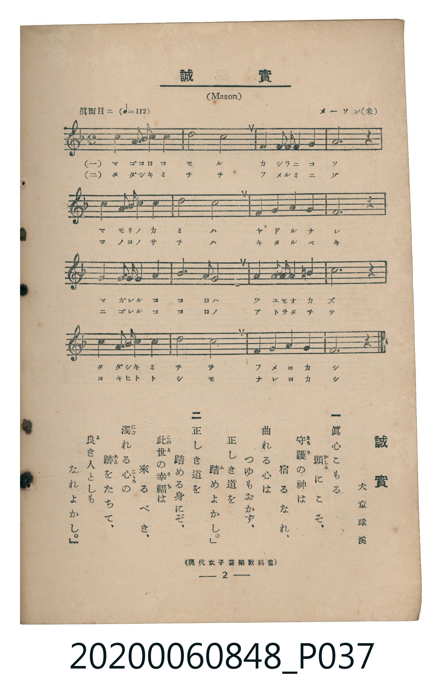

# 誠實

> Re:Shōka 使用 AI 協助辨識與重建樂譜，可能會有錯誤。歡迎回報。

- **鋼琴伴奏版**：<br><audio controls src="seijitsu.mp3"></audio>

- 詞：犬童球溪
- 曲：Lowell Mason（メーソン）
- 臺灣教育會公認《新定兒童唱歌》高等科男子用（2020.006.0848）

## 說明

原書資訊與歌詞全文（對應 P037.jpg，書頁 p. 2，高一第一學期第 2 首）：
調性與拍號：ヘ長調（1 降記號）、4/4 拍（眞面目ニ ♩=112）
出處註記：（現代女子音樂教科書）


## 歌詞

```text
一　眞心（まごころ）こもる頭（かしら）にこそ、
守護（まもり）の神（かみ）は宿（やど）るなれ、
曲（まが）れる心（こころ）はつゆもおかず、
正（ただ）しき道（みち）を踏（ふ）めよかし。

二　正（ただ）しき道（みち）を踏（ふ）める身（み）にぞ、
此世（このよ）の幸福（さち）は來（きた）るべき、
濁（にご）れる心（こころ）の跡（あと）をたちて、
良（よ）き人（ひと）としもなれよかし。
```

## ABC

<div class="abc-score" data-abc-src="seijitsu.abc" aria-label="五線譜載入中"></div>

[下載 ABC 原始檔](seijitsu.abc)

## TMD 檔案連結

- [主旋律 TMD 檔案](seijitsu.tmd) [[在 TMD Studio 編輯](https://tmdlang.github.io/Tmd-TS/#tmd=s7IKdvYPcrWy4qpTUCpJTLdSSM7PyUlNLsnMz7MqzsjMK0nNjM_KTMmPL87Iz05Ugisry88pzU21ys4vyY9Pyq8sjjcyMDKINzAwizewMLFAqCvOLy1KTrUqTs7Iz8-JL0mtKEnKz89Gl48vSExPtQowMDZHyBQU5Zel5iXmAXUXFIEckgLWjlCQWpaZkgqSLk5OzIsvSy3KTMtMTUFyYmpRMdgbECtKihLzipOLMgtAfkOoyi8qychPL0osyKi0ysgsLskvykxOzInPTsxD8m1JRirQs6m5-eh6M9Mz86xyUzOzMrH4DSpdnlpcklqUF5-bmpOfUokhXZKYCQxbUPiWJ8bnJmbm5STmAX2hpaXwYtWCp-uXKWhpcSnaKhgaGnHZ2yq4cdmY6JvYgQx5sXLe-z2znneteb566fMJzc92rQKb_Wz2JqCwT355ak6Ogm9icX7e-z0dj5sXPm7e87hp7-Pmze_3dIIVvmjf9bxx8bOpM180bXo2p_lp65oXq3ofN3Q9m7bh6bpZT1snAc19OmXjs7U9jxu6X66e8Xxt5_PlE59P2f507YTnU1YATQXFuR4wzvVAcQ42lktfS8GWWoBLQUHhad_8Z7N3vNjc_mJF14uOdqBjgN5-2rri2bR2oAOebuh91t6pAEo4elkF6e_39AAVv1zQqFCgp2AE5AFd_WRHw_M1a4Dk07U7ns2ZD2QrGCm8XDYN6FxgMIGseLFq_7OG5SDDu3tfzJwPFH3cPOPl1O1AcaAVhgovZ_a-WDEDLNP5uKERGPwKQJVAqedz5r2cu-j57HWPm7sVHs1caQuMI6AasLPbd72YOfXFit1AnUADQYr79z3Zvfjp0s3A0Hs5f_OzFU3AkAeGJ9DBID0gTUBHPm5oAJr6dH8zKM4a9z1unPK4cfLjJqBtnWBG0-Om7pcL1oJlux83Tn_cBPQFUGo1SLZxLtB5YNvXdbxYux1qBEhPF1jRuudLgSkGohPoNaDI-qfrQH583NTyuHElSKQJKLXqcRMwxsEGgdMSxCE9YOkeoAqY64AWwp22_nHjksdNbSDLGrvAFsyCGbF2MVj1_MeNC8BKpz9u7H3ZOBksuP9x40KwuZNe7OgHi2wFcxsfN8E82NAECZtdQDc1kGtY94tdqyFqYKE1D-68JU92ABMDxD_rgPZCgurpzh3Pl0FMmQo1t3H9k31tYJFeoAtgobUTxIWatb8RLA00fgre0Fr3YjvQRKAgMLSA-QjkZLCfFj5uXAY160XnenDEQJzT-2TXLrCGTVANjSvAkQ_UD44t5NACaqY860GBgpY-F1cwqHgrKS61CshMzMt3qDGoqQZZomBjaKZlB2Zhy_QKkFz3YmGPgoaJwtMN_c_XN-jAc6omFg1Au0CG1SiYKuiCoTGYNIHzYXSNghmUBYMwGRisUTCEsiC0IZxvBFcBMR0TGsBUgF3jY1ij8Lh5HlTscdMWKL0ZKLoWLroZburj5kVo5j1uXo3husdNMLHHTduhqlYCcTc2E5v24nBpPKpLjUBq98NtbYCb_7gJ7tLm-UgubcRw6SZMlzZPhcsuhPsHYQ7CzSDb9xF0Kf70sqtnoNMLLH3AUgcivcBUoEO86QWaGh43rwLiPpgoPPZBamEhCYOPm_sxXPe4eQlcthPOgqeh5i4klWtwuBNbaoGlMpjbHjevQHHnViRzMVMLFnciUhpSSkS4cyYWlbjdSaBs6SQnrcDiE0IbYcR3DTD9INwCEoWpQPgSphZCG8P5JupwJegJDAbxFy6QqANFIVKgoRQFMDZEHSgIsSeXFriaZVB6EVD3KriZSAmwaRcOt2JJMEgFFLQgJNGtsKSF5NYmWIH5uLkDSm9CST6whAeyv42gW_EmmqezZw-LAoYOxTykMICyUNILpMLChNjSC8IEiNseN0-CxzMixrGbi1mVgkyEFXWIgo58d9ZycenaKcDaNwpAtjIXAA)]
- [鋼琴伴奏 TMD 檔案](seijitsu_piano.tmd) [[在 TMD Studio 編輯](https://tmdlang.github.io/Tmd-TS/#tmd=s7IKdvYPcrWy4qpTUCpJTLdSSM7PyUlNLsnMz7MqzsjMK0nNjM_KTMmPL87Iz05Ugisry88pzU21ys4vyY9Pyq8sjjcyMDKINzAwizewMLFAqCvOLy1KTrUqTs7Iz8-JL0mtKEnKz89Gl48vSExPtQowMDZHyBQU5Zel5iXmAXUXFIEckgLWjlCQWpaZkgqSLk5OzIsvSy3KTMtMTUFyYmpRMdgbECtKihLzipOLMgtAfkOoyi8qychPL0osyKi0ysgsLskvykxOzInPTsxD8m1iEVBzempual6JVUFmYl5-fGJycn5uQWJeJkgMobAkA6jIKjU3H92SzPTMPKvc1MysTCyBAJUuTy0uSS3Ki89NzclPqcSQLknMBEYCKCLKE-NzEzPzchLzgN7V0lJ4sWrB0_XL3u_peNm95_mELU_2bHm6tP95Z8f7PZ0KWlpcirYKhoZGXPa2Cm5cNib6JnYgk1-snPd-z6znXWuer176fELzs12rwBY-m70JKOyTX56ak6Pgm1icnwc09nHzwsfNex437X3cvBloJljhi_ZdzxsXP5s680XTpmdzmp-2rnmxqvdxQ9ezaRuerpv1tHUS0NynUzY-W9vzuKH75eoZz9d2Pl8-8fmU7U_XTng-ZQXQVFCK0QOmGD1QigEbyxUMCqCS4lKrAFAgB3k41BjUVHMpAIGNoZmWHZilr6XwfM2aJzsaXizsUdDSB4vVKJgq6IKhMZg0gfNhdI2CGZQFgzAZGKxRMISyILQhnG8EVwExHRMawFSAXeNjWKPwuHkeVOxx0xYovRkouhYuuhlu6uPmRWjmPW5ejeG6x00wscdN26GqVgJxNzYTm_bicGk8qkuNQGr3w21tgJv_uAnu0ub5SC5txHDpJkyXNk-Fyy6E-wdhDsLNINv3EXQpcrTv6qFZtMOiGRbJiGiHqUCHeKMdGqmPm1cBcR9MFB6JILWwAIHBx839GK573LwELtsJZ8GTQnMXkso1ONyJLdJhiQXmtsfNK1DcuRXJXMxIx-JORIJBSlAId87EohK3O1FyeidKlMOiBUIbYURbDTAZIIwEicJUIBwLUwuhjeF8E3W4EvR0AoP4szokBkAxgeR3lIwJY0PUgUICe6y3wNUsg9KLgLpXwc1ESkdNu3C4FUu8IxUX0GKJRLfCUgiSW5tgxdfj5g4ovQklFcDSD8j-NoJuRYr7p7NnD-7sToeyE5I1oSyUaIfUApgQW7QjTIC47XHzJHh0ISIOu7mY9RPIRFjBgyh2yHdnLXrV74Nc9ZvgrfkN4xWiDWNhFDD3AxkmSHwkedN4VAED_JULIZPBfKCRpvFEmI1WisH1gBlg41CFIOaZgZhm8bmxCkZAhhFYDEUdmjXoGYZiLwBjRtdOARY50T5AGRS-EZivzAUA)]

## 分析

```text
================================================================================
📊 TMD Song Profile: [ 誠實 ]
================================================================================
⏱  Duration:       0:34 (34.3s), 16 measures total
🎼 Key & Tempo:    首調基準 F, != 112.0 BPM, <4/4>
   - 分析範圍：      由實際發聲的音符與和弦推測調性；播放脈絡另行呈現
🎤 人聲音域:    F4 (MIDI 65) – D5 (MIDI 74) [跨度: 9 個半音 / 0.8 個八度, 難度: easy]
   - 最低音:  F4 in [Seijitsu #1 @ m.3, 0:04]
   - 最高音: D5 in [Seijitsu #1 @ m.2, 0:02]
   - 適合: soprano, mezzo-soprano, contralto, tenor, baritone, bass
🏛  結構:      Seijitsu (34.3s)
⚡ 編曲密度:        Peak 1 軌道同時演奏
🗝  調性診斷：       F 調性不明確（純淨自然大調，未偵測到可信轉調）
   - 風格氣質:    純淨自然大調（陽光明朗、易唱易記，無明顯調外色彩）
   - 轉調歷程:    全曲維持單一推測調性（未偵測到可信轉調）
   - 核心骨幹音:  C, A, F, G, D
   - 調性數值:    F 調性不明確 [相關度: 0.82, 穩定度: Ambiguous, 自然音純度: 98.3%]
   - 候選調性 (K-S): F 大調 (0.82), C 大調 (0.82), A 小調 (0.69)
   - 五度圈歷程:   -1
   - 各段落調性細節:
     • [Seijitsu #1]: F 調性不明確 (r: 0.82, 自然音純度: 98.3%, 調外音: B)

  [ 五度圈游移軌跡 ]
               C  
        [F ]*          G  
      Bb               D  
      Eb               A  
         Ab           E  
            Db       B  
               F# 
     (* = active key center)

  [ 十二半音累積音高分佈 ]
     C  : ████████████████████████  30.0%
     C# :                            0.0%
     D  : ████████                  10.0%
     D# :                            0.0%
     E  :                            0.0%
     F  : ███████████████           18.3%
     F# :                            0.0%
     G  : █████████████             16.7%
     G# :                            0.0%
     A  : ████████████████          19.6%
     A# : ███                        3.7%
     B  : █                          1.7%
--------------------------------------------------------------------------------
Assignment 軌道音域：
  - Piano         : F4 – D5 (9 個半音 / 0.8 個八度, 51 個音符)
================================================================================
```


## 原書掃描頁




