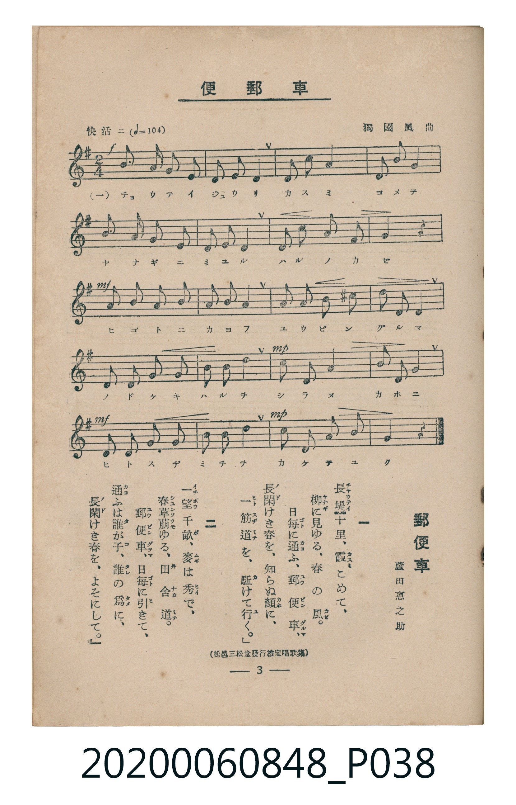

# 郵便車

<audio controls src="yubinsha.mp3"></audio>

- 詞：蘆田惠之助
- 曲：獨國風曲
- 臺灣教育會公認《新定兒童唱歌》高等科男子用（2020.006.0848）

## 說明

原書資訊與歌詞全文（對應 P038.jpg，書頁 p. 3，高一第一學期第 3 首）：
調性與拍號：ト長調（1 升記號）、2/4 拍（快活ニ ♩=104）
出處註記：（松邑三松堂發行檢定唱歌集）

## 歌詞

```text
一　長堤（ちゃうてい）十里（じふり）、霞（かすみ）こめて、
柳（やなぎ）に見（み）ゆる、春（はる）の風（かぜ）。
日毎（ひごと）に通（かよ）ふ、郵便車（いうびんぐるま）、
長閑（のど）けき春（はる）を、知（し）らぬ顏（かほ）に、
一筋道（ひとすぢみち）を、駈（か）けて行（ゆ）く。

二　一望（いちばう）千畝（せんぽ）、麥（むぎ）は秀（ひい）で、
春草（しゅんさう）萌（も）ゆる、田舍道（ゐなかみち）。
郵便車（いうびんぐるま）、日毎（ひごと）に引（ひ）きて、
通（かよ）ふは誰（た）が子（こ）、誰（たれ）の爲（ため）に、
長閑（のど）けき春（はる）を、よそにして。
```

## ABC

```abc
X:1
T:郵便車
C:曲：獨國風曲
M:2/4
L:1/16
Q:1/4=104
K:G
V:V1 name="Piano" snm="Pia"
[V:V1]
!f! G2 G2 F2 G2 | A2 F2 D4 | G2 B2 d4 | A2 B2 A4 |
G2 G2 F2 G2 | A2 F2 D4 | G2 B2 d2 A2 | G4 z4 |
!mf! A2 A2 B2 A2 | G2 B2 d4 | A2 A2 G2 ^c2 | d2 A2 F4 |
D2 F2 A2 c2 | B2 d2 g4 | !mp! e2 c2 A4 | d2 B2 G4 |
!mf! D2 F2 A2 c2 | B2 d2 g4 | !mp! e2 c2 A2 d2 | G4 z4 |
```

## TMD 檔案連結

- [主旋律 TMD 檔案](yubinsha.tmd) [[在 TMD Studio 編輯](https://tmdlang.github.io/Tmd-TS/#tmd=s7IKdvYPcrWy4qpTUCpJTLdSSM7PyUlNLsnMz7MqzsjMK0nNjM_KTMmPL87Iz05Ugisry88pzU21ys4vyY9Pyq8sjjcyMDKINzAwizewMLFAqCvOLy1KTrUqTs7Iz8-JL0mtKEnKz89GyBcU5Zel5iXmAdUUFIGsSwErQihILctMSQVJp6ZkluQXZSbmIDkitagY7FCwJfElRYl5xclFmQUg1yNUlWSkAl0KlizIL0IyGiqRmpyRl5-Tn16pxKWlpfCyeeuTfftf7O5S0NLiUrRVMDQw4bK3VXDnsjHSN7ED6X2xct77PbNezGh7PmXDs-YFT3Z2P-1aCTb12exNQJnnvSuezul-uWgFkAsWftG-63nj4mdTZ75o2vRsTvPT1jUvVvU-buh6Nm3D03WznrZOer566dMpG5-t7Xnc0P1y9YznazufL5_4fMr2p2snPJ-y4v2eDlDg6gEDVw8UuO_3dCpxcelrKdhSC3ApKCg87Zv_bPaOF5vbX6zoetHRDnQM0J9PW1c8m9YOdMDTDb3P2jsVAgyMLfSyCtLf7-kBKn65oFGhQE_BGMgDuvrJjobna9YAyadrdzybMx_IVjBWeLlsGtC5wEABWfFi1f5nDctBhnf3vpg5Hyj6uLnj5dTtQHGgFYYKT3uBls8Ay3Q-bmgEhrcCUCXI9v2rn23Z_bi5W-HRzJW2wBgBKgC7uX3Xi5lTX6zYDdQGNA2o8tncfS-bJj7Z0QlkPF3Q9HzmnhcLe56tWgQKZ3AIv5zdBtIM0g106uOGBqD9TxcsAWp93LjwcVPz48a2x43LHje2AFU97W182d4DlprxuHHr46YuiMNezgEmAKBg9-PGmY8bgW7vfNw4-XFTI0hjQyPI6GfzN4NUNLU8blz1uLEPrGL1i2XdYG1gDU1tj5u6gaqfzVgKFlwP5IKVrQMmHJjpc8D2NYFNnL702XqgQUCJTY8bpzxuBCoCGfqyAeRtkOqmDrDIVpADYWkYLAV0BNBPmx83TX7cOAFka-M-iD9A5gK9_3LaRLC6dY8bV4KNmPi4sRfdXU2TgBqez4cITgeLAFWuebmwH-bY3RAHQc0FpYa13S8bJ8OcvAIcWIuA3gcGNNzEl8uBrgbph1m8DBhf4KADRdPjxn6Q98Hm7QJmjgagqc_mzIb5auHjxg1Av4Fjqvn51Llg8dlgf-6FxtQusIObGmCRsP758gaYi0BR_LhxOSzKZix90QtMqSDvPW5qBZsyFWL6iwkQJzUhRxww87_o6IV6sGkCOKKBoQDzHSTWiIwIXJH7dM9UiCCY24tIX1hivXH9i1UbwILg7NPYAyw8wFygA0F2wGUfNwF9A0pozzuA5kJEGlHijqQ0AXTB48a5IM3AcAM5EOxxysskKFDQ0ufi8k3MzLMKyEzMy3eoMahRqAbZoGBjoWUHZgBLQkjBA0k6TolFxQqGjxomg0oJkHaQGqCmtFoFQyA0jwcSNQpGIIZpvIIukG0ILKhMwSwjIMsIxAKnOZjJu3qQTDYFmgwqghEm4zXVCMzSVTDAMHVHJ5KplkBTDY1QHZwLdLER1EmojjQC8kzUgUyQ-UAb0Yx-Ons2clAYg8w2QzEb6ESgNiMFEyAbZKxhHNjk6tyCWgUzoCg4DIDixmC3o4XGFGTDzYGGGxlgOpywDaYoIVPLxaVrpwCKaAUgrczFBQA)]
- [鋼琴伴奏 TMD 檔案](yubinsha_piano.tmd) [[在 TMD Studio 編輯](https://tmdlang.github.io/Tmd-TS/#tmd=s7IKdvYPcrWy4tLSUnjZvPXJvv0vdne939PxsnvP8wlbnuzZ8nRp__POjvd7OhW0tLgUbRUMDUy47G0V3LlsjPRN7LjqFJRerJz3fs-sFzPank_Z8Kx5wZOd3U-7ViqBZJ7N3gSUed674umc7peLVgC5YOEX7bueNy5-NnXmi6ZNz-Y0P21d82JV7-OGrmfTNjxdN-tp66Tnq5c-nbLx2dqexw3dL1fPeL628_nyic-nbH-6dsLzKSuArjMyMDLQMzAw0zOwMLEAuk2Ji8s3MTPPKiAzMS8_yMOhxqBGoZpLAQhsLLTswAx9LYXna9Y82dHwYmGPgpY-WAyoKK1WwRAIzeOBRI2CEYhhGq-gC2QbKhgrmIJZRkCWEYjFhWzSrh4Uk_CaYgRm6SoYYJiyoxPVPblABxlBbUR1gxGQZ6IOZIKMA1qAZtLT2bNRTALaD1RkpGACZIMMMYwDm1OdW1CrYAYUBXsIKG4Mdhia16ZgOoqweaYonqxFjhIfEqLEMF4h2jAWaB-EBvkEyDKNhwqBGHBFxnjU4I0sEuzAFCEYi8S42AwkZRSfGwthmYEVGYHFYuE0gRgmbIsJkGECNxBoGZI2qFq8UU-KHbgCCpgSdO0UQIlBAUgrc3EBAA)]

## 分析

```text
================================================================================
📊 TMD Song Profile: [ 郵便車 ]
================================================================================
⏱  Duration:       0:23 (23.1s), 20 measures total
🎼 Key & Tempo:    首調基準 G, != 104.0 BPM, <2/4>
   - 分析範圍：      由實際發聲的音符與和弦推測調性；播放脈絡另行呈現
🎤 人聲音域:    D4 (MIDI 62) – G5 (MIDI 79) [跨度: 17 個半音 / 1.4 個八度, 難度: challenging]
   - 最低音:  D4 in [Main #1 @ m.2, 0:01]
   - 最高音: G5 in [Main #1 @ m.14, 0:15]
   - 適合: soprano, mezzo-soprano, tenor, baritone
🏛  結構:      Main (23.1s)
⚡ 編曲密度:        Peak 1 軌道同時演奏
🗝  調性診斷：       D 調性不明確（流行色彩大調，未偵測到可信轉調）
   - 風格氣質:    流行大調（略帶和弦色彩音與裝飾副屬和弦）
   - 轉調歷程:    全曲維持單一推測調性（未偵測到可信轉調）
   - 核心骨幹音:  G, A, D, F#, B
   - 調性數值:    D 調性不明確 [相關度: 0.83, 穩定度: Ambiguous, 自然音純度: 94.7%]
   - 候選調性 (K-S): D 大調 (0.83), G 大調 (0.82), B 小調 (0.51)
   - 五度圈歷程:   +2
   - 各段落調性細節:
     • [Main #1]: D 調性不明確 (r: 0.83, 自然音純度: 94.7%, 調外音: C)

  [ 五度圈游移軌跡 ]
               C  
         F            G  
      Bb              [D ]*
      Eb               A  
         Ab           E  
            Db       B  
               F# 
     (* = active key center)

  [ 十二半音累積音高分佈 ]
     C  : █████                      5.3%
     C# : █                          1.3%
     D  : ███████████████████       21.1%
     D# :                            0.0%
     E  : ██                         2.6%
     F  :                            0.0%
     F# : ██████████                10.5%
     G  : ████████████████████████  26.3%
     G# :                            0.0%
     A  : ████████████████████      22.4%
     A# :                            0.0%
     B  : ██████████                10.5%
--------------------------------------------------------------------------------
Assignment 軌道音域：
  - Piano         : D4 – G5 (17 個半音 / 1.4 個八度, 64 個音符)
================================================================================
```


## 原書掃描頁




