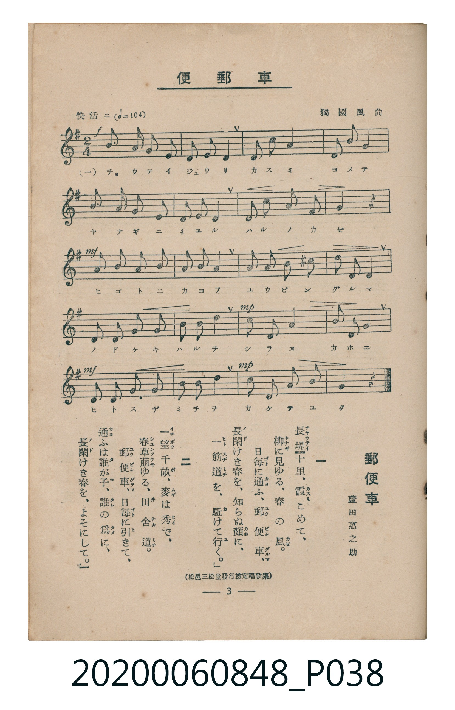

# 郵便車

> Re:Shōka 使用 AI 協助辨識與重建樂譜，可能會有錯誤。歡迎回報。

- **鋼琴伴奏版**：<br><audio controls src="yubinsha.mp3"></audio>
- **NEUTRINO 歌聲合成版**：<br><audio controls src="yubinsha_neutrino.mp3"></audio>

- 詞：蘆田惠之助
- 曲：獨國風曲
- 臺灣教育會公認《新定兒童唱歌》高等科男子用（2020.006.0848）

## 說明

原書資訊與歌詞全文（對應 P038.jpg，書頁 p. 3，高一第一學期第 3 首）：
調性與拍號：ト長調（1 升記號）、2/4 拍（快活ニ ♩=104）
出處註記：（松邑三松堂發行檢定唱歌集）


## 歌詞

```text
一　長堤（ちゃうてい）十里（じふり）、霞（かすみ）こめて、
柳（やなぎ）に見（み）ゆる、春（はる）の風（かぜ）。
日毎（ひごと）に通（かよ）ふ、郵便車（いうびんぐるま）、
長閑（のど）けき春（はる）を、知（し）らぬ顏（かほ）に、
一筋道（ひとすぢみち）を、駈（か）けて行（ゆ）く。

二　一望（いちばう）千畝（せんぽ）、麥（むぎ）は秀（ひい）で、
春草（しゅんさう）萌（も）ゆる、田舍道（ゐなかみち）。
郵便車（いうびんぐるま）、日毎（ひごと）に引（ひ）きて、
通（かよ）ふは誰（た）が子（こ）、誰（たれ）の爲（ため）に、
長閑（のど）けき春（はる）を、よそにして。
```

## ABC

<div class="abc-score" data-abc-src="yubinsha.abc" aria-label="五線譜載入中"></div>

[下載 ABC 原始檔](yubinsha.abc)

## TMD 檔案連結

- [主旋律 TMD 檔案](yubinsha.tmd) [[在 TMD Studio 編輯](https://tmdlang.github.io/Tmd-TS/#tmd=s7IKdvYPcrWy4qpTUCpJTLdSSM7PyUlNLsnMz7MqzsjMK0nNjM_KTMmPL87Iz05Ugisry88pzU21ys4vyY9Pyq8sjjcyMDKINzAwizewMLFAqCvOLy1KTrUqTs7Iz8-JL0mtKEnKz89Gl48vSExPtQowMEbSWVCUX5aal5gH1F1QBHJIClg7QkFqWWZKKki6ODkxL74stSgzLTM1BcmJqUXFYG9ArCgpSswrTi7KLAD5DaEqv6gkIz-9KLEgo9IqI7O4JL8oMzkxJz47MQ_JtyUZqUDPgk0oAGrAkEhNzsjLz8lPr0Q2NzM9M88qNzUzKxOLv6HS5anFJalFefG5qTn5KUDdWloKL5u3Ptm3_8XuLgUtLS5FWwVDAxMue1sFdy4bI30TO5ABL1bOe79n1osZbc-nbHjWvODJzu6nXSvBRj-bvQko87x3xdM53S8XrQBywcIv2nc9b1z8bOrMF02bns1pftq65sWq3scNXc-mbXi6btbT1knPVy99OmXjs7U9jxu6X66e8Xxt5_PlE59P2f507YTnU1a839MBil09YOzqgWL3_Z5OJS4ufS0FW2oBLgUFhad985_N3vFic_uLFV0vOtqBjgH682nrimfT2oEOeLqh91l7pwIoiehlFaS_39MDVPxyQaNCgZ6CMZAHdPWTHQ3P16wBkk_X7ng2Zz6QrWCs8HLZNKBzgYECsuLFqv3PGpaDDO_ufTFzPlD0cXPHy6nbgeJAKwwVnvYCLZ8Blul83NAIDG8FoEqQ7ftXP9uy-3Fzt8KjmSttgTECVAB2c_uuFzOnvlixG6gNaBpQ5bO5-142TXyyoxPIeLqg6fnMPS8W9jxbtQgUzuAQfjm7DaQZpBvo1McNDUD7ny5YAtT6uHHh46bmx41tjxuXPW5sAap62tv4sr0HLDXjcePWx01dEIe9nANMAEDB7seNMx83At3e-bhx8uOmRpDGhkaQ0c_mbwapaGp53LjqcWMfWMXqF8u6wdrAGpraHjd1A1U_m7EULLgeyAUrWwdMODDT54DtawKbOH3ps_VAg4ASmx43TnncCFQEMvRlA8jbINVNHWCRrSAHwtIwWAroCKCfNj9umvy4cQLI1sZ9EH-AzAV6_-W0iWB16x43rgQbMfFxYy-6u5omATU8nw8RnA4WAapc83JhP8yxuyEOgpoLSg1ru182ToY5eQU4sBYBvQ8MaLiJL5cDXQ3SD7N4GTC-wEEHiqbHjf0g74PN2wXMHA1AU5_NmQ3z1cLHjRuAfgPHVPPzqXPB4rPB_twLjaldYAc3NcAiYf3z5Q0wF4Gi-HHjcliUzVj6oheYUkHee9zUCjZlKsT0FxMgTmpCjjhg5n_R0Qv1YNMEcEQDQwHmO0isERkRuCL36Z6pEEEwtxeRvrDEeuP6F6s2gAXB2aexB1h4gLlAB4LsgMs-bgL6BpTQnncAzYWINKLEHUlpAuiCx41zQZqB4QZyINjjlJdJUKCgpc_FFVmalJlXnJFoFZCZmJfvUGNQUw2yRMHG0EzLDszCVhoqQIojYIJS0DBReLqh__n6Bh14EaaJRQPQLpBhNQrVabXAwksXCI0UDIGkWTyQqFEwBVFgNpgFglBBE7BSFCGQfpBesBDYXB_DGoXHzY2Pm5eDBR83LQNy28CsJWB9j5t2PG5eCpUCks2r4EY-bloNFt8JFp-PJL4ZLLIQTIIMQ7LPCCQPMhok1wjEc-Bmg2R2g8Uh-uciTGxeAFa1DizejyQ-Ce7Ux83tcJvwh_-uHnLCn6ywN4cohIW5AZawh4VFF9x_3VC_gUL0cTMk1EEhDfMzyP8QkcfNfWD_g9ig0NsDVQV3DVKYb4dEIyR4HzftRQ725kU4rNoAdRrMEoijwEkGwyoCib6TrESfC0z1oIAEhT6MrkERgTgVxIKJmqhDIgJIgiMDETlIwQ5JOFvAfupADnaoP1eAyalIYQEOHWgmmAwNR4gOSChB9M3DDHpSdeJzHVRmLVgMkbXwhv3T2bPJCXtE2IGSLwhDMgEIg8IW4tbq3IJacHIHq0RECFgVTDN64INTbXMn2Csb4R5CT9ubEAHStB0sshJM9iCJQ1TOhgcReqpHj0yIDSCZ_WB714BJUHTATASLN4PFwe5EFYeUaQibCJQ0U8hO9OSGPiSD4CtwwCkIkqqgRXcTNPAhBQ4oZ6MGPqSYB0cUpG4Ap2iQzHqoKiwFDumRDIkmSMkEDmJItINkYCkdYU8tF5eunQKsFlYAspW5AA)]
- [鋼琴伴奏 TMD 檔案](yubinsha_piano.tmd) [[在 TMD Studio 編輯](https://tmdlang.github.io/Tmd-TS/#tmd=s7IKdvYPcrWy4qpTUCpJTLdSSM7PyUlNLsnMz7MqzsjMK0nNjM_KTMmPL87Iz05Ugisry88pzU21ys4vyY9Pyq8sjjcyMDKINzAwizewMLFAqCvOLy1KTrUqTs7Iz8-JL0mtKEnKz89Gl48vSExPtQowMEbSWVCUX5aal5gH1F1QBHJIClg7QkFqWWZKKki6ODkxL74stSgzLTM1BcmJqUXFYG9ArCgpSswrTi7KLAD5DaEqv6gkIz-9KLEgo9IqI7O4JL8oMzkxJz47MQ_Jt4lFQM3pqbmpeSVWBZmJefnxicnJ-bkFiXmZIDGEwpIMoCIrsFUFQJMxJFKTM_Lyc_LTK5EdkJmemWeVm5qZlYklgKDS5anFJalFefG5qTn5KUDdWloKL5u3Ptm3_8Xurvd7Ol5273k-YcuTPVueLu1_3tnxfk-ngpYWl6KtgqGBCZe9rYI7l42RvokdyNQXK-e93zPrxYy251M2PGte8GRn99OulWD7ns3eBJR53rvi6Zzul4tWALlg4Rftu543Ln42deaLpk3P5jQ_bV3zYlXv44auZ9M2PF0362nrpOerlz6dsvHZ2p7HDd0vV894vrbz-fKJz6dsf7p2wvMpK4CuA6UNPWDa0AOlDaDblLi4IkuTMvOKMxKtAkDBGeThUGNQU82lAAQ2hmZadmCWvpbC8zVrnuxoeLGwR0FLHyxWo1CdVqtgrKALhEYKhkDSLB5I1CiYgigwG8wCQaigCVgpihBIP0gvWAhsro9hjcLj5sbHzcvBgo-blgG5bWDWErC-x007HjcvhUoByeZVcCMfN60Gi-8Ei89HEt8MFlkIJkGGIdlnBJIHGQ2SawTiOXCzQTK7weIQ_XMRJjYvAKtaBxbvRxKfBHfq4-Z2uE3IwbirByUYyQpCc4hCWNAZYAlCmJe64M7shjoRFDCPmyGBBwowmNNB3oCIPG7uA3sDxAYFwh6oKrhrkIJuOyQ2IKH0uGkvcug1L8Jh1Qao02CWQBwFjnkMq1CSYCdqEswFpkFQeIACEUbXoIhAbASxYKIm6pDwBJLgMEWEMVLoQaJxC9hpHcihB3XuCjA5FclLYE9Ck-RkaHBAdEA8C9E3DzMESdWJz3VQmbVgMURCRwrCp7NnowQhIghAiQmEIUkShEFBBLGyOregFpz4wCoR4QpWBdOMHobgNNTcCXbRRri70FPaJoS_mraDRVaCyR4kcYjK2XCfoqdB9DiB2ACS2Q-2dw2YBIUqzESweDNYHOxOVHFIQYGwCSX7TsFMguQGIiS54svF4PiExDG0WGuChiEkF4OyC2oYQopAcHhDyk1w-gLJrIeqwpKLSY8rSGhDsjs4pCCxB5KBpTuEPbXo9YwPcj1jgbeaMYxXiDaMhVGgBAtkmcbHIhjYxdD04SuCKbQCFG94iylizTMDMY2ATDDDDCxmBBVCKMOfm6Gq4H4hxm94gwo1uVNkASSggIlB104Blh6ifYASKHwjMF-ZCwA)]

## 分析

```text
================================================================================
📊 TMD Song Profile: [ 郵便車 ]
================================================================================
⏱  Duration:       0:23 (23.1s), 20 measures total
🎼 Key & Tempo:    首調基準 G, != 104.0 BPM, <2/4>
   - 分析範圍：      由實際發聲的音符與和弦推測調性；播放脈絡另行呈現
🎤 人聲音域:    D4 (MIDI 62) – D5 (MIDI 74) [跨度: 12 個半音 / 1.0 個八度, 難度: easy]
   - 最低音:  D4 in [Yubinsha #1 @ m.2, 0:01]
   - 最高音: D5 in [Yubinsha #1 @ m.12, 0:12]
   - 適合: soprano, mezzo-soprano, contralto, tenor, baritone, bass
🏛  結構:      Yubinsha (23.1s)
⚡ 編曲密度:        Peak 1 軌道同時演奏
🗝  調性診斷：       D 大調（流行色彩大調，未偵測到可信轉調）
   - 風格氣質:    流行大調（略帶和弦色彩音與裝飾副屬和弦）
   - 轉調歷程:    全曲維持單一推測調性（未偵測到可信轉調）
   - 核心骨幹音:  D, G, A, B, C
   - 調性數值:    D 大調 [相關度: 0.85, 穩定度: Moderate, 自然音純度: 94.7%]
   - 候選調性 (K-S): D 大調 (0.85), G 大調 (0.81), B 小調 (0.67)
   - 五度圈歷程:   +2
   - 各段落調性細節:
     • [Yubinsha #1]: D 大調 (r: 0.85, 自然音純度: 94.7%, 調外音: C)

  [ 五度圈游移軌跡 ]
               C  
         F            G  
      Bb              [D ]*
      Eb               A  
         Ab           E  
            Db       B  
               F# 
     (* = active key center)

  [ 十二半音累積音高分佈 ]
     C  : ████                       5.3%
     C# : █                          1.3%
     D  : ████████████████████████  31.6%
     D# :                            0.0%
     E  : ████                       5.3%
     F  :                            0.0%
     F# : █                          1.3%
     G  : ██████████████            18.4%
     G# :                            0.0%
     A  : ██████████████            18.4%
     A# :                            0.0%
     B  : ██████████████            18.4%
--------------------------------------------------------------------------------
Assignment 軌道音域：
  - Piano         : D4 – D5 (12 個半音 / 1.0 個八度, 64 個音符)
================================================================================
```


## 原書掃描頁




