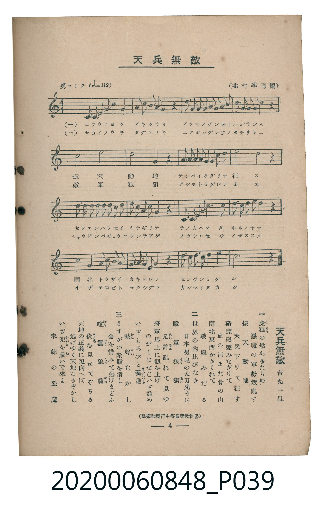

# 天兵無敵

> Re:Shōka 使用 AI 協助辨識與重建樂譜，可能會有錯誤。歡迎回報。

- **鋼琴伴奏版**：<br><audio controls src="tenpei_muteki.mp3"></audio>

- 詞：吉丸一昌
- 曲：北村季晴（編）
- 臺灣教育會公認《新定兒童唱歌》高等科男子用（2020.006.0848）

## 說明

原書資訊與歌詞全文（對應 P039.jpg，書頁 p. 4，高一第一學期第 4 首）：
調性與拍號：ハ長調（無升降記號）、4/4 拍（勇マシク ♩=112）
出處註記：（弘樂社發行中等音樂教科書）


## 歌詞

```text
一　虎狼（こらう）の慾（よく）あきたらぬ　惡魔（あくま）の軍勢（ぐんせい）叛亂（はんらん）す
振天動地（しんてんどうち）　天兵（てんぺい）下（くだ）りて征（せい）す
硝煙（せうえん）砲聲（はうせい）みなぎりて　血（ち）の河（かは）また骨（ほね）の山（やま）
南北東西（なんぼくとうざい）かきくれて　戰塵（せんじん）みだる

二　世界（せかい）の內（うち）比（たぐひ）なき　日本男兒（にっぽんだんじ）の太刀先（たちさき）に
敵軍（てきぐん）狼狽（らうばい）　足許（あしもと）亂（みだ）れて見（み）ゆ
將軍（しゃうぐん）馬上（ばじゃう）に劍（けん）を上（あ）げ　のがしはせじいざ進（すす）め
いざもろびと驀進（まっしぐら）　喊聲（かんせい）たかし

三　さすがの敵膽（てきたん）を消（け）し　命（いのち）を惜（おし）みて逃（に）げまどふ
喧囂（けんがう）狼藉（らうぜき）　後（うしろ）を見（み）せてぞちる
天地（てんち）の正義（せいぎ）に刄向（はむか）へば　逃（に）げゆく天地（てんち）なきぞかし
いざ兜（かぶと）を脫（ぬ）いで來（こ）よ　未練（みれん）の惡魔（あくま）
```

## ABC

<div class="abc-score" data-abc-src="tenpei_muteki.abc" aria-label="五線譜載入中"></div>

[下載 ABC 原始檔](tenpei_muteki.abc)

## TMD 檔案連結

- [主旋律 TMD 檔案](tenpei_muteki.tmd) [[在 TMD Studio 編輯](https://tmdlang.github.io/Tmd-TS/#tmd=s7IKdvYPcrWy4qpTUCpJTLdSSM7PyUlNLsnMz7MqzsjMK0nNjM_KTMmPL87Iz05Ugisry88pzU21ys4vyY9Pyq8sjjcyMDKINzAwizewMLFAqCvOLy1KTrUqTs7Iz8-JL0mtKEnKz89Gl48vSExPtQowMLZEyBQU5Zel5iXmAXUXFIEckgLWjlCQWpaZkgqSLk5OzIsvSy3KTMtMTUFyYmpRMdgbECtKihLzipOLMgtAfkOoyi8qychPL0osyKi0ysgsLskvykxOzInPTsxD8m1JRirQs7mZOZkliUWVyJoz0zPzrEoSM4HBAwqi8sT43MTMvJzEPKBDtLQUni5Z-bR16_OWhc-mblXQ0uJStFUwNDTisrdVcOayMdE3sQMZ9WLlvPd7Zj2d0Plkx44nOxqezegB2_Bs9iaQcM_0Z3MnPl27-NnMLe_3dDzfvuL9nk6w_Iv2Xc8bFz-bOvNF06Znc5qftq55sar3cUPXs2kbnq6b9bR10vPVS59O2fhsbc_jhu6Xq2c8X9v5fPnE51O2P1074fkUoDEdoDjTA8aZHijOwMZy6Wsp2FILcCkoKDztm_9s9o4Xm9tfrOh60dEOdAzQt09bVzyb1g50wNMNvc_aOxVAEa-XVZD-fk8PUPHLBY0KBXoKJkAe0NXAAHm-Zg2QfLp2x7M584FsBROFl8umAZ0LDB2QFS9W7X_WsBxkeHfvi5nzgaKPm_tfTt0OFAcFWMvCp73tL2f2vlgxAyzb-bihERjyCkDVIBd0tz9unve4afvjpvUKj2autAVGD1AN2Ontu17MnPpixW6gTqChIMV7Zjxb0fR8yb7nM_e8WNjzZMdaYJi-nL8ZKAiMBmDgAl0P0gzSDXTx44aGFzP7nnfvAWp93Dj5cVPn48Y2kAMa1z1r3QcSbAKK94NFmh439j5unA9Wswao8Vnzwpdrp4A1AqX6HzcC1YM0vtjd-7R7EVh8wuOmyY8bZz9ubAFKPe2f_WRXE1h8PUgcaE7TZLCWmSDXPOtZD0qK3VOfztkAVjQdrHkZmFwJdNbjxoXgoGmApFiwGojsLogFT3Z0gwWBTlkAUtnUBVTwdF8jWBDqCKhlzxfOfd46EyYBNBroUZBbni_Y9KIRmKbBbgSJw7Xtf9y46nFjH8RQULAtbAArA7sJGFqbNoO53UCNYJF9wKB6uQqUhB837n7cuBai7OnGjeBAbYGEFjgOe6eDM9DGF0tBiQFkDchPe8D-WAF2xDSYI4CmA6Og_3FTD8QRzzo2PF0ICYnZYF0zYEEKdO6Cx03dkHjeBcxeDU92THs-tQfmZaBJECPXPW1dDhaEhu-z9ZAonQ-KPVBQANUAPQ7MtQ3Ppi99NmcNKHe2TgKrWf24cfHjxr1gm4G2geyHmrlk1dOOhqetHTCjFj5unAo0BCy7GhzbU7cC0wk0DkGeAiUVUAR073nevRccRqCk-LhxA9ShwBDftvnFCnDwgdIbMHUASVBJA0tUIC-Dox0UOC-WQdICMEiBIm3ggN7QDrMSqLkZbDrU1pfLgNm3CywFtA8YiCBZiGOfdkG0TISGbNMkmEqgrUAFk4AuA_r4cSPQ1ungVAMM3RlARwOj7WUDJCnNBCKw3kaQOyByIOc3Af29GeiJlysbYEqByQYYpECDgC4Dlh7g5D6tC5Ymu5HzEzhggfE4HZqZQWrBwQy0DuiYdaAgbgMHJTSIgVkX6oVn2yAxMxFszHSQJRMhKoFOA_oFnKiByprngAWBSX46LFUte9nQDIl8qPdBTgZmz63gIJ62_OlsSGyAwgvsDlA4AmP1xXSgd-CxOgeaGIAW74OkSaAgMFbAgk2TUGIP5F-gB-aBUhEwRYOsARYA0EICUgDAMuHaxc_3rYRnd2B2hcZhR8vTCUC_QkoeYCABTQeK7wDFdgMw6FE91AR0Sj8OK8A5AeQUcLjDI_NpKySggKLbIIkS5IkWoIlAwTVgnUBly5_sAwYGqJwFK-gAZak5q55vB1WaoLAFJlxo7l2HtWwF2Ud5lQcFClr6XFwhqXkFqZm-pSWp2ZlWAZmJefkONQY11SCLFGwMzbTswCxsFa4CpMYDVjEKGibArNX_fH2DDryW1MSiAWgfyLAaBUMFXSA0VDAGkqYgVhxYAMIBwRoFM5iwORCDODApA7gSI4guU7AUCMOUgWiQNqBF6ErgNsGNATvJx7BG4XHTZrDI4-aVQPYyMKsPTK6AqgXVvjDLHzctAousBZP7ofpAZA9UTTyaWoh-YD2OMLlpA5gNsvdx0x4wuQSio7kf6pbNcHMhqnaimw5xvxHIlt1QW1ZDzYHZAvILxLRGJDeB3Qx1wSQw2QX3EZr7m7uh-puBeC7CNc0NSC7bAbcRZjrExsdNWxEhBTUJw_3GID0gdRA_Pm5ag3B_cxvM_XC3wd0PdccmsOxGMLkd0_3g0ICYBwkDmI5VcB2Pm-fD7ULycdMmeIx1gsmpGO7Hn0F29ZCVQWDJFAaN0QXgyR8BMXMIKCOAsgOIhmUOeC4A66_BNBluLrYssh0S4sgQGGaYgqAgBBZwsJSHUAtLgcipCxK_kLQ-C8SCpF5wboOlMXBMwWKnaTcsSpGMxpc1gE6Epx2Ehg3Y3b0Sm7uBlTHMRmwZeztQCbhAaO4Ak5DEBHE6JCnDEhZIBtVomGXYssRGLOHdtAbTgbjc3bQHa4aGKoS4GyQPzRAQd4MLEoiLHzftg5oOiziEu1djuJtAXdFJTlaAJkcgBWahERgpGSwArzwwswSo6gFhjKoHBMEcuJVAHpgFNhdvroAVvMuAGFRZwIolUCEOrUogYQov3iHpA1LgrgOzEQkcLa6gBRakKAeFOdRccLGEiGhQcQhSPRvCb-6FF5-QqgCmGlvFAczVi5G8gFQrNU8Ai-6AKIBVi6DCEZw6kRRCClRIpQhio_sC4n5wXoAWuJDQgYQdzBegSgSpwG7aBs3XULJ5IXZfgPIKSjGCHGaIkIeFNdT90HBcAJaBhOwMuKfR3Q_SA_EZJMfCiie0wg9iNUgDKHJBytZCMxHUCsz6CX-2eTp7NkU1CCwLwBpF8AxSg9JmguUH1NyClhOQWUh1Epb6Cgax5JbmLkSIPW6eg2hUQctOaH7ZBiah-QUadGvBJCTcEaUqWkzBciMoHYDTEyxNwEpeSLkMi1dYKYYOseUTWA0AcR3ELEipD3ZZ82S4L0AmQ5oNzWD14BQPzVig5hy6myGugLgZVposgeZqCA_mTnB-Jc7N4BoEi5uhaX0a3LWQ3AtyM6jxCms8toPZkNwNawIj5whIeIJiAhah4AYWtE6ExRRMNXJphd3NtVxcunYKyB0SBSBfmQsA)]
- [鋼琴伴奏 TMD 檔案](tenpei_muteki_piano.tmd) [[在 TMD Studio 編輯](https://tmdlang.github.io/Tmd-TS/#tmd=s7IKdvYPcrWy4qpTUCpJTLdSSM7PyUlNLsnMz7MqzsjMK0nNjM_KTMmPL87Iz05Ugisry88pzU21ys4vyY9Pyq8sjjcyMDKINzAwizewMLFAqCvOLy1KTrUqTs7Iz8-JL0mtKEnKz89Gl48vSExPtQowMLZEyBQU5Zel5iXmAXUXFIEckgLWjlCQWpaZkgqSLk5OzIsvSy3KTMtMTUFyYmpRMdgbECtKihLzipOLMgtAfkOoyi8qychPL0osyKi0ysgsLskvykxOzInPTsxD8m1iEVBzempual6JVUFmYl5-fGJycn5uQWJeJkgMobAkA6jIKjczJ7MksagS2ZbM9Mw8q5LETGA4gsKyPDE-NzEzLycxD-hiLS2Fp0tWPm3d-rxl4bOpW9_v6XjZvef5hC1P9mx5urT_eWfH-z2dClpaXIq2CoaGRlz2tgrOXDYm-iZ2IPNfrJz3fs-spxM6n-zY8WRHw7MZPWBrn83eBBLumf5s7sSnaxc_m7kFaOzz7SuARoHlX7Tvet64-NnUmS-aNj2b0_y0dc2LVb2PG7qeTdvwdN2sp62Tnq9e-nTKxmdrex43dL9cPeP52s7nyyc-n7L96doJz6cAjekAxbgeMMb1QDEONpYrJDWvIDXTt7QkNTvTKgAUUEEeDjUGNdVcCkBgY2imZQdm6WspPF-zBujaFwt7FLT0wWI1CoYKukBoqGAMJE1BrDiwAIQDgjUKZjBhcyAGcWBSBnAlRhBdpmApEIYpA9EgbUCL0JXAbYIbA3aSj2GNwuOmzWCRx80rgexlYFYfmFwBVfu4aT3c8sdNi8Aia8Hkfqg-ENkDVROPphai_3HzPITJTRvAbJC9j5v2gMklEB3N_VC3bIabC1G1E910iPuNQLbshtqyGmoOzBaQXyCmNSK5CexmqAsmgckuuI_Q3N_cDdXfDMRzEa5pbkBy2Q64jTDTITY-btqKCCmoSRjuNwbpAamD-PFx0xqE-5vbYO6Huw3ufqg7NoFlN4LJ7ZjuB4cGxDxIGMB0rILreNw8H24Xko-bNsFjrBNMTsVwP3I639WDms5hqQ0GjdEF4KkYATETOig9g1I1iIalcXhiBuuvwTQZbi62lL4dEnDIEOh1TEFQSHQiEhBCLSwhIScSSDRBkuwsEAuSCMGZBpZUwAEOC-Sm3bCYQTIaXwoHOhGeBBAaNmB390ps7p6AsBFb_twOVALO180dYBKSJiBOh6RIWPoAyaAaDbMMW8reiCW8m9ZgOhCXu5v2YM2XUIUQd4Pkoeka4m5weQBx8eOmfVDTYRGHcPdqDHejlNydKCkamqqAFJiFRmAkSLAAvCjHTNmgigCEMSoCEARz4FYCeWAW2Fy8iRtWDC4DYlDRDSskQEUqtGCHBA28sIVEM6T4WwdmI9IpWpBDiw9IwQoKOqi54EICEV-gwgmkejaE39wLL8wgBTNMNbZiHJg5FyN5AamOaJ4AFt0BUQCrpEBFFTiRISmEFG-QKgrERvcFxP3gJA0t_iChAwk7mC9ARTpS8dm0DZo9oWTzQuy-ACV5lNIAOcwQIQ8La6j7oeG4ACwDCdkZcE-jux-kB-IzSMaDlTJoZRjEapAGUOSClK2F5gWoFZi1BXLqfzp7NvbyHJaSYS0NeDqvQWmIwJI1aqJHS9DILKQaAkvtAYNYEn1zF8Ljj5vnIFoq0JIMmuy3gUlosoeGwFowCQk-RBmHFuCwTAWKTnCygEUtrByElJKw6IGVKegQW3KHlccQ10HMgpTBYJc1T4b7AmQypC5uBqsHJ1xo_gC1kdDdDHEFxM2wQmEJNHNCeDB3grMdcW4Gl-dY3AxNstPgroVkQpCbQS1CWIusHcyGZFJYuxI5YUPCExQTsAgFt1qgNRQspmCqkQsd7G6uxdZW90Fuq5vgb6rHK0QbxsKoGgUTIMMkPlbBND4emA6ByR1IR5tCBcAMZD1AFXjbR2iGoxgGMh1mG1wFlAGVx1dTEXQYQdvxlgQQTTD3oRtNOFSA8aJrp4AcNdE-QFkMMSMsYsZgMWUuAA)]

## 分析

```text
================================================================================
📊 TMD Song Profile: [ 天兵無敵 ]
================================================================================
⏱  Duration:       0:34 (34.3s), 16 measures total
🎼 Key & Tempo:    首調基準 C, != 112.0 BPM, <4/4>
   - 分析範圍：      由實際發聲的音符與和弦推測調性；播放脈絡另行呈現
🎤 人聲音域:    C4 (MIDI 60) – E5 (MIDI 76) [跨度: 16 個半音 / 1.3 個八度, 難度: moderate]
   - 最低音:  C4 in [TenpeiMuteki #1 @ m.1, 0:00]
   - 最高音: E5 in [TenpeiMuteki #1 @ m.5, 0:09]
   - 適合: soprano, mezzo-soprano, contralto, tenor, baritone, bass
🏛  結構:      TenpeiMuteki (34.3s)
⚡ 編曲密度:        Peak 1 軌道同時演奏
🗝  調性診斷：       C 大調（純淨自然大調，未偵測到可信轉調）
   - 風格氣質:    純淨自然大調（陽光明朗、易唱易記，無明顯調外色彩）
   - 轉調歷程:    全曲維持單一推測調性（未偵測到可信轉調）
   - 核心骨幹音:  C, D, G, E, A
   - 調性數值:    C 大調 [相關度: 0.85, 穩定度: Moderate, 自然音純度: 100.0%]
   - 候選調性 (K-S): C 大調 (0.85), G 大調 (0.78), A 小調 (0.55)
   - 五度圈歷程:   +0
   - 各段落調性細節:
     • [TenpeiMuteki #1]: C 大調 (r: 0.85, 自然音純度: 100.0%)

  [ 五度圈游移軌跡 ]
              [C ]*
         F            G  
      Bb               D  
      Eb               A  
         Ab           E  
            Db       B  
               F# 
     (* = active key center)

  [ 十二半音累積音高分佈 ]
     C  : ████████████████████████  29.5%
     C# :                            0.0%
     D  : ██████████████████        22.3%
     D# :                            0.0%
     E  : ███████████               13.4%
     F  :                            0.0%
     F# :                            0.0%
     G  : █████████████████         21.4%
     G# :                            0.0%
     A  : █████████                 10.7%
     A# :                            0.0%
     B  : ██                         2.7%
--------------------------------------------------------------------------------
Assignment 軌道音域：
  - Piano         : C4 – E5 (16 個半音 / 1.3 個八度, 80 個音符)
================================================================================
```


## 原書掃描頁




