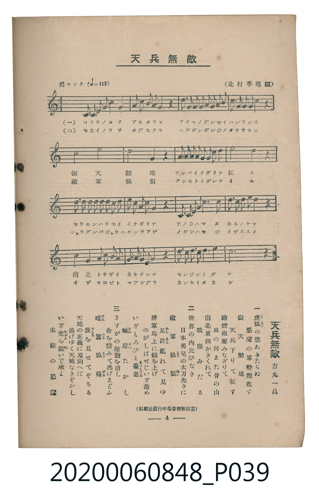

# 天兵無敵

<audio controls src="tenpei_muteki.mp3"></audio>

- 詞：吉丸一昌
- 曲：北村季晴（編）
- 臺灣教育會公認《新定兒童唱歌》高等科男子用（2020.006.0848）

## 說明

原書資訊與歌詞全文（對應 P039.jpg，書頁 p. 4，高一第一學期第 4 首）：
調性與拍號：ハ長調（無升降記號）、4/4 拍（勇マシク ♩=112）
出處註記：（弘樂社發行中等音樂教科書）

## 歌詞

```text
一　虎狼（こらう）の慾（よく）あきたらぬ　惡魔（あくま）の軍勢（ぐんせい）叛亂（はんらん）す
振天動地（しんてんどうち）　天兵（てんぺい）下（くだ）りて征（せい）す
硝煙（せうえん）砲聲（はうせい）みなぎりて　血（ち）の河（かは）また骨（ほね）の山（やま）
南北東西（なんぼくとうざい）かきくれて　戰塵（せんじん）みだる

二　世界（せかい）の內（うち）比（たぐひ）なき　日本男兒（にっぽんだんじ）の太刀先（たちさき）に
敵軍（てきぐん）狼狽（らうばい）　足許（あしもと）亂（みだ）れて見（み）ゆ
將軍（しゃうぐん）馬上（ばじゃう）に劍（けん）を上（あ）げ　のがしはせじいざ進（すす）め
いざもろびと驀進（まっしぐら）　喊聲（かんせい）たかし

三　さすがの敵膽（てきたん）を消（け）し　命（いのち）を惜（おし）みて逃（に）げまどふ
喧囂（けんがう）狼藉（らうぜき）　後（うしろ）を見（み）せてぞちる
天地（てんち）の正義（せいぎ）に刄向（はむか）へば　逃（に）げゆく天地（てんち）なきぞかし
いざ兜（かぶと）を脫（ぬ）いで來（こ）よ　未練（みれん）の惡魔（あくま）
```

## ABC

```abc
X:1
T:天兵無敵
C:曲：北村季晴（編）
M:4/4
L:1/16
Q:1/4=112
K:C
V:V1 name="Piano" snm="Pia"
[V:V1]
C2 D2 E2 F2 G4 E4 | F2 G2 A2 F2 G4 z4 | A2 A2 G2 G2 F2 F2 E2 E2 | D2 E2 F2 E2 D4 z4 |
G8 c8 | B8 G4 z4 | A2 A2 G2 G2 ^F2 F2 G2 A2 | d8 G4 z4 |
G2 G2 G2 G2 G2 F2 E2 F2 | G2 A2 G2 F2 E4 z4 | D2 D2 E2 F2 G4 G4 | A2 B2 c2 A2 G4 z4 |
c4 G4 E2 F2 G2 E2 | F2 G2 A2 B2 c4 z4 | d2 d2 c2 A2 G4 B4 | c12 z4 |
```

## TMD 檔案連結

- [主旋律 TMD 檔案](tenpei_muteki.tmd)
- [鋼琴伴奏 TMD 檔案](tenpei_muteki_piano.tmd)

## 分析

```text
================================================================================
📊 TMD Song Profile: [ 天兵無敵 ]
================================================================================
⏱  Duration:       0:34 (34.3s), 16 measures total
🎼 Key & Tempo:    首調基準 C, != 112.0 BPM, <4/4>
   - 分析範圍：      由實際發聲的音符與和弦推測調性；播放脈絡另行呈現
🎤 人聲音域:    C4 (MIDI 60) – D5 (MIDI 74) [跨度: 14 個半音 / 1.2 個八度, 難度: moderate]
   - 最低音:  C4 in [Main #1 @ m.1, 0:00]
   - 最高音: D5 in [Main #1 @ m.8, 0:15]
   - 適合: soprano, mezzo-soprano, contralto, tenor, baritone, bass
🏛  結構:      Main (34.3s)
⚡ 編曲密度:        Peak 1 軌道同時演奏
🗝  調性診斷：       G 大調（流行色彩大調，未偵測到可信轉調）
   - 風格氣質:    流行大調（略帶和弦色彩音與裝飾副屬和弦）
   - 轉調歷程:    全曲維持單一推測調性（未偵測到可信轉調）
   - 核心骨幹音:  G, C, E, D, F
   - 調性數值:    G 大調 [相關度: 0.84, 穩定度: Moderate, 自然音純度: 89.3%]
   - 候選調性 (K-S): G 大調 (0.84), C 大調 (0.81), E 小調 (0.63)
   - 五度圈歷程:   +1
   - 各段落調性細節:
     • [Main #1]: G 大調 (r: 0.84, 自然音純度: 89.3%, 調外音: F)

  [ 五度圈游移軌跡 ]
               C  
         F           [G ]*
      Bb               D  
      Eb               A  
         Ab           E  
            Db       B  
               F# 
     (* = active key center)

  [ 十二半音累積音高分佈 ]
     C  : ███████████               15.2%
     C# :                            0.0%
     D  : ████████                  10.7%
     D# :                            0.0%
     E  : ████████                  11.6%
     F  : ████████                  10.7%
     F# : █                          1.8%
     G  : ████████████████████████  33.0%
     G# :                            0.0%
     A  : ███████                    9.8%
     A# :                            0.0%
     B  : █████                      7.1%
--------------------------------------------------------------------------------
Assignment 軌道音域：
  - Piano         : C4 – D5 (14 個半音 / 1.2 個八度, 80 個音符)
================================================================================
```


## 原書掃描頁




