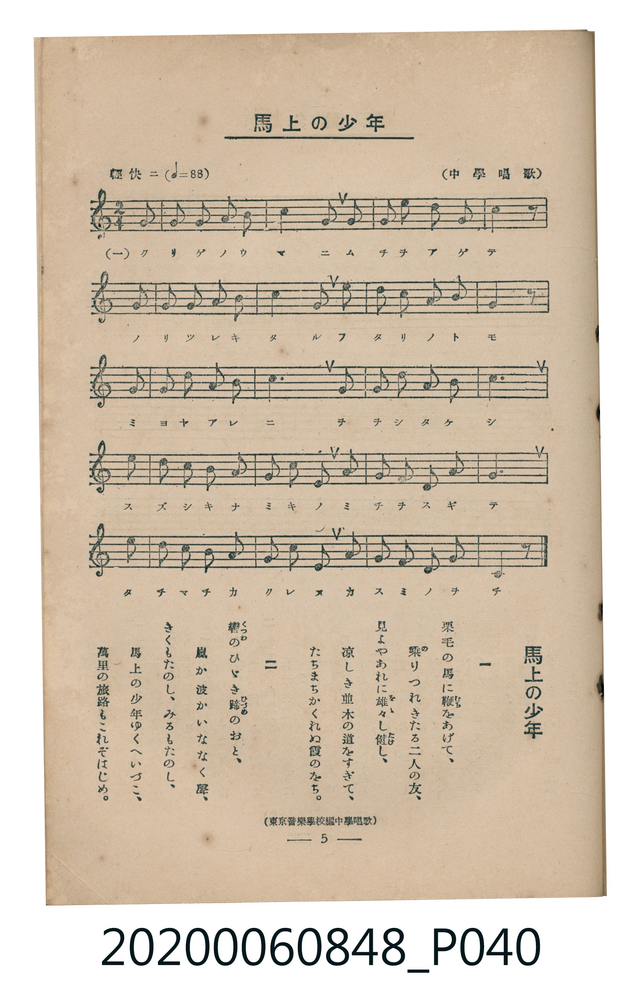

# 馬上の少年

> Re:Shoka 使用 AI 辨識樂譜，可能會有錯誤。歡迎回報。

<audio controls src="bajo_no_shonen.mp3"></audio>

- 詞：大和田建樹
- 曲：小山作之助
- 出處：東京音樂學校編《中學唱歌》
- 臺灣教育會公認《新定兒童唱歌》高等科男子用（2020.006.0848）

## 說明

原書資訊與歌詞全文（對應 P040.jpg，書頁 p. 5，高一第一學期第 5 首）：
調性與拍號：ヘ長調（1 降記號）、2/4 拍（輕快ニ ♩=88，弱起後半拍進入）
出處註記：（中學唱歌）／（東京音樂學校編中學唱歌）

## 歌詞

```text
一　栗毛（くりげ）の馬（うま）に鞭（むち）をあげて、
乘（の）りつれきたる二人（ふたり）の友（とも）、
見（み）よやあれに雄々（をを）し健（たけ）し、
涼（すず）しき並木（なみき）の道（みち）をすぎて、
たちまちかくれぬ霞（かすみ）のをち。

二　轡（くつわ）のひびき蹄（ひづめ）のおと、
嵐（あらし）か波（なみ）かいななく聲（こゑ）、
きくもたのし、みるもたのし、
馬上（ばじゃう）の少年（せうねん）ゆくへいづこ、
萬里（ばんり）の旅路（たびぢ）もこれぞはじめ。
```

## ABC

```abc
X:1
T:馬上の少年
C:曲：小山作之助
M:2/4
L:1/16
Q:1/4=88
K:F
V:V1 name="Piano" snm="Pia"
[V:V1]
z2 z2 z2 F2 | F2 A2 G2 F2 | c4 c2 c2 | d2 f2 c2 A2 |
c6 F2 | F2 A2 G2 F2 | G4 G2 c2 | A2 F2 G2 E2 |
F6 F2 | G2 A2 B2 G2 | c6 c2 | G2 A2 B2 G2 |
A6 c2 | d2 c2 B2 A2 | G2 F2 d2 c2 | B2 A2 G2 F2 |
c6 c2 | d2 c2 B2 A2 | G2 F2 d2 c2 | A2 F2 G2 E2 |
F6 z2 |
```

## TMD 檔案連結

- [主旋律 TMD 檔案](bajo_no_shonen.tmd) [[在 TMD Studio 編輯](https://tmdlang.github.io/Tmd-TS/#tmd=s7IKdvYPcrWy4qpTUCpJTLdSSM7PyUlNLsnMz7MqzsjMK0nNjM_KTMmPL87Iz05Ugisry88pzU21ys4vyY9Pyq8sjjcyMDKINzAwizewMLFAqCvOLy1KTrUqTs7Iz8-JL0mtKEnKz89GyBcU5Zel5iXmAdUUFIGsSwErQihILctMSQVJp6ZkluQXZSbmIDkitagY7FCwJfElRYl5xclFmQUg1yNUlWSkAl0KlizILwIaraWl8HLZmic7uh43rnu6YeLTnVsUtLS4FG0VLCy47G0V3LhsjPRN7ED6X6yc937PrKdLlj-d1PN8yoanu3c9W7ETbPKz2ZtAMhv6n27c-GTvnCc7u592rQTLPG3f9WLmVKDks7kbn-xa83L-5mcrmp6u3fFswcLn21c8buh6smMtkPt0ysZna3seN3SDNb1o3_W8cfGzqTNfNG16Nqf5aeuaF6t6gWqfTdvwdN2sp62Tnq9eCtfxcvWM52s7ny-f-HzK9qdrJzyfsuL9ng5Q-OsBw18PFP7v93QqcXHpaynYUgtwKSgoPO2b_2z2jheb21-s6HrR0Q50DDB8nraueDatHeiApxt6n7V3KgQYmBjoZRWkv9_TA1T8ckGjQoGegimQB3T1kx0Nz9cAA74BFBxz5gPZCqbAqJgGdC4wvEBWvFi1_1nDcpDh3b0vZs4Hij5unvFy6nagONAKQ4WXM3tfrJgBlul83NAIjCcFoEqg1Is9U5_uX_24uVvh0cyVthbAEOh5umfji63bn-7redrbBVT0smHT09alQH1gr4Aj6cWK3UDTgJYADUCOFbB7-oGCWKMQTSUXyDygnx43NDxbMP3Z-tlAfY8b-x83AZPXJJAzG9cBUxtYsO1x4z6wyOqX89aCRJoaHjcuBIk0TXrc2ARU_7hxGdBbYBN3Ah0G1LMOLA00a8njpp7Hjb2PG-c_bup-sqvnya5dYAVbwSJdEJue9neDBVc8bmqCBBE4VJdBRIFhCDQLaG0LyDaQcatfzm553NAKdsskIAKbMv1pIzCcgOrnP26cCBGBGvRs2x6wxMzHjcAwA0s09j7ZsezZHFASfNy4CmgHUATq68bJEFuR_AjU2IfwI9iGhcBAAZPd4FADOmrNyznAbAfUCRQBagC7unEdWP_Cxw1NkADfBcwJDS_2Ak0GhzYoeIAxBlbYuOlx42agM17sbAHLArlLHzc1wmSBYQnMhmAHPN06AawCGBggz4BVdD_bvAjuGYjI40ZggAG5QNT_ohGY8YGykx83gcMG5hNgxABdD4xDoJeAloBCDOT1pm40QZBqSOkDNmbD48YZj5uagWkDGoHg8ggsNRucYNY-bgIGIzD0gGygN3eA3bIUZD80biesedkOTIdgs5qAroKmhGfTW19sXw-LRmBwAD0FNAXoFqAaYCDPe9y4Hmx3IyhIgQZRXkZAgYKWPheXb2JmnlVAZmJevkONQY1CNcgGBRsLLTswA1gyQXPnhv7n6xuArgSVBSYKT1tXP-1oA-a352uWwfMryDyQphoFAzA0VKgBJwGQKZDi5MVCUAA4JRYVKxg-aphsgqLJUMFYwQikCVjW6AKxKZBlpmAYB2QYQwV1Mczc1YNkpinQTFCRis1MI6BmI7CZxkC-kYJ5PFgam5k7OpHMtASaaWiEYqgR0AgTIAlzE8hQhJgxTAzZzKezZyP73RhkqBmKoWZALSZgj4LcC-LVgPmIEMEw9MmuKciGmgMNNTIgaCiG9w2AptZycenaKYDSggKQVubiAgA)]
- [鋼琴伴奏 TMD 檔案](bajo_no_shonen_piano.tmd) [[在 TMD Studio 編輯](https://tmdlang.github.io/Tmd-TS/#tmd=s7IKdvYPcrWy4tLSUni5bM2THV2PG9c93TDx6c4t7_d0vOze83zClid7tjxd2v-8s-P9nk4FLS0uRVsFCwsue1sFNy4bI30TO646BaUXK-e93zPr6ZLlTyf1PJ-y4enuXc9W7FQCyTybvQkks6H_6caNT_bOebKz-2nXSrDM0_ZdL2ZOBUo-m7vxya41L-dvfrai6enaHc8WLHy-fcXjhq4nO9YCuU-nbHy2tudxQzdY04v2Xc8bFz-bOvNF06Znc5qftq55saoXqPbZtA1P18162jrp-eqlcB0vV894vrbz-fKJz6dsf7p2wvMpK4CeMjIwMtAzMDDTM7AwsQB6SYmLyzcxM88qIDMxLz_Iw6HGoEahmksBCGwstOzADH0thad7Nr7Yuh3ojefrGxS09MHCNQoGYGioUMMFU_d8DTAQG14s7EEoMlQwVjACKVIwVdAFYlMgy0zBMA7IMIYK6mKYsasHhxlGQMVGYDOMgXwjBfN4sDQ2M3Z0ophhBNRhAiRhVoLMQIgZw8SQjXg6ezaKEWZABSZgV4McA-LVgPkI72EY8WTXFIJGYPjEAGhGLXK8-JATLyBT8MVLvEK0YSyMgvONYXwTIMMkHkmBaTyQZQoUATHQDUePMDTDUfSCGXA1mCJACsPtqHGJxzi4-_GowbQAPaZhnofRcK0IASMgyyg-NxbBIBREqCmBCCsIhRAwjejaKYCSiQKQVubiAgA)]

## 分析

```text
================================================================================
📊 TMD Song Profile: [ 馬上の少年 ]
================================================================================
⏱  Duration:       0:28 (28.6s), 21 measures total
🎼 Key & Tempo:    首調基準 F, != 88.0 BPM, <2/4>
   - 分析範圍：      由實際發聲的音符與和弦推測調性；播放脈絡另行呈現
🎤 人聲音域:    E4 (MIDI 64) – F5 (MIDI 77) [跨度: 13 個半音 / 1.1 個八度, 難度: moderate]
   - 最低音:  E4 in [Main #1 @ m.8, 0:10]
   - 最高音: F5 in [Main #1 @ m.4, 0:04]
   - 適合: soprano, mezzo-soprano, contralto, tenor, baritone, bass
🏛  結構:      Main (28.6s)
⚡ 編曲密度:        Peak 1 軌道同時演奏
🗝  調性診斷：       F 大調（純淨自然大調，未偵測到可信轉調）
   - 風格氣質:    純淨自然大調（陽光明朗、易唱易記，無明顯調外色彩）
   - 轉調歷程:    全曲維持單一推測調性（未偵測到可信轉調）
   - 核心骨幹音:  C, F, G, A, D
   - 調性數值:    F 大調 [相關度: 0.90, 穩定度: Moderate, 自然音純度: 100.0%]
   - 候選調性 (K-S): F 大調 (0.90), C 大調 (0.82), A 小調 (0.62)
   - 五度圈歷程:   -1
   - 各段落調性細節:
     • [Main #1]: F 大調 (r: 0.90, 自然音純度: 100.0%)

  [ 五度圈游移軌跡 ]
               C  
        [F ]*          G  
      Bb               D  
      Eb               A  
         Ab           E  
            Db       B  
               F# 
     (* = active key center)

  [ 十二半音累積音高分佈 ]
     C  : ████████████████████████  27.5%
     C# :                            0.0%
     D  : █████                      6.2%
     D# :                            0.0%
     E  : ██                         2.5%
     F  : █████████████████████     23.7%
     F# :                            0.0%
     G  : ███████████████           17.5%
     G# :                            0.0%
     A  : ██████████████            16.2%
     A# : █████                      6.2%
     B  :                            0.0%
--------------------------------------------------------------------------------
Assignment 軌道音域：
  - Piano         : E4 – F5 (13 個半音 / 1.1 個八度, 66 個音符)
================================================================================
```


## 原書掃描頁




