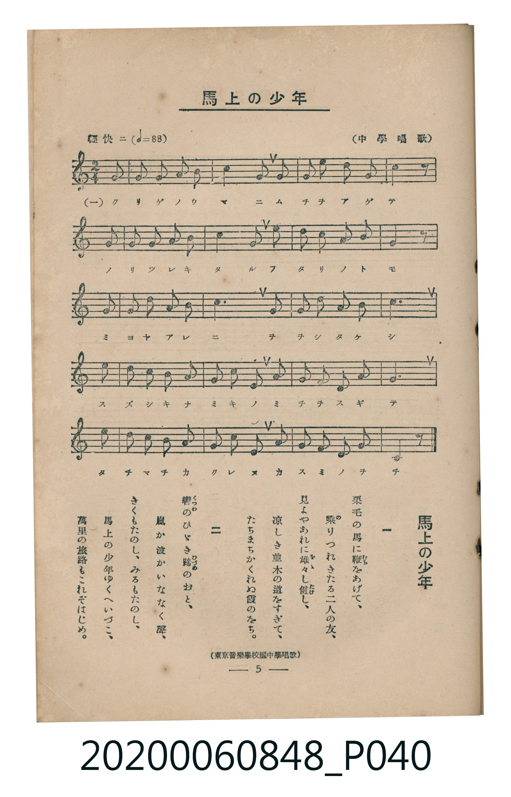

# 馬上の少年

> Re:Shōka 使用 AI 協助辨識與重建樂譜，可能會有錯誤。歡迎回報。

- **鋼琴伴奏版**：<br><audio controls src="bajo_no_shonen.mp3"></audio>
- **NEUTRINO 歌聲合成版**：<br><audio controls src="bajo_no_shonen_neutrino.mp3"></audio>

- 詞：大和田建樹
- 曲：小山作之助
- 出處：東京音樂學校編《中學唱歌》
- 臺灣教育會公認《新定兒童唱歌》高等科男子用（2020.006.0848）

## 說明

原書資訊與歌詞全文（對應 P040.jpg，書頁 p. 5，高一第一學期第 5 首）：
調性與拍號：ハ長調（無升降記號）、2/4 拍（輕快ニ ♩=88，弱起後半拍進入）
出處註記：（中學唱歌）／（東京音樂學校編中學唱歌）


## 歌詞

```text
一　栗毛（くりげ）の馬（うま）に鞭（むち）をあげて、
乘（の）りつれきたる二人（ふたり）の友（とも）、
見（み）よやあれに雄々（をを）し健（たけ）し、
涼（すず）しき並木（なみき）の道（みち）をすぎて、
たちまちかくれぬ霞（かすみ）のをち。

二　轡（くつわ）のひびき蹄（ひづめ）のおと、
嵐（あらし）か波（なみ）かいななく聲（こゑ）、
きくもたのし、みるもたのし、
馬上（ばじゃう）の少年（せうねん）ゆくへいづこ、
萬里（ばんり）の旅路（たびぢ）もこれぞはじめ。
```

## ABC

<div class="abc-score" data-abc-src="bajo_no_shonen.abc" aria-label="五線譜載入中"></div>

[下載 ABC 原始檔](bajo_no_shonen.abc)

## TMD 檔案連結

- [主旋律 TMD 檔案](bajo_no_shonen.tmd) [[在 TMD Studio 編輯](https://tmdlang.github.io/Tmd-TS/#tmd=s7IKdvYPcrWy4qpTUCpJTLdSSM7PyUlNLsnMz7MqzsjMK0nNjM_KTMmPL87Iz05Ugisry88pzU21ys4vyY9Pyq8sjjcyMDKINzAwizewMLFAqCvOLy1KTrUqTs7Iz8-JL0mtKEnKz89Gl48vSExPtQowMDFAyBQU5Zel5iXmAXUXFIEckgLWjlCQWpaZkgqSLk5OzIsvSy3KTMtMTUFyYmpRMdgbECtKihLzipOLMgtAfkOoyi8qychPL0osyKi0ysgsLskvykxOzInPTsxD8m1JRirQs2ATCoAakHVnpmfmWeWmZmZlIvlOS0vh5bI1T3Z0PW5c93TDxKc7tyhoaXEp2ipYWHDZ2yo4c9kY6ZvYgUx5sXLe-z2zni5Z_nRSz_MpG57u3vVsxU6w-c9mbwLJbOh_unHjk71znuzsftq1EizztH3Xi5lTgZLP5m58smvNy_mbn61oerp2x7MFC59vX_G4oevJjrVA7tMpG5-t7Xnc0A3W9KJ91_PGxc-mznzRtOnZnOanrWterOoFqn02bcPTdbOetk56vnopXMfL1TOer-18vnzi8ynbn66d8HzKivd7OkAxrAeMYT1QDL_f06nExaWvpWBLLcCloKDwtG_-s9k7Xmxuf7Gi60VHO9AxwPB52rri2bR2oAOebuh91t6pAEomelkF6e_39AAVv1zQqFCgp2AK5AFd_WRHw_M1wIBvAAXHnPlAtoIpMCqmAZ0LDC-QFS9W7X_WsBxkeHfvi5nzgaKPm_tfTt0OFAda8bxl4dPe9pcze1-smAGW7Xzc0AiMKwWgaqD0iz1Tn-5f_bi5W-HRzJW2FsBQ6Hm6Z-OLrduf7ut52tsFVPSyYdPT1qVAfWDvgCPqxYrdQNOAFgENQI4ZsJv6gYJYoxFNJRfIPKC_Hjc0PFsw_dn62UB9jxv7HzcBk9gkkDMb1wFTHFiw7XHjPrDI6pfz1oJEmhoeNy4EiTRNetzYBFT_uHEZ0FtgE3cCHQbUsw4sDTRryeOmnseNvY8b5z9u6n6yq-fJrl1gBVvBIl0Qm572d4MFVzxuaoIEEThkl0FEgeEINAtobQvINpBxq1_Obnnc0Ap2yyQgApsy_WkjMJyA6uc_bpwIEYEa9GzbHrDEzMeNwDADSzT2Ptmx7NkcUDJ83LgKaAdQBOrrxskQW5H8CNTYh_Aj2IaFwEABk93gUAM6as3LOcCsB9QJFAFqALu6cR1Y_8LHDU2QAN8FzA0NL_YCTQaHNih4gDEGVti46XHjZqAzXuxsAcsCuUsfNzXCZIFhCcyKYAc83ToBrAIYGCDPgFV0P9u8CO4ZiMjjRmCAAblA1P-iEZj5gbKTHzeBwwbmE2DEAF0PjEOgl4CWgEIM5PWmbjRBkGpICQQ2ZsPjxhmPm5qBaQMageAyCSw1G5xg1j5uAgYjMPSAbKA3d4DdshRkPzRuJ6x52Q5Mh2CzmoCugqaEZ9NbX2xfD4tGYHAAPQU0BegWoBpgIM973LgebHcjKEiBBlFeTkCBgpY-F5dTYla-X35wRn5eap5VQGZiXr5Dja5hTTXIJgUbCy07MANbKaUAKSZeLOxR0IBkYQVtBRMFYHH7fH2DDryM0cSiE2gxyNQaBQMwNAWyTIHQTMEcyDKMU9AFc0GCxnEKRnFgNlgYrBas18ewRiEeDB83rQdKP25eBWRtAtJ9QHoZWGQeUAeopHncvADMbwRioIqmRWCVIJE2oAqgCUA9UFON0E1tAeL1EFObJ4FFJoNMbVoL57cC8UKovavAIh0QU4H21IDzAO7g29UDDj4SQw0jrIChVAMKJyAXIm6KEVbg8AH7Zg3Y9UCRpv3g8FkNxFOhfIgqkF87wD5ZBA2f-Ujh87h5JVDtdiAG6ewCq5sPDhMgv2kJmN8FwcAwfNy0GSyyERomQJsJhMmOTvLCBOh_pEABBQs2UVBQIQXKCiBeAkkSwIABiXSDlYESCogHSi4grwKDpmkjOJC2Q-SbdiIHCcijwMCCBCEwMSHUgYIOGsjY5ScQCpCns2eTEyCQ5GAO9D0oGIBMYyjTRMEIysIMj6ZdUP-CkjcsaiE8UKKA-AWWjXYC8Tp4NgKFyX6UMNnxuHkxOC9C8sZusLdBvF4g3gzE4FwKDroZ4JQDyksgkc3EBs2TXVOoHjTgsgacfQxQUgrI1_MgNDChwxwOzEzNPXARYIiAwgscVpD00whO9vEo2QfkdWg2A4UYuEh53NwETSGQ7ALKpPuAdD8oHMEiC-Em1XJx6dopIBfcCkC-MhcA)]
- [鋼琴伴奏 TMD 檔案](bajo_no_shonen_piano.tmd) [[在 TMD Studio 編輯](https://tmdlang.github.io/Tmd-TS/#tmd=s7IKdvYPcrWy4qpTUCpJTLdSSM7PyUlNLsnMz7MqzsjMK0nNjM_KTMmPL87Iz05Ugisry88pzU21ys4vyY9Pyq8sjjcyMDKINzAwizewMLFAqCvOLy1KTrUqTs7Iz8-JL0mtKEnKz89Gl48vSExPtQowMDFAyBQU5Zel5iXmAXUXFIEckgLWjlCQWpaZkgqSLk5OzIsvSy3KTMtMTUFyYmpRMdgbECtKihLzipOLMgtAfkOoyi8qychPL0osyKi0ysgsLskvykxOzInPTsxD8m1iEVBzempual6JVUFmYl5-fGJycn5uQWJeJkgMobAkA6jICmxVAdBkZGsy0zPzrHJTM7MykYJBS0vh5bI1T3Z0PW5c93TDxKc7t7zf0_Gye8_zCVue7NnydGn_886O93s6FbS0uBRtFSwsuOxtFZy5bIz0TexARr9YOe_9nllPlyx_Oqnn-ZQNT3fverZiJ9jSZ7M3gWQ29D_duPHJ3jlPdnY_7VoJlnnavuvFzKlAyWdzNz7Ztebl_M3PVjQ9Xbvj2YKFz7eveNzQ9WTHWiD36ZSNz9b2PG7oBmt60b7reePiZ1Nnvmja9GxO89PWNS9W9QLVPpu24em6WU9bJz1fvRSu4-XqGc_Xdj5fPvH5lO1P1054PmUF0FOg9KEHTB96oPQB9JISF5dTYla-X35wRn5eap5VAChYgzwcanQNa6q5FIDAxkLLDszQ11J4vgYYSA0vFvYoaOmDxWoUDMDQFMgyBUIzBXMgyzBOQRfMBQkaxykYxYHZYGGwWrBeH8MahXgwfNy0Hij9uHkVkLUJSPcB6WVgkXlAHY-bu4F4AZjfCMRAFU2LwCpBIm1AFUATgHqgphqhm9oCxOshpjZPAotMBpnatBbObwXihVB7V4FFOiCmAu2p4UL2_K4eFM9jeBno2RqQd4FciLgphpfB3gQ7ag3YEUCRpv1gb64G4qlQPkQVyMkdYActgnpzPpI3HzevBKrdDsQgnV1gdfPBXgPym5aA-V0QDAyKx02bwSIboV4D2ozitR2daF4DegPJbyDfYRMF-RjJbyuAeAkkgoD-A4l0g5WBog3EA0UeyMVAHzZtBPt1O0S-aSeyz0DuBfoZEhLAqEWoA4UANKywy09A9dfT2bNR_AWJHHOgJ0C-ATKNoUwTBSMoC9NbTbugzgalGVhAQ3igKII4CZY2dwLxOnjaBHltP4rXdjxuXgxO4JAEtxvsehCvF4g3AzE46YNDYAY4HkEJFCSyGbsPn-yaQrwPwfkQnCYNUOIN5Ph5EBqYemD2A1Nocw9cBOgxkLfBXobEZiM4LcWjpEmQD6BpF-RxcHZ73NwEjS9IGgSl_H1Auh8UHGCRhXCTarGVSD64SqSneza-2LpdQRt30QT0p4JhvEK0YayCaTyQNo2PRYgYQyhg6MCkMNVAggpPKYDTdCgFjBIgwyg-NxbKQLEQ03j0nIjbacQ4H0ihWYCeJfBoNgOJmIFcjt8TIAZGKKEmS1JtwRURwPSha6eAnESifYCSGGJGYDFlLgA)]

## 分析

```text
================================================================================
📊 TMD Song Profile: [ 馬上の少年 ]
================================================================================
⏱  Duration:       0:27 (27.3s), 20 measures total
🎼 Key & Tempo:    首調基準 C, != 88.0 BPM, <2/4>
   - 分析範圍：      由實際發聲的音符與和弦推測調性；播放脈絡另行呈現
🎤 人聲音域:    C4 (MIDI 60) – E5 (MIDI 76) [跨度: 16 個半音 / 1.3 個八度, 難度: moderate]
   - 最低音:  C4 in [BajoNoShonen #1 @ m.21, 0:27]
   - 最高音: E5 in [BajoNoShonen #1 @ m.4, 0:04]
   - 適合: soprano, mezzo-soprano, contralto, tenor, baritone, bass
🏛  結構:      BajoNoShonen (27.3s)
⚡ 編曲密度:        Peak 1 軌道同時演奏
🗝  調性診斷：       G 調性不明確（純淨自然大調，未偵測到可信轉調）
   - 風格氣質:    純淨自然大調（陽光明朗、易唱易記，無明顯調外色彩）
   - 轉調歷程:    全曲維持單一推測調性（未偵測到可信轉調）
   - 核心骨幹音:  G, C, A, D, B
   - 調性數值:    G 調性不明確 [相關度: 0.85, 穩定度: Ambiguous, 自然音純度: 97.4%]
   - 候選調性 (K-S): G 大調 (0.85), C 大調 (0.85), E 小調 (0.58)
   - 五度圈歷程:   +1
   - 各段落調性細節:
     • [BajoNoShonen #1]: G 大調 (r: 0.87, 自然音純度: 97.3%, 調外音: F)

  [ 五度圈游移軌跡 ]
               C  
         F           [G ]*
      Bb               D  
      Eb               A  
         Ab           E  
            Db       B  
               F# 
     (* = active key center)

  [ 十二半音累積音高分佈 ]
     C  : ██████████████████        24.7%
     C# :                            0.0%
     D  : ████████                  10.4%
     D# :                            0.0%
     E  : ██████                     7.8%
     F  : ██                         2.6%
     F# :                            0.0%
     G  : ████████████████████████  32.5%
     G# :                            0.0%
     A  : ██████████                13.0%
     A# :                            0.0%
     B  : ███████                    9.1%
--------------------------------------------------------------------------------
Assignment 軌道音域：
  - Piano         : C4 – E5 (16 個半音 / 1.3 個八度, 66 個音符)
================================================================================
```


## 原書掃描頁




