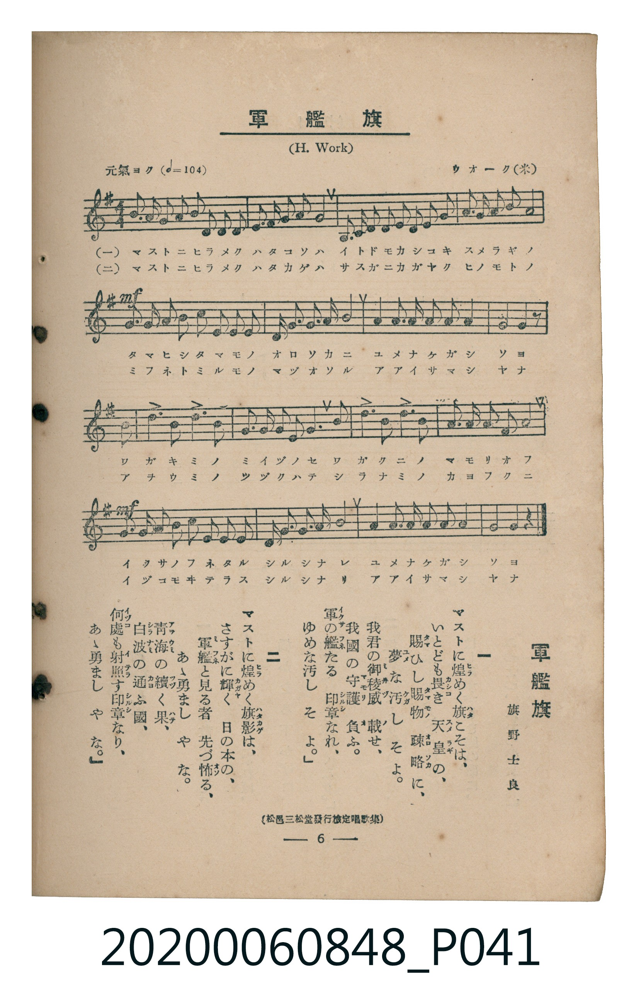

# 軍艦旗

> Re:Shōka 使用 AI 協助辨識與重建樂譜，可能會有錯誤。歡迎回報。

- **鋼琴伴奏版**：<br><audio controls src="gunkanki.mp3"></audio>

- 詞：旗野士良
- 曲：Henry Clay Work（ウオーク）
- 臺灣教育會公認《新定兒童唱歌》高等科男子用（2020.006.0848）

## 說明

原書資訊與歌詞全文（對應 P041.jpg，書頁 p. 6，高一第一學期第 6 首）：
調性與拍號：ト長調（1 升記號）、4/4 拍（元氣ヨク ♩=104）
出處註記：（松邑三松堂發行檢定唱歌集）


## 歌詞

```text
一　マストに煌（ひら）めく旗（はた）こそは、
いとども畏（かしこ）き　天皇（すめらぎ）の、
賜（たま）ひし賜物（たまもの）　疎略（おろそか）に、
夢（ゆめ）な汚（けが）しそよ。
我君（わがきみ）の御稜威（みいづ）載（の）せ、
我國（わがくに）の守護（まもり）負（お）ふ。
軍（いくさ）の艦（ふね）たる　印章（しるし）なれ、
ゆめな汚（けが）しそよ。

二　マストに煌（ひら）めく旗影（はたかげ）は、
さすがに輝（かがや）く　日（ひ）の本（もと）の、
軍艦（みふね）と見（み）る者（もの）　先（ま）づ怖（おそ）る、
あゝ勇（いさ）ましやな。
青海（あをうみ）の續（つづ）く果（はて）、
白波（しらなみ）の通（かよ）ふ國（くに）、
何處（いづこ）も射照（いてら）す印章（しるし）なり、
あゝ勇（いさ）ましやな。
```

## ABC

<div class="abc-score" data-abc-src="gunkanki.abc" aria-label="五線譜載入中"></div>

[下載 ABC 原始檔](gunkanki.abc)

## TMD 檔案連結

- [主旋律 TMD 檔案](gunkanki.tmd) [[在 TMD Studio 編輯](https://tmdlang.github.io/Tmd-TS/#tmd=s7IKdvYPcrWy4qpTUCpJTLdSSM7PyUlNLsnMz7MqzsjMK0nNjM_KTMmPL87Iz05Ugisry88pzU21ys4vyY9Pyq8sjjcyMDKINzAwizewMLFAqCvOLy1KTrUqTs7Iz8-JL0mtKEnKz89Gl48vSExPtQowMDFEyBQU5Zel5iXmAXUXFIEckgLWjlCQWpaZkgqSLk5OzIsvSy3KTMtMTUFyYmpRMdgbECtKihLzipOLMgtAfkOoyi8qychPL0osyKi0ysgsLskvykxOzInPTsxD8m1JRirQs7mZOZkliUWVyJoz0zPzrHJTM7MysXgOKl2eWlySWpQXn5uak58C1K2lpfBid--LzmXPpk9X0NLiUrRVMDQw4bK3VXDnsjHRN7EDGfBi5bz3e2YBVbxs73u6ePWLzvVgc5_N3gQU9kjNK6pUcM5JrFQIzy_Kfr-n43HTssdNqx4373nctP79nk6w2hftu543Ln42deaLpk3P5jQ_bV3zYlXv44auZ9M2PF0362nrpOerlz6dsvHZ2p7HDd0vV894vrbz-fKJz6dsf7p2wvMpK4CmgiJVDxipeqBIBRvLpa-lYEstwKWgoPC0b_6z2TtebG5_saLrRUc70DFAnz9tXfFsWjvQAU839D5r71QApQy9rIL093t6gIpfLmhUKNBTMAPygK5-sqPh-Zo1QPLp2h3P5swHshXMFF4umwZ0LjCkQFa8WLX_WcNykOHdvS9mzgeKPm7ueDl1O1AcaIWhwtNeoOUzwDKdjxsagTGgAFQJsr21-dmGxY-bVwADVeHRzJW2wGgCqgE7u33Xi5lTX6zYDdQJNBCo-NncfS-bJj7Z0QlkPF3Q9HzmnhcLe56tWgQKanAgv5zdBtIM0g107eOGhsfN8x437QS65XHj6uetPaBYbNz0uAno7M7HTY2PG_uBsQ8WXP-4Eey2xsmPG-eCuA2NIFMeN7Y8blzxuHHl46am51P7wUq7HzdOB6oDqwbGdcPTJSufzwKF5OPGmSBDm4DifWDZdVBTXmyeA5ae_7hxH1hiE9AIoODzzpVwcaAFQA3g4Gl4Pq3v-dSlYKmux029YBd1gzWuhpr4dMkicIpsA1oIllj1bCMohB43TnzcCPQmUAToxrmPmzoeNzSBNDzrmPh0wmywnn6gCpDLG4FRA3Lk030Ln6-Y83QF0CCg_v1gLwMt73wBil2gCNhRjbOhNoMMmgN0DNwgILkaatC6jhdrt4P1gL3T1AUyZdMCiEfAarZCnQPMnGBRoFVA_VMh-oHZFSy49XHjWrDI_MdN3aAA7t3wfDXElOkgkUZglIG8_LgJmKsg0QQOCAKhAE4Vu4BaiEoVT_duhCcMcJxPApuHSBhTQdENCoDVL_bMhSWMnsdNLWB1_UBrnk2HxCGwOAF579mcNeBgA8YzMOMjJw9wSQULfbjvV7xYBg5nSDw1db9oaIXph6aTp60dkNAGq1_6rAGYI8FpphHoIJAWuGOBkTH3aTckkQLDHBLg-8DhCeSugsbKy7mTnm2FRCBQw6THjW3wRPJ8FySYlkDSBiiM5kESNTCAgG4H5WqQEc9n7n22GZw2QWaDYwlmxMsGSNx0A-MDkhigCQmehCBGPNk7FZjvYU5dCs1qTU1PN7Q8b10OEweWxeD4apyJO3l0keh_yotbKFDQ0ufici_NA1Zx2ZlWAZmJefkONQY11SBLFGwMzbTswCxsBb0CpKQFFmwKGiYKTzf0P1_foAMvnTWxaADaBTKsRsFYQRcIjRQMwaQumG8aj0LUKJiBKF0F83i4MhCNDIEGQdSYxCPpBOtDsECaasDaQWyYbRA-klFgl_kY1igAsxxYBJjvgOwOEKu5G0xOApMrweRCsIr1YLMfN_dDdewH4s1g1l6wKog4soMfNy2BqAWa_Li5E8xaBNaxGkxuB5MQM9ZCdeyE6lgIs71pHZjfh90PRpT7AeKWTTj9sBVhetMahOlQfRARkD8RpoPshbgZ6l-oqzD9gD-97eohJ71V56bVQlMPIgmYADE4hSCIGlC6gamDJFFIUkX2PizpQGgjMA3DEBXo6RTGN4DajJTYgMENCZh5sMiBJgGQOCQaYQEGCiqQjlVANihpwJIZJOAhUYAWUc3LoGxIZIPoLqDqjWA94GgC2waLVohpCAhs7EBZoMB53AyOTKRENh-qaioQ94JZkEgFiT9uBicGVLeDfdkKdfMquB8gatETGUgnRAWEBco6kKQHDRdkt4OTG6rbu5DdDjaDUOLa0UlO4jJFshVckKHxYenBEEzDyyRUJYQNQU5uwDIRbxEGjlt4SIALElhswUIHFiPQOASFLThmIDKPm3ajqIZmYzRzQaKo6Q45piH8RUAMimlIfIPSClZXg9MTqMBBmA5Ku7hc3QLlt8JdASqmHje3oZgASh8g1aDiDmEGKF3gMBdcgEHSPcSl2PwIcTXelPR09uwhXkwhRQ04QUFrLWBwwLIgOJlAAgmS-aFFFigIQTq2w7M1LKOCC59m5CQEcQd1iykkl4MSFby-BSUVcL0KrW_B9RM4wcBqVVA9i8_lkAILxeVULaQgLq_l4tK1U4A1yRSAbGUuAA)]
- [鋼琴伴奏 TMD 檔案](gunkanki_piano.tmd) [[在 TMD Studio 編輯](https://tmdlang.github.io/Tmd-TS/#tmd=s7IKdvYPcrWy4qpTUCpJTLdSSM7PyUlNLsnMz7MqzsjMK0nNjM_KTMmPL87Iz05Ugisry88pzU21ys4vyY9Pyq8sjjcyMDKINzAwizewMLFAqCvOLy1KTrUqTs7Iz8-JL0mtKEnKz89Gl48vSExPtQowMDFEyBQU5Zel5iXmAXUXFIEckgLWjlCQWpaZkgqSLk5OzIsvSy3KTMtMTUFyYmpRMdgbECtKihLzipOLMgtAfkOoyi8qychPL0osyKi0ysgsLskvykxOzInPTsxD8m1iEVBzempual6JVUFmYl5-fGJycn5uQWJeJkgMobAkA6jIKjczJ7MksagS2ZbM9Mw8q9zUzKxMLKEAlS5PLS5JLcqLz03NyU8B6tbSUnixu_dF57Jn06e_39PxsnvP8wlbnuzZ8nRp__POjvd7OhW0tLgUbRUMDUy47G0V3LlsTPRN7ECmvlg57_2eWUBtL9v7ni5e_aJzPdiyZ7M3AYU9UvOKKhWccxIrFcLzi7KBJj9uWva4adXj5j2Pm9YDjQWrfdG-63nj4mdTZ75o2vRsTvPT1jUvVvU-buh6Nm3D03WznrZOer566dMpG5-t7Xnc0P1y9YznazufL5_4fMr2p2snPJ-yAmgqKEnoAZOEHihJgI3lci_NA4ZsdqZVACgUgzwcagxqqrkUgMDG0EzLDszS11J4vmbNkx0NLxb2KGjpg8VqFIwVdIHQSMEQTOqC-abxKESNghmI0lUwj4crA9HIEGgQRI1JPJJOsD4EC6SpBqwdxIbZBuEjGQV2mY9hjcLj5nlgkcdNO4HsDhCruRtMTgKTK8HkQrCK9WCzHzf3Q3XsB-LNYNZesCqIOLKDHzctgagFmvy4uRPMWgTWsRpMbgeTEDPWQnXshOpYCLO9aR2Y34fdD0aU-wHilk04_bAVYXrTGoTpUH0QEZA_EaaD7IW4GepfqKsw_YCcbHb1oCSb6ty0WmgiQMSkCRCDIxpB1ICiH6YOktIgKQ7ZF7AUAKGNwDQMQ1SgJzcY3wBqM1KaAYYaxH_zYGEMjUmQOCQ2YP4G-RikYxWQDYphWGqBhB8kJNHCu3kZlA2JMxDdBVS9EawHHNpg22CxAzENAR83r4CyQIHzuBkcJ0hpZT5U1VQg7gWzIHEDEn_cDI5TVLeDfdkKdfMquB8gatHTCkgnRAWEBcoBkBQEDRdkt4NTDarbu5DdDjYDNY3s6ERJI6ZImsHFChofFq2GYBpeQqAqIWwIcqoBllB4CxRwFME9BM7WsECHeRIWsNCoAAUROIAhMo-bdqOohmYqNHNBoqjJBznCIPxFQAyKMEi0gaIcq6vByQKU_RGmg5IgLle3QPmtcFeACo3HzW0oJoCiGaQaVPggzABFLw5zwcUJJPlCXIrNjxBXIyWIp7NnD9ZCAymEwekCWhUAfQXLEODYhvgVkhWhBQgoJEA6tsMzGSzbgIuCZuSUAHEHdQsNJJeD0ga8EgPFOLiyglZi4EIfHO-wqgpUeeFzOaT4QHE5VYsMiMtr0VsrPsitFRO8jRXDeIVow1gYVQNqbESbxCMJoCswjQeyTIEq4Ay8tRpUH8xYosxDUmOAvzyktuvRsxcVXA-MHF07BVj8RPsAZVD4RmC-MhcA)]

## 分析

```text
================================================================================
📊 TMD Song Profile: [ 軍艦旗 ]
================================================================================
⏱  Duration:       0:36 (36.9s), 16 measures total
🎼 Key & Tempo:    首調基準 G, != 104.0 BPM, <4/4>
   - 分析範圍：      由實際發聲的音符與和弦推測調性；播放脈絡另行呈現
🎤 人聲音域:    B3 (MIDI 59) – D5 (MIDI 74) [跨度: 15 個半音 / 1.2 個八度, 難度: moderate]
   - 最低音:  B3 in [Gunkanki #1 @ m.3, 0:04]
   - 最高音: D5 in [Gunkanki #1 @ m.9, 0:18]
   - 適合: soprano, mezzo-soprano, contralto, tenor, baritone, bass
🏛  結構:      Gunkanki (36.9s)
⚡ 編曲密度:        Peak 1 軌道同時演奏
🗝  調性診斷：       G 大調（純淨自然大調，未偵測到可信轉調）
   - 風格氣質:    純淨自然大調（陽光明朗、易唱易記，無明顯調外色彩）
   - 轉調歷程:    全曲維持單一推測調性（未偵測到可信轉調）
   - 核心骨幹音:  G, A, B, D, E
   - 調性數值:    G 大調 [相關度: 0.77, 穩定度: Moderate, 自然音純度: 100.0%]
   - 候選調性 (K-S): G 大調 (0.77), D 大調 (0.69), E 小調 (0.52)
   - 五度圈歷程:   +1
   - 各段落調性細節:
     • [Gunkanki #1]: G 大調 (r: 0.77, 自然音純度: 100.0%)

  [ 五度圈游移軌跡 ]
               C  
         F           [G ]*
      Bb               D  
      Eb               A  
         Ab           E  
            Db       B  
               F# 
     (* = active key center)

  [ 十二半音累積音高分佈 ]
     C  : ██                         2.0%
     C# :                            0.0%
     D  : █████████████             15.2%
     D# :                            0.0%
     E  : ███████                    8.4%
     F  :                            0.0%
     F# : █                          1.2%
     G  : ████████████████████████  28.4%
     G# :                            0.0%
     A  : ████████████████████████  28.0%
     A# :                            0.0%
     B  : ██████████████            16.8%
--------------------------------------------------------------------------------
Assignment 軌道音域：
  - Piano         : B3 – D5 (15 個半音 / 1.2 個八度, 88 個音符)
================================================================================
```


## 原書掃描頁




