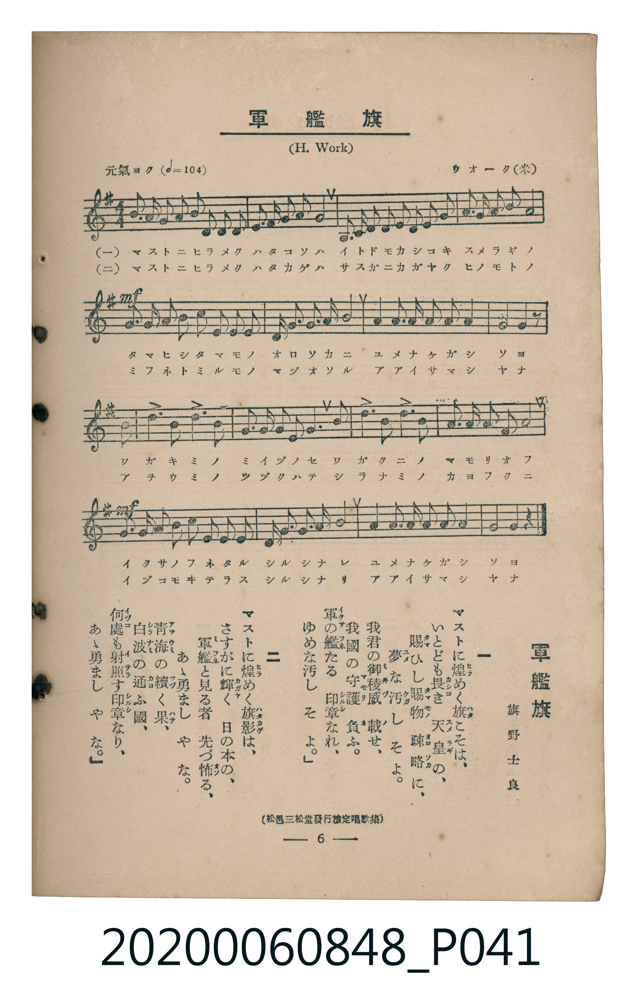

# 軍艦旗

<audio controls src="gunkanki.mp3"></audio>

- 詞：旗野士良
- 曲：Henry Clay Work（ウオーク）
- 臺灣教育會公認《新定兒童唱歌》高等科男子用（2020.006.0848）

## 說明

原書資訊與歌詞全文（對應 P041.jpg，書頁 p. 6，高一第一學期第 6 首）：
調性與拍號：ト長調（1 升記號）、4/4 拍（元氣ヨク ♩=104）
出處註記：（松邑三松堂發行檢定唱歌集）

## 歌詞

```text
一　マストに煌（ひら）めく旗（はた）こそは、
いとども畏（かしこ）き　天皇（すめらぎ）の、
賜（たま）ひし賜物（たまもの）　疎略（おろそか）に、
夢（ゆめ）な汚（けが）しそよ。
我君（わがきみ）の御稜威（みいづ）載（の）せ、
我國（わがくに）の守護（まもり）負（お）ふ。
軍（いくさ）の艦（ふね）たる　印章（しるし）なれ、
ゆめな汚（けが）しそよ。

二　マストに煌（ひら）めく旗影（はたかげ）は、
さすがに輝（かがや）く　日（ひ）の本（もと）の、
軍艦（みふね）と見（み）る者（もの）　先（ま）づ怖（おそ）る、
あゝ勇（いさ）ましやな。
青海（あをうみ）の續（つづ）く果（はて）、
白波（しらなみ）の通（かよ）ふ國（くに）、
何處（いづこ）も射照（いてら）す印章（しるし）なり、
あゝ勇（いさ）ましやな。
```

## ABC

```abc
X:1
T:軍艦旗
C:曲：Henry Clay Work（ウオーク）
M:4/4
L:1/16
Q:1/4=104
K:G
V:V1 name="Piano" snm="Pia"
[V:V1]
B3 c B2 G2 E3 F G2 E2 | D2 G2 G2 A2 B8 | D3 E F2 G2 A2 A2 G2 A2 | B3 c B2 A2 d8 |
!mf! B3 c B2 G2 E3 F G2 E2 | D2 G2 G2 A2 B8 | A3 B c4 B3 G A4 | G8 G4 z4 |
G4 B4 d4 d3 B | c2 e2 d2 c2 B8 | G4 B4 d4 d3 B | A2 B2 c2 B2 A8 |
!mf! B3 c B2 G2 E3 F G2 E2 | D2 G2 G2 A2 B8 | A3 B c4 B3 G A4 | G8 G4 z4 |
```

## TMD 檔案連結

- [主旋律 TMD 檔案](gunkanki.tmd) [[在 TMD Studio 編輯](https://tmdlang.github.io/Tmd-TS/#tmd=s7IKdvYPcrWy4tLSUnixu_dF57Jn06craGlxKdoqGBqYcNnbKrhz2Zjom9hx1SkovVg57_2eWUAVL9v7ni5e_aJzvRJI-NnsTUBhj9S8okoF55zESoXw_KLs93s6Hjcte9y06nHznsdN69_v6QSrfdG-63nj4mdTZ75o2vRsTvPT1jUvVvU-buh6Nm3D03WznrZOer566dMpG5-t7Xnc0P1y9YznazufL5_4fMr2p2snPJ-yAmiqkYGRgZ6BgZmegYWJBdhYLn0tBVtqAS4FBYWnffOfzd7xYnP7ixVdLzragY4B-vxp64pn09qBDni6ofdZe6dCgIGJoV5WQfr7PT1AxS8XNCoU6CmYAXlAVz_Z0fB8zRog-XTtjmdz5gPZCmYKL5dNAzoXGFIgK16s2v-sYTnI8O7eFzPnA0UfN3e8nLodKA60wlDhaS_Q8hlgmc7HDY3AGFAAqgTZ3tr8bMPix80rgIGq8GjmSltgNAHVgJ3dvuvFzKkvVuwG6gQaCFT8bO6-l00Tn-zoBDKeLmh6PnPPi4U9z1YtAgU1OJBfzm4DaQbpBrr2cUPD4-Z5j5t2At3yuHH189YeUCw2bnrcBHR25-OmxseN_cDYBwuuf9wIdlvj5MeNc0HchkaQKY8bWx43rnjcuPJxU9Pzqf1gpd2PG6cD1YFVA-O64emSlc9ngULyceNMkKFNQPE-sOw6qCkvNs8BS89_3LgPLLEJaARQ8HnnSrg40AKgBnDwNDyf1vd86lKwVNfjpl6wi7rBGldDTXy6ZBE4RbYBLQRLrHq2ERRCjxsnPm4EehMoAnTj3MdNHY8bmkAannVMfDphNlhPP1AFyOWNwKgBOfLpvoXPV8x5ugJoEFD_frCXgZZ3vgDFLlAE7KjG2VCbQQbNAToGbhCQXA01aF3Hi7XbwXrA3mnqApmyaQHEI2A1W6HOAWZOsCjQKqD-qRD9wOwKFtz6uHEtWGT-46ZuUAD3bni-GmLKdJBIIzDKQF5-3ATMVZBoAgcEgVAAp4pdQC1EpYqnezfCEwY4zieBzUMkjKmg6AYFwOoXe-bCEkbP46YWsLp-oDXPpkPiEFicgLz3bM4acLAB4xmY8ZGTB7ikgoU-3PcrXiwDhzMknpq6XzS0wvRD08nT1g5IaIPVL33WAMyR4DTTCHQQSAvcscDImPu0G5JIgWEOCfB94PAEcldBY-Xl3EnPtkIiEKhh0uPGNngieb4LEkxLIGkDFEbzIIkaGEBAt4NyNciI5zP3PtsMTpsgs8GxBDPiZQMkbrqB8QFJDNCEBE9CECOe7J0KzPcwpy6FZrWmpqcbWp63LoeJA8ticHw1zsSdPLpI9D_lxS0UKGjpc3H5JmbmWQVkJublO9QY1ChUg2xQsDE007IDs4ClPKRQBZZhQHc5JRYVKxg-apgMKv5A-kFqahSMFXSB0ARMGwKxWTxYwDwewauBKjUFcUCiIGwExBC9CIiiEKwZaAxCOQjD2DClyNaDxE0xjET2y64eJL-YAv0CqtAQfqnOTauliYdAciBZE6g4RJ0hVByhDmQOMoTxDbD6Zkcnkm8sgb4xNELxDkw3zFWwsIHQxnBbQa4yg4qD2Lh8Qax5sJCAmQXzJdY4eTp7NnL6MgZ5A1irD61YqeXi0rVTAOUnBSCtzMUFAA)]
- [鋼琴伴奏 TMD 檔案](gunkanki_piano.tmd) [[在 TMD Studio 編輯](https://tmdlang.github.io/Tmd-TS/#tmd=s7IKdvYPcrWy4tLSUnixu_dF57Jn06e_39PxsnvP8wlbnuzZ8nRp__POjvd7OhW0tLgUbRUMDUy47G0V3LlsTPRN7LjqFJRerJz3fs8soLaX7X1PF69-0bleCST8bPYmoLBHal5RpYJzTmKlQnh-UTbQ5MdNyx43rXrcvOdx03qgsWC1L9p3PW9c_GzqzBdNm57NaX7auubFqt7HDV3Ppm14um7W09ZJz1cvfTpl47O1PY8bul-unvF8befz5ROfT9n-dO2E51NWAE01MjAy0DMwMNMzsDCxABvL5ZuYmWcVkJmYlx_k4VBjUKNQzaUABDaGZlp2YJa-lsLzNWue7Gh4sbBHQUsfLFajYKygC4QmYNoQiM3iwQLm8QheDVSpKYgDEgVhIyCG6EVAFIVgzUBjEMpBGMaGKUW2HiRuimEkstt39aC4vTo3rZYmHgDJgWRNoOIQdYZQcYQ6kDnIEMY3wOr6HZ0orocphjkC5nUIbQy3BOQIM6g4iI3L0cSaB_M4zCyYp7AG-dPZs4dakNci5wUflLxggjcrGMYrRBvGAt0PpM3ic2PBzgeyTeNjYXJIIkZA2giiyhgiCZfCm2iJssUEyDABCiCMhMkBKQMC6QqiEOoohFlww9EVoHgJw_3oKYA67gdGkq6dAiieFIC0MhcXAA)]

## 分析

```text
================================================================================
📊 TMD Song Profile: [ 軍艦旗 ]
================================================================================
⏱  Duration:       0:36 (36.9s), 16 measures total
🎼 Key & Tempo:    首調基準 G, != 104.0 BPM, <4/4>
   - 分析範圍：      由實際發聲的音符與和弦推測調性；播放脈絡另行呈現
🎤 人聲音域:    D4 (MIDI 62) – E5 (MIDI 76) [跨度: 14 個半音 / 1.2 個八度, 難度: moderate]
   - 最低音:  D4 in [Main #1 @ m.2, 0:02]
   - 最高音: E5 in [Main #1 @ m.10, 0:21]
   - 適合: soprano, mezzo-soprano, contralto, tenor, baritone, bass
🏛  結構:      Main (36.9s)
⚡ 編曲密度:        Peak 1 軌道同時演奏
🗝  調性診斷：       G 大調（純淨自然大調，未偵測到可信轉調）
   - 風格氣質:    純淨自然大調（陽光明朗、易唱易記，無明顯調外色彩）
   - 轉調歷程:    全曲維持單一推測調性（未偵測到可信轉調）
   - 核心骨幹音:  B, G, A, D, C
   - 調性數值:    G 大調 [相關度: 0.83, 穩定度: High, 自然音純度: 100.0%]
   - 候選調性 (K-S): G 大調 (0.83), B 小調 (0.68), E 小調 (0.62)
   - 五度圈歷程:   +1
   - 各段落調性細節:
     • [Main #1]: G 大調 (r: 0.83, 自然音純度: 100.0%)

  [ 五度圈游移軌跡 ]
               C  
         F           [G ]*
      Bb               D  
      Eb               A  
         Ab           E  
            Db       B  
               F# 
     (* = active key center)

  [ 十二半音累積音高分佈 ]
     C  : ██████                     7.3%
     C# :                            0.0%
     D  : ███████████               13.3%
     D# :                            0.0%
     E  : ██████                     7.3%
     F  :                            0.0%
     F# : ██                         2.0%
     G  : ████████████████████      25.0%
     G# :                            0.0%
     A  : ████████████              15.3%
     A# :                            0.0%
     B  : ████████████████████████  29.8%
--------------------------------------------------------------------------------
Assignment 軌道音域：
  - Piano         : D4 – E5 (14 個半音 / 1.2 個八度, 88 個音符)
================================================================================
```


## 原書掃描頁




