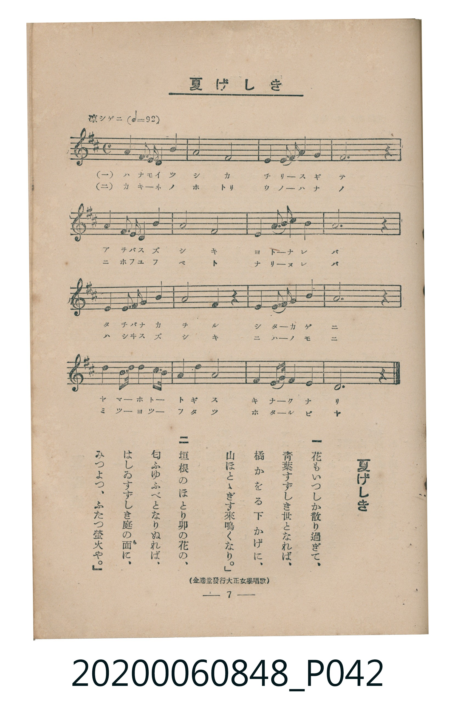

# 夏げしき

<audio controls src="natsugeshiki.mp3"></audio>

- 出處：金港堂發行《大正女學唱歌》
- 臺灣教育會公認《新定兒童唱歌》高等科男子用（2020.006.0848）

- note

原書資訊與歌詞全文（對應 P042.jpg，書頁 p. 7，高一第一學期第 7 首）：
調性與拍號：ニ長調（2 升記號）、4/4 拍（涼シゲニ ♩=92）
出處註記：（金港堂發行大正女學唱歌）

## 歌詞

```text
一　花（はな）もいつしか散（ち）り過（す）ぎて、
青葉（あをば）すずしき世（よ）となれば、
橘（たちばな）かをる下（した）かげに、
山（やま）ほとゝぎす來鳴（きな）くなり。

二　垣根（かきね）のほとり卯（う）の花（はな）の、
匂（にほ）ふゆふべとなりぬれば、
はしゐすずしき庭（には）の面（も）に、
みつよつ、ふたつ螢火（ほたるび）や。
```

## 原書掃描頁



## 調性分析

```text
================================================================================
📊 TMD Song Profile: [ 夏げしき ]
================================================================================
⏱  Duration:       0:41 (41.7s), 16 measures total
🎼 Key & Tempo:    首調基準 D, != 92.0 BPM, <4/4>
   - 分析範圍：      由實際發聲的音符與和弦推測調性；播放脈絡另行呈現
🎤 人聲音域:    D4 (MIDI 62) – D5 (MIDI 74) [跨度: 12 個半音 / 1.0 個八度, 難度: easy]
   - 最低音:  D4 in [Main #1 @ m.1, 0:01]
   - 最高音: D5 in [Main #1 @ m.7, 0:16]
   - 適合: soprano, mezzo-soprano, contralto, tenor, baritone, bass
🏛  結構:      Main (41.7s)
⚡ 編曲密度:        Peak 1 軌道同時演奏
🗝  調性診斷：       A 大調（純淨自然大調，未偵測到可信轉調）
   - 風格氣質:    純淨自然大調（陽光明朗、易唱易記，無明顯調外色彩）
   - 轉調歷程:    全曲維持單一推測調性（未偵測到可信轉調）
   - 核心骨幹音:  A, F#, D, E, B
   - 調性數值:    A 大調 [相關度: 0.82, 穩定度: Moderate, 自然音純度: 100.0%]
   - 候選調性 (K-S): A 大調 (0.82), D 大調 (0.76), F# 小調 (0.74)
   - 五度圈歷程:   +3
   - 各段落調性細節:
     • [Main #1]: A 大調 (r: 0.82, 自然音純度: 100.0%)

  [ 五度圈游移軌跡 ]
               C  
         F            G  
      Bb               D  
      Eb              [A ]*
         Ab           E  
            Db       B  
               F# 
     (* = active key center)

  [ 十二半音累積音高分佈 ]
     C  :                            0.0%
     C# :                            0.0%
     D  : ████████████              16.5%
     D# :                            0.0%
     E  : ████████████              16.5%
     F  :                            0.0%
     F# : █████████████████         23.7%
     G  :                            0.0%
     G# :                            0.0%
     A  : ████████████████████████  32.6%
     A# :                            0.0%
     B  : ████████                  10.6%
--------------------------------------------------------------------------------
Assignment 軌道音域：
  - Piano         : D4 – D5 (12 個半音 / 1.0 個八度, 54 個音符)
================================================================================
```

## ABC

```abc
X:1
T:夏げしき
C:TMD (Chen, Chih-Han / aguai)
M:4/4
L:1/16
Q:1/4=92
K:D

V:V1 name="Piano" snm="Pia"

[V:V1]
f4 f3 e d4 f4 | a8 f8 | e4 e3 f a4 f4 | e12 z4 |
f4 f3 e d4 f4 | a8 b8 | a4 b3 d a4 f4 | a12 z4 |
d4 d3 b a4 b4 | a8 f4 z4 | e4 e3 f a4 b4 | a12 z4 |
f4 a3 a b4 d3 b | a4 f4 d8 | e4 e3 a f4 e4 | d12 z4 |
```

- [主旋律 TMD 檔案](natsugeshiki.tmd)
- [鋼琴伴奏 TMD 檔案](natsugeshiki_piano.tmd)
