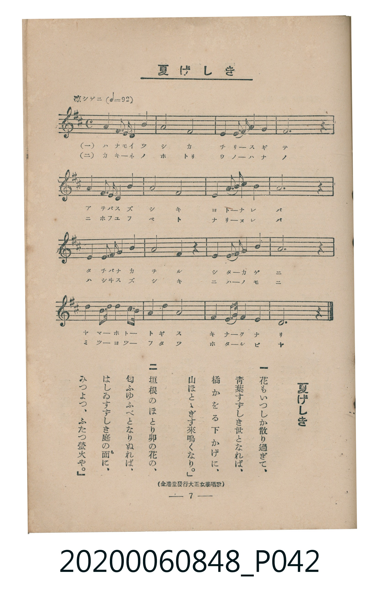

# 夏げしき

> Re:Shōka 使用 AI 協助辨識與重建樂譜，可能會有錯誤。歡迎回報。

- **鋼琴伴奏版**：<br><audio controls src="natsugeshiki.mp3"></audio>

- 出處：金港堂發行《大正女學唱歌》
- 臺灣教育會公認《新定兒童唱歌》高等科男子用（2020.006.0848）

## 說明

原書資訊與歌詞全文（對應 P042.jpg，書頁 p. 7，高一第一學期第 7 首）：
調性與拍號：ニ長調（2 升記號）、4/4 拍（涼シゲニ ♩=92）
出處註記：（金港堂發行大正女學唱歌）


## 歌詞

```text
一　花（はな）もいつしか散（ち）り過（す）ぎて、
青葉（あをば）すずしき世（よ）となれば、
橘（たちばな）かをる下（した）かげに、
山（やま）ほとゝぎす來鳴（きな）くなり。

二　垣根（かきね）のほとり卯（う）の花（はな）の、
匂（にほ）ふゆふべとなりぬれば、
はしゐすずしき庭（には）の面（も）に、
みつよつ、ふたつ螢火（ほたるび）や。
```

## ABC

<div class="abc-score" data-abc-src="natsugeshiki.abc" aria-label="五線譜載入中"></div>

[下載 ABC 原始檔](natsugeshiki.abc)

## TMD 檔案連結

- [主旋律 TMD 檔案](natsugeshiki.tmd) [[在 TMD Studio 編輯](https://tmdlang.github.io/Tmd-TS/#tmd=s7IKdvYPcrWy4qpTUCpJTLdSSM7PyUlNLsnMz7MqzsjMK0nNjM_KTMmPL87Iz05Ugisry88pzU21ys4vyY9Pyq8sjjcyMDKINzAwizewMLFAqCvOLy1KTrUqTs7Iz8-JL0mtKEnKz89Gl48vSExPtQowMDFCyBQU5Zel5iXmAXUXFIEckgLWjlCQWpaZkgqSLk5OzIsvSy3KTMtMTUFyYmpRMdgbECtKihLzipOLMgtAfkOoyi8qychPL0osyKi0ysgsLskvykxOzInPTsxD8m1JRirQs8WpicX5ecXIejPTM_OsShIzgaEDCqHyxPjcxMy8nMQ8oDu0tBSeLul_3DjpceP0x429ClpaXIq2CpZGXPa2Ci5cNib6JnYgk56273oxc-r7PbNetk98tmP90wVNz2fuebGw53FD19Mly5-tXfx06eana3c8nbLx2VqgYDfY-hftu543Ln42deaLpk3P5jQ_bV3zYlUvUMezaRuerpv1tHXS89VL4Tperp7xfG3n8-UTn0_Z_nTthOdTVrzf0wGKLz1gfOmB4uv9nk4lLi59LQVbagEuBQWFp33zn83e8WJz-4sVXS862oGOebFy3tPWFc-mtQMd8HRD77P2TgVQpOtlFaS_39MDVPxyQaNCgZ6COZAHdPWTHQ3P16wBkkD_P5szH8hWMFd4uWwa0LnA8AJZ8WLV_mcNy0GGd_e-mDkfKPq4ufvl1O1AcZAfFZ72Ai2fAZbpfNzQCAxzBaBKoNSzbXseN21_3LQJqF7h0cyVtpZGQCVgV4Pj48WK3UCNQPOAatEiBjNWQDpBWoEufdzQ8KJrI1DT48b1jxtXgaxtanrc2PK4cQk4GXQ_m7oYLLsQLNX1srEPzJ0J4jb2PW5cBnQmyKyXcye9mAj0JlCu6XETMA1tAKuY-bhxFiQ9PdkBDIeOx00dYPEVQMseN_UAlUH1P1sJdD1Q83ygVSBRiFsau0FmNXU_2dENlgUaBA4aoDgona6Gan66EeyFJqCz94Gld4NsaJoLduHMJ_vaXm7eAtbfCzMXmM6B9nc9bmiChMQuYMJreDpv8bMFO8EKgeYD1a4Fq10HM6_rae96sGwbRBw95IAqoe7paQJLrAbqBEtsfdzUBiIbd8K83vW4cQ1KAICNmf64aQJyoD3dBXQCxCCgzSAbXs5dBPYq0AIgFxYAjxv3g2KsCah0CVAIbBUwJJe8mLfoeeNqsBFAL8wHhuTjxs3gmGwBeR2ok_KsAwUKWvpcXL7A0sQqIDMxL9-hxqCmGmSBgo2hmZYdmAXMsJD8AUyVQDc5JRYVKxg-aphsAsw-iHzVCTIJpLxGwVRBFwyNwaSRgiGUbwalESpgEKISAWuAuiAsCG0M12ECV4GuBwYNYCrArvExrFF43NwPFXvc3AWlFyk8bloCF22BmwrMrmjmPW5ajeG6x82NcL2roPQeoMqdcD3rkNS24XBpPKpLjUC2w-x63LQWYW5zL9y2PiRzZ6O7tLkD5hwUxzYtQ9MOMRQ9UCCGwizA7VjkRLGrBylRmAITBbCQp32igKg0AxbThMyAQSyJomkRVOxx8yYoPQElCnfBTcWWKNZiuO5x8wq4iR1QGhTOsNB93LwGSe0EHC7FkiiAdQfMBEiUP26eCsSIWJ2KZO5MdJdC3YLqUoSbkJJvcw-ZLkUpJjqRUoQlMEUYAqs87EkCPY_D8jbhJAGPTjLMgEFsSWI_VAyWv8FJAhFY8NwJChZIokHAx80wWXjAICUcmNmQcgKRy2GmIEczOsSWJOCZF2rD4-YNZCReJJciJTKI2ZAkASsOQCUmKS5FShJPZ89GrjmMQWnCDFeaMIyDGgGJQCAXLgLJ7WZIUQqXQo9jRO0ASRcmaHyQClgBhA6x1R-ImmIelAaFDaz8Rc7uINWwDIeoBRAxg3AhIhYQtRIobaxHE4WEOHqxDoPY0sZ8uAmQeg3iWkThhBAFqYYVHsipH1YfIrkW4VvklAxP84-bJyOphYUXbtfWcnHp2imAGh4KQFqZCwA)]
- [鋼琴伴奏 TMD 檔案](natsugeshiki_piano.tmd) [[在 TMD Studio 編輯](https://tmdlang.github.io/Tmd-TS/#tmd=s7IKdvYPcrWy4qpTUCpJTLdSSM7PyUlNLsnMz7MqzsjMK0nNjM_KTMmPL87Iz05Ugisry88pzU21ys4vyY9Pyq8sjjcyMDKINzAwizewMLFAqCvOLy1KTrUqTs7Iz8-JL0mtKEnKz89Gl48vSExPtQowMDFCyBQU5Zel5iXmAXUXFIEckgLWjlCQWpaZkgqSLk5OzIsvSy3KTMtMTUFyYmpRMdgbECtKihLzipOLMgtAfkOoyi8qychPL0osyKi0ysgsLskvykxOzInPTsxD8m1iEVBzempual6JVUFmYl5-fGJycn5uQWJeJkgMobAkA6jIqjg1sTg_rxjZksz0zDyrksRMYDCCgrI8MT43MTMvJzEP6GAtLYWnS_ofN0563Dj9cWPv-z0dL7v3PJ-w5cmeLU-X9j_v7Hi_p1NBS4tL0VbB0ojL3lbBhcvGRN_EDmT80_ZdL2ZOfb9n1sv2ic92rH-6oOn5zD0vFvY8buh6umT5s7WLny7d_HTtjqdTNj5bCxTsBrvpRfuu542Ln02d-aJp07M5zU9b17xY1QvU8WzahqfrZj1tnfR89VK4jperZzxf2_l8-cTnU7Y_XTvh-ZQVQAeCYlsPGNt6oNgGOk-Ji8sX6B-rAFDgBHk41BjUVHMpAIGNoZmWHZilr6XwfM2aJzsagK5T0NIHi9UomCrogqExmDRSMITyzaA0QgUMQlQiYA1QF4QFoY3hOkzgKtD1wKABTAXYNT6GNQqPm_uhYo-bu6D0IoXHTUvgoi1wUx83bUcz73HTagzXPW5uhOtdBaX3AFXuhOtZh6S2DYdL41FdagSyHWbX46a1CHObe-G29SGZOxvdpc0dMOegOLZpGZp2iKHogQIxFGYBbscix_yuHprFPESlmYI5QTNgEEvMNy2Cij1u3gSlJ6DE0y64qdhifi2G6x43r4Cb2AGlQYEJC8LHzWuQ1E7A4VIsMd_cDTcBEq-Pm6cCMSLqpiKZOxPdpVC3oLoU4SakNNrcQ6ZLUTJ8J0q0o2dWWCYlHO3wKCPDDBjEFu37oWKwjAqOdkSAwLMZyOuQhIGAj5thsnDPIyUOmNmQDI_IrjBTkKMSHWKLdnguhNrwuHkDGQkUyaVICQliNiTaYfkaVPSR4lKkaH86ezZKtBvGQVVB4gjIhYtAMq0ZUqzBpdCjEVGSQ6LeBI0PUgErR9AhtrIeUarPg9Ig78PKSuRcC1INyzeIEhsR-AgXIgIaUYOAon89migkUNGLYBjEFv3z4SZA6iCIaxFlDEIUpBpWBiAncFjdheRahG-REys8WT9unoykFhZeuF1bi9wQ8EFuCJjgbQcYxitEG8YqmMQDaZP4WIQIlAImDpCUKVAKzkBWY4C_siFsvBGQYRSfGwtlYNiIbgFasUbQdfhUYDEfPf-YQB0Oo3GED9QwrMEDjBpdOwVQ7CgAaWUuAA)]

## 分析

```text
================================================================================
📊 TMD Song Profile: [ 夏げしき ]
================================================================================
⏱  Duration:       0:41 (41.7s), 16 measures total
🎼 Key & Tempo:    首調基準 D, != 92.0 BPM, <4/4>
   - 分析範圍：      由實際發聲的音符與和弦推測調性；播放脈絡另行呈現
🎤 人聲音域:    D4 (MIDI 62) – D5 (MIDI 74) [跨度: 12 個半音 / 1.0 個八度, 難度: easy]
   - 最低音:  D4 in [Main #1 @ m.1, 0:01]
   - 最高音: D5 in [Main #1 @ m.13, 0:31]
   - 適合: soprano, mezzo-soprano, contralto, tenor, baritone, bass
🏛  結構:      Main (41.7s)
⚡ 編曲密度:        Peak 1 軌道同時演奏
🗝  調性診斷：       A 大調（流行色彩大調，未偵測到可信轉調）
   - 風格氣質:    流行大調（略帶和弦色彩音與裝飾副屬和弦）
   - 轉調歷程:    全曲維持單一推測調性（未偵測到可信轉調）
   - 核心骨幹音:  A, F#, E, D, B
   - 調性數值:    A 大調 [相關度: 0.83, 穩定度: Moderate, 自然音純度: 94.5%]
   - 候選調性 (K-S): A 大調 (0.83), D 大調 (0.78), F# 小調 (0.74)
   - 五度圈歷程:   +3
   - 各段落調性細節:
     • [Main #1]: A 大調 (r: 0.83, 自然音純度: 94.5%, 調外音: G)

  [ 五度圈游移軌跡 ]
               C  
         F            G  
      Bb               D  
      Eb              [A ]*
         Ab           E  
            Db       B  
               F# 
     (* = active key center)

  [ 十二半音累積音高分佈 ]
     C  :                            0.0%
     C# : ██                         3.0%
     D  : ███████████               14.0%
     D# :                            0.0%
     E  : ███████████               14.4%
     F  :                            0.0%
     F# : ████████████████          20.8%
     G  : ████                       5.5%
     G# :                            0.0%
     A  : ████████████████████████  31.8%
     A# :                            0.0%
     B  : ████████                  10.6%
--------------------------------------------------------------------------------
Assignment 軌道音域：
  - Piano         : D4 – D5 (12 個半音 / 1.0 個八度, 54 個音符)
================================================================================
```


## 原書掃描頁




