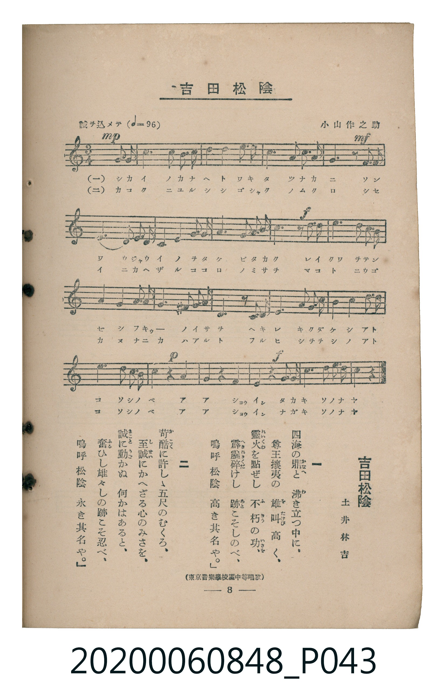

# 吉田松陰

<audio controls src="yoshida_shoin.mp3"></audio>

- 詞：土井林吉（土井晩翠）
- 曲：小山作之助
- 出處：東京音樂學校編《中等唱歌》
- 臺灣教育會公認《新定兒童唱歌》高等科男子用（2020.006.0848）

## 說明

原書資訊與歌詞全文（對應 P043.jpg，書頁 p. 8，高一第一學期第 8 首）：
調性與拍號：イ短調（無升降記號）、3/4 拍（誠ヲ込メテ ♩=96，弱起第 3 拍進入）
出處註記：（東京音樂學校編中等唱歌）

## 歌詞

```text
一　四海（しかい）の鼎（かなへ）と　沸（わ）き立（た）つ中（なか）に、
尊王攘夷（そんのうじゃうい）の　雄叫（をたけび）高（たか）く、
靈火（れいくゎ）を點（てん）ぜし　不朽（ふきゅう）の功（いさを）、
霹靂（へきれき）碎（くだ）けし　跡（あと）こそしのべ、
嗚呼（ああ）　松陰（しょういん）　高（たか）き其名（そのな）や。

二　苛酷（かこく）に許（ゆる）しゝ五尺（ごしゃく）のむくろ、
至誠（しせい）にかへざる心（こころ）のみさを、
誠（まこと）に動（うご）かぬ　何（なに）かはあると、
奮（ふる）ひし雄々（をを）しの跡（あと）こそ忍（しの）べ、
嗚呼（ああ）　松陰（しょういん）　永（なが）き其名（そのな）や。
```

## ABC

```abc
X:1
T:吉田松陰
C:曲：小山作之助
M:3/4
L:1/16
Q:1/4=96
K:C
V:V1 name="Piano" snm="Pia"
[V:V1]
!mp! z4 z4 E3 E | A6 B2 c2 A2 | B2 A2 E4 A3 B | c6 d2 B4 |
!mf! A6 z2 e3 e | E4 A2 B2 c2 B2 | A4 E4 A3 B | c4 d2 c2 B4 |
!f! A6 z2 e3 e | e4 d4 c3 B | A4 B2 c2 d4 | ^G3 A B8 |
E6 z2 A3 A | c2 B2 A4 ^G4 | A4 E4 A3 B | c6 B2 A2 ^G2 |
!p! A4 z4 E4 | A4 z4 B3 B | !f! c4 z4 d3 d | e4 A4 c3 B |
A8 z4 |
```

## TMD 檔案連結

- [主旋律 TMD 檔案](yoshida_shoin.tmd) [[在 TMD Studio 編輯](https://tmdlang.github.io/Tmd-TS/#tmd=s7IKdvYPcrWy4qpTUCpJTLdSSM7PyUlNLsnMz7MqzsjMK0nNjM_KTMmPL87Iz05Ugisry88pzU21ys4vyY9Pyq8sjjcyMDKINzAwizewMLFAqCvOLy1KTrUqTs7Iz8-JL0mtKEnKz89GyBcU5Zel5iXmAdUUFIGsSwErQihILctMSQVJp6ZkluQXZSbmIDkitagY7FCwJfElRYl5xclFmQUg1yNUlWSkAl2akVkM1F6pxKWlpfB0QufzKRuezd33cuYGBS0tLkVbBUszLntbBWcuG2N9EzuQ1hcr573fM-vpnPlPdk19Nm86UMv7PR1Q7syVz_cveL-nE2zHs9mbQAo39D_duPHJ3jlPdnY_7VoJlnnavuvFzKlAyWdzNz7Ztebl_M3PVjQ9Xbvj2YKFz7eveNzQ9WTH2udrO59O2fhsbc_jhm6wphftu543Ln42deaLpk3P5jQ_bV3zYlUvUO2zaRuerpv1tHXS89VL4Tperp4BNOD58onPp2x_unbC8ykrgI4ExYQeMCb0QDEBdiWXvpaCLbUAl4KCwtO--c9m73ixuf3Fiq4XHe1AxwCD62nrimfT2kGhtKH3WXunQoCBibFeVkH6-z09QMUvFzQqFOgpAB3UA3T1kx0Nz9esAZKg4JgzH8hWsFB4uWwa0LnA8AJZ8WLV_mcNy0GGd_e-mDkfKPq4acnz-WuB4kArnrcsfNrb_nJm74sVM8CynY8bGoFRpwBUDZR-sWrB4-ZNL_btedy88HFzm8KjmSttLc2AVj_ds_HF1u0g64xBSl82bHrauhSoG-wpcHS9WLEbaCbQOqAxWOMNOdJAOkFagR553NDwdPbsZ1u3A_U9bpz-uLH7cWMLyF2N617u6QMLAkVWPW7cARYERn_Ds01Adsfjpn6wSO_z1d1gZWDfNC4B2gPmArUAxYEiq4FeBLtzQ9fzvu5nU2Y8XQKxbO7jpslAax43tj1unPG4qRnMgNoNtObl7Jan_avBNk0Cmv64ceLjxs1AWWA0QOyDWdAPteDl3I7njRANPUCDQBJNQB90AvW_3A3MFUA9y4BWgvXMAfm1oeHJjt5nc_aCpbYCvfK4qRXoCIgLnnYBPQQUB5ozFWgCJKrA1szZ-XJuE1huB1gP0DJg5HU-XwQJrv7HjaBMBnYvyI4X2xeCxZuAoQcWB3p6LjiogV7fCQuc6bOeTtwDUwc0HWhbAySnQyOmqR0SPlAfAMMHPRx6n7ZuezoBlI7AFgBNXwX2fcvjhiZIdO8CZr6GF92zX7ZCYgAYs0DHQOJx9YsVG8Fh1_a4CWIe0M65T3ZNebphF1jxFLAIMJYg6tc9bmoABzEwl4O98KJ9MzD9wpLRbFhUrgZbAwypaUBzn-5vBisA2joZqBNqUON-SBjDDIKasg-sDhJmq592A0skoCAwCKaARYCGrgHF4F6IODC5AaMeIr4eFIhNQAYwtUJCd-k6aBxDvbYJ6EZg-nrc0ApNX5AIBkcK1vh6uh8SriAFYEEKIu7ZBnD-ATkZlBMJRBzQDsoLPyhQ0NLn4vJNzMyzCshMzMt3qDGoUagG2aBgY2imZQdmActcSGkDrBqer28AFVoYxQ7IHJDaGgUDBV0whNHVuQW1QMUgprFCDTjVgUyEFJovFgL92-GUWFSsYPioYbIJiklmUBNA0ByIDeOABEiwBqoAJAjiQ0yHsEFKYfJgDTBoBOKAdIAgTAWyFSAHV-emAR0L0QakUJ27qwfJuaZA51qiOBfZFXDnghjolhF0LtipcO143YvmXKhLUAwCQajRILtQIqATOQIMgF4yxB4FcP_ATYTZZaoO9QvMqTAIdwyakyFGmqH6GhaTIAg1kZhwQ_ILsMpC9gsoeowMUPyCkhpgFoItQ7cInnThKRe3Goi3sUQi3BBgFEFDDUhhRBHMPKQYwoxqZPNquGq5uHTtFECZVgFIK3NxAQA)]
- [鋼琴伴奏 TMD 檔案](yoshida_shoin_piano.tmd) [[在 TMD Studio 編輯](https://tmdlang.github.io/Tmd-TS/#tmd=s7IKdvYPcrWy4tLSUng6ofP5lA3P5u57OXPD-z0dL7v3PJ-w5cmeLU-X9j_v7Hi_p1NBS4tL0VbB0ozL3lbBmcvGWN_EjqtOQenFynnv98x6Omf-k11Tn82bDjQHqB3Knbny-f4FQL1KIIXPZm8CKdzQ_3Tjxid75zzZ2f20ayVY5mn7rhczpwIln83d-GTXmpfzNz9b0fR07Y5nCxY-377icUPXkx1rn6_tfDpl47O1PY8busGaXrTvet64-NnUmS-aNj2b0_y0dc2LVb1Atc-mbXi6btbT1knPVy-F63i5egbQgOfLJz6fsv3p2gnPp6wAOtLIwMhAz8DATM_AwsQC7Eou38TMPKuAzMS8_CAPhxqDGoVqLgUgsDE007IDs_SBIbVn44ut24H-eL6-QUFLHyxco2CgoAuGMLo6t6BWwRjMNFao4YJpfr5mzZMdDS8W9iB0mkF1gKA5EBvGAQmQYA1UAUgQxIeYBmGDlMLkwRpg0AjEAekAQZgKZCtADqzOTQM6DqINSKE6b1cPivOQbYU7D8RAN5yg88BOg2vH6z4050FdgmIQCEKNBtmFEsCdWAMY7nq4fpjJpupQl8McBoNwq9EcCDHSDNWPsHgCQaiJxIQSksufzp6N4nKUmIUZDzYa3Vh4soOnOtxqIJ7EEkFwQ4DBDw0jIIUR_DDzkEIfMxqRzavhqkXOWj4oWcuEcM4CQfxZKD5eIdosPjcWSgIdiy6AUAKUQuaiG42W_DGNxieCabaCIZBjGKtgChTEn0rhuoxAhoA8YBwPtANEoJuJ00Koi_ClKSx6weELZSEJwt2BK9iAsaprpwCKWAUgrczFBQA)]

## 分析

```text
================================================================================
📊 TMD Song Profile: [ 吉田松陰 ]
================================================================================
⏱  Duration:       0:39 (39.4s), 21 measures total
🎼 Key & Tempo:    首調基準 C, != 96.0 BPM, <3/4>
   - 分析範圍：      由實際發聲的音符與和弦推測調性；播放脈絡另行呈現
🎤 人聲音域:    E4 (MIDI 64) – E5 (MIDI 76) [跨度: 12 個半音 / 1.0 個八度, 難度: easy]
   - 最低音:  E4 in [Main #1 @ m.1, 0:01]
   - 最高音: E5 in [Main #1 @ m.5, 0:08]
   - 適合: soprano, mezzo-soprano, contralto, tenor, baritone, bass
🏛  結構:      Main (39.4s)
⚡ 編曲密度:        Peak 1 軌道同時演奏
🗝  調性診斷：       A 小調（純淨自然小調，未偵測到可信轉調）
   - 風格氣質:    純淨自然小調（陰鬱抒情、旋律集中，無明顯調外色彩）
   - 轉調歷程:    全曲維持單一推測調性（未偵測到可信轉調）
   - 核心骨幹音:  A, E, B, C, D
   - 調性數值:    A 小調 [相關度: 0.88, 穩定度: High, 自然音純度: 95.9%]
   - 候選調性 (K-S): A 小調 (0.88), A 大調 (0.71), E 大調 (0.53)
   - 五度圈歷程:   +3
   - 各段落調性細節:
     • [Main #1]: A 小調 (r: 0.88, 自然音純度: 95.9%, 調外音: G#)

  [ 五度圈游移軌跡 ]
               C  
         F            G  
      Bb               D  
      Eb              [A ]*
         Ab           E  
            Db       B  
               F# 
     (* = active key center)

  [ 十二半音累積音高分佈 ]
     C  : ███████████               16.2%
     C# :                            0.0%
     D  : █████                      7.2%
     D# :                            0.0%
     E  : ███████████████           20.7%
     F  :                            0.0%
     F# :                            0.0%
     G  :                            0.0%
     G# : ███                        4.1%
     A  : ████████████████████████  34.2%
     A# :                            0.0%
     B  : ████████████              17.6%
--------------------------------------------------------------------------------
Assignment 軌道音域：
  - Piano         : E4 – E5 (12 個半音 / 1.0 個八度, 72 個音符)
================================================================================
```


## 原書掃描頁




